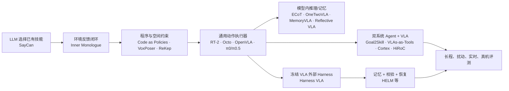

# 具身 Agent：技术路线与当前进展

> 核查日期：2026-08-18。这里的“当前进展”优先描述一手论文已展示的能力，同时把作者自评与独立证据分开。

## 1. 一张图看主线

这条演进不是“新方法淘汰旧方法”。它逐步把长程任务拆成四个可归因问题：

1. 该选择哪个技能；
2. 技能是否可执行、是否完成；
3. 失败后如何恢复；
4. 哪些历史信息需要跨时间保存。

## 2. 八条技术路线

| 路线 | 代表工作 | 核心做法 | 已有进展 | 主要缺口 |
|---|---|---|---|---|
| LLM + 技能价值 | SayCan | 语言先验与技能 affordance / value 联合打分 | 证明 LLM 可组合已有机器人技能 | 技能库固定；反馈与恢复较弱 |
| 语言反馈闭环 | Inner Monologue | 把成功检测、场景描述、人类反馈回写给规划器 | 从开环规划迈向 plan–act–observe | 自然语言反馈可能不精确，物理时序弱 |
| 程序 / 约束生成 | Code as Policies、VoxPoser、ReKep | 生成程序、3D 价值图或时空关键点约束 | 具备组合性、可解释几何约束 | 对感知、API 和规划器质量敏感 |
| 单体通用 VLA | RT-2、Octo、OpenVLA、π0 | 从图像与语言直接生成动作或 action chunk | 局部操作、多任务迁移显著提升 | 长程状态、失败恢复、分布扰动仍弱 |
| 模型内推理 / 记忆 | ECoT、OneTwoVLA、MemoryVLA、Reflective VLA | 在 VLA 内加入推理 token、记忆或行动后果上下文 | 减少高低层接口割裂 | 通常需要数据合成与联合训练，难做低资源复现 |
| 双系统层级控制 | Goal2Skill、Cortex、HiRoC | VLM 规划子任务，VLA 执行动作；对齐语义与可达性 | 适合长程任务和明确子目标 | 高层语义计划可能不具备低层可执行性 |
| VLA 工具族 | VLAs-as-Tools | 多个专用 VLA 作为工具，进度反馈触发重规划 | 工具选择与执行反馈被显式建模 | 需要工具对齐后训练和多策略维护 |
| 冻结 VLA Harness | Harness VLA、HELM | 固定 VLA，外接原语、记忆、Verifier 和恢复控制 | 最适合低资源、因果归因和系统研究 | 主要证据仍偏仿真；实时、真机和独立复现不足 |

## 3. 领域已经做到什么

### 3.1 局部视觉—动作执行已经有强公共基线

OpenVLA、Octo、π0/π0.5 等让研究者不必从零训练局部操作策略。通用 VLA 已能在匹配数据和本体的任务上提供可靠 action / action chunk，但“模型可加载”不等于“检查点适用于当前 benchmark”。动作维度、相机、proprioception、归一化和机器人本体必须对齐。

### 3.2 高层规划与低层执行正在形成明确接口

2026 年的 Goal2Skill、VLAs-as-Tools、Cortex 和 HiRoC 都把高层语义推理与低层动作执行分开。共同趋势是：

- 子任务必须可执行，而不是只在语言上合理；
- Agent 不应每个控制周期轮询，而应在事件或阶段边界重规划；
- 执行器需要返回进度、完成或失败证据；
- 高层与低层之间要共享受约束的技能语义。

Cortex 进一步把操作子任务标准化为 32 个 canonical primitives，并强调从可达性和物体属性约束计划。其闭环提升来自作者自评，尚不应视为独立结论。

HiRoC（2026-08）把层级架构推进到后训练阶段：先对齐 Planner 子目标与 Executor，再用在线交互强化学习改进子目标条件动作。它代表训练式上界，但其交互与计算预算不适合当前冻结 VLA 的低资源主线。

### 3.3 “记忆”开始从长上下文中独立出来

MemoryVLA 把记忆放入策略内部；HELM 把情景记忆、状态校验和回滚放在外部；RMBench 则专门评估依赖历史的操作任务。这意味着“把上下文窗口拉长”不再是唯一方案。

但不同论文中的 memory 不是同一对象：

| 记忆类型 | 内容 | 生命周期 | 推荐实现 |
|---|---|---|---|
| Task State | 当前目标、对象绑定、已完成步骤、预算 | 单回合 | 强类型状态，不做向量检索 |
| Episodic Trace | 关键观测、动作、结果、失败 | 单回合或少量回合 | 时间索引 + 关键帧 |
| Competence Memory | 某技能在何种条件下成功/失败 | 跨回合 | 结构化统计 + 可选检索 |
| Semantic Knowledge | 手册、对象知识、技能说明 | 长期 | RAG / 文档检索 |

### 3.4 校验与恢复成为独立研究变量

Inner Monologue 已表明反馈重要；HELM 将 learned State Verifier 作为核心组件；Harness VLA 则通过固定原语、终止谓词和失败记忆组织恢复。当前合理的比较不再是“有无 Agent”，而是分别控制：

- 原始终止谓词 vs 类型化结果；
- chunk 边界检查 vs chunk 内事件检查；
- 规则校验 vs 学习式校验；
- 无恢复 vs 固定恢复表 vs LLM 重规划。

### 3.5 基准开始主动打破“背动作序列”

标准 LIBERO 上许多模型已达到高成功率，难以区分系统能力。LIBERO-Pro 通过对象、初态、指令和环境扰动揭示标准评测可能高估泛化；RMBench 专门测历史依赖；RoboCasa365 和 RoboTwin 2.0 扩大任务与随机化规模。

这使评测重点从“标准任务是否成功”转向：

- 指令重定向后能否重新绑定目标；
- 布局变化后能否重新预对位；
- 失败是否及时发现；
- 是否重复同类失败；
- 长程收益是否抵消 Agent 推理延迟。

### 3.6 人类视频数据的规模化主线（行业口径，概念对照）

2025–2026 年，[NVIDIA EgoScale](https://arxiv.org/abs/2602.16710)（20,854 小时，R²=0.998）、Generalist [GEN-0→GEN-1→GEN-1.5](https://news.ifeng.com/c/8s1YDd9FBc9)（27 万→50 万+ 小时，后者零梯度 in-context 学习）、Dyna Robotics [DYNA-2](https://m.163.com/dy/article/L47HHACL0511B8LM.html)（100 万+ 小时，闭源）共同表明：人类第一视角视频可作为零机器人动作数据的预训练主干，且跨具身迁移拐点约在 1 万–10 万小时；光轮智能 [EgoSuite-Open100K](https://huggingface.co/collections/LightwheelAI/egosuite-open100k)（10 万小时，与 Hugging Face 联合开源）首次把拐点量级数据公开。这些均为闭源/受限行业模型，只能作概念对照，不能作为本地复现基线；对本地课题的直接影响是：人类视频桥接（IDM/潜动作/手关键点）可作为低资源路线的远期扩展，不改变"冻结 VLA + Harness"的主线。详见 [reference 数据文档](reference/vla/数据与特征/具身数据来源与能力边界.md)。（核查：2026-08-26）

## 4. 尚未解决的关键问题

### 4.1 缺少真正同条件的独立复现

多数 2026 前沿工作仍是预印本，结果来自提出方自己的模型、prompt、任务拆分和算力配置。它们适合产生研究假设，不适合作为本地实验必须达到的绝对分数。

### 4.2 Planner–Executor gap 仍是核心瓶颈

语言计划可能语义正确但不可达；VLA 可能动作可行但执行了错误对象。接口必须同时携带：目标 ID、局部指令、前置条件、可达性、终止条件、预算和结果证据。

### 4.3 长程收益与实时性往往分开报告

仿真可以暂停等待 LLM/VLA，真实世界不能。若世界在推理期间继续变化，旧观测生成的动作会过期。因此必须分开报告：

- 功能模式：环境等待推理，验证逻辑；
- 延迟感知模式：世界持续运行，验证系统价值。

### 4.4 真机安全不能由 Agent 自己保证

Agent 或 VLA 输出不得绕过速度、工作空间、碰撞、关节限位和急停。论文中“可靠”通常指任务成功与恢复，不等价于经过形式化证明或认证的安全。

### 4.5 记忆增益容易与额外信息泄漏混淆

任务特定示例、成功规则、失败模型和参考轨迹若同时加入，不能把整体提升归因于单一记忆模块。引导 seed 与评测 seed 必须分离，评测期间持久记忆默认冻结。

## 5. 对当前课题的路线判断

### 主线：外部 Harness 的严格归因

推荐把研究问题收敛为：

> 在冻结同一 VLA、同一工具和同一感知条件下，类型化事件校验与结构化能力记忆，能否比固定 FSM、原始 Harness 和文本记忆更早发现失败、更少重复失败，并在延迟感知模式下保持净成功率收益？

原因：

- 能复用公开检查点与仿真，不要求训练大型 VLA；
- 能与 Harness VLA、HELM、Goal2Skill 形成清晰学术对照；
- 每个贡献都可以单变量消融；
- 与课程要求的 plan → execute → monitor 和模块化工具一致；
- 失败也有信息价值：若 FSM 与规则已足够，就应删除复杂 Agent / learned verifier。

### 暂缓路线

- 从零训练完整 VLA 或世界模型；
- 同时常驻多个大型 VLM/VLA；
- 用语义 SLAM 解决纯桌面 LIBERO 问题；
- 让 MPC 在接触阶段逐步改写 VLA 动作；
- 只与 Frozen VLA 比，不与“相同工具的固定 FSM”比；
- 只报告成功率，不报告失败发现、恢复、延迟和成本。

## 6. 下一步阅读

- [论文总表](02-论文总表.md)：按研究作用寻找论文；
- [Baseline 与评测矩阵](03-Baseline与评测矩阵.md)：把研究主张变成对照组；
- [基础实验流程](04-基础实验流程.md)：把比较落到配对 seed 和 trace；
- [领域综述与开题方案](领域的理解.md)：更完整的理论论证与资源边界。
