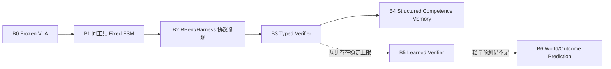

# Baseline 与评测矩阵

## 1. 先定研究主张，再定 baseline

Baseline 不是“找几篇分数低的论文”。它必须排除更简单解释。当前课题可能提出的主张与最低必要对照如下：

| 研究主张 | 最低必要对照 | 不能只比较什么 |
|---|---|---|
| Agent 提升长程成功率 | 同工具、同状态、同恢复预算的固定 FSM | 不能只比 Frozen VLA |
| 结构化记忆有效 | 无记忆、Task Trace、等信息量文本记忆、结构化记忆 | 不能把参考轨迹、规则和失败案例同时加入 |
| 类型化 Verifier 有效 | 原终止谓词、同检查频率的类型化结果、chunk 内检查 | 不能同时改变信号语义与检查频率 |
| learned Verifier 有必要 | 最强规则、同输入轻量分类器、规则—学习集成 | 不能只比“完全无校验” |
| LLM 规划有必要 | 固定 FSM / behavior tree 使用同一技能和恢复表 | 不能给 LLM 更多工具或更高预算 |
| 世界模型有必要 | 规则结果检测、轻量 outcome predictor | 不能直接从无预测跳到完整视频 WM |
| 长程能力提升 | 按子目标数/接触数/时长分箱的同分布任务 | 不能用 LIBERO-Pro 扰动替代 horizon scaling |
| 实时系统有价值 | 世界持续运行的延迟感知模式 | 不能只在暂停等待模型的仿真中测成功率 |

## 2. 推荐的递进 Baseline 梯子

所有组共享同一 VLA checkpoint、动作适配、工具实现、感知等级、安全层、任务、seed 和总执行预算。

| 编号 | 组别 | 新增机制 | 回答的问题 | 是否主实验 |
|---|---|---|---|---|
| B0 | Frozen VLA | 无外部编排；局部指令直接执行 | 局部策略本身能做多少 | 是 |
| B1 | Fixed FSM | 固定任务图、相同原语、确定性重试 | 收益是否只来自外部编排 | 是 |
| B2 | Protocol Harness | 复现固定版本 RPent/Harness 的原语、终止谓词与记忆 | 原论文协议在本地是否成立 | 是 |
| B3 | Typed Verifier | B2 + 标准错误码与证据；先保持同检查周期 | 类型化失败语义的独立收益 | 是 |
| B4 | Competence Memory | B3 中以等信息量结构化能力记忆替换文本 Global Memory | 结构化技能工作域是否更可泛化 | 是 |
| B5 | Learned Verifier | B3/B4 + 轻量 outcome predictor | 学习校验是否超过规则上限 | 可选 |
| B6 | Predictive Planner | 候选动作/原语后果预测或小型世界模型 | 更强预测是否值得其成本 | 远期 |

推荐主论文对比为 B0–B4。B5 只有在规则 Verifier 存在稳定、可量化的误差上限后再做；B6 不进入 MVP。

## 3. 与论文方法的映射

| 本地组别 | 最接近的论文 | 可以比较什么 | 不应宣称什么 |
|---|---|---|---|
| B0 | OpenVLA、π0/π0.5、SmolVLA、TurboVLA | 同 checkpoint 的本地成功率与延迟 | 不与异本体论文 headline 分数横比 |
| B1 | SayCan 的固定技能思想、behavior tree | 同工具下规则编排上限 | 不把 FSM 设成故意弱基线 |
| B2 | Harness VLA | 协议复现或本地成对增益 | 条件不同时不称“复现绝对成绩” |
| B3 | Inner Monologue、HELM 的 verification gap | 失败语义、发现延迟、恢复触发 | 不把检查频率变化算成语义收益 |
| B4 | HELM、Goal2Skill、Harness VLA、RMBench | 任务/情景/能力记忆的作用差异 | 不把训练 seed 的轨迹泄漏当泛化 |
| B5 | HELM learned State Verifier | 规则 vs 学习模型的成本—收益 | 不假设 learned 一定更优 |
| B6 | 世界模型 / predictive VLA 路线 | 候选评价与风险预测 | 不宣称世界模型替代控制与安全层 |

VLAs-as-Tools、Cortex、HiRoC 和 OneTwoVLA 通常需要后训练或联合训练。对当前单卡课题，它们是**概念对照**，而不是必须复现的数值 baseline。

## 4. 主实验矩阵

### 4.1 Harness / Agent 归因

| 因素 | A0 | A1 | A2 | A3 |
|---|---|---|---|---|
| 高层决策 | Fixed FSM | LLM Agent | Fixed FSM | LLM Agent |
| 结构化 Task State | 开 | 开 | 开 | 开 |
| 工具与预算 | 相同 | 相同 | 相同 | 相同 |
| Verifier | 相同 | 相同 | 相同 | 相同 |
| 目的 | 测无 LLM 上限 | 测 LLM 增量 | 复查稳定性 | 完整组合 |

关键比较是 A0 vs A1。若 LLM 不优于 FSM，系统仍可保留工具、状态、Verifier 和记忆，但默认规划器应改为 FSM。

### 4.2 Verifier 归因

| 组别 | 返回语义 | 检查周期 | 输入 | 目的 |
|---|---|---|---|---|
| V0 | 原终止谓词 | 原周期 | 原信号 | 忠实协议基线 |
| V1 | 类型化结果 | 与 V0 相同 | 与 V0 等价 | 隔离语义结构收益 |
| V2 | 类型化结果 | chunk 内关键事件 | 相同可部署信号 | 隔离早检测收益 |
| V3 | learned verifier | 与 V2 相同 | 同一观测契约 | 隔离学习模型收益 |
| V4 | 规则 + learned | 与 V2 相同 | 同一观测契约 | 检查互补性 |

### 4.3 Memory 归因

| 组别 | 可见信息 | 写入策略 | 主要问题 |
|---|---|---|---|
| M0 | 当前 Task State | 单回合 | 无持久记忆上限 |
| M1 | Task State + 完整近期 trace | 单回合 | 短期历史是否足够 |
| M2 | M1 + 文本 Global Memory | 引导 seed 后冻结 | 复现文本经验记忆 |
| M3 | M1 + Typed Competence Memory | 引导 seed 后冻结 | 等信息量结构化替换 |
| M4 | M2 + M3 | 引导 seed 后冻结 | 追加是否优于替换 |

M2 与 M3 必须使用同一批引导回合、相同事实和相同检索 top-k。评测 seed 上禁止写回持久记忆。

## 5. Benchmark 选择

| 阶段 | 推荐环境 | 原因 | 不支持的结论 |
|---|---|---|---|
| 接口冒烟 | 标准 LIBERO 的 1–2 个任务 | 快速验证动作适配、相机、终止谓词 | 不支持泛化、长程或记忆结论 |
| 协议复现 | Harness VLA 使用的固定 LIBERO / LIBERO-Pro 子集 | 与目标论文最接近 | 条件不完全一致时不比较绝对成绩 |
| 扰动主实验 | LIBERO-Pro Goal-S / Goal-T 等固定拆分 | 目标重绑定、位置与指令扰动 | 不等价于 horizon scaling |
| 记忆主实验 | RMBench | 任务定义显式依赖历史 | 新基准结果仍需谨慎外推 |
| 长程扩展 | CALVIN、LIBERO-Long | 按连续子目标与链长评测 | 不直接代表真实移动操作 |
| 系统扩展 | RoboCasa365、RoboTwin 2.0 | 家庭移动操作、双臂和域随机化 | 不适合作为第一阶段低成本调试 |

## 6. 公平性清单

每个比较必须固定：

- VLA 权重、commit、精度、推理参数和 warm-up；
- 相机、proprioception、图像预处理、动作维度与归一化；
- 原语实现、成功谓词、公共安全层和最大重试；
- 任务版本、初始状态、随机 seed 和扰动；
- LLM 模型版本、温度、prompt、token 和工具调用预算；
- 功能模式或延迟感知模式，不能混报；
- 评测期间可见的特权状态；
- 记忆引导成本和持久写入策略。

## 7. 指标与最低报告集

### 任务表现

- Episode Success Rate，按任务宏平均；
- Subgoal Completion Rate；
- 成功率随子目标数、接触阶段数和时长的变化；
- 目标绑定准确率。

### 校验与恢复

- Failure Detection Latency；
- 失败后冗余动作 / action chunk 数；
- Recovery Rate；
- 同类失败重复率；
- 各类型错误的 precision / recall / F1。

### 系统与成本

- Agent 与 VLA p50 / p95 延迟；
- episode 墙钟时间；
- 过期动作数和 deadline miss；
- 峰值显存与长回合显存增长；
- LLM token、调用数和费用；
- VLA 调用、重试和无效工具调用数。

## 8. 统计方案

- 所有方法使用配对任务与 seed；
- 主终点在看结果前冻结；
- 按任务聚类 bootstrap 置信区间，不把同一任务多个回合当完全独立；
- 同时报绝对值、成对差值、置信区间和准确分母；
- 开发集只用于排错，正式 seed 不参与 prompt、规则和记忆调优；
- 资源不足时，在查看组间差异前统一缩减任务或 seed。

## 9. 退出与证伪条件

| 结果 | 结论 | 动作 |
|---|---|---|
| B1 ≈ B2 且都优于 B0 | 收益来自外部编排，不一定来自 LLM/记忆 | 默认采用更简单的 FSM |
| B3 不优于 B2 | 原终止机制足够或类型化语义无增益 | 保留统一协议，删除研究主张 |
| B4 只在引导 seed 有效 | 记忆可能是轨迹复现 | 不宣称跨场景泛化 |
| V3 不优于 V2 | learned verifier 缺少闭环价值 | 保留规则方法 |
| 功能模式有效、延迟模式无效 | 推理等待抵消成功率收益 | 降低 Agent 调用频率或收缩结构 |
| P0 感知有效、可部署感知无效 | 方法依赖特权状态 | 结论限定为仿真上界 |

真正可信的课题允许上述结果发生，而不是预先假定所有模块都必须保留。
