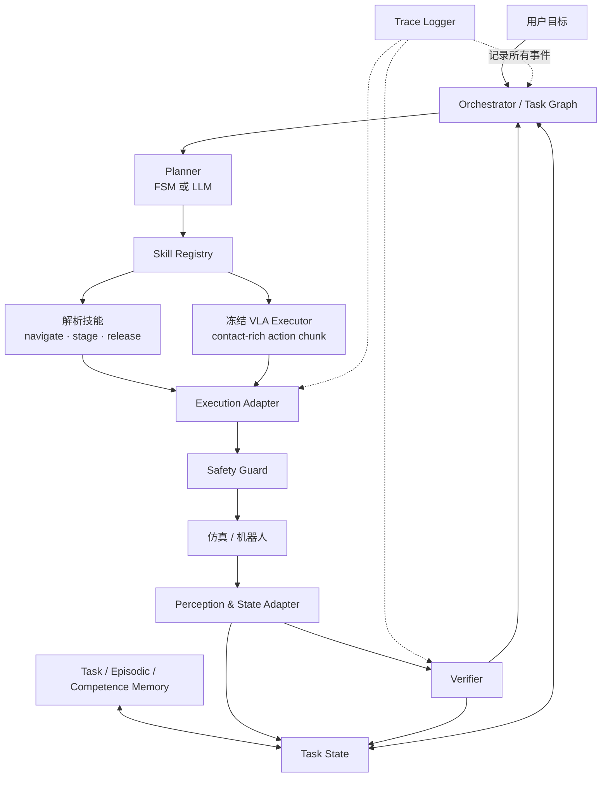
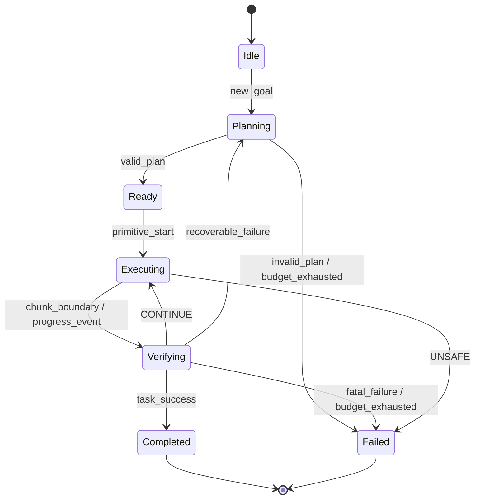

# 具身 Agent 模块设计

## 1. 设计目标

系统采用“低频 Agent 控制平面 + 高频机器人执行平面”。Agent 选择有完成语义的技能，但不直接写关节控制命令；VLA、解析规划器和控制器各自保持明确边界。



## 2. 模块清单

| 模块 | 职责 | 输入 | 输出 | 运行频率 |
|---|---|---|---|---|
| Orchestrator | primitive 生命周期、预算、事件路由、取消 | Task State、事件 | 下一状态、调度命令 | 事件触发 |
| Planner | 目标分解、技能选择、恢复决策 | 状态切片、技能规格 | 类型化计划 / 工具调用 | 低频 |
| Task State Store | 当前目标、对象绑定、进度、预算、最近失败 | 观测与事件 | 版本化状态 | 事件更新 |
| Skill Registry | 技能发现、schema、版本和前置条件 | 技能定义 | 可调用技能列表 | 静态 / 启动 |
| VLA Executor | 图像 + 局部指令 → action chunk | 最新观测、proprio、局部目标 | 动作块、推理元数据 | 技能执行期 |
| Analytic Skills | 导航、预对位、搬运、释放等 | 目标位姿、约束 | reference 或技能结果 | 按需 |
| Execution Adapter | 动作反归一化、坐标变换、队列和取消 | VLA / 规划器输出 | 标准控制 reference | 中频 |
| Safety Guard | 限速、限位、碰撞与急停 | reference、机器人状态 | 允许/投影/停止 | 高频 |
| Perception Adapter | 最新完整帧组、对象/位姿/置信度 | 传感器与状态估计 | Observation Bundle | 持续 |
| Verifier | 完成、失败、停滞和风险事件 | 观测、动作、子目标、证据 | Typed Result | chunk 边界或关键事件 |
| Memory Store | 短期 trace 与跨回合能力统计 | 结果与人工规则 | 受控检索结果 | 读多写少 |
| Trace Logger | 可追溯事件、延迟、资源和配置 | 全模块事件 | JSONL / 指标 | 全程 |
| Benchmark Adapter | reset、任务、success predicate、扰动 | benchmark API | 标准 episode 接口 | 每回合 |

## 3. 核心数据契约

### 3.1 Observation Bundle

```yaml
obs_id: obs_0042
episode_id: ep_0007
capture_time: 1787011200.123
frame_window_ms: 18
cameras:
  agentview_rgb: "frame-ref"
  wrist_rgb: "frame-ref"
proprio:
  ee_pose: [x, y, z, qx, qy, qz, qw]
  gripper_width: 0.031
objects:
  - object_id: mug_blue_01
    pose_frame: robot_base
    relative_pose: [x, y, z, qx, qy, qz, qw]
    confidence: 0.86
privilege_level: P1
```

`objects` 不是所有 VLA 的直接输入。它进入 Task State、Planner、解析技能和 Verifier；VLA 默认仍使用其训练分布要求的图像、语言和 proprioception。

### 3.2 Task State

```yaml
state_version: 17
goal: "把蓝色杯子放进左侧篮筐"
active_subgoal: "抓取蓝色杯子"
target_binding:
  object_id: mug_blue_01
  evidence_obs_id: obs_0042
completed_subgoals: []
active_primitive: pick_v2_0007
budgets:
  env_steps_left: 316
  vla_chunks_left: 7
  retries_left: 1
last_result:
  status: EMPTY_GRASP
  primitive_id: pick_v2_0006
  obs_id: obs_0038
```

### 3.3 Skill Specification

```yaml
name: vla_act
version: "2.1"
kind: learned_contact_skill
arguments:
  local_instruction: string
  target_object_id: string
  max_chunks: integer
preconditions:
  - target_binding_confidence >= 0.7
  - observation_age_ms <= 250
termination:
  success: target_state_satisfied
  failure: [EMPTY_GRASP, TARGET_LOST, STALLED, UNSAFE, TIMEOUT]
interruptible: chunk_boundary
requires:
  observation: [agentview_rgb, wrist_rgb, proprio]
```

### 3.4 Primitive Result

```yaml
status: SUCCESS | CONTINUE | EMPTY_GRASP | TARGET_LOST | STALLED | UNSAFE | TIMEOUT | INTERNAL_ERROR
primitive_id: pick_v2_0007
obs_id: obs_0047
chunk_id: chunk_0021
event_time: 1787011201.512
evidence:
  gripper_width: 0.011
  target_track_confidence: 0.84
  progress_delta: 0.00
recoverable: true
suggested_recovery: RESTAGE_AND_RETRY
```

`UNSAFE` 由不可被 Agent 绕过的公共安全层上报。Agent 只能停止或选择更保守路径，不能覆盖安全判定。

## 4. 事件与状态机



Agent 只在以下事件重新调用：

- 新任务或子目标完成；
- 目标绑定变化；
- recoverable failure；
- primitive 超时或预算耗尽；
- 人类介入；
- 公共安全停止后决定终止，而非继续控制。

`CONTINUE` 不应触发完整 LLM 规划。这样能避免持续轮询带来的延迟和费用。

## 5. Planner 接口

### 输入切片

Planner 只看到与当前决策相关的状态：

- 当前目标、已完成步骤和活动子目标；
- 目标对象与置信度；
- 可用技能及 schema；
- 最近一个失败及证据；
- 剩余预算；
- 从 Memory 检索的少量相关经验。

不把完整视频、所有历史消息或向量库全文直接塞给 Planner。

### 输出

```json
{
  "decision_id": "dec_0018",
  "state_version": 17,
  "tool": "move_to_staging_pose",
  "arguments": {
    "target_object_id": "mug_blue_01",
    "offset_m": [0.0, 0.0, 0.08]
  },
  "expected_outcome": "target reachable and centered",
  "on_success": "vla_act",
  "on_failure": "inspect_target",
  "budget": {"timeout_s": 8.0}
}
```

Orchestrator 必须验证 `state_version`、工具 schema、预算和前置条件。不能直接执行未经验证的自由文本。

## 6. Memory 设计

### 6.1 三层存储

| 存储 | 主键 | 示例字段 | 允许写入时机 |
|---|---|---|---|
| Task State | `episode_id` | 当前目标、绑定、进度、预算 | 每个事件 |
| Episodic Trace | `episode_id + event_time` | 关键帧、调用、结果、失败 | 每个事件；只追加 |
| Competence Memory | `skill + context_bin` | 成功率、失败类型、恢复效果、样本数 | bootstrap / train 阶段 |

Semantic RAG 另存技能说明、对象知识和手册，不与实时状态混合。

### 6.2 能力记忆示例

```yaml
skill: vla_pick
skill_version: "2.1"
context:
  object_class: mug
  occlusion: partial
  staging_distance_bin: far
statistics:
  attempts: 18
  success: 7
  failure_counts:
    EMPTY_GRASP: 8
    TARGET_LOST: 3
recoveries:
  RESTAGE_CLOSER:
    attempts: 8
    success: 6
source_split: bootstrap
frozen_for_eval: true
```

小样本统计必须保留 `attempts`，不能把一次成功经验写成普遍规则。

## 7. Verifier 设计

### MVP 规则信号

- 空抓：夹爪闭合宽度 + 目标相对运动 / 接触信号；
- 停滞：末端或目标进度在窗口内低于阈值；
- 目标丢失：连续跟踪置信度低于阈值；
- 成功：任务特定可部署证据组合；
- 不安全：底层 safety guard 事件。

### 可选 learned verifier

输入限制为部署时可获得的观测、动作、子目标和短期记忆。输出至少包括失败概率、类型和校准置信度。离线 AUROC 高不等于闭环有效，最终仍需比较成功率、发现延迟和误触发成本。

## 8. 多速率与并发

| 层 | 典型速率 | 原则 |
|---|---:|---|
| 安全 / 控制 | 100–1000 Hz | 独立进程或实时线程，不等待 Agent |
| 状态估计 / 感知 | 10–60 Hz | 发布带时间戳的最新完整观测 |
| VLA action chunk | checkpoint 决定 | 一个回合内常驻 GPU，避免逐 chunk 换入换出 |
| Verifier | chunk 边界或关键事件 | 先做同步确定性版本 |
| Agent Planner | 任务/完成/失败事件 | 不连续轮询 |

MVP 先采用同步 primitive 循环。异步推理、双缓冲和 speculative action 只有在 `obs_id` 版本、取消语义和过期动作丢弃已经稳定后再加入。

## 9. 建议代码结构

后续实现可落在 `workspace/embodied_agent/`：

```text
workspace/embodied_agent/
├── configs/                 # 环境、模型、任务、实验组
├── core/
│   ├── orchestrator.py
│   ├── events.py
│   ├── schemas.py
│   └── budgets.py
├── planners/
│   ├── fsm_planner.py
│   └── llm_planner.py
├── skills/
│   ├── registry.py
│   ├── analytic/
│   └── vla/
├── perception/
├── verification/
│   ├── rule_verifier.py
│   └── learned_verifier.py
├── memory/
│   ├── task_state.py
│   ├── episodic.py
│   └── competence.py
├── safety/
├── adapters/
│   ├── libero.py
│   ├── rp_ent.py
│   └── robot.py
├── logging/
├── evaluation/
└── tests/
```

LangChain StructuredTool 可实现工具 schema；LangGraph 可实现事件状态图。但领域对象和协议应定义在 `core/`，避免把研究逻辑绑定到某个编排框架。

## 10. 测试边界

### 单元测试

- schema 验证、状态版本与预算；
- 坐标变换和动作反归一化；
- 各错误码触发条件；
- Memory 在 eval split 禁止写入；
- 过期动作拒绝执行。

### 集成测试

- reset → observe → plan → execute → verify 全链路；
- primitive 取消和超时；
- 空抓 / 目标交换 / 停滞注入后恢复；
- safety interrupt 后无法被 Planner 恢复执行；
- trace 可重建每个动作来源。

### 评测测试

- 所有方法收到同一 task × seed manifest；
- 配置差异只包含预注册自变量；
- 成功谓词与 Agent 观测隔离；
- metrics 可以从原始 trace 重新计算。

更完整的 ROS 2 协议、坐标与工具 JSON 设计见 机器人学习项目与 Tools MVP 总览（本地附件或依赖，未上传：`../dev_docs/机器人学习项目与Tools_MVP总览.md`）。
