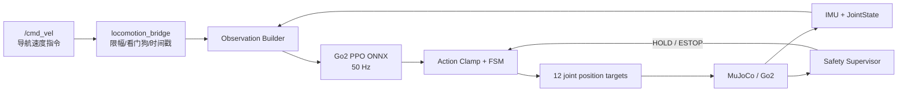

# Unitree Go2 强化学习运动控制 MVP

> 项目名称：**Go2 Velocity Policy：从 Isaac Lab 训练到 MuJoCo/ROS 2 部署**  
> 上层消费者：局部导航控制器、`locomotion_bridge`、安全监督器  
> 核心结论：MVP 只训练“机身速度指令 → 12 关节目标”的鲁棒速度跟踪策略。

## 1. 学习目标与边界

### 1.1 要证明的能力

给定机身坐标系速度指令

```text
command = [vx, vy, wz]  # m/s, m/s, rad/s
```

策略根据 IMU、关节状态和上一动作，以 50 Hz 输出 Go2 的 12 维关节目标位置偏移，使机器人在平地及轻微扰动下稳定跟踪速度。该项目学习到完整的 RL locomotion 工作流：MDP 定义、PPO 训练、域随机化、评估、ONNX 导出、sim2sim 和安全部署。

### 1.2 MVP 不包含

- 不训练“目标点/图像/点云 → 关节动作”的端到端导航策略；
- 不把障碍物、地图或语言放入策略 observation；
- 不做 trot/pace/bound 多步态选择；MVP 只需稳定 trot；
- 不在线强化学习，不在真机上探索；
- 不把 RL 策略直接暴露成 Agent tool；
- 不以 Isaac Sim 单一成功回放作为完成标准，必须经过 MuJoCo sim2sim。

## 2. 现有工程复用

主基线：`运动控制/RL_for_go2/unitree_rl_lab-main`

已具备：

- Isaac Lab 环境与 `Unitree-Go2-Velocity` 任务；
- RSL-RL PPO 训练/推理；
- 50 Hz 策略配置（`dt=0.005`、`decimation=4`）；
- 45 维基础 observation 和 12 维关节位置 action；
- ONNX 导出；
- Go2 C++ 部署状态机 `Passive -> FixStand -> Velocity`；
- `unitree_mujoco-main` 的 sim2sim 环境。

MVP 不改写官方训练框架，只新增配置、评估和 ROS 2 适配层。

## 3. 系统架构



Agent 不在图中：Agent 只能通过导航 Action 间接影响 `/cmd_vel`，或调用独立的 operator-approved locomotion mode Action。

## 4. 目标文件结构

在现有 `unitree_rl_lab-main` 内只增加 `mvp/` 与配置覆盖；ROS 包放在集成工作区。

```text
运动控制/RL_for_go2/unitree_rl_lab-main/
├── source/unitree_rl_lab/...                 # 现有官方任务
├── scripts/rsl_rl/...                        # 现有训练/推理
├── deploy/robots/go2/...                     # 现有 C++ 部署
└── mvp/
    ├── configs/
    │   ├── go2_velocity_mvp.yaml             # 训练覆盖参数
    │   └── evaluation.yaml                   # 固定种子与阈值
    ├── scripts/
    │   ├── train_mvp.sh
    │   ├── export_onnx.sh
    │   ├── eval_isaac.sh
    │   └── eval_mujoco.sh
    ├── tests/
    │   ├── test_observation_order.py
    │   ├── test_onnx_parity.py
    │   └── test_command_watchdog.py
    └── artifacts/
        └── README.md                         # 记录产物 URI/hash，不提交大模型

具身-agent/workspace/robot_tools_mvp/ros2_ws/src/
├── locomotion_bridge/
│   ├── config/go2.yaml
│   ├── launch/locomotion.launch.py
│   ├── src/locomotion_bridge_node.cpp
│   └── test/
└── safety_supervisor/
    ├── config/safety_limits.yaml
    ├── src/safety_supervisor_node.cpp
    └── test/
```

## 5. MDP 定义

### 5.1 Observation

沿用当前基线的 45 维 observation，顺序必须成为版本化协议：

| 范围 | 项 | 维度 | 坐标/单位 | 预处理 |
|---|---|---:|---|---|
| 0:3 | base angular velocity | 3 | `base_link`, rad/s | 乘训练 scale |
| 3:6 | projected gravity | 3 | `base_link` | 单位向量 |
| 6:9 | velocity command | 3 | `base_link`, m/s, rad/s | clip + scale |
| 9:21 | joint position relative | 12 | rad | 相对默认站姿 |
| 21:33 | joint velocity | 12 | rad/s | clip + scale |
| 33:45 | last action | 12 | 归一化 | 上一策略输出 |

部署包必须随模型保存 `observation_schema_version`、关节顺序、scale、clip、默认姿态和策略频率。只有 `policy.onnx` 而无这些元数据的产物视为不可部署。

### 5.2 Action

```text
policy_output[12]
  -> clip(action_min, action_max)
  -> q_target = q_default + action_scale * policy_output
  -> joint/order validation
  -> low-level position controller
```

Go2 关节顺序固定并写入 manifest，不能依赖消息到达顺序或字典迭代顺序。实际顺序以当前训练资产与 C++ 部署配置的共同校验结果为准。

### 5.3 Command 范围

为保证与当前环境和 SCAN 闭环输出匹配，MVP 训练/部署共同范围：

| command | 训练极限 | MVP 导航运行限幅 |
|---|---:|---:|
| `vx` | `[-1.0, 1.0] m/s` | `[-0.6, 0.6] m/s` |
| `vy` | `[-0.4, 0.4] m/s` | `[-0.3, 0.3] m/s` |
| `wz` | `[-1.0, 1.0] rad/s` | `[-0.8, 0.8] rad/s` |

训练范围大于运行范围，用于留出控制余量；真机初测再降至 0.3 m/s 和 0.5 rad/s。

### 5.4 Reward 最小集合

保留易于解释和消融的项：

- xy 线速度跟踪；
- yaw 角速度跟踪；
- 非期望 z 速度、roll/pitch 角速度惩罚；
- 姿态/重力方向稳定；
- 关节力矩、关节加速度和 action rate 惩罚；
- 足端滑移与非期望接触惩罚；
- 足端离地时间/trot 节律奖励；
- 摔倒终止。

MVP 的重点不是刷新 reward 数量，而是保证训练和部署 observation/action 完全一致。

### 5.5 域随机化

P0 只开启可验证的随机化：

- 摩擦系数；
- base 质量；
- 初始关节速度；
- 周期性机身速度扰动；
- observation 小幅噪声；
- 控制延迟 0–1 policy step。

电机强度、质心偏移、传感器 bias 和更长延迟放入 P1；同时开启太多随机化会让失败难以归因。

## 6. 运行时模块与输入输出

### 6.1 `locomotion_bridge`

| 方向 | 接口 | 类型 | 频率/QoS | 说明 |
|---|---|---|---|---|
| 输入 | `/cmd_vel` | `geometry_msgs/Twist` | 10–20 Hz, reliable | SCAN 闭环控制器输出，`base_link` 语义 |
| 输入 | `/joint_states` | `sensor_msgs/JointState` | ≥50 Hz, sensor QoS | 必须校验 12 个关节均存在 |
| 输入 | `/imu/data` | `sensor_msgs/Imu` | ≥100 Hz, sensor QoS | 姿态与角速度 |
| 输入 | `/safety/command` | `robot_tools_msgs/SafetyCommand` | event | HOLD/ESTOP 优先级最高 |
| 输出 | `/locomotion/joint_targets` | 自定义或 SDK2 low command | 50 Hz | 12 关节位置目标 |
| 输出 | `/locomotion/state` | `robot_tools_msgs/LocomotionState` | 10 Hz | mode、watchdog、policy hash |
| 输出 | `/diagnostics` | `diagnostic_msgs/DiagnosticArray` | 1 Hz/event | 延迟、丢帧、NaN、限幅统计 |

关键规则：

- `/cmd_vel` 超过 200 ms 未更新时，目标速度在一个短斜坡内归零，随后进入 `HOLD`；
- 任意 observation 非有限、关节缺失、时间戳倒退时不执行策略输出；
- ONNX 输出先检查 shape/finite，再限幅；
- 手柄/实体急停的优先级高于 ROS 和 Agent；
- 同一时刻只有一个 velocity command owner，使用 mux/lease，避免导航与测试脚本争抢。

### 6.2 `SetLocomotionMode.action`

该 Action 仅供导航管理器和 operator 使用，普通 Agent 默认不加载。

```text
# Goal
uint8 requested_mode      # PASSIVE=0, STAND=1, VELOCITY=2, HOLD=3
float32 transition_timeout_s
---
# Result
uint16 code
string message
uint8 final_mode
bool retryable
---
# Feedback
uint8 current_mode
float32 progress
```

不提供任意 gait name、任意策略文件路径或跳过 `FixStand` 的参数。

## 7. 训练、导出与评估流程

### 7.1 阶段 A：复现

1. 固定依赖版本、GPU、seed 和资产 hash；
2. 运行 `Unitree-Go2-Velocity` 原配置；
3. 记录 reward 曲线、episode length 和评估视频；
4. 确认 observation/action 顺序；
5. 导出 ONNX，并以相同 observation 比较 PyTorch/ONNX 输出。

### 7.2 阶段 B：鲁棒化

1. 加入轻量 terrain 与域随机化；
2. 使用固定命令轨迹而非随机训练回合做评估；
3. 选择 checkpoint 时同时看跟踪误差、跌倒率和 action 平滑度；
4. 冻结模型和 manifest，计算 SHA-256。

### 7.3 阶段 C：sim2sim

MuJoCo 场景执行统一命令序列：

```text
0–2 s    stand / zero command
2–7 s    vx = 0.4
7–12 s   vy = 0.2
12–17 s  wz = 0.5
17–22 s  vx = 0.3, wz = 0.3
22–25 s  zero command
```

在 20 个固定种子中改变摩擦、质量、微小初始姿态和外力。保存输入命令、实测 base twist、姿态、关节目标、接触和 safety events。

## 8. 产物协议

```text
artifacts/go2_velocity/<semantic_version>/
├── policy.onnx
├── policy_manifest.yaml
├── deploy.yaml
├── metrics.json
└── sha256sums.txt
```

`policy_manifest.yaml` 至少包含：

```yaml
policy_id: go2_velocity:v0.1.0
framework: rsl_rl
control_frequency_hz: 50
observation_schema_version: go2_obs_v1
action_schema_version: go2_joint_pos_v1
joint_names: []                 # 明确列出 12 项
command_limits: {vx: [-1.0, 1.0], vy: [-0.4, 0.4], wz: [-1.0, 1.0]}
runtime_limits: {vx: [-0.6, 0.6], vy: [-0.3, 0.3], wz: [-0.8, 0.8]}
normalization: {}
default_joint_positions: []
action_scale: 0.25
training_commit: "..."
asset_hash: "..."
onnx_sha256: "..."
```

## 9. MVP 验收

### 9.1 正确性

- PyTorch 与 ONNX 在 1,000 个保存 observation 上最大绝对输出误差 `< 1e-4`；
- observation 关节名乱序时仍正确重排，缺失/重复关节时拒绝运行；
- command、observation 或 action 中出现 NaN/Inf 时进入 HOLD；
- 200 ms command watchdog 和 500 ms 内安全停止可重复通过自动测试。

### 9.2 性能

在 MuJoCo 20 个固定种子上：

- 25 s 命令序列跌倒率为 0；
- `vx/vy` 稳态 RMSE 各 `< 0.15 m/s`；
- `wz` 稳态 RMSE `< 0.20 rad/s`；
- roll/pitch 绝对值的 99 分位 `< 0.35 rad`；
- 单次 ONNX 推理 p99 `< 5 ms`（目标部署机）；
- 速度归零后 1 s 内机身速度 `< 0.08 m/s`。

这些是 MVP 工程门槛，不是算法论文的通用 SOTA 指标；若现有硬件不满足，应保留测量值并调整运行速度上限，而不是删除指标。

## 10. 对 Agent tools 的贡献

该项目不直接产出 `walk(vx, vy, wz)` 工具。它产出：

1. 可被导航器稳定消费的速度执行后端；
2. `get_robot_state()` 中的 locomotion mode、policy ID 和健康状态；
3. `navigate_to()` 结果中的控制跟踪质量；
4. `stop_robot()` 的确定性制动通路；
5. 明确的“策略能做什么/不能做什么”的 capability manifest。

Agent 的动作语义应保持在“去某处/停止/报告状态”，而不是“以 0.37 m/s 走 2.4 秒”。

## 11. 后续 P1

- 高度扫描 observation 与崎岖地形 curriculum；
- actuator/延迟/IMU bias 更完整的域随机化；
- 真机低速 sim2real 和 system identification；
- 导航器依据 locomotion health 自动降速；
- 明确需求出现后再评估步态条件策略，而不是先扩 action/observation。

