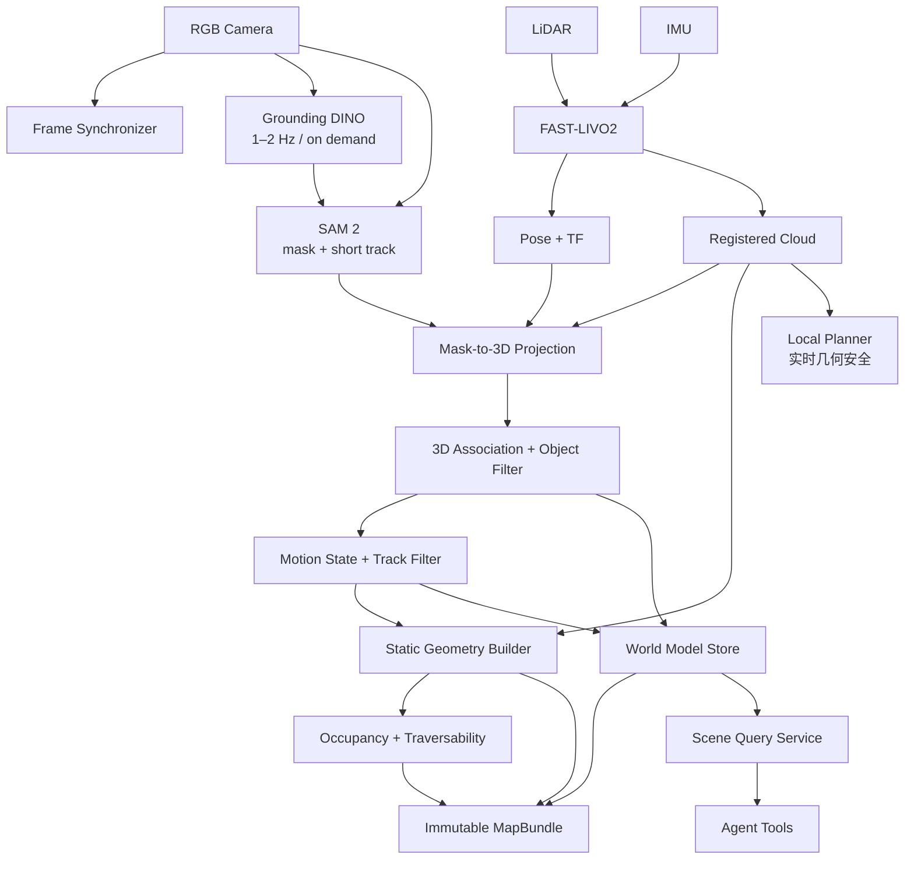

# 语义、动态与对象级建图 MVP

> 项目名称：**ObjectMap：FAST-LIVO2 几何底图 + 开放词汇对象层 + 动态轨迹层**  
> 主要消费者：全局/局部导航、场景查询服务、具身 Agent  
> 核心结论：MVP 采用“几何定位建图与语义对象建图松耦合”；持久化静态几何和稳定对象，滚动维护动态轨迹，不构建昂贵的逐点稠密语义世界模型。

## 1. 要解决的问题

感知层必须同时回答三类不同问题：

1. **定位与几何**：机器人在哪里？墙、地面、不可穿越结构在哪里？
2. **对象与语义**：有哪些可被语言引用的对象？它们的 3D 位姿和范围是什么？
3. **动态状态**：哪些观测正在移动？速度、轨迹、最后可见时间和不确定性是什么？

这些信息的更新频率、可靠性和存储方式不同，不能只用一个点云或一个 scene graph 代替全部状态。

## 2. 确定的感知组合

### 2.1 P0 方法

| 子问题 | 选定方法 | 输出 | 原因 |
|---|---|---|---|
| 几何定位/建图 | FAST-LIVO2，LiDAR + IMU；相机稳定后启用 LIVO | pose、局部/全局点云、关键帧 | 当前仓库已有 ROS 2 工程、回环、重定位、地图保存 |
| 二维静态抽象 | PCD/voxel 投影 + 地面过滤 + inflation | `OccupancyGrid`、occupancy 文件 | 直接供 Nav2 全局规划，易评估 |
| 开放词汇检测 | Grounding DINO，低频/事件触发 | 文本标签、2D box、score | Agent 查询不是固定闭集，需文本条件检测 |
| 对象分割/短时跟踪 | SAM 2，以 detection box/mask prompt 初始化 | instance mask、短时 mask track | 得到对象轮廓并减少每帧重复检测 |
| 3D 对象估计 | mask + 深度/点云投影、鲁棒聚类、OBB | centroid、bbox3d、covariance | 与 Go2 的 RGB + LiDAR 几何链兼容 |
| 跨帧对象关联 | 3D 距离 + IoU + class/embedding 门控 | stable object ID | 简单、可解释、可回放调参 |
| 动静分类 | 地图残差 + 多帧速度 + 滞回状态机 | STATIC/MOVING/STOPPED/UNKNOWN | 不把类别等同于运动状态 |
| 存储 | MapBundle + SQLite + PCD/PGM/GeoJSON | 可版本化数据产品 | 小型 MVP 无需独立图数据库/向量数据库 |

Grounding DINO 与 SAM 2 不承担紧急避障。局部导航始终使用实时几何点云保守避障；语义模型掉帧或漏检不能让障碍“消失”。

### 2.2 为什么不选单一方法

- FAST-LIVO2 的视觉地图点服务于光度定位，不等于可语言查询的对象地图；
- 2D segmentation 不能直接给出稳定 map-frame 位姿；
- 对 `person` 等类别设固定 dynamic 标签是错误的：站立的人当前可以是静止，移动的椅子当前可以是动态；
- 把所有分割 mask 永久融合到每个 3D 点会导致存储大、类别更新困难、动态拖影；
- scene graph 适合关系查询，但不适合替代导航 occupancy 和实时局部障碍。

## 3. MVP 范围

### 3.1 包含

- 使用 rosbag 或仿真传感器流完成可重复建图；
- 输出持久静态几何、二维 occupancy、对象数据库和区域文件；
- 预注册 10 个演示类别；新的开放词汇检测只由显式、可取消的 `InspectScene.action` 触发，普通查询只读已融合状态；
- 稳定对象 ID、3D 中心/包围盒、置信度、新鲜度和证据；
- 动态对象的短期轨迹与速度；
- `locate_object` / `query_scene` 所需只读接口；
- 地图版本、标定 hash 和数据血缘。

### 3.2 不包含

- 不做语义约束回环或对象级 SLAM 联合优化；
- 不做完整 panoptic 3D benchmark；
- 不承诺任意自然语言概念都能正确检测；
- 不持久化每帧 RGB、mask 和完整点云到 SQLite；
- 不把动态对象写入静态 occupancy；
- 不自动修改已发布的不可变地图版本；
- 不做人的身份识别、面部识别或长期个体跟踪。

## 4. 系统架构



## 5. 目标文件结构

```text
具身-agent/workspace/robot_tools_mvp/ros2_ws/src/
├── semantic_perception/
│   ├── config/
│   │   ├── classes.yaml
│   │   ├── grounding_dino.yaml
│   │   ├── sam2.yaml
│   │   └── projection.yaml
│   ├── semantic_perception/
│   │   ├── detector_node.py
│   │   ├── segment_tracker_node.py
│   │   ├── mask_projector_node.py
│   │   └── object_association_node.py
│   ├── launch/semantic_perception.launch.py
│   └── test/
├── dynamic_object_tracker/
│   ├── config/tracker.yaml
│   ├── src/dynamic_object_tracker_node.cpp
│   └── test/
├── map_builder/
│   ├── config/occupancy.yaml
│   ├── src/occupancy_builder_node.cpp
│   ├── scripts/build_map_bundle.py
│   └── test/
├── world_model_store/
│   ├── migrations/001_initial.sql
│   ├── world_model_store/repository.py
│   ├── world_model_store/bundle_writer.py
│   ├── schemas/manifest.schema.json
│   └── test/
├── scene_query_server/
│   ├── scene_query_server/node.py
│   ├── scene_query_server/ranking.py
│   └── test/
└── robot_tools_msgs/
    ├── msg/ObjectObservation.msg
    ├── msg/ObjectState.msg
    ├── msg/ObjectTrack.msg
    ├── srv/QueryObjects.srv
    ├── srv/GetMapInfo.srv
    └── action/InspectScene.action

感知/fast_livo2-main/                    # 现有几何基线，独立构建
├── config/mid360_mapping.yaml
├── config/mid360_localization.yaml
└── srv/SaveMap.srv

具身-agent/workspace/robot_tools_mvp/maps/
└── <map_name>/<version>/
    ├── manifest.yaml
    ├── geometry.pcd
    ├── occupancy.yaml
    ├── occupancy.pgm
    ├── traversability.tif
    ├── objects.sqlite3
    └── regions.geojson
```

## 6. 模块功能与输入输出

| 模块 | 功能 | 输入 | 输出 |
|---|---|---|---|
| FAST-LIVO2 | 同步、去畸变、ESKF、回环、几何图 | LiDAR、IMU、可选 RGB | odom、TF、registered cloud、map、save service |
| `detector_node` | 文本条件 2D 检测 | RGB、class prompt set | Detection2DArray + label score |
| `segment_tracker_node` | box-to-mask、短时传播、重新提示 | RGB、detections | instance masks + local track IDs |
| `mask_projector_node` | mask 内点云/深度投影和鲁棒 3D 拟合 | mask、camera info、TF、cloud/depth | ObjectObservation |
| `object_association_node` | 跨帧匹配、对象状态滤波、ID 管理 | observations | ObjectState updates |
| `dynamic_object_tracker` | 速度估计、动静状态、短期轨迹 | object updates、map residual | ObjectTrack + dynamic obstacle cloud |
| `map_builder` | 静态点过滤、地面/高度抽象、2D 栅格 | geometry cloud、dynamic mask | PCD、OccupancyGrid、traversability |
| `world_model_store` | 事务写入、版本、证据与查询 | stable updates | SQLite + manifest |
| `scene_query_server` | 只读过滤、排序、空间关系 | QueryObjects request | ranked ObjectState list |

## 7. ROS 消息协议

### 7.1 `ObjectObservation.msg`

单帧证据，不直接作为稳定世界状态：

```text
std_msgs/Header header                 # frame_id 必须可转换到 map
string observation_id
string sensor_id
string local_track_id
string label
string[] label_aliases
float32 detection_confidence
sensor_msgs/RegionOfInterest bbox2d
geometry_msgs/PoseWithCovariance pose
geometry_msgs/Vector3 size
float32 geometry_confidence
uint32 point_count
string mask_encoding                   # P0 只存 evidence URI，不在 topic 塞大 JSON
string evidence_uri
```

### 7.2 `ObjectState.msg`

供运行时查询的稳定对象状态：

```text
std_msgs/Header header                 # map frame, state update time
string object_id
string map_id
string canonical_label
string[] aliases
float32 semantic_confidence
geometry_msgs/PoseWithCovariance pose
geometry_msgs/Vector3 size
uint8 motion_state                     # UNKNOWN/STATIC/MOVING/STOPPED
geometry_msgs/TwistWithCovariance velocity
builtin_interfaces/Time first_seen
builtin_interfaces/Time last_seen
uint32 observation_count
string region_id
string[] evidence_ids
```

### 7.3 `QueryObjects.srv`

```text
# Request
string text_query
string[] class_any
string region_id
geometry_msgs/PointStamped near
float32 within_radius_m
uint8 motion_filter                    # ANY/STATIC/MOVING/STOPPED
float32 min_confidence
float32 max_age_s
uint32 limit
string expected_map_id
---
# Response
uint16 code
string message
string map_id
robot_tools_msgs/ObjectState[] objects
```

查询规则：

- 空间过滤由数据库执行，文本查询只影响 label/alias 排序；
- `limit` 上限 50；普通 Agent tool 默认 5；
- 返回对象必须包含 age 与 confidence，wrapper 不隐藏不确定性；
- 相同名称多个实例必须全部带不同 `object_id`，不得让模型凭数组顺序选择；
- query 不触发移动。需要转动/巡检时显式调用 `InspectScene.action`。

### 7.4 `InspectScene.action`

可选 P0.5：在当前位置执行受限观察（例如原地小角度扫描），用于刷新对象状态。它是长时、可取消、有运动副作用的 Action，不能伪装成查询 Service。

## 8. 3D 对象生成与关联

### 8.1 单帧 3D 估计

1. 将 LiDAR 点或注册深度投影至图像；
2. 选择 mask 内且时间差小于阈值的点；
3. 去除地面和明显背景平面；
4. 使用中位数/MAD 或 DBSCAN 去离群；
5. 点数充足时拟合 map-frame OBB；不足时只返回 centroid + 大协方差；
6. 保存 `point_count`、重投影误差、TF age 和 geometry confidence；
7. 不可得到可靠深度时允许 2D observation，但不写入可导航对象位姿。

### 8.2 关联代价

仅在门控内计算：

```text
cost = w_pos * mahalanobis_distance
     + w_iou * (1 - bbox3d_iou)
     + w_sem * semantic_mismatch
     + w_app * embedding_distance
```

P0 可不启用外观 embedding，但 position/IoU/class 门控必须存在。Hungarian assignment 后：

- matched：更新对象滤波器与 observation count；
- unmatched observation：连续确认 N 帧后创建新 object；
- unmatched object：保留到 TTL；静态对象 TTL 长，动态 track TTL 短；
- merge/split：只记录 alias/parent relation，不静默重用另一个实体 ID。

### 8.3 动静状态机

```text
UNKNOWN -> STATIC    : 连续 N 帧速度低且与静态图一致
UNKNOWN -> MOVING    : 连续 N 帧速度超过阈值
STATIC  -> MOVING    : 位移显著且排除定位跳变
MOVING  -> STOPPED   : 速度低于低阈值并持续 T 秒
STOPPED -> MOVING    : 再次超过高阈值
STOPPED -> STATIC    : 长时间稳定，经地图提交策略确认
```

使用高/低双阈值形成滞回。初始建议：移动进入阈值 `0.20 m/s`，停止阈值 `0.08 m/s`，但必须通过回放标定；不能写死在代码。

## 9. 几何静态抽象

为了分别服务定位、规划和 Agent，静态环境保留四种抽象：

| 抽象 | 表达 | 消费者 | 更新 |
|---|---|---|---|
| 几何点云 | `geometry.pcd` | 重定位、离线检查 | 发布地图版本时 |
| 二维占据 | PGM/YAML + `OccupancyGrid` | Nav2 全局 planner | 发布地图版本时 |
| 可通行性 | GeoTIFF/栅格值 | P1 全局 planner、可视化 | 发布地图版本时 |
| 区域/地点 | GeoJSON polygon/point | Agent target resolver | 人工或半自动审核 |

P0 occupancy 生成步骤：地面分割 -> 动态点剔除 -> 高度裁剪 -> xy 栅格投影 -> 形态学清理 -> 机器人 footprint inflation -> unknown 保留。地图构建和导航 footprint 参数必须来自同一配置源。

## 10. MapBundle 与 SQLite 数据结构

### 10.1 `manifest.yaml`

```yaml
schema_version: map_bundle_v1
map_id: office_a:v001
frame_id: map
created_at: "2026-08-12T10:00:00+08:00"
source_bags: ["rosbag2://office_a_run_03"]
sensors:
  lidar: {id: mid360_01, calibration_sha256: "..."}
  camera: {id: front_rgb_01, calibration_sha256: "..."}
geometry:
  file: geometry.pcd
  voxel_size_m: 0.05
occupancy:
  yaml: occupancy.yaml
  resolution_m: 0.05
objects:
  database: objects.sqlite3
  schema_version: object_store_v1
checksums: {}
```

### 10.2 SQLite 最小表

```sql
CREATE TABLE objects (
  object_id TEXT PRIMARY KEY,
  map_id TEXT NOT NULL,
  canonical_label TEXT NOT NULL,
  aliases_json TEXT NOT NULL,
  semantic_confidence REAL NOT NULL,
  x REAL NOT NULL, y REAL NOT NULL, z REAL NOT NULL,
  qx REAL NOT NULL, qy REAL NOT NULL, qz REAL NOT NULL, qw REAL NOT NULL,
  size_x REAL NOT NULL, size_y REAL NOT NULL, size_z REAL NOT NULL,
  covariance_json TEXT NOT NULL,
  motion_state INTEGER NOT NULL,
  vx REAL NOT NULL, vy REAL NOT NULL, vz REAL NOT NULL,
  first_seen_ns INTEGER NOT NULL,
  last_seen_ns INTEGER NOT NULL,
  observation_count INTEGER NOT NULL,
  region_id TEXT,
  status TEXT NOT NULL CHECK(status IN ('active','stale','removed'))
);

CREATE TABLE observations (
  observation_id TEXT PRIMARY KEY,
  object_id TEXT,
  stamp_ns INTEGER NOT NULL,
  sensor_id TEXT NOT NULL,
  detection_confidence REAL NOT NULL,
  geometry_confidence REAL NOT NULL,
  evidence_uri TEXT,
  FOREIGN KEY(object_id) REFERENCES objects(object_id)
);

CREATE TABLE tracks (
  track_id TEXT PRIMARY KEY,
  object_id TEXT,
  started_ns INTEGER NOT NULL,
  ended_ns INTEGER,
  summary_json TEXT NOT NULL,
  FOREIGN KEY(object_id) REFERENCES objects(object_id)
);

CREATE TABLE regions (
  region_id TEXT PRIMARY KEY,
  name TEXT NOT NULL,
  aliases_json TEXT NOT NULL,
  geometry_geojson TEXT NOT NULL
);
```

空间规模较小时 SQLite 足够；对象增长或需要复杂空间索引时再加 RTree 虚表。embedding 不作为 P0 强依赖；若加入，单独存版本化向量和 encoder ID，禁止把不可解释 blob 混入 `aliases_json`。

### 10.3 写入语义

- SQLite 使用 WAL 和事务；
- 高频 track state 在内存中，按 1 Hz/事件节流落盘；
- 原始证据存文件/对象存储，数据库只存 URI 与 hash；
- MapBundle 发布后只读；新增观测进入 working map，审核/构建后生成 `v002`；
- 地图切换通过显式 lifecycle transition，不覆盖正在导航使用的文件。

## 11. Agent 交互数据结构

`locate_object("red fire extinguisher")` 的建议返回：

```json
{
  "status": "SUCCEEDED",
  "map_id": "office_a:v001",
  "query": "red fire extinguisher",
  "objects": [
    {
      "object_id": "obj_01JABC",
      "label": "fire extinguisher",
      "aliases": ["red extinguisher", "灭火器"],
      "pose": {"frame_id": "map", "x": 4.2, "y": -1.0, "z": 0.8},
      "size_m": [0.22, 0.18, 0.62],
      "motion_state": "STATIC",
      "confidence": 0.86,
      "last_seen": "2026-08-12T09:58:11+08:00",
      "age_s": 109.0,
      "region_id": "corridor_east",
      "evidence_ids": ["obs_01JXYZ"]
    }
  ]
}
```

Agent 只基于结构化字段选择对象；若多个候选置信度接近或位姿过期，应该询问、调用 `inspect_scene` 或选择最近候选，不能假装唯一确定。

## 12. 实施阶段

### M0：几何回放

- 用现有 FAST-LIVO2 跑通 rosbag；
- 统一 TF 到 `map/odom/base_link`；
- 保存/加载 PCD；
- 生成 occupancy 并在 Nav2 中可视化。

### M1：离线对象生成

- 对关键帧运行固定 10 类 Grounding DINO + SAM 2；
- mask 投影到 3D；
- 保存 observation，不做实时要求；
- 人工检查 20 个对象实例。

### M2：对象融合与存储

- 跨帧关联、稳定 ID、协方差；
- SQLite migration、事务和 MapBundle manifest；
- QueryObjects service。

### M3：动态轨迹

- 在回放中加入移动人/推车；
- 速度滤波、状态机、短时轨迹；
- 动态点不进入静态 occupancy；
- 发布给导航的仍是实时几何障碍。

### M4：低频在线

- detector 1–2 Hz，SAM 2 在中间帧跟踪；
- 资源过载时优先保证 FAST-LIVO2 和局部规划；
- 队列只保留最新帧，禁止延迟无限累积；
- 失配后自动重新检测/提示，而不是延续错误 mask。

## 13. MVP 验收

固定一段带标注的 rosbag/仿真序列，含 10 类、至少 20 个静态实例、3 个移动实例和短时遮挡：

| 能力 | 通过条件 |
|---|---|
| 几何重放 | 相同配置重复两次生成的 manifest、点数/占据统计在允许误差内一致 |
| frame/time | 100% 持久对象可转换到 `map`；无未来时间戳；TF age 均记录 |
| 3D 定位 | 静态对象中心误差中位数 `<0.30 m`，p90 `<0.60 m` |
| 对象检索 | 10 类 top-5 recall `≥0.90`；无匹配查询返回空列表而非幻觉对象 |
| ID 稳定 | 2 s 以内遮挡后 ID 保持率 `≥0.85` |
| 动静分类 | 3 个移动实例 recall `≥0.90`，静态误报率 `<0.10` |
| 静态地图纯净 | 移动实例轨迹不形成持久 occupancy 拖影 |
| 新鲜度 | 所有查询均返回 `last_seen/age_s/confidence/map_id` |
| 性能隔离 | 语义节点停止或 GPU OOM 时，定位和局部几何 Topic 仍可运行并报警 |
| 存储 | 进程中断后 SQLite 可恢复；已发布 MapBundle checksum 不变 |

指标必须同时报告准确率与延迟：detector、SAM、3D 投影、关联、查询 p50/p95，以及 GPU/CPU/内存。在线语义帧率不作为安全能力证明。

## 14. 对 Agent tools 的贡献

P0 产出：

```text
locate_object(query, near?, max_age_s?)
query_scene(region?, classes?, dynamic_only?)
get_map_info()
```

P0.5 可增加：

```text
inspect_scene(query, sweep_angle_rad, timeout_s)
```

Operator-only：

```text
save_map(name, resolution)
publish_map_version(working_version)
reset_localization(initial_pose)
```

工具层不得向 Agent 返回数据库路径、模型 checkpoint 路径或任意 SQL；Agent 输入始终经过 schema 验证与参数化查询。

## 15. 后续 P1/P2

### P1

- 固定场景上将开放词汇 teacher 蒸馏/标注为轻量 closed-set detector；
- 2.5D traversability 与坡度/台阶层；
- region/door/place 拓扑关系；
- 动态轨迹短期预测接入局部 planner cost；
- RTree 空间索引和对象 embedding 检索；
- 主动观察和视角选择。

### P2

- 对象级 SLAM 联合优化与跨 session 对象合并；
- 完整 3D scene graph；
- 语义变化检测和地图生命周期治理；
- 多机器人地图合并；
- 操作可供性、关节物体和 VLA 操作接口。

## 16. 参考

- [当前 FAST-LIVO2 工程](../依赖索引.md)
- [Grounding DINO 官方实现](https://github.com/IDEA-Research/GroundingDINO)
- [SAM 2 官方实现](https://github.com/facebookresearch/sam2)
- [Grounded SAM 2 组合示例](https://github.com/IDEA-Research/Grounded-SAM-2)

