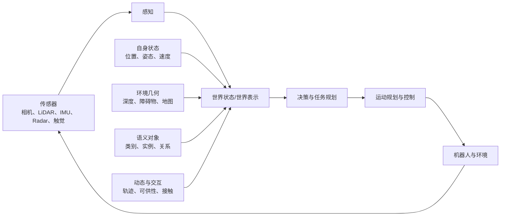
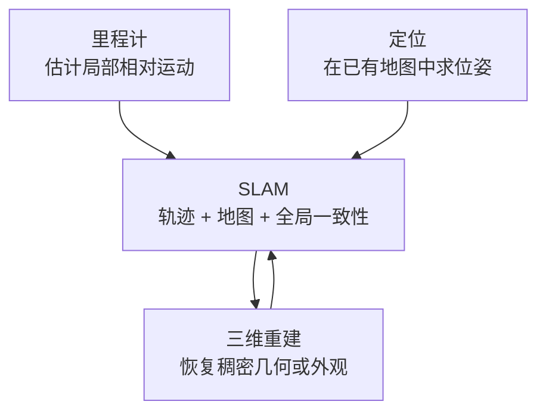

# 机器人感知领域的整体理解

> 本文不是按“某个说法是否正确”组织，而是沿着机器人系统架构，把感知领域拆成若干相互关联的研究板块。核心问题是：感知研究有哪些分支，各自输出什么，以及它们如何服务于决策、规划、控制和 Agent。

## 1. 感知在机器人系统中的位置

机器人系统可以抽象成：



所谓“纯感知”，可以理解为：**输入主要是传感器数据，输出是对机器人自身和外部世界的估计，而不是直接输出电机控制量。**

它大致包含五类输出：

1. **自身状态**：机器人在哪里、姿态如何、速度多大。
2. **空间几何**：环境形状、深度、障碍物、自由空间和地图。
3. **语义信息**：场景里有什么对象，它们是什么、在哪里、彼此有什么关系。
4. **动态信息**：对象如何运动，未来可能出现在哪里。
5. **交互信息**：物体是否可抓、可推、可开，以及接触力、滑移和材质等信息。

按照研究路线，可以把机器人感知领域整理为：

```text
机器人感知
├─ 1. 几何感知与传统 SLAM
│  ├─ VO / VIO / LO / LIO / LIVO
│  ├─ 定位、回环与重定位
│  ├─ 2D SLAM
│  ├─ 3D SLAM
│  └─ 传统稠密建图与三维重建
├─ 2. 成熟的深度学习感知
│  ├─ 二维识别、检测、分割、跟踪
│  ├─ 深度、光流、人体与关键点
│  ├─ 三维检测、分割和点云理解
│  └─ BEV、占据与多传感器融合
├─ 3. 深度学习感知前沿
│  ├─ 视觉基础模型与开放词汇感知
│  ├─ NeRF / 3D Gaussian / 神经重建
│  ├─ 动态 4D 场景理解
│  ├─ 视觉语言与多模态感知
│  └─ 可供性、触觉与主动感知
├─ 4. SLAM 前沿
│  ├─ 学习增强 SLAM
│  ├─ 神经隐式与 Gaussian-SLAM
│  ├─ 语义、对象和开放词汇 SLAM
│  ├─ 动态、长期和多机器人 SLAM
│  └─ 不确定性与主动 SLAM
└─ 5. 面向决策与 Agent 的感知
   ├─ 显式感知模块/工具
   ├─ 世界模型和空间记忆
   ├─ 混合式智能系统
   └─ 端到端 VLA / 策略模型
```

## 2. 几何感知与传统 SLAM

这一部分主要依赖多视图几何、概率估计、滤波、非线性优化和传感器模型。它解决的是“机器人如何确定自己在哪里，以及周围空间长什么样”。

### 2.1 里程计与状态估计

| 名称 | 主要传感器 | 主要输出 | 典型特点 |
| --- | --- | --- | --- |
| VO | 相机 | 相对位姿、轨迹 | 利用图像特征或光度变化估计相机运动 |
| VIO | 相机 + IMU | 位姿、速度、IMU 偏置 | 图像提供长期约束，IMU 提供高频运动信息 |
| LO | LiDAR | 相对位姿、局部点云 | 通过点云扫描匹配估计运动 |
| LIO | LiDAR + IMU | 位姿、速度、偏置、局部地图 | 几何精度和高速运动鲁棒性较好 |
| LIVO | LiDAR + IMU + 相机 | 状态、几何及外观地图 | 同时利用 LiDAR 几何、视觉纹理和 IMU 高频信息 |

这些方法首先解决局部运动估计。若系统进一步具有持久地图、回环检测、重定位、地图合并和全局一致性优化，就进入更完整的 SLAM 范畴。

### 2.2 定位、里程计、SLAM 和重建的关系



- **里程计**关注短时间或局部窗口内的运动，长期运行会产生漂移。
- **定位**是在已有地图或全局参考系中估计位姿，例如 AMCL、视觉重定位和 GNSS 地图匹配。
- **SLAM**同时估计轨迹与地图，并通过回环和全局优化维持长期一致性。
- **三维重建**关注表面、体积或外观质量，可以使用 SLAM 输出的位姿，也可以反过来通过稠密地图帮助定位。

### 2.3 2D SLAM

2D SLAM 通常假设机器人在平面运动，状态主要是 `(x, y, yaw)`，地图通常是二维占据栅格或二维位姿图。

常见输入包括：

- 2D 激光雷达；
- 轮速里程计；
- IMU；
- 有时也会把深度相机数据投影为二维激光扫描。

典型应用包括扫地机器人、仓储 AMR、配送机器人、室内巡检和结构化园区导航。

典型系统包括：

- **SLAM Toolbox**：基于扫描匹配和位姿图优化，支持建图、定位、多会话和持续建图。
- **Cartographer 2D**：使用局部子地图、扫描匹配和全局约束完成二维建图。
- **AMCL**：使用粒子滤波在一张已有二维地图中定位。它属于定位模块，不负责建图，也不是里程计。

因此，典型 ROS 移动机器人流程是：

```text
建图阶段：轮速计/IMU + 2D LiDAR → SLAM Toolbox → 保存地图
运行阶段：轮速计/IMU + 2D LiDAR + 已有地图 → AMCL → Nav2 规划与导航
```

2D 激光 SLAM 一般不称为 LIO。LIO 通常指三维 LiDAR 与 IMU 的六自由度紧耦合状态估计。

### 2.4 3D SLAM

3D SLAM 估计六自由度位姿，并建立三维地图。它不只服务自动驾驶和高精地图，也用于无人机、腿足机器人、机械臂、AR/VR、测绘、数字孪生和搜救。

可以按照传感器路线继续划分：

| 路线 | 代表输入 | 典型系统 | 特点 |
| --- | --- | --- | --- |
| 视觉 SLAM | 单目、双目、RGB-D | ORB-SLAM3、DROID-SLAM | 成本低、语义和纹理丰富，但受光照与纹理影响 |
| 视觉惯性 SLAM/VIO | 相机 + IMU | VINS-Mono、ORB-SLAM3 VI | 高频、尺度可观测性和快速运动性能更好 |
| LiDAR SLAM | 3D LiDAR | LOAM、Cartographer 3D | 几何直接，但会遇到走廊、平面等退化环境 |
| LiDAR 惯性 | LiDAR + IMU | FAST-LIO2、LIO-SAM | 适合车辆、无人机和复杂运动平台 |
| LiDAR 视觉惯性 | LiDAR + 相机 + IMU | FAST-LIVO2 | 结合几何、纹理和高频惯性信息 |

几个代表系统在这棵领域树中的位置是：

- **ORB-SLAM3**：视觉/视觉惯性 SLAM，属于特征法和非线性优化路线，支持单目、双目、RGB-D、IMU、回环和多地图。
- **VINS-Mono**：单目 VIO/视觉惯性状态估计，核心是 IMU 预积分和滑动窗口非线性优化，并具有回环与位姿图模块。
- **FAST-LIO2**：LiDAR-惯性里程计与建图，采用紧耦合迭代误差状态卡尔曼滤波。
- **FAST-LIVO2**：LiDAR-惯性-视觉里程计，以滤波框架融合直接 LiDAR 和直接视觉观测，能够生成带几何和外观信息的地图，为后续三维重建提供较好的输入。

这里需要用两条分类轴来理解算法：

- **观测构造方式**：特征法、直接法、扫描匹配、学习特征。
- **状态求解方式**：卡尔曼滤波、滑动窗口优化、Bundle Adjustment、因子图/位姿图优化。

例如“直接法”和“滤波法”并不冲突；FAST-LIVO2 就是在滤波框架中使用直接观测。

### 2.5 传统三维建图与重建

在深度学习兴起前，三维重建已经形成了完整路线：

- 双目、多视图几何和 Structure from Motion；
- Multi-View Stereo 稠密匹配；
- LiDAR 点云配准和融合；
- TSDF 体素融合，例如 KinectFusion；
- Surfel 地图；
- 点云表面重建和 Mesh 提取；
- Occupancy Grid、Octree 等自由空间表示。

点云、TSDF、Mesh 是不同的场景表示，不是互斥的研究任务。例如可以先融合深度形成 TSDF，再从 TSDF 中提取 Mesh。

## 3. 成熟的深度学习感知

这一部分可以称为“传统深度学习感知”或“成熟深度学习感知”：它们已经形成相对稳定的任务定义、数据集和评测指标，并广泛用于机器人系统。

### 3.1 二维图像和视频感知

| 任务 | 输出 | 代表方法 | 对机器人有什么用 |
| --- | --- | --- | --- |
| 图像分类 | 整张图像的类别 | CNN、ViT | 场景和状态识别 |
| 目标检测 | 类别、边界框、置信度 | YOLO、DETR | 找到人、车辆和可操作对象 |
| 语义分割 | 每个像素的语义类别 | DeepLab、Mask2Former | 地面、道路、墙面和可通行区域 |
| 实例分割 | 对象类别、实例和掩码 | Mask R-CNN、Mask2Former | 区分多个同类对象 |
| 全景分割 | 背景语义和对象实例 | Mask2Former | 完整场景解析 |
| 可提示分割 | 提示对应的对象掩码 | SAM、SAM 2、SAM 3 | 交互标注、对象选择和视频跟踪 |
| 多目标跟踪 | 跨帧身份和轨迹 | DeepSORT、ByteTrack 等 | 动态避障和行为预测 |
| 深度估计 | 像素级深度 | 双目网络、Depth Anything 系列 | 三维投影、避障和重建 |
| 光流 | 像素运动 | RAFT 等 | 运动估计和动态场景理解 |
| 关键点/人体姿态 | 关键点或骨架 | Pose Estimation | 人机协作、动作理解和模仿学习 |

在这个分类中：

- YOLO 的典型位置是**目标检测**。
- SAM 2 的典型位置是**图像/视频可提示对象分割**。它负责给出对象掩码，但默认不负责给每个掩码分配语义类别。
- 真正的语义分割是为每个像素输出语义类别；实例分割还要区分同类对象的不同实例。

### 3.2 三维深度学习感知

三维深度学习并不只等于点云重建，还包括：

- 点云分类；
- 点云语义分割和实例分割；
- 3D 目标检测；
- 3D 多目标跟踪；
- 深度补全；
- 场景流和运动估计；
- 6D 物体位姿估计；
- 抓取姿态和可供性估计；
- 三维占据预测和 BEV 感知。

**PointNet** 是直接处理无序点集的分类与分割网络，是三维点云学习的代表性基础工作。它可以为语义 SLAM、对象识别或三维分割提供特征，但自身不是 SLAM 算法。

### 3.3 多传感器深度学习融合

在自动驾驶和移动机器人中，常把相机、LiDAR、Radar 等特征投影到共享的三维体素或 BEV 空间，再完成：

- 3D 检测；
- 道路和车道理解；
- 语义分割；
- 动态占据预测；
- 运动预测。

BEVFusion 是这一方向的代表。这里的“统一模态”更准确地说是**统一特征或空间表示**：相机、LiDAR 和 Radar 的原始物理特性仍然不同。

## 4. 深度学习感知前沿

### 4.1 视觉基础模型和开放词汇感知

传统检测和分割通常依赖固定类别集合，而基础模型试图让感知接受文本、图像、点或示例作为提示。

主要方向包括：

- 开放词汇目标检测，例如 Grounding DINO；
- 可提示对象分割，例如 SAM 2；
- 文本/示例驱动的概念检测、分割和跟踪，例如 SAM 3；
- 通用视觉特征和视觉语言特征；
- 开放词汇 3D 检测、分割和场景查询。

这使机器人能够查询“杯子”“可以坐的地方”或“红色工具箱旁边的物体”，而不只识别训练集预定义的几十个类别。

### 4.2 神经三维重建与场景表示

三维重建是任务，下面这些是不同的输出表示或技术路线：

| 表示 | 主要特点 | 与机器人任务的关系 |
| --- | --- | --- |
| 点云 | 直接表达空间采样点 | 测绘、检测、避障、点云分割 |
| TSDF/体素 | 融合多帧深度并表达表面和空间 | 稠密建图、Mesh 提取、碰撞检测 |
| Mesh | 显式三角形表面 | 仿真、数字孪生、规划和物理交互 |
| NeRF | 用神经隐式场表达密度和辐射 | 高质量新视角合成、神经重建 |
| 3D Gaussian Splatting | 用显式三维高斯表达几何和外观 | 快速高保真渲染、在线稠密地图 |
| 对象/场景图 | 表达对象、属性和空间关系 | 长期记忆、任务规划和语言查询 |

NeRF 和 3D Gaussian Splatting 最初主要解决场景表示和新视角合成。它们只有与在线相机跟踪、增量建图和回环等模块结合，才进入 Neural-SLAM 或 Gaussian-SLAM。

对机器人来说还要区分两个目标：

- **渲染真实**：新视角图像看起来是否逼真；
- **几何真实**：表面位置、尺度、完整度是否足够用于抓取和避障。

高 PSNR 或高视觉质量不自动代表几何精度足够。

### 4.3 动态与 4D 场景理解

真实世界并非静态。前沿研究逐渐从三维静态场景扩展到随时间变化的 4D 场景：

- 动态物体分割；
- 刚体与非刚体跟踪；
- 人体和手部运动；
- 4D Gaussian / Dynamic NeRF；
- 场景流；
- 未来占据和轨迹预测；
- 对象状态变化，例如门的开关和物体被移动。

这部分处于感知、世界模型和运动预测的交叉区域。

### 4.4 视觉语言、多模态和开放世界感知

视觉语言模型使感知输出从固定类别扩展为语义特征、自然语言描述和关系推理。进一步还会结合：

- 图像与视频；
- 点云和深度；
- 音频；
- 触觉与力觉；
- 本体状态和历史动作；
- 语言任务指令。

研究重点不只是“多模态输入”，而是如何把不同模态对齐到稳定的空间坐标、对象身份和时间记忆中。

### 4.5 可供性、触觉与主动感知

具身机器人需要理解“能怎样操作”，而不仅是“这是什么”。因此还包括：

- 可抓取、可推动、可开启等可供性；
- 6D 物体位姿和抓取位姿；
- 触觉接触、力、滑移、材质和形变；
- 手眼协调和视觉伺服；
- 主动选择视角；
- 主动触碰、探索或请求人类确认。

主动感知把感知从被动识别变成一个闭环问题：机器人通过行动获得更有价值的观测。

## 5. SLAM 前沿

SLAM 前沿不是简单把所有三维模型名称放在一起，而是研究“状态估计、地图表示和高级场景理解如何共同演化”。

### 5.1 学习增强的几何 SLAM

用神经网络替换或增强传统 SLAM 的某些环节，同时保留几何优化结构：

- 学习特征和匹配；
- 学习单目深度；
- 学习光流和对应关系；
- 学习回环描述子；
- 学习动态物体掩码和异常值权重；
- 可微 Bundle Adjustment 或可微因子图。

DROID-SLAM 是代表性工作：网络迭代更新相机位姿和稠密深度，同时使用可微稠密 Bundle Adjustment。

### 5.2 Neural-SLAM 与 Gaussian-SLAM

这条路线用神经隐式场或三维高斯作为地图，同时联合完成相机跟踪和稠密建图：

- NeRF-SLAM；
- 神经隐式 SDF/Occupancy SLAM；
- RGB-D Gaussian-SLAM，例如 SplaTAM；
- 单目 Gaussian-SLAM；
- LiDAR-视觉-惯性 Gaussian Mapping。

主要研究问题包括：

- 在线速度和算力；
- 单目尺度与初始化；
- 几何精度；
- 回环后如何修正整张稠密地图；
- 动态物体；
- 地图内存持续增长；
- 如何导出规划可用的占据、深度或 Mesh。

### 5.3 语义、对象和开放词汇 SLAM

传统 SLAM 地图回答“墙和点在哪里”，语义 SLAM 进一步回答“这些东西是什么”。

可以分成：

- 语义点云和语义体素地图；
- 对象级 SLAM；
- 场景图和对象关系图；
- 开放词汇三维地图；
- 视觉语言地图；
- 面向任务的可供性地图。

VLMaps 把视觉语言特征融合到空间地图中，使机器人可以通过语言查询导航目标；ConceptFusion 则研究开放集、多模态、可查询的三维地图。

### 5.4 动态 SLAM

传统 SLAM 常假设世界主体静态。动态 SLAM 需要同时处理：

- 剔除动态对象，避免污染静态地图；
- 跟踪人、车辆和可移动物体；
- 同时估计相机和多个对象的运动；
- 维护物体被移动前后的长期状态；
- 对非刚体进行时空重建。

### 5.5 长期、多会话与多机器人 SLAM

SLAM 从“一次性跑完一段数据”走向长期自主运行：

- 多次进入同一环境并合并地图；
- 适应光照、季节、家具和道路变化；
- 地图更新、遗忘和压缩；
- 多机器人协同建图；
- 云端与边缘地图同步；
- 地点识别和跨设备地图复用。

### 5.6 主动 SLAM 与不确定性

机器人可以根据地图和位姿的不确定性选择下一步观测位置，在完成任务的同时主动探索未知区域。这一方向连接：

- SLAM；
- 探索和信息增益；
- 路径规划；
- 传感器调度；
- 不确定性估计和风险控制。

## 6. 感知如何服务于决策和 Agent

你的理解“这些感知能力可以作为 Agent 的 Tools”是成立的，但可以进一步拆成三种接入方式。

### 6.1 显式感知模块或工具

Agent 按需调用感知能力：

```text
detect_objects(image)       → 对象、类别、框、置信度
segment_object(image, text) → 对象掩码
estimate_depth(image)       → 深度图
localize(sensor_data)       → 位姿和协方差
query_map("红色杯子")       → 地图坐标和对象状态
estimate_grasp(object)      → 抓取候选与置信度
```

这种方式适合高层任务规划、语义查询、失败恢复和人机交互。

### 6.2 持续运行的感知基础设施

定位、障碍物检测、状态估计和安全监控通常不能等 Agent 临时调用，而要持续高频运行：

```text
传感器流 → 状态估计/局部地图/动态跟踪 → 实时共享世界状态
                                             ↓
                              Agent、规划器和控制器共同读取
```

因此，感知既可以是 Tool，也可以是系统一直运行的基础服务。

### 6.3 端到端隐式感知

VLA 或端到端策略直接从图像、语言和机器人状态生成动作。模型内部仍然进行了感知，只是没有显式输出检测框、地图或对象列表。

RT-2、OpenVLA 等属于这一方向。它们适合从任务数据中学习视觉、语言和动作的联合表示，但在长时定位、精确几何、安全约束和故障诊断方面，通常仍可与显式模块组合。

### 6.4 三种系统架构

| 架构 | 感知的位置 | 适合场景 |
| --- | --- | --- |
| 模块化 | 感知显式输出位姿、地图、对象和动态状态 | 导航、自动驾驶、安全关键系统、可解释工程系统 |
| 混合式 | 学习策略/VLA 与 SLAM、地图、规划器和安全层结合 | 当前较实际的通用机器人路线 |
| 端到端 | 感知隐含在观察到动作的网络中 | 数据充分、任务边界明确、可通过大量交互训练的场景 |

所以更准确的总体关系不是“传统感知已经过时，具身智能都是端到端”，而是：

> **感知可以作为独立模块、Agent Tool、共享世界模型的构建器，也可以成为端到端策略中的隐式表征。不同方式会长期并存，并按任务精度、实时性、安全性和数据规模组合。**

## 7. 整个感知领域可以归纳成四个层次

### 第一层：状态与几何

回答：

- 我在哪里？
- 环境的形状是什么？
- 哪里能走、哪里会碰撞？

对应 VO、VIO、LIO、SLAM、深度、点云、占据和三维重建。

### 第二层：语义与对象

回答：

- 周围有什么？
- 哪些像素/点属于哪个对象？
- 对象的类别、身份、位置和关系是什么？

对应检测、分割、跟踪、3D 检测、开放词汇感知和对象地图。

### 第三层：动态与交互

回答：

- 对象正在怎样运动？
- 未来可能发生什么？
- 物体可以怎样抓取、推动或使用？

对应动态感知、轨迹预测、场景流、可供性、6D 位姿、触觉和主动感知。

### 第四层：任务相关世界表示

回答：

- 哪些信息与当前任务有关？
- 如何将几何、语义、动态和记忆统一提供给决策系统？

对应语义地图、开放词汇地图、对象场景图、空间记忆、多模态世界表示，以及与 Agent/VLA 的接口。

## 8. 总结

沿着你的思路，机器人“纯感知”领域可以概括为四条技术主线：

1. **传统几何感知与 SLAM**：解决自身状态、空间几何、定位和地图一致性。
2. **成熟深度学习感知**：解决检测、分割、跟踪、深度、点云和多传感器特征融合。
3. **深度学习前沿**：走向基础模型、开放词汇、神经三维重建、动态 4D、多模态、触觉和可供性。
4. **SLAM 前沿**：把学习特征、神经/高斯地图、语义对象、动态环境和长期记忆引入定位建图。

这些感知能力最终形成不同层次的世界表示，服务于决策、规划和控制。它们既可以作为 Agent 的显式工具，也可以作为持续运行的机器人基础设施，还可以被端到端 VLA 隐式吸收。

## 代表性研究资料

### 几何感知与 SLAM

- [ORB-SLAM3](https://doi.org/10.1109/TRO.2021.3075644)：视觉、视觉惯性与多地图 SLAM。
- [VINS-Mono](https://github.com/HKUST-Aerial-Robotics/VINS-Mono/blob/master/support_files/paper/tro_technical_report.pdf)：优化式单目视觉惯性状态估计。
- [FAST-LIO2](https://arxiv.org/abs/2107.06829)：直接 LiDAR-惯性里程计。
- [FAST-LIVO2](https://arxiv.org/abs/2408.14035)：直接 LiDAR-视觉-惯性里程计。
- [DROID-SLAM](https://proceedings.neurips.cc/paper/2021/hash/89fcd07f20b6785b92134bd6c1d0fa42-Abstract.html)：学习与可微稠密 BA 结合的视觉 SLAM。
- [SLAM Toolbox](https://docs.ros.org/en/ros2_packages/humble/api/slam_toolbox/) 与 [AMCL](https://docs.nav2.org/configuration/packages/configuring-amcl.html)：ROS 2 中常见的二维建图与定位组件。

### 深度学习与三维表示

- [YOLO](https://arxiv.org/abs/1506.02640)：实时目标检测代表工作。
- [Mask2Former](https://openaccess.thecvf.com/content/CVPR2022/html/Cheng_Masked-Attention_Mask_Transformer_for_Universal_Image_Segmentation_CVPR_2022_paper.html)：语义、实例与全景分割统一框架。
- [SAM 2](https://ai.meta.com/research/publications/sam-2-segment-anything-in-images-and-videos/) 与 [SAM 3](https://ai.meta.com/research/publications/sam-3-segment-anything-with-concepts/)：可提示分割及概念驱动检测、分割和跟踪。
- [PointNet](https://openaccess.thecvf.com/content_cvpr_2017/html/Qi_PointNet_Deep_Learning_CVPR_2017_paper.html)：点集分类与分割。
- [NeRF](https://arxiv.org/abs/2003.08934)：神经辐射场。
- [3D Gaussian Splatting](https://doi.org/10.1145/3592433)：显式高斯辐射场与实时渲染。
- [SplaTAM](https://openaccess.thecvf.com/content/CVPR2024/html/Keetha_SplaTAM_Splat_Track__Map_3D_Gaussians_for_Dense_RGB-D_CVPR_2024_paper.html) 与 [Gaussian Splatting SLAM](https://openaccess.thecvf.com/content/CVPR2024/html/Matsuki_Gaussian_Splatting_SLAM_CVPR_2024_paper.html)：3DGS 与在线 SLAM 的结合。

### 语义地图、多模态与具身系统

- [BEVFusion](https://arxiv.org/abs/2205.13542)：相机与 LiDAR 的统一 BEV 特征融合。
- [VLMaps](https://arxiv.org/abs/2210.05714)：面向语言导航的视觉语言地图。
- [ConceptFusion](https://arxiv.org/abs/2302.07241)：开放集多模态三维地图。
- [RT-2](https://proceedings.mlr.press/v229/zitkovich23a.html) 与 [OpenVLA](https://openvla.github.io/)：端到端视觉-语言-动作模型。
