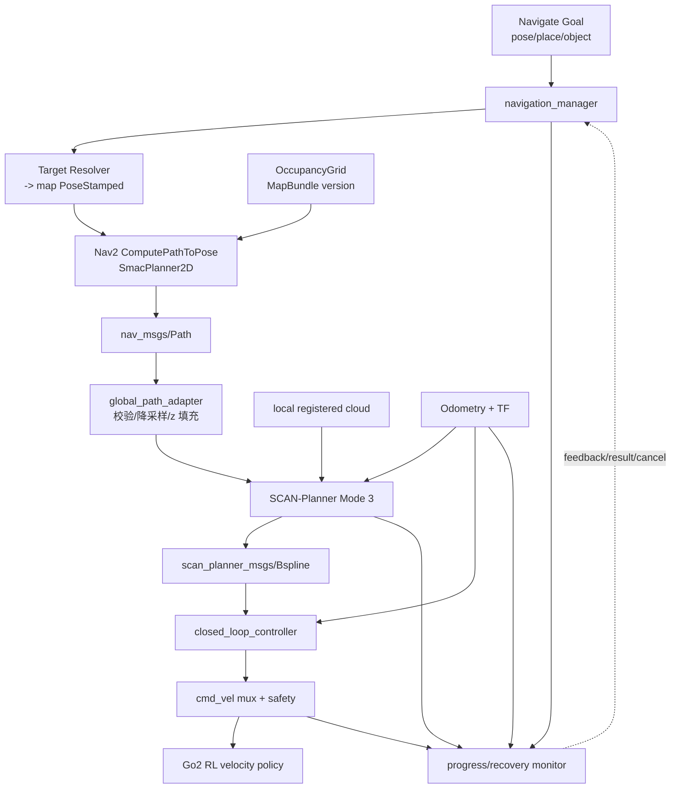

# Unitree Go2 已知地图全局 + 局部导航 MVP

> 项目名称：**MapNav-Go2：Nav2 全局路径 + SCAN 空间碰撞感知局部规划 + RL 速度执行**  
> 前置依赖：有效的二维占据图、`map -> odom -> base_link`、可用 `/cmd_vel` 速度执行后端  
> 核心结论：复用 SCAN-Planner 做局部空间避障，新增 Nav2 全局规划和任务级导航 Action；不把 SCAN-Planner 误当作完整导航栈。

## 1. 项目目标与范围

### 1.1 MVP 场景

- 单层室内/园区平面；
- 已知静态地图；
- Go2 作为 SE(2) 移动底盘，地面高度变化很小；
- 全局路径绕开墙体等静态障碍；
- 局部规划利用实时点云绕开临时静态障碍和横穿动态障碍；
- 目标可由 map pose、place ID 或静态 object ID 给出；
- 支持反馈、取消、超时、阻塞恢复和安全停止。

### 1.2 非目标

- 不做 frontier exploration/主动建图；
- 不做多楼层、楼梯、电梯和跨层 B-spline 执行；
- 不做语义规划代价学习；
- 不做端到端学习式导航；
- 不以 Agent 的重复 tool call 代替局部重规划；
- 不直接在真机首测完整速度范围。

## 2. 现有工程定位

`规划控制/SCAN-Planner-Ros2-main` 已有：

- ROS 2 Humble 原生移植；
- 局部栅格地图、空间碰撞检查、动态 A*、B-spline 优化和重规划 FSM；
- Mode 3 接收 `nav_msgs/Path` 的 `/initial_path`；
- 输出 `scan_planner_msgs/Bspline`；
- `closed_loop_controller` 根据 B-spline 与 odometry 发布 `/cmd_vel`；
- 确定性仿真器和 `map.pcd` 示例。

缺失的完整导航能力：

- 面向整个静态地图的全局规划服务；
- 从 Agent goal 到 planner/controller 生命周期的 Action server；
- 地图版本、目标解析、取消、结果和错误码；
- 与统一 `map/odom/base_link` TF、occupancy map、RL locomotion 的集成；
- 系统级恢复与可观测性。

因此技术组合确定为：

```text
Nav2 map_server + planner_server (SmacPlanner2D)
    -> nav_msgs/Path
    -> global_path_adapter
    -> SCAN-Planner navi_mode=3
    -> scan_planner_msgs/Bspline
    -> closed_loop_controller
    -> geometry_msgs/Twist
    -> Go2 RL locomotion bridge
```

NavFn 可作为打通接口的回退插件，但 MVP 验收固定一个全局 planner，避免对比算法分散精力。

## 3. 架构与状态机



导航状态机：

```text
IDLE
  -> VALIDATING
  -> GLOBAL_PLANNING
  -> LOCAL_TRACKING
       -> REPLANNING -> LOCAL_TRACKING
       -> RECOVERY   -> GLOBAL_PLANNING or LOCAL_TRACKING
  -> ARRIVED | CANCELED | FAILED
```

每个状态有超时且只允许受控迁移。收到 cancel/ESTOP 时不等待 planner 完成，立即撤销 command lease、发布零速度，并在确认后返回。

## 4. 目标文件结构

```text
具身-agent/workspace/robot_tools_mvp/ros2_ws/src/
├── robot_tools_msgs/
│   ├── action/Navigate.action
│   ├── msg/NavigationState.msg
│   └── srv/ResolvePlace.srv
├── navigation_manager/
│   ├── config/navigation_manager.yaml
│   ├── launch/navigation.launch.py
│   ├── src/navigation_manager_node.cpp
│   ├── include/navigation_manager/
│   │   ├── goal_validator.hpp
│   │   ├── progress_checker.hpp
│   │   └── recovery_policy.hpp
│   └── test/
├── global_path_adapter/
│   ├── config/path_adapter.yaml
│   ├── src/global_path_adapter_node.cpp
│   └── test/test_path_adapter.cpp
├── scan_planner_adapter/
│   ├── config/topic_remaps.yaml
│   ├── src/scan_status_adapter_node.cpp
│   └── test/
└── system_bringup/
    ├── config/nav2_planner.yaml
    ├── config/scan_planner.yaml
    ├── launch/map_navigation.launch.py
    └── behavior_trees/navigate_with_scan.xml

规划控制/SCAN-Planner-Ros2-main/
└── src/planner/...                         # 保持算法工程独立，仅做必要 bugfix
```

P0 可以先用 Python 写 `navigation_manager` 以快速验证协议；进入真机前应将高频/安全关键部分保留在 C++ 节点，Agent wrapper 仍使用 Python。

## 5. 模块划分

| 模块 | 责任 | 输入 | 输出 | 失败 |
|---|---|---|---|---|
| `target_resolver` | 将 pose/place/object 解析成静态 map pose | Goal、场景查询 | `PoseStamped(map)` | `REJECTED`, `TARGET_STALE` |
| `goal_validator` | 边界、占据、frame、数值、地图版本校验 | pose、map metadata | validated pose | `NO_MAP`, `REJECTED` |
| Nav2 planner server | 全局静态路径 | map、start、goal | `nav_msgs/Path` | `NO_PATH` |
| `global_path_adapter` | path frame 校验、降采样、补 z、发布 transient-local | Path、ground height | `/initial_path` | `INTERNAL_ERROR` |
| SCAN-Planner | 局部空间避障和 B-spline | initial path、local cloud、odom | `planning/bspline` | blocked/replan event |
| closed-loop controller | B-spline 跟踪 | B-spline、odom | `/cmd_vel` | stale trajectory |
| `navigation_manager` | Action、进度、取消、恢复、结果 | goal + 全栈状态 | feedback/result | typed error |
| safety/mux | command ownership、限幅、watchdog | cmd_vel、health | safe cmd_vel | `UNSAFE` |

## 6. 输入输出协议

### 6.1 `Navigate.action`

建议以类型字段表达三种目标，不把任意 JSON 字符串塞进 ROS Action：

```text
# Goal
uint8 POSE=0
uint8 PLACE=1
uint8 OBJECT=2
uint8 target_type
geometry_msgs/PoseStamped target_pose
string place_id
string object_id
float32 approach_distance_m
float32 position_tolerance_m
float32 yaw_tolerance_rad
float32 timeout_s
bool allow_replan
string expected_map_id
---
# Result
uint16 code
string message
bool retryable
string goal_id
geometry_msgs/PoseStamped final_pose
float32 elapsed_s
float32 final_distance_m
uint32 replan_count
string[] evidence_ids
---
# Feedback
string phase
geometry_msgs/PoseStamped current_pose
float32 distance_remaining_m
float32 navigation_time_s
uint32 replan_count
string active_recovery
```

字段约束：

- 三种 target 只能恰好设置一种；
- `target_pose.header.frame_id` 必须为 `map`，其他 frame 由调用前的 resolver 显式转换；
- `approach_distance_m` 仅对 object target 生效，范围 `[0.5, 3.0]`；
- tolerance 范围 `[0.1, 1.0] m` 和 `[0.1, 1.57] rad`；
- timeout 范围 `[5, 600] s`；
- `expected_map_id` 与当前地图不一致时拒绝，不静默切换。

### 6.2 ROS Topics / Actions

| 方向 | 名称 | 类型 | 提供者 -> 消费者 | 要求 |
|---|---|---|---|---|
| 输入 | `/map` | `nav_msgs/OccupancyGrid` | map_server -> Nav2 | reliable + transient local |
| 输入 | `/tf`, `/tf_static` | TF2 | localization -> all | `map->odom->base_link` |
| 输入 | `/local_cloud_registered` | `sensor_msgs/PointCloud2` | FAST-LIVO2 -> SCAN | sensor QoS，frame 明确 |
| 输入 | `/odom` | `nav_msgs/Odometry` | localization -> SCAN/controller | 连续 `odom` frame |
| 内部 | `/compute_path_to_pose` | `nav2_msgs/action/ComputePathToPose` | manager -> planner_server | 长时可取消 |
| 内部 | `/plan/global` | `nav_msgs/Path` | planner -> adapter | `map` frame |
| 内部 | `/initial_path` | `nav_msgs/Path` | adapter -> SCAN | reliable + transient local |
| 内部 | `/planning/bspline` | `scan_planner_msgs/Bspline` | SCAN -> controller | traj_id 单调 |
| 输出 | `/cmd_vel/navigation` | `geometry_msgs/Twist` | controller -> mux | 10–20 Hz |
| 状态 | `/navigation/state` | `NavigationState` | manager -> observability | 5 Hz/event |

当前 SCAN launch 中的 `/LIO/odom_vehicle`、`/LIO/clouds_lidar` 等通过 launch remap 归一，算法源码不硬编码集成层名称。

### 6.3 `global_path_adapter`

适配步骤固定且可单元测试：

1. 验证 header、有限数值、至少 2 个 pose；
2. 使用 TF 将整条路径转换到 SCAN 配置的 global frame；
3. 按弧长 `0.3–0.5 m` 降采样，始终保留终点；
4. MVP 平面场景将每点 `z` 设为地面高度；SCAN 内部再按现有配置处理 body height；
5. 原子发布完整新 path；
6. 使用 `path_id/map_id/goal_id` 关联日志；
7. 不可转换或出现路径跳变时拒绝，不能部分发布。

### 6.4 控制权与速度契约

```text
navigation_manager acquires lease "navigation:<goal_id>"
closed_loop_controller publishes /cmd_vel/navigation
twist_mux selects highest valid owner
safety_supervisor clamps and watches timeout
locomotion_bridge consumes only /cmd_vel/safe
```

导航层运行限幅必须不超过 RL policy manifest：

```yaml
linear_x: [-0.6, 0.6]
linear_y: [-0.3, 0.3]
angular_z: [-0.8, 0.8]
accel_xy: 0.8       # m/s^2
accel_yaw: 1.5      # rad/s^2
```

## 7. 全局、局部与动态障碍的职责

### 全局层

- 输入持久化静态 occupancy map；
- 解决从当前位置到目标区域的拓扑可达性和长距离绕行；
- 低频或事件触发重规划；
- MVP 不把每个行人写进全局地图。

### 局部层

- 输入实时局部点云；
- 几何上对所有当前障碍保守处理，不依赖分类正确性；
- 输出短时 B-spline 并持续重规划；
- 对未知/动态障碍采用减速、停等、再规划。

### 语义动态层

- 提供“人/推车/门”等对象身份、速度估计和可解释 evidence；
- P0 不作为碰撞安全的唯一来源；
- P1 才可把经验证的预测轨迹加入动态代价。

这一职责划分保证 Grounding DINO/SAM 2 的推理延迟或漏检不会直接造成碰撞。

## 8. 进度判断与恢复

### 8.1 到达条件

连续 0.5 s 同时满足：

- 平面距离 `< position_tolerance_m`；
- 如果 goal 要求朝向，yaw 误差 `< yaw_tolerance_rad`；
- 机身平面速度 `< 0.08 m/s`；
- localization healthy；
- 无激活 safety event。

不能仅依据 planner 声称完成或路径耗尽返回成功。

### 8.2 卡住条件

滑动窗口 5 s 内：

- 距离进展 `< 0.15 m`；
- 控制器持续给出非零命令；
- 未到达目标。

则触发一次恢复。MVP 恢复顺序：

1. 零速 HOLD 0.5 s；
2. 请求 SCAN 局部重规划；
3. 仍失败则重新计算一次全局路径；
4. 可选小角度原地调整（只有 clearance 足够才允许）；
5. 恢复次数超过 3，返回 `BLOCKED`。

禁止让 LLM 自由生成恢复动作；Agent 只根据类型化 `BLOCKED` 决定是否换目标或询问用户。

### 8.3 定位故障

以下任一条件触发 `LOCALIZATION_LOST`：

- odometry 超过 300 ms 未更新；
- TF lookup 连续失败；
- pose covariance 超过配置阈值；
- 位姿发生不符合 map correction 约定的大跳变。

处理：立即零速、释放 command lease、取消内部 planner goal、返回 retryable error。重定位是 operator/P1 工具，不由导航器暗中执行。

## 9. 分阶段实现

### M0：接口与 frame

- 用确定性仿真器统一 `/odom`、`/local_cloud_registered`、`map`；
- 为 SCAN Mode 3 发布两点以上 `nav_msgs/Path`；
- 验证 B-spline 和 `/cmd_vel` 闭环。

### M1：局部闭环

- 固定参考路径；
- 静态障碍、横穿障碍、传感器短暂缺帧测试；
- 接入 RL locomotion bridge 的 MuJoCo 后端。

### M2：全局规划

- 从 MapBundle 加载 occupancy；
- Nav2 Planner Server 计算 Path；
- adapter 发布给 SCAN；
- 可达/不可达目标测试。

### M3：Navigation Action

- goal validation、feedback、cancel、timeout、typed result；
- progress checker 和固定恢复表；
- map version 绑定和日志追踪。

### M4：Agent tool

- LangChain StructuredTool 只封装 `Navigate.action`；
- JSON Schema 验证；
- tool 超时不等于 ROS goal 消失，必须主动 cancel 并等待确认。

## 10. MVP 验收

使用固定 map、固定目标列表和固定动态障碍脚本，全部自动化：

| 测试 | 样本 | 通过条件 |
|---|---:|---|
| 全局可达 | 20 goals | 20/20 产出 frame 正确且不穿静态占据栅格的 Path |
| 全局不可达 | 5 goals | 5/5 返回 `NO_PATH`，不发布运动命令 |
| 静态局部绕障 | 20 seeds | 成功率 ≥90%，0 碰撞 |
| 动态横穿 | 20 seeds | 0 碰撞；允许停等；最终成功率 ≥80% |
| 取消 | 每个 phase 各 5 次 | 500 ms 内 `/cmd_vel/safe=0`，结果为 `CANCELED` |
| 定位丢失 | 10 次注入 | 1 s 内停车并返回 `LOCALIZATION_LOST` |
| 卡住 | 10 次封路 | 最多 3 次恢复后返回 `BLOCKED`，无无限循环 |
| 重复目标 | 20 runs | 最终位置误差中位数 `<0.25 m`，p95 `<0.5 m` |

记录指标：规划时间、路径长度、完成时间、最小障碍距离、重规划次数、速度跟踪 RMSE、状态码和恢复轨迹。

## 11. Agent tool 映射

普通 Agent 只看到：

```text
navigate_to(target, tolerance_m, timeout_s) -> typed result
cancel_navigation(goal_id)                 -> typed result
get_navigation_status(goal_id?)            -> read-only status
```

不暴露：

```text
compute_path_raw(...)
publish_initial_path(...)
set_cmd_vel(...)
clear_costmap_anywhere(...)
force_recovery(...)
```

内部模块可以提供调试服务，但必须与 Agent tool registry 分离。

## 12. 后续 P1

- 2.5D traversability 参与全局规划；
- exploration server 与地图增量版本；
- 基于对象预测轨迹的动态局部代价；
- `NavigateThroughPoses`、巡检和拓扑路线；
- 自动重定位流程；
- 真机速度/加速度标定和足式机器人 body envelope 的姿态相关碰撞模型。

## 13. 参考

- [SCAN-Planner 当前 ROS 2 工程](../依赖索引.md)
- [Nav2 Navigation Concepts](https://docs.nav2.org/concepts/)
- [Nav2 BT Navigator](https://docs.nav2.org/configuration/packages/configuring-bt-navigator.html)
- [ROS 2 Action 适用边界](https://docs.ros.org/en/rolling/Concepts/Basic/About-Actions.html)

