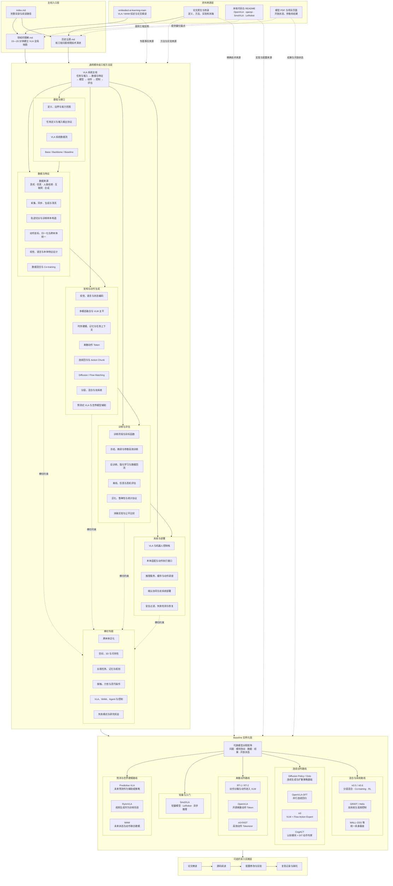

# VLA 模块化研究手册

> 面向已有深度学习与多模态研究经验、希望快速进入 Vision-Language-Action（VLA）领域的研究者。本手册从任务接口、数据、模型模块、动作生成、训练评估和机器人系统六个层面建立工程主线，再用代表模型与完整 baseline 将通用方法实例化。

## 1. 手册定位

本手册回答三类问题：

1. **领域问题怎样组织**：VLA 与 VLM、Agent、世界模型、WAM 和经典控制分别负责什么；
2. **概念怎样进入工程系统**：视觉、语言、本体状态和动作经过哪些模块，数据如何构造，训练和评估如何闭环；
3. **为什么选择某条技术路线**：离散动作、连续回归、Diffusion/Flow、分层系统和预测式策略分别适合什么问题。

它不替代论文、源码和复现日志。具体依赖版本、运行命令、逐函数实现和平台踩坑应在选定 Baseline 后进入对应官方代码处理。

## 2. 当前阅读入口

| 文档 | 作用 | 建议阅读时间 |
|---|---|---:|
| [领域的理解](领域的理解.md) | 建立 VLA 工程主线、模块地图和技术选型框架 | 15–20 分钟 |
| [历史沿革](历史沿革.md) | 按数据、动作表示、系统形态和学习方式理解范式演进 | 15 分钟 |
| [定义、边界与能力范围](基础/定义、边界与能力范围.md) | 区分 VLA、VLM、策略、Agent、WM、WAM 与控制器 | 10 分钟 |
| [任务定义与输入输出协议](基础/任务定义与输入输出协议.md) | 把任务落到观测、目标、本体状态、动作和时间尺度 | 15 分钟 |
| [VLA 系统数据流](基础/VLA系统数据流.md) | 理解训练与推理时各模块如何连接 | 15 分钟 |
| [Base、Backbone、Baseline 与常见误解](基础/Base、Backbone、Baseline与常见误解.md) | 建立模型比较和研究归因的共同语言 | 10 分钟 |
| [数据与特征](数据与特征/index.md) | 从数据来源进入采集、样本、动作统一、特征与 Co-training | 按专题选读 |
| [架构与动作生成](架构与动作生成/index.md) | 从多模态编码进入时序、动作表示、生成头和系统结构 | 按专题选读 |

## 3. 完整内容架构

> 从资料来源到模块方法再到模型实例的完整回路：实线表示主阅读路径（入口 → 模块方法 → Baseline），虚线表示跨层引用或横切约束。

**各层当前状态**

| 层级 | 进度 | 说明 |
|---|---|---|
| 主线入口 + 基础 | 第一批完成 | `领域的理解` `历史沿革` `定义、边界` `任务与 I/O` `系统数据流` `Base/Backbone/Baseline` |
| [数据与特征](数据与特征/index.md) · [架构与动作生成](架构与动作生成/index.md) | 第二批完成 | 6 篇数据专题与 8 篇架构/动作专题；均包含模块接口、模型事实和验证方法 |
| [训练与评估](训练与评估/index.md) · [系统与部署](系统与部署/index.md) · [横切专题](横切专题/index.md) | 第三批完成 | 训练/微调/RL、三层评估与统计、在线控制与安全，以及跨本体/空间/长程/接触等 20 篇目录与专题文档 |
| Baseline | 第四批 | 含对照矩阵与各路线代表模型实例化文档 |

尚未完成的第四批暂不建立空白链接，避免把目录占位误认为已有内容。

第三批的三个入口分别回答：

- [训练与评估](训练与评估/index.md)：训练信号如何进入哪些参数，以及能力声明需要什么证据；
- [系统与部署](系统与部署/index.md)：模型输出怎样经 action server、adapter、控制器和安全监督形成在线闭环；
- [横切专题](横切专题/index.md)：跨本体、空间、长程和接触能力如何同时约束数据、模型与系统。

## 4. 按研究目标阅读

### 初次进入 VLA

`领域的理解 → 定义、边界与能力范围 → 历史沿革 → 任务定义与输入输出协议 → VLA 系统数据流 → Base/Backbone/Baseline`

重点是先确定 VLA 在机器人系统中的责任边界，再进入动作路线和具体模型。

### 已有 VLM/多模态经验，准备改模型

`Base/Backbone/Baseline → VLA 系统数据流 → 架构与动作生成 → 训练与评估 → Baseline 对照矩阵`

先进入[架构与动作生成](架构与动作生成/index.md)，再到[训练与评估](训练与评估/index.md)，重点关注预训练 Base 如何经状态、时序和动作模块落到训练目标，以及改动需要什么公平对照。

### 做机器人数据和跨本体训练

`任务与 I/O → 数据与特征 → 动作坐标与归一化 → Co-training → 跨本体专题`

从[数据与特征](数据与特征/index.md)开始，再读[跨本体泛化](横切专题/跨本体泛化.md)；数据格式统一并不等于动作语义统一，坐标系、控制频率、状态字段和有效自由度决定跨本体训练是否成立。

### 做推理、部署或真机系统

`VLA 系统数据流 → 系统与部署 → 推理服务与动作调度 → 评估与安全`

从[系统与部署](系统与部署/index.md)进入；需要把模型延迟、动作块执行策略、低层控制频率、异常降级和安全过滤放在同一闭环中分析。

### 选择第一个 Baseline 候选

- 轻量和完整工程入口：SmolVLA；
- 研究离散动作 token：OpenVLA；
- 研究动作解码优化：OpenVLA-OFT；
- 研究连续生成：Diffusion Policy / Octo；
- 研究 Flow Matching 与分层通才：π0 家族；
- 研究认知–动作分工和双系统：CogACT / GR00T；
- 研究未来预测与动作联合：Predictive VLA / WAM。

这些名称目前只是代表模型候选；只有绑定任务、数据、训练 recipe、推理与评测协议后，才构成可复用的实验 baseline。具体规格与开放状态将在第四批 Baseline 文档中统一整理。

## 5. 资料与可信度口径

事实采用以下优先级：论文正文与附录、官方代码/README/模型卡、本地 PDF 与项目页、站内综述与细读。站内材料用于检索和交叉对照，不替代一手来源。

- **作者自评**：论文或厂商在自有协议上报告，不能自动视为独立复现；
- **官方统一评测**：由基准维护方在固定协议下执行；
- **独立复现**：由非提出方复现并说明代码、数据和协议；
- **未披露/待核**：一手来源没有公开或当前材料不足，不根据常识补全。

不同数据、动作空间、相机设置、控制频率和评测版本的结果不直接排名。

## 6. 本地深读与代码入口

- [VLA 深度调研与论文细读](../依赖索引.md)
- [VLA × WAM 时间线](../依赖索引.md)
- [模型规格对比](../依赖索引.md)
- [基准与评测](../依赖索引.md)
- [OpenVLA 代码](../依赖索引.md)
- [openpi 代码](../依赖索引.md)
- [SmolVLA 模型说明](../依赖索引.md)
- 本地论文：[OpenVLA](../依赖索引.md) · [π0.5](../依赖索引.md) · [SmolVLA](../依赖索引.md)
