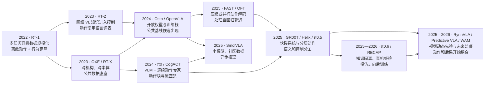

# VLA 历史沿革：工程问题如何逐步被重新定义

> 本文按论文或官方项目的首次公开时间组织，资料覆盖至 **2026 年 6 月**。2025—2026 年工作多为预印本或机构技术报告，文中的成功率、控制频率和相对提升若没有独立复现，均标为“作者自评”。不同机器人、数据与评测协议下的数字只用于建立数量级，不用于横向排名。

VLA 的历史不只是模型越来越大。每次关键转折都在重写一个工程问题：机器人知识从哪里来，异构轨迹如何进入同一模型，视觉语言表征怎样变成高频连续控制，慢速语义推理与快速执行如何分工，以及策略部署后能否继续从失败中学习。

## 1. 六条相互耦合的演进轴

| 工程轴 | 早期形态 | 逐步形成的主流做法 | 尚未闭合的问题 |
|---|---|---|---|
| 知识来源 | 单任务机器人示范 | 机器人轨迹 + 网络图文 + 人类视频 + 仿真/合成数据 | 各数据源贡献难以解耦，机器人动作监督仍稀缺 |
| 数据组织 | 单实验室、单本体数据 | OXE/LeRobot 等公共格式，多数据集重采样与协同训练 | 动作语义、坐标系、频率和质量标签仍不统一 |
| 动作表示 | 单步连续回归 | 离散 token、连续动作块、扩散/流匹配、分层混合 | 精度、生成延迟、多峰性与跨本体统一难以同时最优 |
| 系统形态 | 单任务端到端策略 | VLM + 动作专家、双系统、异步策略服务 | 模块接口、刷新频率和安全责任缺少统一约定 |
| 训练范式 | 行为克隆 | 网络数据协同训练、多阶段预训练、知识隔离、后训练与真机 RL | 在线数据成本高，灾难性遗忘与安全探索仍突出 |
| 评估对象 | 单任务成功率 | 分布内、组合泛化、跨场景/跨本体、真机闭环和系统时延 | 协议不统一，自评居多，离线指标与闭环收益相关性弱 |

这六条轴并非同一条时间线。例如，Diffusion Policy 推进的是动作生成，不提供开放语义；OXE 推进的是数据公共化，不决定动作头；RynnVLA 改变的是预训练先验，动作侧又采用连续隐变量。将“Base、数据、动作头、训练和部署”分开观察，比按模型参数量排列更能解释技术选择。

## 2. 工程演进主线

图中有三条最重要的因果链：

- **数据链**：RT-1 证明多任务真机数据的规模效应，OXE 将数据组织推进到跨机构、跨本体，Octo/OpenVLA 才能成为公共模型底座。
- **动作链**：RT-2/OpenVLA 复用语言模型的离散生成，Diffusion Policy、Octo 与 π0 共同形成连续动作块技术线；FAST、OFT 和分层系统则分别从压缩、并行解码与职责拆分处理实时性。这里描述的是共享的技术源流，不表示三者存在单一路径的直接继承关系。
- **学习链**：行为克隆首先吸收成功示范，视频预训练扩展动态先验，知识隔离与 RECAP 一类方法进一步引入部署经验、失败和纠正数据。

## 3. 2022：规模化机器人模仿先于 VLA

### 3.1 RT-1 把瓶颈从“单任务算法”移到“数据与模型容量”

RT-1 使用约 **35M** 参数的 EfficientNet-B3、FiLM、TokenLearner 和 8 层 decoder-only Transformer，在 **13 万条真实机器人 episode、700+ 条指令**上训练。模型将 11 维动作分别量化到 256 个区间，以交叉熵学习离散动作分类，并以约 3 Hz 闭环运行。

它的工程意义不在开放世界语义——RT-1 没有互联网预训练的 VLM——而在于确立了三件事：多任务真机数据可以被同一 Transformer 吸收；动作可以被改写为分类/token 预测；模型容量与数据多样性共同决定泛化。作者在训练任务上报告 97% 成功率，并展示混入仿真和异构机器人数据的收益，但这些结果来自 Everyday Robots 的受控平台，不能外推为通用机器人能力。

RT-1 因此更适合作为 VLA 的直接工程前身：它给出了动作与训练骨架，RT-2 才把网络规模的视觉语言知识接入这套骨架。

## 4. 2023：知识迁移与公共数据底座同时出现

### 4.1 RT-2：动作成为 VLM 可以生成的“另一种语言”

RT-2 将 6-DoF 末端位姿增量、夹爪与终止标志写成 8 个整数；连续维仍使用 256-bin 离散化。PaLI-X 直接复用整数 token，PaLM-E 版本则覆写低频词表项。机器人样本与原有网络视觉语言样本在同一训练过程中 co-fine-tune，使 VLM 在学习动作时继续接触网络概念，降低只用机器人数据微调造成的知识遗忘。

这项设计几乎不改 VLM 的自回归目标，却带来明显系统代价：5B/12B/55B 级模型需要远程 TPU 服务，55B 版本作者报告约 1–3 Hz，5B 版本约 5 Hz。RT-2 的开放世界泛化结果主要是作者真机自评，代码和权重未公开。由此形成此后长期存在的矛盾：语言模型提供语义迁移，但逐 token 解码与大主干不适合高频接触控制。

### 4.2 Diffusion Policy：连续动作生成形成另一条技术源流

同年公开的 Diffusion Policy 不是 VLA：它没有语言/VLM 主干。但它把策略建模成条件去噪过程，并以 receding horizon 方式生成连续动作块，能表达同一观测下的多种合理动作。这条路线随后进入 Octo、π0、CogACT 和 GR00T 等 VLA 的动作专家，说明“知识主干如何预训练”和“动作分布如何生成”是两个可以独立选择的模块问题。

### 4.3 OXE / RT-X：数据格式开始决定模型上限

Open X-Embodiment 汇集多机构、多机器人数据，原始集合达到百万级 episode。不同子项目依据动作空间、相机质量和任务覆盖筛选不同混合：Octo 使用约 80 万条轨迹，OpenVLA 使用约 97 万条演示。OXE 并没有消除跨本体差异，但它把研究问题从“是否有数据”推进为“如何统一动作语义、归一化、重采样和数据质量”。

## 5. 2024：公共基线候选出现，动作生成开始组件化

### 5.1 Octo 与 OpenVLA 建立两类开放起点

Octo 是 27M/93M 参数的通用 Transformer 扩散策略，在 OXE 约 80 万条轨迹上训练。块式注意力与 readout token 将任务输入、观测和动作头解耦，使新传感器或动作空间能够作为模块加入；其价值是跨本体策略初始化与低成本适配，而不是复用大型语言生成器。

OpenVLA 则将 RT-2 的离散动作路线完整开放：DINOv2 与 SigLIP 提供空间/语义互补视觉特征，经投影后送入 Llama 2 7B；7 维动作各生成一个分位数分箱 token。模型在 OXE 约 97 万条演示上训练，主训练消耗约 **21,500 A100 GPU·小时**。作者在 29 个任务的自有真机协议上报告，相对 55B RT-2-X 提高 16.5 个成功率百分点；这一数字不代表独立统一基准排名。

两者共同改变了研究生态：前者提供模块化连续策略，后者提供可微调的离散 VLA。研究者第一次能够围绕公共权重替换视觉编码、动作头、微调方式和数据混合，而不只比较闭源系统演示。

### 5.2 π0 与 CogACT：语义主干和动作专家明确分工

π0 以 PaliGemma 为 VLM Base，并加入约 300M 参数的流匹配动作专家，一次生成 50 步连续动作块；CogACT 则由 VLM 产生认知条件，再交给 DiT 动作模块。它们没有放弃 VLM，而是把高频、连续、多峰动作分布交给专门模块。

这一结构性转变比“扩散还是流匹配”的名称更重要：视觉语言 token 成为动作专家的条件，proprioception、带噪动作和时间步进入动作分支；语言推理与运动生成可以使用不同宽度、注意力和采样频率。代价是训练目标、梯度接口与部署链路都比单一自回归模型复杂。

## 6. 2025：效率、分层和系统工程成为主线

### 6.1 FAST 与 OpenVLA-OFT 从两侧处理自回归瓶颈

π0-FAST 使用 DCT、量化和 BPE 压缩动作轨迹，使离散自回归模型用更短 token 序列表达高频信号；OpenVLA-OFT 则保留 OpenVLA 主干，将动作侧改造成并行连续动作块回归，并加入多图像输入等优化。OFT 作者报告 LIBERO 平均成功率 97.1%，并在 A100 上报告 108.8 Hz 的动作生成吞吐，对比原 OpenVLA 的 4.2 Hz；这一吞吐指标不等于机器人闭环控制频率，两项结果也均来自作者协议。

这组工作说明离散/连续并不是整台模型不可改变的身份。动作 tokenizer、输出头、chunk 与解码调度都可以在相同或相近 Base 上重组，技术选型应围绕控制精度、推理预算和任务多峰性，而不是只看模型家族名称。

### 6.2 GR00T、Helix 与 π0.5 把时间尺度差异显式化

GR00T N1 采用 VLM System 2 与流匹配 DiT System 1：前者提供视觉语言条件，后者生成 16 步连续动作块。NVIDIA 将 System 2 描述为约 10 Hz 的高层刷新，将 System 1/动作执行流描述为最高 120 Hz；公开延迟表中，L40 上 batch 1 的 16 步动作块采样约为 63.9 ms，因此 120 Hz 不能解释为每秒 120 次完整模型查询。项目开放约 2.2B 参数的 N1 checkpoint、代码与部分数据/工具；完整训练数据金字塔并未因此等同于完全可复现。Helix 也将慢语义模块与快控制模块异步连接，但模型与数据未开放。

π0.5 将分层发生在输出语义上：高层离散 token 表达子任务，底层流匹配专家生成连续动作块，并通过异构机器人、移动操作、网络多模态等数据 co-training 推进新环境长程任务。论文公开的移动操作部分约 400 小时、约 100 个训练环境，全量混合规模未完整披露。当前本地 `openpi` 已提供 π0、π0-FAST、π0.5 的基础/任务 checkpoint 与训练实现，但 π0.5 仅支持 flow-matching head，不能据此推定原论文的完整数据和全部训练配方均已开放。

分层与双系统是两条正交的设计轴：分层模型用子任务、skill 或抽象动作划分语义层级；双系统让语义模块与动作模块具有不同刷新率或部署路径。二者可以组合，使子任务不必按动作采样率刷新、连续控制也不必等待长序列语言生成，但不能因模块数量相同就互相等同。随之出现的新问题是模块如何同步观测、何时刷新条件、延迟或错误如何传播，以及哪个模块负责安全降级。

### 6.3 SmolVLA：规模化不再只指更大的模型和私有数据

SmolVLA 将系统压缩到约 **0.45B** 参数，其中约 0.1B 为流匹配动作专家；它使用 481 个社区数据集、约 2.29 万条 episode 和 1,060 万帧，并配套动作队列式异步推理。作者在 LIBERO 上报告 87.3% 平均成功率，但与更大模型的数据和输入协议并非严格同条件。

其历史位置在于提供了面向单卡训练、消费级部署和社区数据治理的公共基线候选。VLA 的工程尺度由此出现两种方向：用更大异构数据训练通才，或通过紧凑 Base、视觉 token 压缩和异步系统获得足够好的局部适配能力。

## 7. 2025—2026：预训练先验与学习信号继续扩展

### 7.1 从成功示范到部署经验

π0.6 / π*0.6 将分层基座扩大到 Gemma 3 4B 与约 860M 动作专家，并以 Knowledge Insulation 隔离高层自回归目标与底层连续动作梯度。RECAP 再引入 on-policy rollout、专家干预与价值/优势条件，使策略能利用失败和纠正数据。其关键意义是学习信号从“模仿成功动作”扩展到“区分并改进自己的行为”；相关真机收益均为 Physical Intelligence 自评，权重与完整数据未开放。

这一方向的工程成本也更直接：真机采样吞吐、安全边界、人工干预质量和旧策略数据偏差都会成为训练系统的一部分。后训练不是在行为克隆之后简单增加一个 loss，而是增加一条真实世界数据闭环。

### 7.2 从静态视觉语言知识到视频动态先验

RynnVLA-001 从 Chameleon 自回归图像模型扩展图生视频预训练，使用约 **1,200 万条第一视角人类操作视频**，再经人手轨迹建模和机器人动作训练迁移到操作策略。训练时统一未来帧与动作预测；部署时丢弃未来视觉 token，只输出 ActionVAE 的连续动作隐变量。它因此属于“视频预测作为预训练与辅助监督”的 VLA，而不是推理时依靠世界 rollout 选动作的模型式控制系统。

预测式 VLA、JEPA 式潜变量预测和 WAM 在这一时期逐渐交汇，但需要按预测的系统角色区分：

- **视频/世界模型作为 Base**：提供时序或交互先验，动作接口在后续阶段学习；
- **future auxiliary**：训练时预测未来以改善表征，推理仍由直接策略出动作；
- **联合 WAM**：未来世界与动作在共享表征中联合监督；
- **模型式决策**：推理时 rollout 候选后果，并由目标、价值或安全约束筛选动作。

只有后两类把“预测后果”更深地接入动作 grounding 或在线决策。是否采用视频生成主干本身，不足以判断系统是不是 WAM。

### 7.3 2026：上下文、统一接口和动作语义成为新的扩展方向

π0.7 没有继续显著放大模型，而是给约 5B 的 π0.6 系基座增加视频历史、视觉子目标、子任务、策略质量/错误元数据和控制模式。混合质量数据不再被当成无差别示范：上下文显式标注“采用哪种策略、轨迹质量怎样”，推理时再组合这些条件。Physical Intelligence 报告单个通才可在部分任务追平专用 π*0.6，并展示零样本跨本体叠衣；这些结论来自自有平台，模型和训练数据未开放，论文自身也将组合泛化表述为初步迹象。

同期的 Qwen-VLA 尝试用 Qwen3.5-4B 与 1.15B DiT 将操作、导航和轨迹预测放入共享的 action-and-trajectory 空间，不再为每个平台设置独立输出头；平行公开的 Qwen-RobotManip 与 Qwen-RobotNav 专项模型则分别使用流匹配动作专家和 waypoint head。两种发布形态并存，反映出“统一表征与数据设施”已经可行，而操作/导航的执行接口是否也应完全统一，仍是需要实证比较的架构选择。

X-Tokenizer 则把动作 token 从“低失真压缩码”推进为语义接口：顶层 code 表达粗粒度意图，下层 code 保留运动残差，并通过 VLM 表征对齐与未来特征预测塑造 token 空间。其公开权重在 240 万条轨迹、20 亿 action frame 上预训练。它更接近可冻结复用的动作模块，而不是完整 VLA；价值也需要在控制变量严格的下游策略中继续验证。

## 8. 定量里程碑：数字对应哪一种工程变化

| 首次公开 | 模型/底座 | 参数规模 | 已披露训练数据量级 | 动作与系统形态 | 公开结果或系统指标 | 当前开放状态 |
|---|---|---:|---|---|---|---|
| 2022.12 | RT-1 | 约 35M | 13 万真机 episode；700+ 指令 | 11 维、每维 256-bin；单体 BC | 约 3 Hz；训练任务 97% ⚠️作者自评 | 论文公开；原始模型权重/完整训练栈未公开 |
| 2023.07 | RT-2 | 5B / 12B / 55B | 机器人 + 网络 VL；精确混合规模未披露 | 8 个动作整数 token；单体 co-fine-tune | 55B 约 1–3 Hz、5B 约 5 Hz ⚠️ | 代码/权重未公开 |
| 2023.10 | OXE 数据底座 / RT-X 实验族 | 非单一模型 | OXE 原始集合百万级 episode、22 种本体 | 公共数据层，不限定动作头 | 支撑 RT-X 实验及后续 Octo/OpenVLA 等数据混合 | OXE 数据与工具开放，各子集许可分别适用；这不表示 RT-1-X/RT-2-X 模型资产均开放 |
| 2024.05 | Octo | 27M / 93M | OXE 25 子集、约 80 万轨迹 | 模块化 Transformer + 扩散动作块 | 9 个真机设置、4 个机构验证 ⚠️ | 代码、权重、数据管线与微调脚本开放 |
| 2024.06 | OpenVLA | 官方称 7B；组件相加约 7.5B | OXE 约 97 万演示 | 7 个分位数离散 token；单体 AR | 比 55B RT-2-X 高 16.5pp ⚠️；主训练约 21,500 A100·h | 代码 MIT；权重开放但继承 Llama 2 许可 |
| 2024.10 | π0 | 约 3.3B | 论文全量规模未披露；当前 base checkpoint 标注 10k+ 机器人小时 | VLM + 约 300M flow action expert；$H_{pred}=50$ | 支持最高约 50 Hz 的动作样本执行 ⚠️；不是 50 次完整模型查询/秒 | `openpi` 代码与 checkpoint 可用；原始完整数据未开放 |
| 2025.02 | OpenVLA-OFT | 官方 Base 称 7B；组件相加约 7.5B | OpenVLA Base + 目标域微调数据 | 并行连续 L1 动作块 | LIBERO 97.1%；A100 动作生成吞吐 108.8 Hz ⚠️ | 配方/代码开放 |
| 2025.03 | GR00T N1 | 约 2.2B | 由 88h 真机遥操作种子扩增得到 827h 合成神经轨迹，并混合人类视频（报告口径） | VLM System 2 + flow/DiT System 1；$H_{pred}=16$ | System 2 约 10 Hz 刷新；System 1/动作执行流最高 120 Hz；L40 采样 16 步约 63.9 ms ⚠️ | 2B 权重、代码、部分数据和工具开放 |
| 2025.04 | π0.5 | 精确总数未披露 | 移动操作部分约 400h、约 100 环境；全量混合未披露 | 高层离散子任务 + 底层 flow chunk | 开放世界长程任务为作者真机协议 ⚠️ | `openpi` 有 base/任务 checkpoint 与 flow head；原始数据未开放 |
| 2025.06 | SmolVLA | 约 0.45B | 481 个社区集；2.29 万 episode；1,060 万帧 | 小型 VLM + flow expert；50 步 chunk；异步执行 | LIBERO 平均 87.3% ⚠️ | LeRobot 代码、权重与训练数据开放 |
| 2025.09 | RynnVLA-001 | 约 7B | 约 1,200 万人类第一视角视频 + 机器人数据（后者规模未披露） | AR 视频 Base + ActionVAE；推理只出动作 | 三项 SO100 任务平均 90.6% ⚠️ | 代码与权重开放；完整训练数据未开放 |
| 2025.11 | π0.6 / π*0.6 | 4B Base + 860M action expert | 示范 + on-policy + 专家干预；规模未披露 | 分层混合 + Knowledge Insulation + RECAP | 真机提升均为作者自评 ⚠️ | 权重、数据与完整训练栈未公开 |
| 2026.04 | π0.7 | 约 5B | 成功、失败、旧策略 rollout 等混合质量数据；规模未披露 | 视频历史 + 富上下文条件 + 50 步 flow chunk | 通才追平部分 RL 专家、零样本跨本体结果 ⚠️ | 权重和训练数据未公开 |
| 2026.06 | X-Tokenizer | tokenizer 参数未披露 | 240 万轨迹、20 亿 action frame、17 个机械臂家族（项目口径） | 4 层语义残差量化；意图 code + 运动残差 | 下游收益均为作者自评 ⚠️ | 代码与权重开放，HF 权重标注 Apache-2.0 |

表中的“开放”按资产拆分，而不是给模型贴单一标签：有 checkpoint 不等于训练混合可重建，有代码不等于评测平台公开，开放数据也不自动解决跨本体动作接口。频率则按对象解释：模型/动作块生成吞吐、策略刷新、动作样本执行与低层伺服频率不是同一指标；动作块还应同时报告预测长度 $H_{pred}$ 与每轮实际执行长度 $H_{exec}$。后续用代表模型构造 baseline 时，应分别固定 Base 许可、训练代码、权重、数据、评测脚本和机器人平台。

## 9. 从历史主线到技术选型

历史脉络可以直接映射为当前的模块选择：

| 当前约束 | 历史上形成的候选 | 选择时真正比较的对象 |
|---|---|---|
| 希望最大程度复用 VLM 词表和训练栈 | RT-2、OpenVLA、FAST | token 压缩率、量化误差、串行解码时延 |
| 需要多峰、平滑或高频连续动作 | Diffusion Policy、Octo、π0、CogACT | action horizon、采样步数、动作专家规模、闭环频率 |
| 需要兼顾长程语义与快速控制 | π0.5、GR00T、Helix | 高低层接口、刷新策略、状态同步与错误传播 |
| 算力和数据受限 | Octo 适配、LoRA/OpenVLA-OFT、SmolVLA | Base 迁移性、数据域差、显存与部署延迟 |
| 希望利用无机器人动作的视频 | RynnVLA、Predictive VLA、WAM | 视频先验是否进入动作、仅训练期辅助还是推理期规划 |
| 需要部署后持续改进 | π0.6 / RECAP 一类后训练 | 数据回流、安全探索、价值标注与人工干预成本 |

这张表不是按年份选择模型，而是用历史回答“某种模块为什么出现”。详细参数、训练配置和源码入口应进入各代表模型/基线专页；本文保留的是技术分叉的原因与相互关系。

## 10. 参考与延伸

### 本地资料

- [VLA 深度调研主报告](../依赖索引.md)
- [VLA × WAM 发展时间线](../依赖索引.md)
- [模型规格对比](../依赖索引.md)
- [RT-1 细读](../依赖索引.md)、[RT-2 细读](../依赖索引.md)
- [Octo 细读](../依赖索引.md)、[OpenVLA 细读](../依赖索引.md)
- [π0 细读](../依赖索引.md)、[π0.5 细读](../依赖索引.md)、[π0.6 细读](../依赖索引.md)
- [GR00T N1 细读](../依赖索引.md)、[SmolVLA 细读](../依赖索引.md)、[RynnVLA 细读](../依赖索引.md)

### 原始论文与官方工程入口

- [RT-1](https://arxiv.org/abs/2212.06817)、[RT-2](https://arxiv.org/abs/2307.15818)、[Open X-Embodiment](https://arxiv.org/abs/2310.08864)
- [Diffusion Policy](https://arxiv.org/abs/2303.04137)、[Octo](https://arxiv.org/abs/2405.12213)、[OpenVLA](https://arxiv.org/abs/2406.09246)
- [π0](https://arxiv.org/abs/2410.24164)、[FAST](https://arxiv.org/abs/2501.09747)、[OpenVLA-OFT](https://arxiv.org/abs/2502.19645)
- [π0.5](https://arxiv.org/abs/2504.16054)、[SmolVLA](https://arxiv.org/abs/2506.01844)、[GR00T N1](https://arxiv.org/abs/2503.14734)
- [π0.7](https://arxiv.org/abs/2604.15483)、[Qwen-VLA](https://arxiv.org/abs/2605.30280)、[X-Tokenizer](https://arxiv.org/abs/2606.14752)
- 本地工程入口：[OpenVLA README](../依赖索引.md)、[openpi README](../依赖索引.md)、[SmolVLA README](../依赖索引.md)
