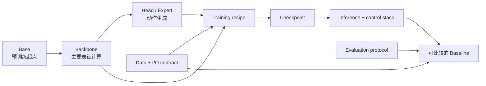

# Base、Backbone、Baseline 与常见误解

> 本文建立 VLA 研究中的比较语言。目标不是增加术语，而是避免把“换了预训练模型”“改了动作头”“下载了 checkpoint”和“完成了 baseline”混成同一件事。

## 1. 五个容易混用的对象

| 对象 | 工作定义 | VLA 中的例子 | 它不等于什么 |
|---|---|---|---|
| Base | 下游训练开始时继承的预训练底座及其初始能力 | 预训练 VLM、OpenVLA-7B、π0/π0.5 base checkpoint、SmolVLA base | 不等于当前系统完整结构，也不自动适配目标机器人 |
| Backbone | 当前模型中承担主要表征与跨模态计算的主干模块 | Llama 2/Prismatic VLM、PaliGemma 系主干、轻量 VLM | 不包含全部动作接口、数据处理和控制系统 |
| Head / Expert | 把主干表示变为任务输出的专用模块 | 离散 action-token head、L1 action head、flow action expert | 有独立 head 不自动构成双系统 |
| Checkpoint | 某一训练时刻保存的权重与必要状态 | base、LoRA、task-specific expert 权重 | 不等于可公平比较的实验，也不保证数据/归一化兼容 |
| Baseline | 在明确任务、数据、训练与评测协议下可作为对照的完整方案 | OpenVLA + 指定数据处理 + 微调配方 + 推理设置 + 闭环评测 | 不只是论文名、模型名、仓库或一组权重 |

此外还需要区分 **recipe**：它是如何训练和部署模型的配方，包括哪些模块可训练、数据如何混合、动作如何表示、推理怎样采样。OpenVLA-OFT 的关键价值就主要体现在优化微调与动作解码 recipe，而不是简单换一个更大的 Base。



Baseline 是图中整条路径的实例，不是其中任意一个方框。

## 2. 为什么这组区分会改变研究结论

VLA 的最终表现同时来自至少五类因素：

\[
\text{Result}=f(\text{Base},\text{Data},\text{Architecture},
\text{Training},\text{Inference/Evaluation}).
\]

如果新方法同时使用更强 VLM、更大数据集、更长动作块和更多推理预算，最终成功率提升是真实的系统进步，但不能只归因于某个新模块。反过来，严格固定所有条件也不总是合理：例如比较离散单步与 flow 动作块时，动作表示本身就要求不同的训练目标。正确做法是明确“研究声称是什么”，再固定足以隔离该声称的变量。

## 3. 三个本地项目中的实例

### 3.1 OpenVLA：同一主干上的 Base、微调与动作 recipe

OpenVLA 以融合 DINOv2 与 SigLIP 的视觉编码和 Llama 2 系 VLM 为主干，把连续机器人动作量化成语言模型可预测的 token。这里可以清楚地区分：

- **Base**：在 OXE 等机器人数据上预训练的 OpenVLA 权重；
- **Backbone**：Prismatic 视觉—语言主干；
- **Head/interface**：动作 token 的生成与数据集级反归一化；
- **Recipe**：LoRA、全量微调或 OFT 等不同适配方式；
- **Baseline**：上述选择加上 BridgeData V2、LIBERO 或目标机器人数据的固定评测协议。

因此，“OpenVLA”只给出模型家族，尚未说明比较的是原始离散解码、LoRA 适配，还是 OFT 的并行连续动作配方。

### 3.2 openpi：Base checkpoint 与 Expert checkpoint 的边界

openpi 的 README 明确区分 base checkpoints 与面向 DROID、ALOHA、LIBERO 等任务/本体的 expert checkpoints。base 在大规模机器人数据上预训练，适合继续微调；expert 已对特定平台或任务做后训练，可直接推理但不保证适配另一套硬件。

这说明：

- base checkpoint 是初始化；
- expert checkpoint 是某一适配结果；
- 只有补齐数据变换、目标本体接口、推理方式和评测协议后，它们才成为你的 baseline。

同一仓库还同时支持 π0 的 flow 路线和 π0-FAST 的自回归路线；当前实现对 π0.5 的训练和推理支持 flow matching head。仓库相同不意味着动作建模假设相同。

### 3.3 SmolVLA：模型 Base 与策略框架不是一回事

SmolVLA 的 base checkpoint 运行在 LeRobot 的数据、策略和部署接口中。LeRobot 提供的是通用策略工程框架，SmolVLA 是其中一个具体策略；`lerobot/smolvla_base` 是权重起点；使用 LIBERO 或自采数据训练和闭环评测后，才形成任务 baseline。

这一区分也避免把“框架支持很多策略”误写成“某个模型天然具有这些策略的能力”。

## 4. 一条 Baseline 至少要描述什么

建议把完整 baseline 记为十元组：

\[
\mathcal B=(T,D,S,O,A,B,R,I,E,C),
\]

分别对应任务 \(T\)、数据 \(D\)、切分 \(S\)、观测接口 \(O\)、动作接口 \(A\)、Base \(B\)、训练 recipe \(R\)、推理设置 \(I\)、评测 \(E\) 与计算预算 \(C\)。

| 维度 | 最少报告的信息 | 为什么影响归因 |
|---|---|---|
| 任务 | 操作/导航、单任务/多任务、仿真/真机 | 不同任务对语义、几何、接触和时序的需求不同 |
| 数据与切分 | 数据版本、来源、规模量级、ID/OOD 划分 | 同名数据集可能有不同清洗和划分；随机切帧可能造成泄漏 |
| 观测接口 | 相机数、历史、状态、语言和目标 | 增加视角或 proprio 本身即可改变难度与信息量 |
| 动作接口 | 坐标、绝对/增量、维度、频率、chunk | 决定学习目标和控制难度，不能只看动作 head 名称 |
| Base | 初始化权重、预训练模态和数据范围 | 更强 Base 可能带来语义提升，也可能已见过评测分布 |
| 架构 | backbone、融合、记忆、动作 head | 这是结构创新实际发生的位置 |
| 训练 recipe | 冻结范围、目标类型、数据混合、训练预算 | 同架构不同 recipe 可产生大幅差异 |
| 推理设置 | 采样步数、chunk 执行、重规划、量化 | 决定延迟、稳定性和模型实际使用方式 |
| 评测协议 | episode、seed、成功判据、系统频率 | 成功率脱离协议不可横向比较 |
| 计算预算 | 可训练参数、训练/推理算力与时延口径 | 防止把更多预算误归因于方法设计 |

Baseline 技术卡可以在此基础上继续给出精确参数和代码入口；领域主报告只需确保这些变量在技术选型与比较中没有被省略。

## 5. 公平比较不是“所有东西完全一样”

公平比较的目标是隔离声称，而不是机械地固定全部条件。

| 研究声称 | 应优先固定 | 允许改变 | 关键对照 |
|---|---|---|---|
| 新动作头优于旧动作头 | Base、数据、观测/动作语义、训练量级、闭环协议 | 与动作头匹配的损失和采样器 | 离散/回归/flow 在同一任务与推理预算下比较 |
| 更强视觉模块改善空间操作 | 数据、语言、动作头、训练与评测 | 视觉 encoder / 几何特征 | 参数量接近的视觉基线、相机/背景扰动 |
| proprio 带来收益 | 其他输入、Base、动作头、数据 | 状态分支 | state-on、state-off、state-shuffled |
| 动作分块改善实时性 | 模型与数据、动作坐标、控制栈 | chunk horizon 与执行调度 | 单步、不同 chunk/执行长度；同时报成功率和时延 |
| 多源 co-training 改善泛化 | 模型、目标域数据与评测 | 增加的数据源和采样配比 | target-only、uniform mix、配方 mix；分别报告 ID/OOD |
| future/world 辅助监督有用 | Base、动作数据、策略头、推理预算 | future loss / branch | action-only、future auxiliary、推理关闭 world branch |
| 双系统改善控制 | 数据、任务、动作接口与硬件 | 快慢模块和调度 | 同 wall-clock 的单体模型；分开报告语义与控制频率 |

有时无法同时匹配参数量、训练 FLOPs 和 wall-clock。此时不应隐藏冲突，而应同时提供“同参数量”和“同实际预算”两个视角，说明哪个结论在哪种约束下成立。

## 6. 结果表应怎样写才可解释

一个紧凑但可审计的结果头可以是：

```text
Task/Split | Data/Version | Base | Trainable modules | Action interface
Train budget | Inference budget | Control rate | Episodes/Seeds | Metric
```

对定量结论还要区分证据来源：

| 标记 | 含义 | 使用方式 |
|---|---|---|
| 论文/作者自评 | 作者按自己的实现和设备报告 | 可说明模型潜力，不视为第三方复现 |
| 官方统一评测 | benchmark 维护方按固定协议运行 | 更适合横向比较，但仍受提交与版本约束 |
| 独立复现 | 非原作者在公开条件下复现 | 最能说明可迁移性，仍需核对数据与实现差异 |
| 本地验证 | 当前环境按固定 commit 与记录运行 | 用于工程决策，不应自动外推到论文级结论 |

平均成功率之外，应保留任务级结果、失败类型和置信信息。一个模型可能靠简单任务拉高平均值，却在长程、语言扰动或接触任务上系统性失败。

## 7. 常见误解与纠正方式

| 常见说法 | 问题在哪里 | 更准确的表达 |
|---|---|---|
| “我下载了官方 checkpoint，所以 baseline 已复现” | 还缺输入变换、动作接口、控制栈和评测协议 | “已验证 checkpoint 推理；闭环 baseline 尚需完成接口和评测” |
| “两者都用 Llama/PaliGemma，所以 backbone 一样” | 视觉 encoder、投影、冻结范围、上下文和版本可能不同 | 分别列出视觉、语言、融合与可训练模块 |
| “用了同一个数据集，所以数据公平” | 版本、过滤、窗口、归一化和切分可能不同 | 报告数据版本与实际样本构造 |
| “参数更少而分数更高，所以架构更优” | 可能使用更强 Base、更多预训练数据或不同评测 | 同时比较初始化、数据、训练与推理预算 |
| “训练 action accuracy/loss 更好，所以策略更好” | 离线 teacher forcing 不反映闭环状态偏移 | 用闭环成功率、失败恢复和动作质量验证 |
| “连续动作一定比离散动作精确” | 坐标、归一化、chunk、数据质量与执行器同样关键 | 在同一动作语义和控制协议下比较 |
| “有 action expert 就是双系统” | 模块分开不代表刷新频率或部署路径分开 | 说明解耦的是参数、语义层级、梯度还是频率 |
| “Base 保留了通用 VLM 的全部能力” | 机器人微调可能遗忘语义，动作模型也可能只训练输出动作 | 单独评估语言/视觉泛化与动作能力 |
| “开源模型就可完整复现” | 代码、权重、数据、训练配方和真机协议可能只开放一部分 | 分项标注开放状态和不可获得条件 |
| “某模型 50/100 Hz，所以能做高频控制” | 数字可能指 chunk 展开或执行频率，不是完整模型刷新率 | 分开报告模型推理、策略更新、控制和端到端频率 |

## 8. 选 Baseline 的实际顺序

不要先按排行榜选模型，而应按下面顺序收缩选择空间：

1. **固定任务和动作接口**：单臂、双臂、移动操作还是导航；末端增量还是关节控制。
2. **确认数据兼容性**：RLDS/OXE、LeRobot 或自定义格式是否能表达相机、状态、动作和语言。
3. **选择动作路线**：离散 token 便于研究 VLM 统一输出；回归适合低时延；diffusion/flow 适合连续多峰动作；混合路线适合语义与控制分工。
4. **按资源选择 Base**：轻量策略适合快速迭代；7B 级 VLA 适合研究 VLM 迁移；大型 flow expert 更依赖动作块和算力。
5. **确认开放边界**：权重、数据、训练 recipe、评测脚本和目标平台是否真的可得。
6. **建立最小对照组**：目标域专用策略、通用 VLA 微调、你的单变量改动。

在本地材料中，SmolVLA 适合观察轻量 VLA 与 LeRobot 统一接口；OpenVLA 适合研究离散动作 token、OXE 与 VLM 迁移；openpi 适合研究连续 flow action expert、动作块和 base/expert 适配。它们不是从弱到强的线性阶梯，而是三种不同研究入口。

## 9. 提交一个新方法前的归因检查

- 研究声称落在哪个模块：数据、Base、视觉/融合、动作头、训练还是系统调度？
- 对照是否共享同一任务、数据切分和动作语义？
- 结果提升是否可能由更多预训练数据、更强 Base 或更大预算解释？
- 训练指标、仿真闭环和真机结果是否被分开报告？
- 推理步数、动作 chunk 和控制频率是否一致或明确披露？
- 作者自评、第三方结果和本地验证是否被混在一起？
- 开放的是代码、权重、数据还是完整 recipe？缺失部分是否明确标注？

## 资料锚点

- [OpenVLA 本地 README](../../依赖索引.md)：Base、LoRA/全量微调、RLDS/OXE 和离散动作接口。
- [openpi 本地 README](../../依赖索引.md)：base/expert checkpoint、π0/π0-FAST/π0.5 与任务适配边界。
- [SmolVLA 本地 README](../../依赖索引.md)：SmolVLA base 与 LeRobot 策略框架的关系。
- [开源代码库对照资料](../../依赖索引.md)：openpi、OpenVLA、LeRobot、GR00T 与 Octo 的工程定位。
- [模型规格资料](../../依赖索引.md)：动作路线、主干、数据、频率与开放状态的横向口径。
- [评测资料](../../依赖索引.md)：benchmark 协议、作者自评与第三方结果的区别。
