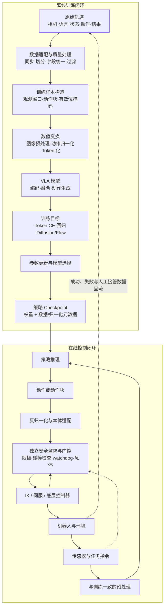
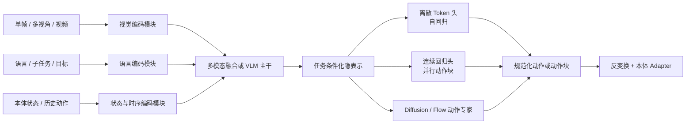

# VLA 系统数据流：从轨迹数据到闭环动作

> 本文回答一个模块级问题：视觉、语言、本体状态与动作数据，在训练和部署时分别怎样经过 VLA 系统。重点是模块职责、接口一致性和技术选型，不展开特定仓库的类名、配置字段或运行命令。

## 1. 先把 VLA 看成两个相连的数据闭环

VLA 不只是“图像和文本进入大模型、动作从另一端出来”。完整系统至少包含两个闭环：离线训练闭环把机器人轨迹变成策略参数，在线控制闭环把策略输出变成物理动作，并由新的观测继续驱动下一轮决策。

这张图有三个直接结论：

- 模型只占系统中间一段。时间同步、动作语义、安全约束和底层控制不因使用 VLA 而消失。
- 训练与推理共享同一份输入变换和动作反变换语义。两侧任何不一致，都会表现成“模型会预测但机器人不会动”。
- checkpoint 只有在携带正确的提示模板、归一化统计、动作空间和本体适配信息时，才构成可部署策略。

## 2. 系统的核心契约

可将通用 VLA 写为：

\[
\pi_\theta\!\left(A_t\mid I_{t-H_{obs}+1:t},\,q_{t-H_{obs}+1:t},\,a_{<t},\,\ell,\,g,\,e\right),
\qquad A_t=[a_t,\ldots,a_{t+H_{pred}-1}].
\]

这里 \(I\) 是单帧、多视角或短视频，\(q\) 是可选的本体状态，\(a_{<t}\) 是可选的历史动作，\(\ell\) 是语言指令，\(g\) 是可选目标，\(e\) 是本体或任务标识，\(A_t\) 是预测长度为 \(H_{pred}\) 的动作块。部署时还需声明每轮实际执行长度 \(H_{exec}\)。这个表达式不是要求所有模型都输入全部字段，而是提醒研究者：每个缺失字段都隐含一个建模假设。

| 接口 | 模块级语义 | 选型时最先确认的事项 |
|---|---|---|
| 视觉观测 | 当前场景、对象、几何与交互状态 | 单/多相机，单帧/历史，分辨率，外参是否稳定 |
| 语言与目标 | 任务意图、对象约束、子任务或目标状态 | 指令粒度，整段任务还是当前子任务，推理时是否变化 |
| 本体状态 | 关节、末端位姿、夹爪、底盘、力觉等 | 坐标系、单位、维度、缺失字段与历史窗口 |
| 动作 | 策略向机器人提出的控制目标 | 关节/末端，绝对/增量，位置/速度/力矩，执行频率 |
| 时间 | 观测与动作之间的因果顺序 | 采样频率、传感延迟、动作 horizon、实际执行长度 |
| 本体元信息 | 将共享表示翻译为平台接口 | 自由度、相机布局、动作掩码、专用 adapter |

动作空间比模型名称更先决定问题。两个系统即使都叫 VLA，只要一个输出末端增量、另一个输出关节位置，训练损失和闭环成功率便不能直接比较。

## 3. 离线数据流：一条轨迹如何变成训练样本

### 3.1 原始轨迹层

原始 episode 通常包含多路图像、状态、操作者动作、语言或任务标签，以及终止和成功信息。数据源可以是真机遥操作、仿真、自动回放或其他策略的 rollout。互联网图文和人类视频能补充语义与动作先验，但没有与目标机器人一致的控制量时，不能直接替代动作监督。

### 3.2 数据适配层

不同来源首先被转换为统一的“观测—动作—任务”接口。这里处理的是语义一致性，而不只是文件格式：相机时间戳要与动作对齐，夹爪开合方向要统一，绝对动作与增量动作不能混用，episode 终止与成功也要分开。

OpenVLA 的本地代码以 RLDS/OXE 数据混合为主要入口；openpi 通过数据配置与 transforms 将 LeRobot 或机器人专用数据转成策略接口；SmolVLA 位于 LeRobot 策略栈中，直接使用多视角图像、状态和可选语言字段。这些仓库的格式不同，但都在解决同一件事：把异构数据投影到模型可消费的统一样本。

### 3.3 时序采样层

数据加载器从 episode 中选择历史观测及未来动作。单步策略令 \(H_{pred}=1\)；动作分块策略令 \(H_{pred}>1\)。当窗口靠近 episode 末尾时，需要同时保留有效位信息，避免把补齐值当成真实监督。

时序设计会同时改变学习问题和部署方式：更长的观测历史有利于处理遮挡与运动状态，却增加视觉 token 和计算；更长的动作块提高推理吞吐，却降低对新观测的响应速度。因此 horizon 不是独立的“模型参数”，而是数据采样、动作头和在线调度共同遵守的接口。

### 3.4 数值变换层

图像被缩放、裁剪和归一化；语言被 tokenizer 编码；状态与动作按训练数据统计量缩放；离散路线还会把动作转成 token，连续路线则保留动作块并为 diffusion/flow 构造训练目标。

这些变换应与 checkpoint 绑定。尤其是动作反归一化：OpenVLA 的公开接口在预测时需要依据数据集键恢复 BridgeData V2 等数据的动作尺度；openpi 的 base 或 expert checkpoint 也依赖匹配的数据与策略配置；SmolVLA 的推理示例把 postprocess 明确放在 `select_action` 之后。三者共同说明，动作输出不是脱离数据语义的通用向量。

## 4. 模型内部数据流：模块职责而非单一架构

| 模块 | 主要职责 | 常见替代方案 | 选择带来的系统影响 |
|---|---|---|---|
| 视觉编码 | 从 RGB/视频提取语义、局部结构和几何线索 | 单一 VLM encoder；语义与自监督视觉双流；视频编码器 | 冻结更稳、更省算力；解冻更适配机器人视角但更易过拟合 |
| 语言编码 | 表达指令、目标和高层子任务 | LLM/VLM tokenizer；独立文本 encoder；自然语言中介 | 语言能力强不等于动作 grounding 强，需要闭环和指令扰动评测 |
| 状态编码 | 表达机器人自身姿态与接触上下文 | 不输入状态；MLP 投影；状态 token；条件调制 | 有助于精确控制，也可能诱发忽略视觉/语言的捷径 |
| 融合主干 | 聚合视觉、语言、状态与历史 | 单一 Transformer；cross-attention；组件化认知模块 | 决定模态交互与推理成本，不直接决定动作输出形式 |
| 动作生成 | 将隐表示映射为可执行分布 | 离散 token、连续回归、diffusion、flow、混合头 | 决定量化误差、多峰表达、推理步数和动作块能力 |
| 本体 Adapter | 恢复物理单位并映射到机器人接口 | 数据集级反归一化；每本体投影；动作 mask | 是跨本体共享模型能否真正落地的边界 |

模块可以联合训练，也可以在参数、梯度或刷新频率上解耦。“有动作专家”只说明存在专用动作模块，不自动等于双系统；工程上的双系统还会明确慢语义与快动作模块的独立更新节奏或部署路径。

## 5. 训练数据流：模型到底从哪些监督学习

不同动作头的前半段数据流相似，分歧主要发生在动作表示和目标函数。

| 路线 | 监督进入模型的方式 | 学到的直接对象 | 主要收益 | 主要代价 |
|---|---|---|---|---|
| 离散动作 token | 连续动作先量化或压缩，再做 next-token 预测 | 动作 token 的条件分布 | 可复用语言模型输出接口和交叉熵训练 | 量化误差与串行解码，长 chunk 可能产生很多 token |
| 连续回归 | 动作块经归一化后直接回归 | 条件均值或稳健回归目标 | 训练和推理简单、并行、低延迟 | 多种可行动作并存时可能平均化 |
| Diffusion / Flow | 对动作块加噪或构造插值路径，学习条件去噪/速度场 | 连续动作分布或生成流 | 适合多峰、精细且高维的动作块 | 训练目标和采样器更复杂，推理步数影响时延 |
| 混合目标 | 主干学习离散动作/语言，动作专家学习连续生成 | 语义规划与底层连续控制 | 可在语义泛化与高频动作间分工 | 数据、损失和模块耦合更难归因 |

训练阶段还可能混入图文、VQA、视频预测、价值或成功标签。这些辅助监督是否有效，不能只由辅助 loss 下降判断，而要比较其对动作闭环、OOD 泛化或数据效率的净增益。

## 6. 推理数据流：动作如何真正执行

部署时的数据路径比一次 `forward` 更长：

1. 采集最新相机和状态，并对齐时间戳；
2. 使用与训练相同的图像、语言、状态变换；
3. 模型生成单步动作或动作块；
4. 将规范化输出恢复到目标本体的坐标和单位；
5. 对动作做限幅、工作空间、碰撞和异常值检查；
6. 由动作队列决定执行整块、前若干步或与下一块重叠融合；
7. 底层控制器以更高频率跟踪目标；
8. 读取新观测并重规划。

动作块把“模型推理频率”和“机器人控制频率”解耦，但二者不是同一个指标。模型可以低频产生一个 chunk，由本地控制器高频展开；反过来，模型输出很快也不表示机器人在真实接触中稳定。报告系统性能时，应分别说明首动作延迟、策略更新频率、动作执行频率和端到端闭环频率。

## 7. 三个本地实现如何实例化同一数据流

| 维度 | OpenVLA | openpi（π0 / π0.5） | SmolVLA |
|---|---|---|---|
| 主要输入 | 图像 + 语言提示；原始 OpenVLA 不以 proprio 为核心输入 | 图像、语言、本体状态，经模型/数据配置适配 | 多视角图像、状态、可选语言 |
| 表示主干 | DINOv2 + SigLIP 视觉特征接入 Llama 2 系 VLM | PaliGemma 系视觉语言前缀 + 专用动作路径 | 轻量 VLM/策略模块，集成在 LeRobot |
| 动作路径 | 7 维动作离散成 token，自回归生成后反归一化 | π0 用 flow 生成动作块；π0-FAST 用动作 tokenizer；当前仓库的 π0.5 训练/推理支持 flow head | flow matching 生成连续动作 |
| 数据入口 | RLDS/OXE mixture，包含数据集标准化与动作空间配置 | LeRobot/机器人数据经 transforms、归一化与训练配置进入策略 | LeRobotDataset 直接提供策略 batch |
| 推理输出 | 数据集语义下的连续 7-DoF 动作 | `actions` 动作块，可通过策略服务与机器人/仿真客户端解耦 | `select_action` 后经 postprocess 的连续动作 |
| 最适合说明的概念 | VLM 输出空间如何被改造成动作 token | VLM 与连续动作专家、base 与 expert checkpoint、动作块服务化 | 轻量模型、统一策略接口和训练—推理 API |

表中的差异不用于给三个模型排名，而是展示：同一“观测 → 表征 → 动作 → 执行”的抽象，可以由完全不同的模块组合实现。

## 8. 用模块边界定位问题

| 现象 | 优先检查的边界 | 原因 |
|---|---|---|
| 离线动作误差正常，真机方向或尺度错误 | 反归一化、本体 Adapter、坐标系 | 模型可能正确预测了训练语义，却被错误翻译为物理动作 |
| 训练准确率很高，闭环容易停住 | 数据中的 idle 动作、单步策略、执行调度 | 同分布 teacher forcing 不暴露状态偏移和动作停滞 |
| 换相机或背景后性能断崖 | 视觉预处理、标定、数据切分 | 模型可能依赖背景和视角捷径，而非对象与语言 |
| 换一种说法后动作不变 | 语言融合、数据偏置 | 模型可能从视觉/状态猜任务，实际忽略语言 |
| 动作块开环段越来越偏 | chunk 长度、执行步数、重规划频率 | 预测 horizon 超过有效反馈周期 |
| 单步推理快，端到端仍慢 | 采集、网络、序列化、动作队列与控制器 | 模型吞吐不是系统闭环时延 |
| 多数据集训练反而下降 | 动作语义统一、采样配比、归一化 | 同名字段不代表同一物理量，数据量可能放大冲突 |

排查顺序应从接口与数据一致性开始，再进入模型容量或优化器。具身系统里，许多看似“模型没学会”的问题实际发生在模型之外。

## 9. 研究者应从这张数据流带走什么

- 先定义 observation/action contract，再选择 Base 和动作头。
- 把预处理、归一化、tokenizer、动作 Adapter 视为模型的一部分，而非外围杂项。
- 分开描述训练数据流、模型前向和在线控制闭环。
- 用动作形式、chunk 与调度方式解释实时性，不只报告裸模型 Hz。
- 架构改动应映射到明确模块，并在相同接口和预算下做对照。
- 闭环失败要沿“观测 → 变换 → 模型 → 动作反变换 → 控制”逐层归因。

## 资料锚点

- [OpenVLA 本地 README](../../依赖索引.md)：RLDS/OXE、视觉—语言处理、动作 token、反归一化与评测接口。
- [openpi 本地 README](../../依赖索引.md)：base/expert checkpoints、数据 transforms、动作块、训练与策略服务边界。
- [SmolVLA 本地 README](../../依赖索引.md)：多视角/状态/语言输入、flow matching、LeRobotDataset 与 postprocess。
- [VLA 训练全流程资料](../../依赖索引.md)：预训练、协同训练、后训练和真机经验回流。
- [数据处理资料](../../依赖索引.md)：格式统一、动作归一化、样本构造与多数据集混合。
- [双系统架构资料](../../依赖索引.md)：频率、语义层级和梯度三种解耦的区别。
