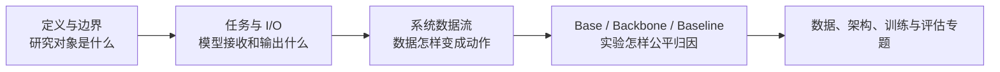

# VLA 基础：共同语言与系统接口

本目录是 VLA 手册的第一组专题，面向已经熟悉深度学习与多模态模型、但刚进入机器人策略研究的读者。它不重复介绍 Transformer、VLM 或扩散模型基础，而是建立四组共同坐标：领域边界、任务接口、系统数据流和比较语言。

## 阅读顺序



| 顺序 | 文档 | 读完应能回答的问题 |
|---:|---|---|
| 1 | [定义、边界与能力范围](定义、边界与能力范围.md) | VLA、VLM、Agent、WM、WAM 与控制器各自解决什么问题？ |
| 2 | [任务定义与输入输出协议](任务定义与输入输出协议.md) | 视觉、语言、本体状态、目标与动作应怎样定义？ |
| 3 | [VLA 系统数据流](VLA系统数据流.md) | 轨迹怎样进入模型，动作又怎样进入机器人闭环？ |
| 4 | [Base、Backbone、Baseline 与常见误解](Base、Backbone、Baseline与常见误解.md) | 模型、预训练起点、训练配方和完整对照实验如何区分？ |

如果只想快速建立系统图，先读第 2、3 篇；如果准备选论文或设计实验，四篇都应阅读。

## 本目录的粒度边界

这里会说明：

- 每个模块解决的问题、输入输出语义和可替代方案；
- 数据、模型、动作适配与控制器之间的接口；
- 训练流与推理闭环为何不同；
- 技术选择的原因、收益、代价和常见误判；
- baseline 比较时需要固定或披露的变量。

这里不会提供：

- 环境安装和完整训练命令；
- 源码类、函数和逐项配置解释；
- 特定 GPU 的调参和依赖排错；
- 单一 baseline 的手把手复现记录。

具体模型的参数、数据规模、动作 chunk、结果和开放状态由 Baseline 专题承接；安装、配置修改与平台踩坑则属于独立复现记录。

## 从基础进入后续专题

完成本目录后，可按研究问题进入以下路线：

| 你的问题 | 下一步应关注的专题 |
|---|---|
| 数据从哪里来，怎样统一多机器人轨迹 | [数据来源、清洗、时序样本、动作坐标与多数据集混合](../数据与特征/index.md) |
| VLM 怎样真正输出可执行动作 | [视觉/语言/状态编码、多模态融合与动作生成](../架构与动作生成/index.md) |
| 离散、回归、Diffusion、Flow 怎样选 | [离散动作 Token](../架构与动作生成/离散动作Token.md)、[连续回归与 Action Chunk](<../架构与动作生成/连续回归与Action Chunk.md>)、[Diffusion 与 Flow Matching](<../架构与动作生成/Diffusion与Flow Matching.md>) |
| 怎样冻结、微调和协同训练 | 训练 Pipeline、参数高效训练与知识隔离 |
| 结果怎样证明而不是只展示 demo | 离线、仿真、真机评估与公平消融 |
| 怎样接入真实机器人 | 本体 Adapter、推理服务、动作调度、安全与恢复 |
| 下一篇应精读什么模型 | Baseline 对照矩阵与对应模型技术卡 |

## 建议保留的一张研究卡

开始阅读或实验前，用一页记录以下信息：

```text
Task：任务、场景与成功判据
Observation：相机、历史、语言、proprio、目标
Action：坐标系、语义、维度、频率、horizon
Data：来源、版本、切分、过滤、归一化
Model：Base、Backbone、融合、Action head
Training：可训练模块、目标、数据混合与预算
Inference：采样、动作块执行、重规划与控制栈
Evaluation：ID/OOD、仿真/真机、episode、seed、系统指标
```

这张卡的价值不是增加流程，而是让“模型更强”变成可解释的问题：究竟是知识底座、数据覆盖、动作表示、训练配方还是闭环系统发生了变化。

## 本地实例锚点

- [OpenVLA](../../依赖索引.md)：离散动作 token、RLDS/OXE 数据与 VLM 迁移。
- [openpi](../../依赖索引.md)：π0/π0.5 的 flow 动作块、base/expert checkpoint 与策略服务。
- [SmolVLA](../../依赖索引.md)：轻量 VLA、LeRobot 数据/策略接口与连续动作。

后续各专题会用这些模型说明通用概念如何在真实工程中落地，但不会要求读者先完成代码复现才能理解正文。
