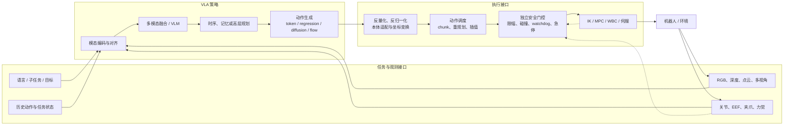
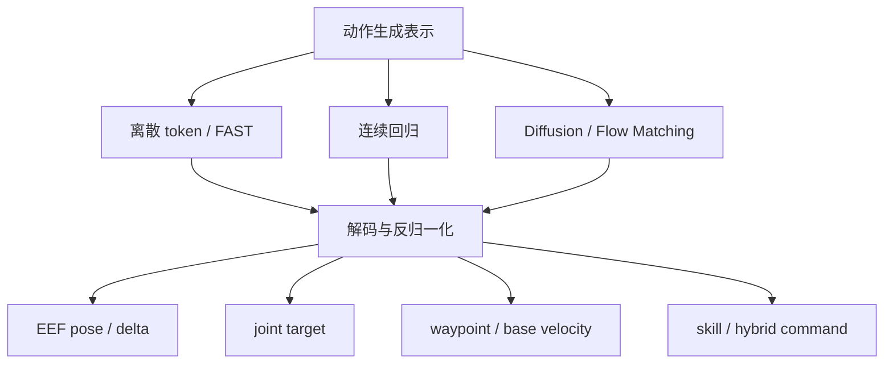
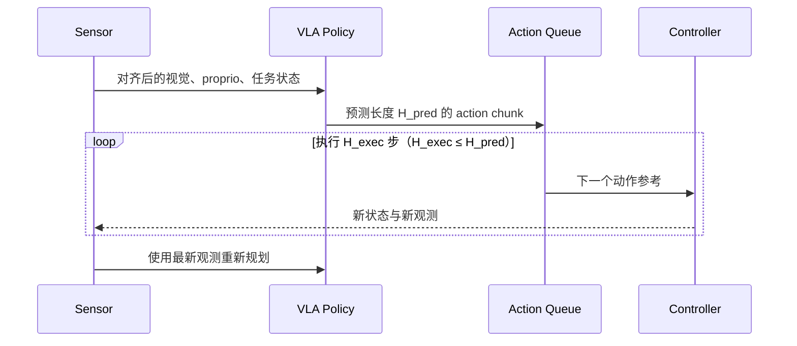

# 任务定义与输入输出协议

> VLA 的模型结构只有放进明确的任务协议中才有意义。本文给出模块级的语义接口：模型看见什么、接收什么任务条件、输出什么动作、各模块以怎样的时间尺度协作。具体数据字段、张量形状和机器人配置由数据专题与 Baseline 文档展开。

## 1. 先固定策略在闭环中的问题

一个可比较的 VLA 任务可写为：

\[
A_{t:t+H_{pred}-1} \sim \pi_\theta(\,O_{t-H_{obs}+1:t},\;S_{t-H_{obs}+1:t},\;A_{<t},\;L_t,\;G_t,\;E\,)
\]

模型根据最近 \(H_{obs}\) 个观测和状态、可选历史动作、语言指令、目标及本体条件，产生从时刻 \(t\) 开始、预测长度为 \(H_{pred}\) 的动作接口。系统每轮实际执行其中 \(H_{exec}\) 步后可以重规划。任务定义的关键不是公式本身，而是其中每个符号的**物理语义和生效时间**。

### Task Card：研究问题的最小接口描述

| 字段 | 需要说明什么 | 它影响的选择 |
|---|---|---|
| 场景与本体 | 单臂、双臂、移动操作、人形；传感器和控制器 | 观测、动作空间、可达性和安全约束 |
| 任务条件 | 自然语言、目标图像、对象/位姿、技能或对话 | 语言编码、grounding 和分层接口 |
| 观测 | 相机数量、RGB/深度/点云、历史、本体与力觉 | 感知 Base、时序模块和部分可观测性 |
| 策略输出 | 末端/关节动作、动作块、路点、技能或混合接口 | 动作头、训练目标和下游执行器 |
| 时间协议 | 观测率、策略刷新率、控制率、horizon 与延迟 | chunk、缓存、异步服务和稳定性 |
| 训练范围 | 数据集、任务、本体、成功/失败和辅助数据 | 泛化边界和数据配比 |
| 评测切分 | 新对象、场景、语言、任务、本体中的哪一项 | “泛化”主张的准确含义 |
| 风险边界 | 碰撞、关节限位、接触力、通信中断和急停 | 安全层、降级策略和真机协议 |

同一篇论文中的成功率若来自不同本体、动作空间或控制协议，不应只按模型名称合并比较。

## 2. 端到端数据流与接口责任

图中的边是需要显式约定的语义接口。模型侧常在归一化空间生成动作，控制侧需要真实单位与参考坐标；模型可能一次预测未来动作块，执行器却只消费前若干步并重新观测。安全监督观察状态、候选动作与控制器状态，并能在执行链上限幅、拒绝或急停。脱离这些接口，只报告“输出 7 维动作”或“50 Hz”无法说明系统真实行为。

## 3. 输入接口：哪些信息进入策略

### 3.1 视觉与空间观测

| 选择 | 提供的信息 | 适合的问题 | 代价与风险 |
|---|---|---|---|
| 单帧 RGB | 当前外观、物体和粗空间关系 | 短程台面操作、低成本部署 | 遮挡、速度和历史状态不可见 |
| 多视角 RGB | 减少单视角遮挡，覆盖工作空间 | 双臂、精细操作、大工作台 | 标定、同步、token 和算力增加 |
| 图像历史 / 视频 | 运动方向、接触过程和状态变化 | 动态任务、失败恢复、部分可观测 | 长上下文不自动等于可靠记忆 |
| 深度 / 点云 / 3D 特征 | 尺度、几何、可达性和相机变化鲁棒性 | 空间泛化、抓取、移动操作 | 传感噪声、跨设备域差和融合复杂度 |

选型由任务缺失的信息决定：如果主要失败来自语义混淆，增加深度未必有效；如果主要失败来自遮挡和精确几何，只扩大 VLM 也未必解决。OpenVLA 以 DINOv2 与 SigLIP 双视觉特征兼顾空间与语义，是“同一视觉接口内组合互补表征”的代表；3D VLA 则直接改变了空间观测接口。

### 3.2 语言、目标与任务状态

语言接口可以是整段任务、当前子任务、对话约束或自动生成的重标注。它需要与动作的时间跨度匹配：一句“整理桌面”通常不能唯一决定下一个毫米级动作，而一句“抓住红杯把手”提供了更接近当前技能的条件。

| 条件形式 | 主要用途 | 需要澄清的边界 |
|---|---|---|
| 自然语言任务 | 开放词汇对象、动作和组合任务 | 描述整段 episode 还是当前片段；是否在执行中更新 |
| 高层子任务 / skill | 分层策略中连接慢推理与快动作 | 谁产生子任务、何时切换、失败后是否回退 |
| 目标图像 / 目标状态 | 提供语言难以表达的视觉终态 | 目标视角和当前相机是否可比 |
| 对象、位姿或 waypoint | 向规划/控制器传递结构化目标 | 它是策略最终输出还是另一个模块的输入 |

语言重标注扩大了表达覆盖，但不会自动创造新的动作行为；多种描述对应同一轨迹时，提升的首先是指令鲁棒性，而非动作能力上限。

### 3.3 Proprio、本体与历史

本体状态告诉策略“机器人现在处于什么姿态”，常包含关节位置/速度、末端位姿、夹爪、底盘、力/力矩或接触状态。若状态与动作语义不一致，例如用末端增量作为动作却只提供不带标定的关节状态，运动学映射负担就会被隐含地交给模型。

跨本体系统还需要告诉模型哪些自由度有效，以及当前机器人支持什么能力。常见方法包括统一动作语义、定长 padding 与 mask、本体专用编码/解码器或 embodiment token；它们解决的是接口兼容，不代表模型已经学会新本体的动力学。

历史接口可包含过去观测、proprio、动作、语言更新和已完成子任务。只增加上下文长度不会保证状态保持；需要用遮挡、重访、步骤完成与失败恢复任务验证时序模块是否真正利用历史。

## 4. 输出接口：Action 到底是什么

| 动作接口 | 策略输出的语义 | 下游模块 | 适合场景 | 主要风险 |
|---|---|---|---|---|
| 末端位姿 / 位姿增量 | EEF 在指定参考系中的位置与旋转目标 | 坐标变换、IK/OSC、轨迹与安全 | 单臂/双臂操作，跨关节配置共享较容易 | frame、旋转表示和增量定义混乱 |
| 关节位置 / 速度 / 力矩 | 本体原生关节命令或目标 | 限位、插值、伺服或动力学控制 | 固定本体、高频精细控制 | 难跨本体；力矩接口安全要求高 |
| 底盘速度 / waypoint | 局部移动目标或轨迹点 | 定位、局部规划、跟踪与避障 | 导航和移动操作 | 地图、坐标与执行延迟耦合 |
| Action chunk | 未来一段末端或关节动作 | 队列、滚动时域执行、重规划 | 连续轨迹、降低大模型调用频率 | open-loop 过长、旧 chunk 与新观测冲突 |
| Skill / 离散动作 | 可复用技能及参数 | 技能库或低层策略 | 长程任务和可解释分层 | 技能覆盖有限，层间错误累积 |
| 阻抗/力控目标 | 目标力、刚度、阻尼或接触参数 | 实时力/阻抗控制器 | 插入、擦拭、人机协作 | 稳定性与硬件风险高，不宜只靠模型兜底 |

### 动作合同（Action Contract）

动作接口至少包含以下语义；这些不是实现字段，而是策略与控制器之间的合同：

- **类型**：绝对目标、相对增量、速度、力矩、路点还是技能；
- **参考系**：world、base、camera、EEF 或对象坐标系；
- **单位与旋转**：米/弧度等单位，以及欧拉角、轴角、四元数或其他旋转表示；
- **自由度与有效性**：各维含义、夹爪语义、padding 与 mask；
- **时间语义**：采样率、预测 horizon、实际执行长度和时间戳；
- **尺度变换**：裁剪、归一化/离散化统计及其所属数据集或本体；
- **执行约束**：位置、速度、加速度、jerk、碰撞与接触限制；
- **异常行为**：模型超时、无效动作、通信断开时是保持、停止还是切换备用控制。

缺少其中任一项，都可能让离线预测正确、真机执行错误。例如同样的 \(\Delta x\)，在 base frame 与 camera frame 中可能指向完全不同方向。

## 5. 动作表示与物理接口是两层概念

离散 token、连续回归、Diffusion 和 Flow Matching 描述的是**模型怎样表示和生成动作分布**；末端增量、关节目标和 waypoint 描述的是**动作的物理语义**。两组选择可以组合，不能互相替代。

OpenVLA 用离散 token 生成单步 7 维末端与夹爪动作；OpenVLA-OFT 在相近 Base 上改为并行连续动作块；π0 与 SmolVLA 使用流匹配动作专家。它们之间的差异同时来自生成表示、动作 horizon、数据配方和执行协议，不能只归因于“离散还是连续”。

## 6. 时间协议：三个频率和两个 horizon

VLA 系统至少存在三种频率：

1. **传感/观测频率**：相机与 proprio 产生数据的速率；
2. **策略刷新频率**：VLA 根据新观测生成动作的速率；
3. **控制/伺服频率**：低层执行并反馈的速率。

还要区分两个 horizon：模型一次**预测多少步**，以及控制器实际**执行多少步后重规划**。动作分块允许策略低频运行、控制器高频消费，但执行完整长 chunk 会降低对新观测的反应速度；只执行前段并滚动重规划，则增加计算与 chunk 交接问题。

“模型能以 50 Hz 控制”可能分别表示输出 chunk 内的动作采样率、策略服务吞吐或真实闭环刷新率。报告性能时需要分开说明；低层运控通常还会以更高频率运行。相关频率层次见[运控算法基础](../../依赖索引.md)。

## 7. 训练样本与运行时接口要一致

训练与部署常见的不一致包括：相机顺序改变、归一化统计用错本体、指令模板不同、历史长度变化、动作采样率改变，以及训练时按未来窗口监督、部署时却以不同节奏执行。这些问题会绕过模型指标，直接破坏闭环。

样本构造的通用原则是保留 episode 与时间语义：视觉、proprio、动作和语言更新共享可追溯的时间轴；episode 尾部、传感器缺失和跨本体无效自由度通过 valid mask 表达，而不是把填充值当成真实监督。具体格式可使用 RLDS、LeRobot 或自定义 Schema，但格式名称本身不保证语义一致。

## 8. 典型任务的接口差异

| 任务族 | 关键输入 | 常见策略输出 | 不能省略的下游能力 |
|---|---|---|---|
| 固定单臂台面操作 | 手眼/第三视角 RGB、EEF/关节、语言 | EEF delta + gripper 或关节动作块 | IK/轨迹、夹爪、碰撞与接触处理 |
| 双臂操作 | 多视角、双臂状态、对象状态 | 双臂同步动作块或共享对象目标 | 自碰撞、相对位姿和同步执行 |
| 移动操作 / 导航 | 第一视角、地图/belief、底盘与机械臂状态 | waypoint、底盘速度、手臂动作或分层技能 | 定位、局部规划、避障与多速率协调 |
| 人形全身控制 | 多相机、IMU、关节、接触与平衡状态 | 高层技能、全身参考或分层动作 | WBC/MPC、平衡、接触切换与任务优先级 |
| 接触丰富与灵巧操作 | 近景视觉、力/触觉、精细 proprio | 高频关节/末端块、力或阻抗目标 | 柔顺控制、接触检测与更严格安全限制 |

因此，VLA 不是一个固定的 “image + text → 7D action” API。该接口适合部分单臂操作 Baseline，但不应被当成移动、人形和灵巧系统的通用定义。

## 9. 代表模型的接口锚点

| 模型族 | 观测与条件 | 策略/动作接口 | 它说明的设计选择 |
|---|---|---|---|
| RT-1 / RT-2 | 图像与自然语言任务 | 量化动作 token | 机器人动作可被纳入 token 预测，但量化和串行生成成为控制约束 |
| OpenVLA | 单图像、语言；跨 OXE 数据训练 | 单步 7 维离散动作 token | 开源 VLM Base 如何对接统一末端动作接口 |
| Octo | 观测、任务条件与可配置历史 | 连续扩散动作块 | 通用策略可通过 task/action heads 适配不同数据接口 |
| π0 / π0.5 | 多模态 VLM 条件、本体状态和多源任务数据 | 流匹配连续动作块；π0.5 增加分层/混合条件 | 语义推理与高频连续控制可以由不同模块承担 |
| SmolVLA | 图像、语言与机器人状态 | 小型流匹配动作专家 + 异步 chunk 执行 | 模型大小、动作队列和策略刷新可共同决定部署体验 |
| Predictive VLA / WAM | 历史观测、历史动作、语言，以及训练时的未来目标或候选未来动作 | 直接动作，或联合的 future world + action | 需要区分预测辅助 VLA 与联合 world/action 的 WAM，并说明未来分支在训练、部署和动作选择中何时生效 |

精确输入尺寸、action horizon、归一化统计和 checkpoint 差异应查对应 Baseline 页面与官方代码，不能由这一模块级对照表代替。

## 10. 公平比较时固定哪些接口

评估一个架构或动作头改动时，至少需要确认以下差异是否被控制或单独报告：

| 比较轴 | 为什么会改变结果 |
|---|---|
| 视觉输入、相机数量与历史 | 改变可观测信息和 token/计算预算 |
| Base checkpoint 与解冻范围 | 改变语义、空间能力和可训练参数量 |
| 训练数据、混合权重与任务切分 | 可能比结构改动带来更大分布优势 |
| 动作物理语义与归一化 | 决定目标难度、量化误差和控制器负担 |
| 预测 horizon、执行长度与控制频率 | 改变反馈及时性、轨迹平滑和推理成本 |
| 下游 IK/控制器与安全过滤 | 直接影响可执行性、碰撞和接触稳定 |
| 推理硬件、批量和服务拓扑 | 决定真实首动作延迟与稳定刷新率 |
| episode 数、成功判据与统计区间 | 决定结果不确定性和横向可比性 |

如果这些接口同时变化，实验仍可证明“整个系统更好”，但不能把全部增益归因于单个动作头或架构模块。

## 11. 常见接口误判

| 表现 | 更可能的接口原因 | 与模型能力的区分方法 |
|---|---|---|
| 手臂稳定向错误方向运动 | camera/base/EEF frame 混用 | 在控制器前检查动作方向和坐标变换 |
| 离线动作误差低，闭环很快漂移 | action 与观测错位，或执行 horizon 太长 | 核对时间戳并缩短重规划间隔 |
| 新机器人上动作幅度异常 | 归一化统计、单位或自由度语义未适配 | 对动作接口做反归一化和范围审计 |
| 轨迹抖动或卡顿 | 策略与控制频率不匹配、队列切换不连续 | 分开测策略刷新、chunk 采样和伺服频率 |
| 抓住后仍夹不稳 | 夹爪定义、接触/力控或终止语义不一致 | 将视觉决策与执行层接触状态分别记录 |
| 长程指令中重复步骤 | 语言条件太粗或缺少任务状态/记忆 | 给出显式子任务状态并测试中断恢复 |

这些诊断的价值在于避免把所有失败都归因于模型规模。VLA 研究中的许多“结构问题”，最终落在观测、动作与时间协议是否一致。

## 延伸阅读

- [定义、边界与能力范围](定义、边界与能力范围.md)
- [VLA 领域的整体理解](../领域的理解.md)
- [具身数据处理](../../依赖索引.md)
- [实验机器人本体](../../依赖索引.md)
- [运控算法基础](../../依赖索引.md)
- [OpenVLA 细读](../../依赖索引.md)
- [π0 细读](../../依赖索引.md)
- [SmolVLA 细读](../../依赖索引.md)
- [世界模型任务定义与输入输出协议](../../world-model/基础/任务定义与输入输出协议.md)
