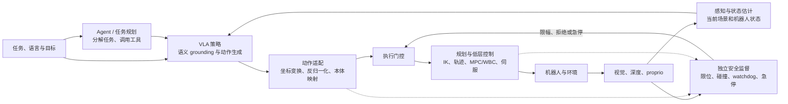

# 定义、边界与能力范围

> 本文回答三个问题：什么样的系统可以称为 VLA，VLA 在机器人系统中负责什么，以及一项 VLA 能力主张需要什么证据。讨论粒度停留在模块与语义接口；具体参数、配置和源码实现由各 Baseline 文档承接。

## 1. 操作性定义：VLA 是语言条件下的具身策略

在机器人语境中，Vision-Language-Action（VLA）可以写成一个条件策略：

\[
\pi_\theta(A_t\mid O_{\le t},\,S_{\le t},\,A_{<t},\,L,\,G,\,E)
\]

- \(O_{\le t}\)：当前及历史视觉观测，可包含单帧、多视角、视频、深度或点云；
- \(L\)：自然语言指令、对话上下文或高层子任务；
- \(S_{\le t}\)：关节、本体、末端、力觉等机器人状态；
- \(A_{<t}\)：可选的历史动作或已执行动作块，用于恢复短期控制上下文；
- \(G\)：可选的目标图像、目标位姿、技能标识或任务状态；
- \(E\)：本体、传感器和动作接口的条件；
- \(A_t\)：一个动作、动作块、轨迹、路点或可由下游控制器执行的目标。

这一定义强调两点。第一，VLA 的判据不是模型名称或是否使用 Transformer，而是它能否把视觉与语言条件落实为**具身动作接口**。第二，“Action”不只指电机命令：末端增量、关节目标和底盘路点都可以是策略输出；skill 也可作为广义 VLA 输出，但只有声明下游 skill policy/控制接口并以物理闭环评测时，才构成完整具身动作接口，否则更接近 Agent/Planner 的技能选择。任何较高层输出都需要说明还有哪些模块把它变为物理执行。

## 2. VLA 在完整机器人系统中的位置

端到端训练可以把图中的若干框合入同一个网络，但工程职责不会因此消失。例如，模型直接预测末端位姿增量，并不等于它同时解决了坐标变换、逆运动学、关节限位和接触安全。判断系统能力时，应区分“模型参数中联合学习了什么”和“部署栈中实际由谁承担责任”。

## 3. 与相邻概念的边界

| 对象 | 核心映射或问题 | 典型输出 | 与 VLA 的边界 |
|---|---|---|---|
| VLM / MLLM | 图像与文本如何对齐、理解和推理 | 文本、视觉 token、区域或分数 | 可作为 VLA 的 Base/Backbone；只回答问题而不产生具身动作时，不是 VLA |
| 传统模仿策略 | 观测下专家会执行什么动作 | 单步动作或动作序列 | 与 VLA 共享策略学习本质；VLA 额外强调语言接口、预训练多模态知识和跨任务复用 |
| 具身 Agent / 任务规划器 | 任务应如何分解、调用什么技能 | 子任务、工具调用、技能参数 | 常位于 VLA 上层；若输出最终可执行动作，也可能与 VLA 功能重叠 |
| 运动规划与控制 | 如何在约束和动力学下稳定执行目标 | 轨迹、关节命令、力矩 | 位于 VLA 下游；高频反馈、接触稳定和硬安全通常仍由此层负责 |
| 世界模型（WM） | 给定状态与干预，世界怎样变化 | 未来状态、观测、奖励或风险 | 不要求直接给出动作；可为 VLA 提供表征、数据、规划或验证 |
| 世界—行动模型（WAM） | 同一系统如何以共享或显式耦合表示联合建模未来世界与动作 | future world + action，部署时也可能只保留 action head | 纯 action-conditioned WM 不生成动作时只是 WAM 可用组件；推理时是否显式 rollout 是另一维度 |
| SLAM / belief estimator | 我在哪里，地图和当前隐状态是什么 | 位姿、地图、belief | 为 VLA 提供状态与记忆；状态估计本身不是动作策略 |

### 三个容易混用的边界

1. **有语言不必然是 VLA。** 语言只用于离线标注，运行时策略不接收语言条件时，更准确的名称可能是语言辅助模仿学习。
2. **有视频生成骨干不必然是 WAM。** 只用无动作视频预训练、只加弱耦合 future auxiliary，或仅训练一个不生成动作的 action-conditioned WM，都不足以单独构成 WAM。WAM 需要同一系统以共享或显式耦合表示联合建模 world 与 action；部署可以只用 action head，也可以采用 predict-then-act 或候选 rollout/联合搜索，推理期预演不是必要条件。
3. **输出动作不等于直接控制电机。** 路点、末端目标和动作块都可构成 VLA 接口，但它们对应不同的控制责任和评测条件。

更完整的 WM/WAM 口径见[世界模型定义、边界与能力分级](../../world-model/基础/定义、边界与能力分级.md)与[WM、WAM、VLA 与 SLAM](../../world-model/系统与研究/WM、WAM、VLA与SLAM.md)。

## 4. 不用单一等级概括 VLA 能力

VLA 的能力不是一条从“小模型”到“大模型”的单轴等级。更实用的做法是把主张拆成六个正交维度：

| 能力维度 | 要回答的问题 | 合适的证据 | 不能由什么直接推出 |
|---|---|---|---|
| 语义 grounding | 是否理解对象、属性、关系与指令变化 | 指令改写、干扰物、指代和反事实目标 | 通用 VQA 分数 |
| 动作能力 | 是否生成可执行且稳定的动作 | 闭环成功率、控制质量、失败类型 | 离线 action loss 或 token accuracy |
| 任务泛化 | 是否迁移到新物体、场景、语言或组合任务 | 按泛化轴隔离的测试集 | 随机切分上的平均分 |
| 本体泛化 | 是否适配不同运动学和传感配置 | 新本体适配成本、统一接口对照 | 在多个相似单臂数据集上训练 |
| 时间能力 | 是否利用历史、维持任务状态并恢复失败 | 遮挡、长程链、重试与中断恢复 | 输入窗口更长或参数更多 |
| 系统可用性 | 是否在目标硬件与控制栈中可靠运行 | 首动作延迟、稳定频率、安全事件和降级行为 | 单次推理吞吐或演示视频 |

因此，“通用 VLA”的完整描述包含适用范围：支持哪些本体、观测、动作和任务，哪些变化在训练中见过，以及所谓零样本是对任务、场景还是本体而言。缺少这些限定时，“通用”尚不是可检验的能力声明。

## 5. 常见系统形态

| 形态 | 模块关系 | 选择原因 | 主要代价 | 代表模型锚点 |
|---|---|---|---|---|
| 单体自回归 VLA | 视觉与文本进入 VLM，动作被表示为 token | 最大程度复用 VLM 架构、词表和 next-token 训练 | 量化误差与串行解码限制高频连续控制 | RT-2、OpenVLA |
| VLM + 连续动作头 | VLM 提供条件表征，回归/扩散/流模块生成动作块 | 保留多模态知识，同时面向连续、多峰动作 | 动作专家与 VLM 的协同训练更复杂 | OpenVLA-OFT、π0、SmolVLA、CogACT |
| 分层/混合 VLA | 高层子任务、技能或离散语义向低层动作模块提供条件 | 把长程任务结构与连续动作生成分开 | 层间标签、切换时机和错误归因更难 | π0.5 |
| 双系统/多速率 VLA | 语义模块与动作模块具有不同刷新率或部署路径 | 让慢语义更新与快动作流并行 | 缓存、同步、陈旧条件和故障传播更复杂 | GR00T、Helix |
| 预测辅助 VLA | future/world 目标用于预训练或辅助监督，部署时直接出动作 | 利用视频或动态先验而不承担在线 rollout 成本 | 预测改进不一定转化为动作收益 | RynnVLA 等 |
| WAM | 同一系统联合建模 world 与 action，并以共享/耦合表示建立 grounding | 可直接出动作或接入规划 | 因果有效性、联合目标和部署成本需要额外验证 | WorldVLA、UWM 等；action-conditioned WM 单列为组件 |

这里的分类是工程形态而非互斥标签。分层描述语义抽象，双系统描述刷新率或部署路径，梯度隔离描述训练耦合；三者可以组合，但不能因存在两个参数模块就互相推出。进一步比较见[双系统架构原理](../../依赖索引.md)和[预测式 VLA](../../依赖索引.md)。

## 6. 技术选型从约束开始

| 主要约束 | 更值得优先考虑的路线 | 原因 | 同时需要检查 |
|---|---|---|---|
| 强语义泛化、技能选择 | VLM 主干 + 离散/分层接口 | 便于继承互联网视觉语言知识 | 动作精度和解码延迟 |
| 灵巧、连续、多峰动作 | 连续回归、Diffusion 或 Flow Matching 动作头 | 能直接建模连续动作块；生成式头更适合多峰分布 | 去噪预算、控制频率和接触反馈 |
| 低算力或本地部署 | 小型 VLM、参数高效微调、异步动作队列 | 降低显存和阻塞时间 | 能力是否来自同分布数据、端到端延迟而非单模块速度 |
| 长程任务与部分可观测 | 历史/记忆、分层 Agent、可选 WM/WAM | 单帧反应策略难以维护任务状态和反事实 | 记忆事实保持、层间失败恢复 |
| 跨本体训练 | 统一语义动作空间 + 本体适配器 + mask | 把共享任务知识与本体运动学差异分开 | 坐标系、自由度、夹爪和频率是否真的对齐 |
| 强安全和动力学约束 | VLA 输出目标/短动作块，下接规划控制与独立安全层 | 将学习策略与硬约束责任分离 | 接口延迟、控制器可达性和异常降级 |

选型的关键不是判断哪种动作头“普遍更先进”，而是确认主要瓶颈位于语义、空间、动作分布、时序、实时性还是本体接口。相同模型在不同动作语义、控制频率和下游控制器下可能呈现完全不同的闭环表现。

## 7. 代表模型如何把概念落地

以下模型适合作为概念锚点；把它们用于实验时，还需连同任务、数据、训练、推理和评测协议一起定义为 baseline：

| 代表模型/家族 | 用它理解什么 | 已公开的工程抓手 | 口径提醒 |
|---|---|---|---|
| RT-1 / RT-2 | 动作离散化、动作进入 token 空间、网络知识与机器人控制协同 | 论文与部分数据生态 | RT-2 模型和完整训练栈未完全开放 |
| OpenVLA | 双视觉编码、VLM 主干、7 维离散动作 token、跨数据集训练 | 代码、权重、训练与评测入口；本地有源码 | 论文核心真机比较属于作者协议，跨协议数字不可直接排名 |
| SmolVLA | 小型 VLM、流匹配动作专家、异步推理 | LeRobot 代码、权重与社区数据公开 | 轻量不等于跨分布能力天然更强 |
| π0 / π0.5 | VLM 与连续动作专家、动作分块、分层与多源协同训练 | openpi 提供模型与适配入口 | 部分数据和训练规模无法完整复制；精确版本需对应具体 checkpoint |
| OpenVLA-OFT | 同一 VLA Base 上从离散单步转向并行连续动作块 | 公开代码路线与评测协议 | 作者报告的速度/成功率需标为自评并绑定硬件与协议 |
| Predictive VLA / WAM | 未来预测是训练先验、联合 world/action 目标还是推理主体 | 多种论文实现 | 训练期 future auxiliary 不自动构成 WAM；视频质量也不能代替动作因果与闭环证据 |

进一步数字、论文结果和开放状态应在 Baseline 对照矩阵中逐项核对。当前本地一手入口包括 [OpenVLA 论文](../../依赖索引.md)、[π0.5 论文](../../依赖索引.md)和[SmolVLA 论文](../../依赖索引.md)。

## 8. 常见误解及其工程后果

| 常见表述 | 更准确的理解 | 若不区分会造成什么 |
|---|---|---|
| “VLA 就是 VLM 加一个动作头” | 结构上可以如此概括，但动作数据、坐标、时序、控制与闭环评测决定它是否可用 | 把动作接口问题误判为模型规模问题 |
| “端到端意味着不需要控制栈” | 端到端描述训练映射，不保证动力学约束和硬安全 | 真机部署缺少 IK、限幅、碰撞与急停责任人 |
| “多机器人数据等于跨本体泛化” | 多本体训练只是条件；还需统一语义接口并在未见本体上验证适配 | 把数据池化结果误报为零样本迁移 |
| “语言推理越强，操作就越准” | 语义 grounding 与毫米级控制是不同瓶颈 | 用 VQA 或推理能力替代闭环控制证据 |
| “生成未来视频就是 WAM” | WAM 需要同一系统联合建模 world/action；无动作未来或仅 action-conditioned WM 都不能单独取得 WAM 资格 | 用视觉保真度替代因果与控制收益 |
| “成功率更高就是架构更好” | 数据、Base、动作空间、控制器和协议都可能是增益来源 | 不公平比较使架构结论无法复用 |

## 9. 能力声明的最小描述

一项 VLA 工作的完整能力描述应让读者确定以下信息：

- 策略接收哪些模态，是否利用历史与任务状态；
- 输出动作的语义、坐标系、时间跨度，以及下游控制器承担什么；
- 数据覆盖哪些任务、本体和失败状态；
- 训练时哪些模块参与，预测或语言目标是否在部署时保留；
- 泛化主张对应哪个变化轴，是否与训练数据隔离；
- 闭环评测的本体、控制频率、任务协议和安全边界；
- 结果属于作者自评、统一官方评测还是独立复现。

这不是复现清单，而是阅读论文、选择 Baseline 和迁移已有多模态经验时的共同坐标系。

## 延伸阅读

- [VLA 领域的整体理解](../领域的理解.md)
- [任务定义与输入输出协议](任务定义与输入输出协议.md)
- [VLA 术语速查](../../依赖索引.md)
- [全模型规格对比](../../依赖索引.md)
- [实验机器人本体](../../依赖索引.md)
- [运控算法基础](../../依赖索引.md)
- [World-Action Model](<../../world-model/动作与决策/World-Action Model.md>)
