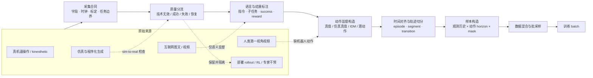
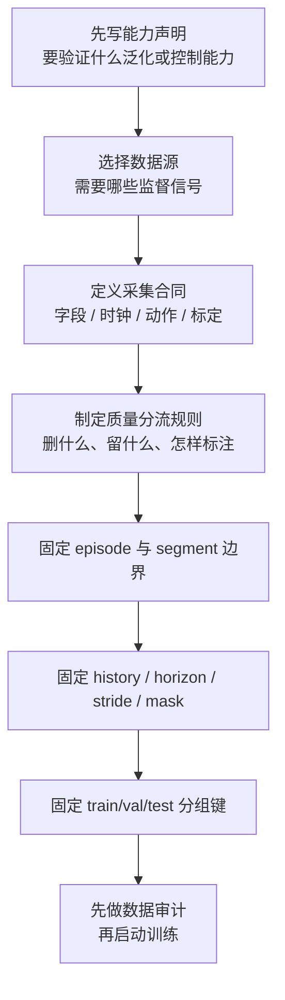

# VLA 数据与特征：从数据源到训练样本

本目录回答一个工程问题：**原始交互、视频或仿真记录怎样被转换成具有明确监督语义的 VLA 训练样本。** 讨论粒度止于字段、时序、模块接口与实验设计；文件格式转换命令、具体类函数和平台驱动不在此处展开。

## 1. 学习目标

完成本目录后，读者应能：

- 根据研究目标判断需要真机动作、仿真状态、人类视频、互联网视觉语言数据还是部署经验；
- 为一次采集定义观测、状态、动作、语言、时间戳、结果与标定字段；
- 区分技术损坏、任务失败、次优行为与恢复行为，并决定删除、隔离或保留；
- 将 episode 切成观测历史与未来动作块，正确处理边界、padding 和 loss mask；
- 解释 RLDS、LeRobot、HDF5、Zarr 等格式如何承载同一逻辑样本；
- 在训练前识别数据泄漏、时序错位、动作标签语义错误和数据混合偏置。

## 2. 总体数据流

这条流水线的关键不是文件扩展名，而是三个合同：

1. **语义合同**：图像、语言、状态和动作描述的是同一任务时刻；
2. **时间合同**：观测历史、动作标签与执行延迟有确定的时间关系；
3. **本体合同**：动作维度、单位、坐标系和绝对/增量语义可被反向解释到具体机器人。

第三项与动作归一化、跨本体接口关系紧密，本目录只说明数据侧必须保存哪些信息；系统接口的完整约束见[任务定义与输入输出协议](../基础/任务定义与输入输出协议.md)。

## 3. 一条可审计轨迹的最小字段

下表不是某个库的强制 schema，而是 RLDS、LeRobot 与自定义数据湖都应能表达的逻辑字段。

| 层级 | 字段 | 语义 | 缺失后的影响 |
|---|---|---|---|
| 数据集 | `dataset_id`、版本、许可、来源 | 数据资产身份与可追溯性 | 无法稳定重建训练混合 |
| 本体 | `embodiment_id`、控制模式、state/action schema | 哪台机器人、动作怎样解释 | 跨本体混合可能产生伪监督 |
| 会话 | `session_id`、operator、环境、标定版本 | 一次采集配置 | 无法按会话切分或定位标定漂移 |
| episode | `episode_id`、任务、起止原因、success | 一次闭环尝试 | 无法区分成功、失败与中断 |
| 帧 | `frame_index`、统一时间戳、各传感器原始时间戳 | 时序位置 | 不能估计模态错位与执行延迟 |
| 观测 | 多视角 RGB/深度、proprio、可选力觉/触觉 | 策略可见信息 | 训练与部署观测不一致 |
| 动作 | command、测得状态变化、单位、坐标系、模式 | 专家意图与真实执行 | 无法判断标签是目标还是结果 |
| 语言 | 总任务、子任务、语言来源与置信度 | 语言条件 | 自动标签噪声不可审计 |
| 结果 | reward、failure type、干预区间、安全事件 | 后训练与评估监督 | 失败数据只能被误当作示范或删除 |
| 有效性 | 每模态 valid mask、padding mask | 字段是否真实存在 | 零填充可能被模型误读为真实零值 |

推荐同时记录动作命令 \(a_t^{cmd}\) 与执行后的测量 \(s_{t+1}^{meas}\)。前者是行为克隆目标，后者用于诊断执行延迟、控制器饱和和接触失败；两者不是同一监督。

## 4. 六篇文档的分工

| 文档 | 核心问题 | 主要产物 |
|---|---|---|
| [具身数据来源与能力边界](具身数据来源与能力边界.md) | 每类数据实际提供什么信息 | 数据源—监督—能力—偏差选择表 |
| [数据采集、生成与清洗](数据采集、生成与清洗.md) | 怎样得到可审计、可分流的原始轨迹 | 采集合同、同步与 QA Pipeline |
| [轨迹切分与训练样本构造](轨迹切分与训练样本构造.md) | 怎样从 episode 生成模型输入与动作标签 | 时间窗公式、padding/loss mask、格式映射 |
| [动作坐标、归一化与跨本体统一](动作坐标、归一化与跨本体统一.md) | 异构动作怎样保持物理语义并进入共享空间 | Action Contract、SE(3) 变换、归一化与 adapter |
| [语言、视觉与本体特征设计](语言、视觉与本体特征设计.md) | 各模态应向策略提供什么信息 | 输入语义合同、缺失/陈旧 mask、融合前表示 |
| [多数据集混合与 Co-training](多数据集混合与Co-training.md) | 不同数据域怎样分配曝光量和梯度责任 | 采样目标、监督 mask、知识保持与消融协议 |

## 5. 推荐学习和实施顺序

在模型训练前，应形成四个可版本化产物：

- `schema`：每个字段的名称、shape、dtype、单位和语义；
- `manifest`：数据集、episode、会话、本体和许可清单；
- `quality report`：缺帧、错位、成功率、失败类型、动作分布与各模态有效率；
- `sampling spec`：观测历史、动作 horizon、stride、padding、切分键和数据集采样权重。

这四个产物比“共有多少 TB”更能决定实验是否可解释。

## 6. 论文与本地工程锚点

| 锚点 | 数据事实 | 在本目录中的用途 |
|---|---|---|
| RT-1 | 约 13 万 episode、700+ 指令、13 台机器人、约 17 个月 | 真机多任务规模化的早期参照 |
| OXE / RT-X | 100 万+轨迹、22 种本体、60 个已有数据集聚合 | 异构数据 schema 与粗动作对齐 |
| Octo | 从 OXE 选 25 个子集、约 80 万轨迹 | 数据筛选与模块化连续策略 |
| OpenVLA | OXE 约 97 万演示；RLDS 轨迹变换和 q01/q99 统计 | 单步离散动作样本与开放训练栈 |
| π0 / openpi | 当前 Base checkpoint 标注 10k+ 机器人小时；默认 action horizon 50 | 多相机、state、连续动作块样本 |
| SmolVLA | 481 个社区数据集、约 2.29 万 episode、1,060 万帧 | 社区数据治理和轻量策略 |
| RynnVLA-001 | 约 1,193 万第一视角人类视频片段 | 无机器人动作视频的动态预训练 |
| GR00T N1 | 约 88h 真机种子扩增为约 827h 神经轨迹 | 人类/生成视频转伪动作的工程例 |

上表中的模型结果和生成放大量多为作者报告；这里将其作为 Pipeline 实例，不用来证明跨协议的优劣。

## 7. 数据评估的四层证据

| 层级 | 检查内容 | 典型指标 |
|---|---|---|
| Schema | 字段完整、单位与 shape 一致 | 缺失率、非法值率、schema 版本覆盖率 |
| 时间 | 模态同步、动作延迟、边界正确 | 时间戳单调性、最大/分位错位、重复帧率 |
| 分布 | 任务、本体、场景、动作和结果覆盖 | episode/小时/有效 transition、长尾覆盖、重复度 |
| 下游 | 数据是否真正改善策略 | 固定训练预算的成功率、失败类型、OOD 与置信区间 |

数据质量代理指标不能替代闭环评估。更低的重建误差、更平滑的动作或更高的自动评分，只说明某种数据属性改善；是否提升任务成功率仍需在固定模型、训练预算和评测协议下验证。

## 8. 启动数据项目的检查点

- [ ] 能明确写出策略在时刻 \(t\) 看见什么、预测什么、何时执行；
- [ ] 每个 action 字段都有单位、坐标系、绝对/增量和控制模式说明；
- [ ] 原始传感器时间戳被保留，而非只剩重采样后的 frame index；
- [ ] 标定版本、机器人配置和采集会话可以反查；
- [ ] 技术无效、任务失败、次优和恢复轨迹使用不同标签；
- [ ] 自动语言/伪动作标签记录生成器版本与置信度；
- [ ] train/val/test 按 episode 以上粒度切分；
- [ ] 样本构造保存 history、horizon、stride 和 padding 规则；
- [ ] 归一化统计量只由训练集计算并随 checkpoint 版本化；
- [ ] 报告同时给出 episode、小时、transition 和有效样本量，不混用口径。

## 资料入口

- [具身数据全景](../../依赖索引.md)
- [具身数据处理](../../依赖索引.md)
- [具身模型训练 Pipeline](../../依赖索引.md)
- [OpenVLA RLDS 数据 Pipeline](../../依赖索引.md)
- [openpi 模型配置](../../依赖索引.md)
- [LeRobot 数据集实现](../../依赖索引.md)
