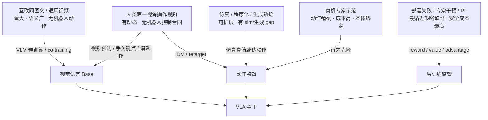

# 具身数据来源与能力边界

数据源决定模型能够获得哪一种监督。真机轨迹提供可执行动作，互联网图文提供语义，人类视频提供交互动态，仿真提供可查询状态和反事实变化，部署日志提供失败与恢复。它们可以协同训练，但不能在没有桥接机制时相互替代。

## 1. 理论起点：数据提供的是不同条件分布

将一条具身记录写为：

\[
z_t=(o_t,s_t,l_t,a_t,r_t,y_t,e,c,m_t),
\]

其中 \(o_t\) 是视觉/传感观测，\(s_t\) 是本体或环境状态，\(l_t\) 是语言/子任务，\(a_t\) 是动作，\(r_t\) 是奖励或结果，\(y_t\) 是额外标注，\(e\) 是本体身份，\(c\) 是控制/坐标合同，\(m_t\) 是有效性 mask。不同数据源只观测这个联合分布的不同子集。

| 数据源 | 可靠可见变量 | 通常缺失或不可靠 | 可直接训练的模块 |
|---|---|---|---|
| 真机专家示范 | \((o,s,l,a,e,c)\) | 失败、反事实、密集 reward | 直接策略、action head、本体适配 |
| 真机 rollout / 干预 | \((o,s,l,a,r/\text{effect})\) | 专家最优动作不总存在 | value、失败恢复、后训练 |
| 仿真 | \((o,s,l,a,r)\) 与场景真值 | 真实外观、接触和传感噪声 | 策略、状态预测、奖励/成功判定 |
| 人类第一视角视频 | \(o\)、手物动态；\(l\) 常为可选弱标签或自动标注 | 机器人 \((s,a,e,c)\)，且语言可能无原生时间对齐 | 视频/时序 Base、潜动作、手轨迹桥接；记录语言来源与置信度 |
| 互联网图文 | \((o,l,y)\) | 时序、动作、控制后果 | VLM Base、语义 grounding |
| 生成视频 | 条件 \((l,o_0)\) 与合成未来 \(\hat o\) | 真实动作和物理可信度 | 数据引擎、future supervision；需伪动作桥接 |

关键约束是可识别性：只有 \((o,l)\) 的数据无法唯一恢复机器人动作 \(a\)。同一画面可能对应不同本体、控制频率和可执行路径。因此，无动作视频需要 IDM、潜动作、手部关键点、retarget 或少量机器人数据完成对齐。

## 2. 数据来源金字塔与监督翻译

数据量从底部向上通常增大，但本体和控制真实性相反。工程目标不是把所有数据变成同一种格式后直接拼接，而是为每类样本声明：哪些目标函数有效、哪些字段必须 mask、哪些模块接收梯度。

## 3. 真机专家示范：动作 grounding 的基准来源

### 3.1 它解决什么问题

遥操作、kinesthetic teaching 或 scripted collection 直接给出观测到动作的对应关系：

\[
\mathcal L_{BC}=-\mathbb E_{(o,l,a)\sim D_{robot}}\log \pi_\theta(a\mid o,l).
\]

动作标签与部署本体、控制器和相机配置一致时，这类数据最适合训练直接策略。其限制是覆盖度：示范集中在成功轨迹与训练环境，策略离开支持集后容易出现误差累积。

### 3.2 代表数据事实

| 数据 | 已披露规模 | 主要价值 | 边界 |
|---|---:|---|---|
| RT-1 | 13 万+ episode、700+ 指令、13 台机器人、约 17 个月 | 证明单一真实平台上多任务数据规模效应 | 单一 EDR 系平台，开放语义有限 |
| BridgeData V2 | 60,096 条轨迹 | 多环境 WidowX 操作、语言与视觉多样性 | 主要是单臂 EEF 控制 |
| DROID | 7.6 万轨迹、350h、564 场景、13 个机构 | 统一 Franka 硬件后的在野分布 | 相机移动带来标定一致性问题 |
| OXE / RT-X | 100 万+轨迹、22 种本体、60 个已有数据集 | 跨机构公共数据底座 | 只做粗动作对齐，原始坐标/控制语义仍异构 |
| AgiBot World | 1,001,552 条轨迹、2,976.4h、100 台机器人 | 工厂化采集与多模态人形数据 | 任务、硬件和许可需按版本核对 |
| AgiBot World 2026（AGIBOT G2） | 100% 真机；总规模与小时数官方未披露（HF 仓库 2026-08 更新） | 商业/家庭场景、LeRobot v2.1、子任务/2D 框/指令多层标注、双臂人形 | 无独立 arXiv 论文；HF 仓库需账号与许可（CC BY-NC-SA 4.0）；仿真孪生见 GenieSim（arXiv:2601.02078） |
| SmolVLA 社区混合 | 481 个数据集、2.29 万 episode、1,060 万帧 | 低成本平台与社区数据治理 | 本体和任务复杂度有限 |

轨迹数、小时和 transition 不能直接换算。一个 3 Hz、30 秒 episode 与一个 50 Hz、30 秒 episode 的监督量差约一个数量级；报告数据规模时至少同时给出 episode、小时、帧/transition 和控制频率。

### 3.3 对训练和评估的影响

- 专家数据主要改善训练分布内的动作拟合；泛化来自任务、对象、场景和本体覆盖，而非 episode 总数本身。
- 同状态附近的专家动作若互相矛盾，L2/L1 回归会趋向平均动作；扩散/流匹配能表达多峰，但不能修复错误的动作合同。
- 随机逐帧切分会把同一 episode 的近重复帧分到训练和验证，离线指标虚高；应按 session/scene/task/embodiment 选择 held-out 组。
- 只收成功示范无法评估恢复能力。失败与干预需要作为独立数据类型保留，而不是混入正向 BC。

## 4. 跨本体聚合：公共格式不等于共同语义

OXE 的工程贡献是将不同数据集组织为可联合读取的 RLDS 轨迹，并给出约 7 维 EEF 公共动作接口。它降低了数据装载成本，但不会自动统一：

- 末端动作处于 base、world、camera 还是 wrist frame；
- 位置/旋转是 absolute、delta 还是 velocity；
- 一个时间步代表 3 Hz、10 Hz 还是 50 Hz；
- gripper 是位置、速度、二值命令还是开合增量；
- success、终止、语言和相机槽位的语义。

因此跨本体数据进入训练前需要一个**本体适配层**：原始字段 → 规范动作/状态 → dataset-specific statistics → mask/padding → 模型输入。OpenVLA 的本地 RLDS Pipeline 为 EEF_POS 定义前 6 维相对动作、最后一维绝对夹爪，并只归一化前 6 维；π0/openpi 则以固定 action dimension 和 mask 接收多本体数据。

技术选择取决于目标：

| 目标 | 更合适的数据策略 | 原因 |
|---|---|---|
| 单一机器人高精度 | 保留原生关节/EEF 合同，少做跨本体压缩 | 避免公共表示丢失硬件细节 |
| 多单臂迁移 | 统一相对 EEF + gripper，保留 frame 元数据 | 共享维度同时可反向解释 |
| 双臂/移动操作 | 结构化左右臂、底盘、升降与 valid mask | 7-DoF 公共接口表达不足 |
| 未见本体泛化 | 训练时按本体 held-out，并区分共享表征与 adapter 参数 | 同本体多场景不能证明跨本体 |

## 5. 仿真与程序化生成：可查询的反事实数据

仿真数据的独特价值是能修改场景参数、重复初始条件，并获得接触、物体位姿、奖励和成功检查器。它适合：

- 生成稀有失败与恢复状态；
- 做对象、布局、相机和动力学的系统性干预；
- 在相同任务下比较不同动作；
- 为世界模型提供完整状态转移。

MimicGen 一类方法将少量示范按对象中心子任务切分，在新物体位姿下变换末端轨迹，再由成功检查器过滤。公开工作报告约 200 条示范可扩增到 50K+轨迹/18 任务；特定 Factory Gear Assembly 设定中，8.2% 的数据生成成功率仍训练出 76% 成功率策略。这说明“生成器成功率”与“训练数据价值”不是同一指标。

仿真边界包括视觉域差、接触模型误差、控制器差异和状态特权。若训练策略使用了真机不可得的状态，仿真成功率不能直接解释为部署能力。评估时应分别报告：仿真内、域随机化、real-to-sim proxy 与真实机器人结果。

## 6. 人类视频：动态先验而非机器人动作标签

人类第一视角视频比真机轨迹更广泛地覆盖手物交互和长程任务，但需要桥接人—机本体差异。

| 桥接方式 | 学到的对象 | 训练用途 | 主要失真 |
|---|---|---|---|
| 视频预测 | \(p(o_{t+1:t+H}\mid o_{\le t},l)\) | 时序/动态 Base | 不提供可执行动作 |
| 手部关键点 | 人手轨迹 | 中间运动表征、retarget | 手与机械臂运动学不同 |
| IDM | \(\hat a_t=f(o_t,o_{t+1})\) | 为视频生成伪动作 | 域外图像与多解性造成噪声 |
| 潜动作 | 离散/连续 latent \(z_t\) | 无监督时序预训练 | latent 没有物理单位，需小量真机对齐 |
| ActionVAE | 动作块 latent | 压缩机器人动作序列 | 仍需有动作的机器人数据训练解码器 |

RynnVLA-001 使用约 1,193 万第一视角人类视频做 I2V 预训练，再以手关键点联合预测桥接到机器人动作；进入机器人阶段时，人类动作头因运动学差异被丢弃并重新初始化。这一事实说明视频迁移的主要资产是视觉动态表征，不是可以直接复用的人类动作头。

**EgoSuite-Open100K（光轮智能 × Hugging Face，2026-08）**：全球首个 10 万小时全模态第一人称人类行为开源数据集（[开源页](https://egosuite100k.lightwheel.ai/) / [HF 集合](https://huggingface.co/collections/LightwheelAI/egosuite-open100k) / [新闻稿](https://lightwheel.ai${EXTERNAL_LOCAL_PATH}/egosuite-open100k)）。约 15,000+ 独立真实场景、15,000+ 任务，覆盖家居、餐旅、零售、运动、物流、办公、工业 7 大类环境；三层标注：21 关节手部位姿（逐帧）、身体位姿、事件级语义标注。分三条线：`EgoStandard`（头戴主体）、`EgoPro`（腕部相机，补手指接触细节）、`EgoDemo`（公开演示、来源可溯），格式为 LeRobot + mcap，HF 上受限访问（需申请）。背景：NVIDIA EgoScale 用 20,854 小时第一视角视频显示对数线性扩展（R²=0.998）；Dyna Robotics DYNA-2 用 100 万+小时人类视频预训练（闭源）并把跨具身迁移拐点定位在 1 万–10 万小时。EgoSuite 的独特价值是第一次把拐点量级的人类数据以统一采集/标注规范公开，可作 IDM/潜动作/手关键点桥接与跨具身迁移研究的公共对齐基线；它没有机器人动作标签，进入策略训练前必须桥接，且与 RynnVLA 一样不能直接复用人类动作头。

**人类数据规模化主线（2025–2026，行业口径）**：NVIDIA EgoScale 用 20,854 小时第一视角视频训练 VLA，得到验证损失与数据小时数的对数线性关系（R²=0.998，22 DoF 灵巧手平均成功率 +54%）。Generalist AI 的 GEN 系列沿同一条曲线放大：GEN-0（2025-11，27 万小时物理交互数据）验证"数据/规模/算力提升 → 下游性能可预测提升"；GEN-1（2026-04，50 万+ 小时真实人类行为数据，简单任务成功率 64%→99%，单项仅约 1 小时真机数据适配）；GEN-1.5（2026-08，在相同 50 万+ 小时基础上持续预训练 8 个月）实现零梯度 in-context 学习——一段 3–12 秒演示塞入 30 秒上下文即可执行新任务（10 任务平均 59%，加 5 分钟任务数据、10 步梯度后 83%）。Dyna Robotics DYNA-2（2026-08，闭源）把预训练数据推到 100 万+ 小时，并把跨具身迁移拐点定位在 1 万–10 万小时。共同点：预训练阶段零机器人动作数据，全部来自人类第一视角演示（手持夹爪/头戴采集）。对本地课题：这些模型均闭源或受限发布，只能作概念对照、不可复现绝对数字；其价值在于把"人类视频是具身预训练主干"和"1 万–10 万小时拐点"变成可引用的行业证据，也解释了 EgoSuite-Open100K（10 万小时）为何恰好卡在拐点量级开源。

对人类视频的有效评估不应只比较视频生成质量。至少需要：冻结/不冻结视频 Base、去除人类视频、只用静态图文预训练、相同机器人数据量等对照，才能把收益归因到动态先验。

## 7. 生成视频与神经轨迹：两级误差链

视频世界模型可以从初始帧与语言生成机器人视频，再由 IDM 或潜动作模型恢复伪动作：

\[
(o_0,l)\xrightarrow{G_\phi}\hat o_{1:H}
\xrightarrow{IDM_\psi}\hat a_{0:H-1}.
\]

误差来自两处：生成模型的视觉/物理幻觉，以及 IDM 的动作反演误差。两者可能相关，不能只对最终伪动作做范围裁剪就认为数据有效。

GR00T/DreamGen 报告用约 88h 真机种子生成约 827h 神经轨迹；DreamGen 在 RoboCasa 特定设置报告最高 333×扩增和已有真机数据时 +8.8% 策略增益。均为作者协议，适合作为数据生成 Pipeline 证据，不是通用放大倍率。

生成数据进入主训练集前应保留：生成 prompt、模型版本、随机种子、过滤器分数、IDM 版本、伪动作置信度和源真机 episode。这样才能按误差来源做消融，而不是把它们当作普通真机轨迹。

## 8. 互联网视觉语言数据：知识协同而非动作监督

网络图文/VQA/caption 数据提供对象、属性、关系和语言表达。RT-2 的关键训练选择是将机器人轨迹与原有视觉语言任务 co-fine-tune，使主干在学习动作 token 时继续接触网络知识。

这类数据的 loss mask 与机器人样本不同：

- VL 样本对自然语言答案或视觉任务目标计算 loss；
- 机器人样本对动作 token、连续动作或子任务计算 loss；
- 缺失动作的 VL 样本不应以零动作补齐后计算 action loss。

它最可能改善语义组合与长尾对象理解，不能自动改善几何精度、接触控制或动作恢复。评估应把新语言表达、新对象语义与精细运动控制分开报告。

## 9. 部署经验与专家干预：补足行为克隆的状态分布

部署策略产生的状态分布 \(d^{\pi}(s)\) 与专家数据 \(d^{E}(s)\) 不同。模型自己的小误差会进入专家数据中从未出现的状态，纯 BC 无法提供恢复标签。

π*0.6 / RECAP 一类系统收集 on-policy rollout、成功/失败、专家干预和价值标签，将优势离散为条件信号。其工程价值是：

- 失败 episode 提供策略真实薄弱点；
- 专家干预给出从错误状态恢复的动作；
- outcome/value 区分“动作看起来像专家”与“最终是否有效”。

代价是安全和偏差：当前策略决定收集到什么数据，人工 rater/干预者决定什么被视为好动作。数据版本必须记录 behavior policy、checkpoint、采集轮次和干预区间，否则多轮数据无法做 off-policy 分析。

## 10. 技术选择：从能力声明倒推数据

| 声称的能力 | 最少需要的数据结构 | 必须设置的 held-out / 对照 |
|---|---|---|
| 新物体语义泛化 | 机器人动作 + VL/对象多样性 | 按对象实例/类别 held-out；语言改写 |
| 新场景泛化 | 多环境真机/仿真，保留 scene_id | 按环境而非帧切分 |
| 跨本体 | 多本体动作合同与 embodiment_id | 未见本体 held-out；共享 Backbone 与 adapter 分开评估 |
| 灵巧接触 | 高频状态/动作、力觉可选、精确同步 | 控制频率与执行延迟固定；真机闭环 |
| 长程任务 | 子任务、终止、恢复、任务进度 | 多阶段 episode；错误恢复与人工干预统计 |
| 利用无动作视频 | 视频 Base + 少量机器人动作桥接 | 无视频、静态图文、相同机器人数据对照 |
| 从失败改进 | rollout、success/reward、干预区间 | BC Base、仅成功数据、加入失败/价值的递进对照 |

## 11. 常见失败模式

1. **把数据规模当作能力解释**：轨迹多但场景、本体和动作模式重复，实际有效覆盖没有增长。
2. **把视频当作动作标签**：没有 IDM/潜动作/retarget 仍声称学到了机器人控制。
3. **跨本体只统一 shape**：零填充后未记录维度语义和 valid mask。
4. **合成数据与真机数据同权**：未保留来源、过滤器和伪动作置信度，无法诊断生成 gap。
5. **失败数据混入正向 BC**：任务失败动作被当作专家目标；相反，全部删除又失去恢复监督。
6. **训练/评测按帧随机切分**：同 episode 和同场景泄漏，泛化分数失真。
7. **用自动质量分替代闭环结果**：平滑、重建或 VLM 评分更高不代表策略成功率更高。

## 12. 数据源审查检查点

- [ ] 每种数据源的可见变量与有效 loss 已声明；
- [ ] episode、小时、transition 与控制频率分别报告；
- [ ] 本体、控制模式、坐标系和采集会话可追溯；
- [ ] 无动作数据的桥接方法与置信度已记录；
- [ ] 生成数据保留生成器、过滤器、IDM 和源 episode 版本；
- [ ] 失败、次优、恢复与技术损坏使用不同标签；
- [ ] held-out 单位与声称的泛化能力一致；
- [ ] 数据增益在固定 Base、训练预算和评测协议下验证；
- [ ] 自评结果、公共基准和独立复现分开标注。

## 资料锚点

- [具身数据全景](../../依赖索引.md)
- [具身数据处理](../../依赖索引.md)
- [RT-1 细读](../../依赖索引.md)
- [π0.5 细读](../../依赖索引.md)
- [GR00T N1 细读](../../依赖索引.md)
- [RynnVLA-001 细读](../../依赖索引.md)
- [下一篇：数据采集、生成与清洗](数据采集、生成与清洗.md)
