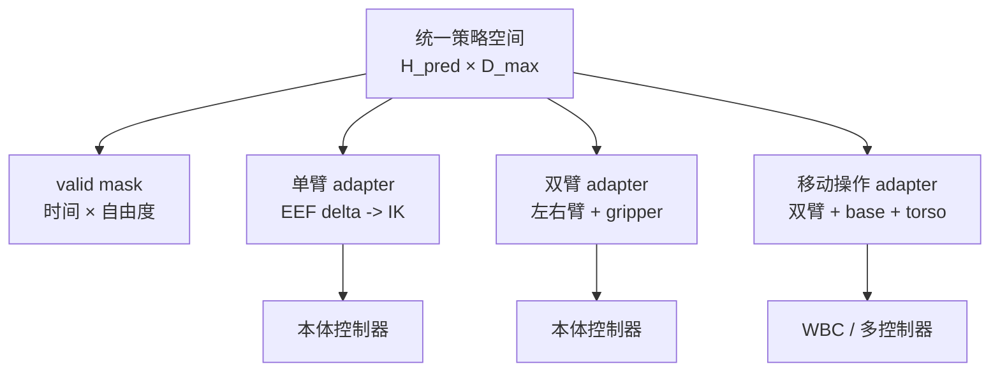

# 动作坐标、归一化与跨本体统一

> 本文解决 VLA 数据工程中最容易被“模型结构”掩盖的问题：不同数据集里的同一串浮点数，是否真的表示同一种物理动作。目标是让研究者能定义动作合同、完成坐标与尺度变换、设计跨本体 adapter，并用 round-trip 和闭环对照验证接口。粒度到模块与公式，不涉及具体类或安装命令。

## 1. 为什么动作统一先于模型统一

多数据集 VLA 常把动作整理成定长向量，但“维度相同”不代表“语义相同”。下面四个动作都可能写成 7 个数：

- base frame 下的末端位置增量 + 欧拉角增量 + 夹爪开合；
- tool frame 下的 twist + 夹爪宽度；
- 绝对末端位姿 + 二值夹爪；
- 前 6 维关节目标 + 一个夹爪命令。

如果只做 padding 和数值归一化，模型会把互相矛盾的监督当成同一任务。完整链路应是：


前半段决定训练标签的意义，后半段决定模型输出是否可执行。二者必须能做往返验证。

## 2. 动作合同：先写物理语义，再写向量

一个模块级 Action Contract 至少包含：

| 字段 | 示例 | 为什么需要 |
|---|---|---|
| `type` | `eef_delta_pose_gripper` | 区分末端、关节、速度、力矩、路点与技能 |
| `frame` | `robot_base` | 决定平移与旋转朝哪个方向生效 |
| `order` | `[dx,dy,dz,rx,ry,rz,g]` | 防止维度静默错位 |
| `unit` | `[m,m,m,rad,rad,rad,normalized]` | 避免 cm/m、度/弧度混用 |
| `rotation` | `axis_angle` | 说明 3 个旋转数如何解释 |
| `mode` | `relative` | 区分绝对目标与增量 |
| `perturbation` | `SE3_exp` / `direct_Rp` | 说明 6D 增量如何构造 \(\Delta T\) |
| `twist_order` | `[vx,vy,vz,wx,wy,wz]` | 固定 Adjoint 与网络维度顺序 |
| `composition` | `left_multiply` | 固定增量作用在 spatial 还是 body frame |
| `rate` | `10 Hz` | 同一数值在不同时间步长下速度含义不同 |
| `range` | 每维物理限幅 | 区分数据裁剪与安全裁剪 |
| `normalizer` | `per_dataset q01/q99` | 保证训练与部署使用同一统计 |
| `mask` | `[1,1,1,1,1,1,1,0,…]` | 区分有效自由度与 padding |
| `consumer` | `IK + joint position controller` | 明确 VLA 之后谁把目标变成执行 |
| `fallback` | 超时停止并清空队列 | 定义异常而非只定义正常动作 |

### 示例：单臂末端增量

```yaml
semantic_type: eef_delta_pose_gripper
reference_frame: robot_base
dimensions: [dx, dy, dz, rx, ry, rz, gripper]
units: [m, m, m, rad, rad, rad, normalized]
rotation_representation: axis_angle
composition: left_multiply
action_rate_hz: 10
normalization_scope: per_dataset_per_dimension
valid_mask: [1, 1, 1, 1, 1, 1, 1]
downstream: pose_target -> IK -> joint_controller
```

这不是某个库的配置格式，而是策略、数据和控制模块应共享的语义合同。

## 3. 坐标系：frame 是动作的一部分

记 \(T^A_B\in SE(3)\) 为“把 B 坐标系中的量表示到 A 坐标系”的齐次变换：

\[
T^A_B=
\begin{bmatrix}
R^A_B & p^A_B\\
0 & 1
\end{bmatrix},
\qquad
\tilde p^A=T^A_B\tilde p^B.
\]

对一个在 camera frame 中预测的点或目标，控制器通常需要先变到 base frame：

\[
T^{base}_{target}=T^{base}_{camera}T^{camera}_{target}.
\]

相机外参若在 episode 间变化，却仍沿用旧标定，模型会看似稳定地向错误方向运动。这类错误不会在 normalized action loss 中暴露。

### 3.1 绝对动作与增量动作

绝对目标直接给出 \(T^b_{e,t+1}\)。增量动作还要说明增量在哪个 frame 定义，以及左乘还是右乘：

- base/spatial frame 增量：

\[
T^b_{e,t+1}=\Delta T^b_t\,T^b_{e,t};
\]

- EEF/body frame 增量：

\[
T^b_{e,t+1}=T^b_{e,t}\,\Delta T^e_t.
\]

两式使用相同的 6 个数字也会得到不同轨迹。数据转换和部署 adapter 必须采用同一复合规则。

位移向量与空间点不能使用同一变换。点坐标包含平移项，纯方向或小位移只旋转：

\[
p^A=R^A_Bp^B+t^A_B,
\qquad
\delta p^A=R^A_B\delta p^B.
\]

若 6D 动作按 \(\xi=[v;\omega]\) 表示 twist，跨 frame 应使用 Adjoint：

\[
\xi^A=\operatorname{Ad}_{T^A_B}\xi^B,
\qquad
\operatorname{Ad}_{T}=
\begin{bmatrix}
R &[t]_{\times}R\\
0 &R
\end{bmatrix}.
\]

若向量顺序是 \([\omega;v]\)，块矩阵位置会改变，因此 `twist_order` 必须进入合同。另一个不能省略的选择是 \(\Delta T=\exp(\hat\xi)\)，还是先由 \(\omega\) 构造 \(R(\omega)\)、再把 \(v\) 直接当平移；二者对有限旋转并不等价。单轴小增量、组合旋转和平移耦合都应进入 round-trip 测试。

| 表示 | 优点 | 主要问题 | 更常见的使用方式 |
|---|---|---|---|
| 绝对末端/关节目标 | 目标明确，适合稳定场景与固定本体 | 依赖坐标原点、标定与工作空间 | 本体专用微调、控制器目标 |
| 相对 EEF delta | 局部、尺度小，较容易跨场景和部分本体共享 | 复合规则、频率和累计漂移敏感 | 单臂/双臂 VLA 常见公共接口 |
| 速度 / twist | 与时间连续控制相符 | 数值含义强依赖采样周期 | 高频视觉伺服与移动底盘 |
| 关节动作 | 无需 IK，接近硬件控制 | 运动学强绑定，跨本体困难 | 固定机器人、灵巧手与人形 |

### 3.2 旋转不是普通的三维回归量

| 表示 | 维度 | 优点 | 风险与检查 |
|---|---:|---|---|
| Euler 角 | 3 | 易读、紧凑 | 轴顺序与内/外旋歧义；万向锁；跨 ±π 不连续 |
| 轴角 / rotation vector | 3 | 适合小增量，紧凑 | 接近 π 时不连续；需说明 norm 是角度 |
| 四元数 | 4 | 无万向锁，适合绝对姿态 | \(q\) 与 \(-q\) 等价；输出需归一化并处理符号连续性 |
| 6D rotation | 6 | 连续回归友好，可正交化为旋转矩阵 | 维度较大，解码时必须恢复正交矩阵 |
| 旋转矩阵 | 9 | 直接参与坐标变换 | 冗余；网络输出不天然满足正交与行列式约束 |

实际系统可以让状态和动作使用不同旋转表示。例如本地资料记录 GR00T 以 6D 表示状态旋转、轴角表示动作增量；这是具体系统选择，不是通用最优结论，且相关收益主要来自作者自评。

## 4. 归一化：统一数值尺度，不是统一物理语义

### 4.1 分位数缩放

对每个数据集、每个有效动作维度，用训练集第 1/99 分位数 \(q_{01},q_{99}\) 做仿射映射。实现需要明确是否裁剪。记 \(r=q_{99}-q_{01}+\epsilon\)：

\[
\hat a_{raw}=2\frac{a-q_{01}}{r}-1,
\qquad
\hat a_{clip}=\operatorname{clip}(\hat a_{raw},-1,1).
\]

与当前统计严格配对的反归一化为：

\[
a=\frac{\hat a+1}{2}r+q_{01}.
\]

忽略仅用于数值稳定的微小 \(\epsilon\) 时，某位置增量维的 \(q_{01}=-0.05\,m,q_{99}=0.05\,m\)，原始动作 \(0.01\,m\) 被编码为 \(0.2\)，反归一化恢复为 \(0.01\,m\)。若部署误用了另一本体的 \([-0.20,0.20]\) 统计，同一个 \(0.2\) 会变成 \(0.04\,m\)，动作幅度放大四倍。

两种公开实现采用不同协议：OpenVLA 的 `BOUNDS_Q99` 在映射后裁剪到 \([-1,1]\)，尾部不可逆；当前 openpi 的 quantile transform 不裁剪，训练样本可落到区间外，但仍能用同一 \(r\) 反变换。分位数本身不必然意味着裁剪。两种协议都要报告训练/部署区间外比例，并保证正反变换使用同一 \(\epsilon\) 与统计版本。

### 4.2 常见尺度策略

| 策略 | 适用条件 | 风险 |
|---|---|---|
| mean/std | 分布近似单峰、连续回归 | 小方差死维会导致归一化爆炸；离群敏感 |
| min/max | 物理上下界可靠且稳定 | 单个异常值会压缩主体分辨率 |
| q01/q99 + clip | 多源动作、希望限制模型值域 | 尾部被截断；统计和裁剪率必须版本化 |
| q01/q99 不裁剪 | 希望保留尾部并保持仿射可逆 | 区间外值可超过 \([-1,1]\)，模型与安全层要能处理 |
| 物理常数缩放 | 明确的速度/位姿设计限幅 | 若数据采集从未覆盖边界，分辨率利用不足 |
| binary / categorical | 夹爪、模式和离散技能 | 不应与连续维共享回归归一化 |

统计量只能从训练切分计算，并随 checkpoint、dataset id、action schema 一起版本化。修改动作维度或 delta/absolute 规则会改变统计语义；单独修改 horizon 不一定要求重算，但如果统计基于展开后的窗口、padding 或加权采样计算，horizon 改动也会改变样本权重，必须重新核对。

## 5. 跨本体：共享空间 + mask + adapter

设统一动作最大维度为 \(D_{max}\)，本体 \(e\) 的有效掩码为 \(m_e\in\{0,1\}^{D_{max}}\)。训练损失只在有效维度和有效时间步上计算：

\[
\mathcal L_{action}
=\frac{\sum_{h,d}m^{time}_h m^e_d\,\ell(\hat a_{h,d},a_{h,d})}
{\sum_{h,d}m^{time}_h m^e_d+\epsilon}.
\]

零填充值与“真实零动作”必须靠 mask 区分。否则模型会因为大量小本体 padding 而偏向输出零，并把未定义自由度当成监督。



Adapter 的职责包括：选择有效字段、反归一化、坐标变换、旋转解码、末端/关节映射、频率桥接和限幅。共享策略学任务与动作先验，adapter 承担不可共享的运动学和控制接口。

## 6. 真实模型与代码事实

| 系统 | 动作统一事实 | 工程含义 | 来源与口径 |
|---|---|---|---|
| OXE / RT-X | 常把异构操作整理为 7 维 EEF 平移、旋转和夹爪，但没有彻底统一所有数据集的 frame、absolute/relative/velocity 语义 | 7D 是最小公共容器，不是完整 Action Contract | [本地数据处理综述](../../依赖索引.md)；OXE 论文 |
| OpenVLA | EEF_POS 的前 6 个相对动作维使用 q01/q99 归一化并裁剪；绝对夹爪维绕过该归一化、按独立语义变换；随后 7 个归一化值统一进入动作 tokenizer | 不能把夹爪当作与 EEF delta 相同的分位数连续量；token 必须绑定 dataset statistics 和夹爪合同 | [OpenVLA 细读](../../依赖索引.md)、[本地 materialize](../../依赖索引.md)与[归一化实现](../../依赖索引.md) |
| π0 论文 | 最大训练本体的 state/action 接口为 18 维，小本体 padding；论文配方报告分位数统计 | 18 是论文数据中最大双臂移动配置，不是当前仓库统一接口宽度 | [π0 细读](../../依赖索引.md) |
| π0.5 论文 | 目标平台约 18–19 DoF，按控制模式与本体组织连续动作 | 不应把 π0 的 18 维直接写成 π0.5 所有平台统一规格 | [π0.5 细读](../../依赖索引.md) |
| 当前 openpi | 默认 `action_dim=32`；当前 DataConfig 对 PI0 默认 mean/std，对 PI05 与非 PI0 默认 quantile；quantile 路径不裁剪 | 论文规格、checkpoint 配方与当前代码默认值是三层口径；部署必须读取实际 config/stats | [openpi 配置](../../依赖索引.md)与[变换实现](../../依赖索引.md) |
| GR00T | 本地资料记录每本体以独立投影/adapter 对齐 state/action，并使用相对 EEF 接口 | 跨本体不仅是 padding，也可用本体专有 adapter | [数据处理综述](../../依赖索引.md)；定量收益为作者自评 |

## 7. Round-trip：动作链必须可逆、可解释

对每个 dataset/embodiment 至少验证：

\[
a_{raw}
\xrightarrow{semantic/frame}
a_{canonical}
\xrightarrow{normalize/tokenize}
a_{model}
\xrightarrow{decode/unnormalize}
\tilde a_{canonical}
\xrightarrow{adapter}
u_{robot}.
\]

| 检查 | 输入 | 预期 |
|---|---|---|
| 数值 round-trip | 正常、边界与尾部动作 | 未裁剪区间内恢复误差接近数值精度；裁剪率单独报告 |
| 单轴方向 | 仅 `+x/+y/+z` 或单关节非零 | 真机/可视化沿合同定义方向运动 |
| 旋转复合 | 单轴小角度与接近边界角 | 左/右乘、轴顺序与单位一致，无符号跳变 |
| twist 跨 frame | 纯平移、纯旋转、平移旋转耦合 | 点、向量和 twist 分别使用齐次变换、旋转或 Adjoint |
| mask | 小本体 padding 维赋随机大值 | 输出和 loss 不受无效维影响 |
| 夹爪 | open/close/width 的边界序列 | 不发生语义翻转，接触后行为符合控制器定义 |
| 频率 | 同轨迹按目标率重采样 | 位移、速度和 chunk 时长保持预期物理量 |

Round-trip 通过只说明接口自洽，不证明策略有效；随后仍需闭环任务和安全评测。

## 8. 对训练、推理和评估的影响

### 训练

- 全局统计可能让大数据本体主导尺度；per-dataset 统计改善数值对齐，却要求推理知道 dataset/embodiment id。
- padding 必须同时带 dimension mask 与 episode 尾部 time mask。
- 坐标转换应在统计计算之前完成，否则 q01/q99 混合不同物理语义。
- relative/absolute、rotation 和 gripper 转换改变后，应重新计算统计并重建标签。

### 推理

- checkpoint、normalization stats、Action Contract 和 adapter 是一个不可拆分的部署单元。
- action chunk 的预测长度与实际执行长度分离；adapter 需要处理旧 chunk、新观测和超时。
- 安全裁剪不应隐藏模型分布外输出：同时记录裁剪前动作、裁剪后命令和拒绝原因。

### 评估

- 离线误差应回到物理单位，分别报告位置、旋转、夹爪和各本体；normalized L1 不可跨统计直接比较。
- 跨本体评测至少区分“同一共享空间的已见本体”“新 adapter 少样本适配”“未见本体零样本”。
- 比较动作表示时固定坐标、统计、horizon、执行频率与下游控制器。

## 9. 选择与消融

| 研究问题 | 最小对照 | 观察指标 |
|---|---|---|
| relative 是否优于 absolute | 同数据、同模型、同控制器，只替换动作语义 | 物理单位误差、闭环成功、累计漂移 |
| per-dataset 是否优于 global stats | 固定 canonical action 后比较统计作用域 | 各本体 loss、饱和/裁剪率、闭环差距 |
| padding 是否伤害模型 | mask-on、mask-off、adapter-only | 无效维输出、有效维性能、小本体退化 |
| EEF 是否更利于跨本体 | EEF shared + adapter 对比 joint-native heads | 新本体适配数据量、IK 失败和成功率 |
| 旋转表示如何选择 | Euler/axis-angle/6D 同预算对照 | 角误差、边界不连续、闭环旋转失败 |

技术选型应从控制接口倒推：固定单本体灵巧手更适合 joint-native 表示；多种单/双臂共享任务可先尝试相对 EEF + adapter；移动、人形则通常需要结构化字段或多头，而不是无限扩张一个匿名向量。

## 10. 失败检查表

| 现象 | 优先检查 | 典型原因 |
|---|---|---|
| 稳定向反方向移动 | frame 与复合顺序 | camera/base 混用，左乘/右乘错误 |
| 幅度突然放大 | stats id、q01/q99/std | 加载了错误本体统计或死维分母过小 |
| 旋转在边界跳变 | 表示、单位、四元数符号 | Euler wrap、degree/radian、\(q/-q\) |
| 小本体总输出零 | mask 与采样比例 | padding 被当监督，大本体/小本体权重失衡 |
| 离线好、闭环漂移 | absolute/delta、频率、执行 horizon | 标签与部署转换不一致或 open-loop 太长 |
| 夹爪完全相反 | gripper semantic | open=1/close=1、relative/absolute 混用 |

## 11. 检查点

1. 为什么统一成 7 维仍不等于完成跨本体对齐？
2. 同一个 tool-frame delta 与 base-frame delta 怎样产生不同位姿？
3. q01/q99 归一化解决了什么，又引入了什么截断？
4. 为什么 padding 的 0 不能代替 valid mask？
5. 若把 action horizon 从 20 改为 50，哪些统计、mask 和部署模块需要重新审计？

答案应能在“Action Contract → 坐标变换 → 统计 → mask → adapter → controller”的链路中定位，而不是归因于模型参数量。

## 延伸阅读

- [任务定义与输入输出协议](../基础/任务定义与输入输出协议.md)
- [VLA 系统数据流](../基础/VLA系统数据流.md)
- [具身数据处理](../../依赖索引.md)
- [运控算法基础](../../依赖索引.md)
- [OpenVLA 细读](../../依赖索引.md)
- [π0 细读](../../依赖索引.md)
- [π0.5 细读](../../依赖索引.md)
