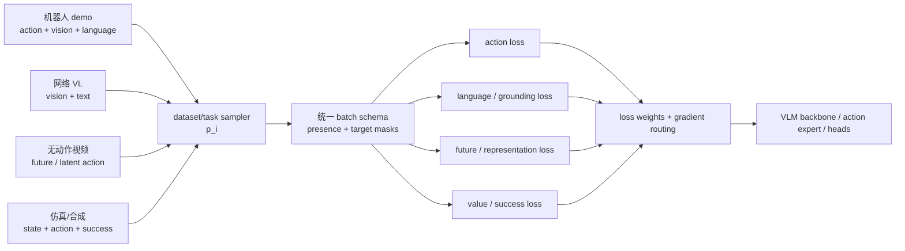
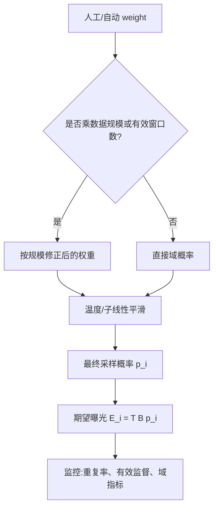

# 多数据集混合与 Co-training

> 多数据集训练的核心不是把路径写进一个列表，而是定义“每一步从哪里采样、哪些监督有效、各目标更新哪些模块，以及如何证明一种数据没有以遗忘或负迁移为代价”。本文给出从采样目标到对照实验的模块级方法，并用 Octo、OpenVLA、π0/π0.5、RT-2 和 Knowledge Insulation 的公开事实落地。

## 1. 混合训练到底在优化什么

设有 \(K\) 个数据域 \(\mathcal D_i\)，域可以是一套数据集，也可以是 `robot × task × environment × source` 组合。训练目标为：

\[
\min_\theta \sum_{i=1}^{K}p_i
\;\mathbb E_{x\sim \mathcal D_i}
\left[\mathcal L_i(x;\theta)\right],
\qquad \sum_i p_i=1.
\]

\(p_i\) 决定长期曝光量，\(\mathcal L_i\) 决定该样本能监督什么。两者不可混为一个“dataset weight”：

- **采样权重**控制一个域多常被看到；
- **目标权重**控制该样本的 action、language、future、value 等 loss 比例；
- **有效性 mask**决定某个监督是否存在；
- **梯度路由**决定 loss 更新主干、动作专家还是任务头。



## 2. 先定义数据域和训练目的

| 数据来源 | 可直接监督 | 主要价值 | 不能假设 |
|---|---|---|---|
| 真机机器人演示 | 图像、proprio、真实动作、语言（若标注） | 动作 grounding 和真实接触分布 | 所有动作都是成功或最优 |
| 跨本体公开数据 | 多任务、多机器人动作 | 共享技能和初始化 | 动作坐标/频率已完全统一 |
| 网络图文/VQA/grounding | 视觉、文本、框/答案 | 开放词汇、对象和语义知识 | 能直接监督机器人动作 |
| 人类第一视角视频 | 交互过程、对象状态变化 | 动态与行为先验 | 人手运动等于机器人命令 |
| 仿真/程序生成 | 状态、动作、奖励、失败、接触 | 覆盖长尾和规模化 | 视觉与动力学真实 |
| 世界模型合成轨迹 | 生成视频与伪动作 | 扩展目标域外观/任务 | 伪动作和物理过程无偏 |
| on-policy / 失败 / 干预 | 当前策略访问状态、成功与恢复 | 修复 covariate shift 和失败模式 | 可直接与专家正样本等权 BC |

混合前要写清每个域希望改变哪个能力。如果加入网络数据只为了保持语义，就应评测语言/对象泛化；如果加入跨本体数据为了技能迁移，就应在新场景或新本体上验证，而不是只看训练域平均 loss。

## 3. 采样分布：数量不是唯一目标

### 3.1 一个统一参数化

设域 \(i\) 有 \(N_i\) 个有效训练单元，人工先验权重为 \(\rho_i\)。常用子线性采样可写为：

\[
\tilde w_i=\rho_i N_i^{\alpha},\qquad
p_i=\frac{\tilde w_i}{\sum_j\tilde w_j}.
\]

- 当所有 \(\rho_i\) 相等时，\(\alpha=1\) 近似按数据量采样，大数据域主导；
- 当所有 \(\rho_i\) 相等时，\(\alpha=0\) 为域等权，小数据域被强烈过采样；
- \(0<\alpha<1\)：在覆盖长尾与尊重规模之间折中。

也可以对现有权重做温度调整：

\[
p_i(\tau)=\frac{\exp(\log(\tilde w_i+\epsilon)/\tau)}
{\sum_j\exp(\log(\tilde w_j+\epsilon)/\tau)}.
\]

\(\tau>1\) 使分布更平，\(\tau<1\) 更集中。这里的 \(\alpha\)、\(\tau\) 和 \(\rho_i\) 都是配方超参数，不应被写成领域定律。

### 3.2 一个算例

三个域分别有 \(N=[10^6,10^4,10^3]\) 个样本，并令人工先验 \(\rho_i=1\)：

| 策略 | 大域约占比 | 中域约占比 | 小域约占比 | 主要风险 |
|---|---:|---:|---:|---|
| \(\alpha=1\) | 98.9% | 1.0% | 0.1% | 长尾几乎看不到 |
| \(\alpha=0\) | 33.3% | 33.3% | 33.3% | 小域反复过拟合 |
| \(\alpha=0.5\) | 88.4% | 8.8% | 2.8% | 仍需按任务价值修正 |

数字仅是教学算例。真实系统还要决定 \(N_i\) 是 episode、frame、action token、秒数还是有效动作窗口；不同计数单位会产生不同采样分布。

### 3.3 曝光量与训练预算

训练 \(T\) 步、batch size 为 \(B\) 时，域 \(i\) 的期望曝光为：

\[
E_i=T B p_i.
\]

应同时记录 `expected exposure`、有效 action token 数和重复遍历次数。只报告原始数据规模无法说明小数据域是否被看过 2 次还是 200 次。

## 4. 真实模型的数据配方事实

| 系统 | 可核对的混合事实 | 能说明什么 | 口径 |
|---|---|---|---|
| RT-2 | 机器人轨迹与网络视觉语言任务做 co-fine-tuning；作者消融称只做机器人微调会遗忘部分网络概念 | 网络数据可作为知识保持信号，而不只是预训练初始化 | 泛化与涌现收益为作者真机自评；精确完整混合规模未披露 |
| Octo | 从 OXE 选 25 个子数据集、约 80 万轨迹；权重大体按规模，并对高多样性数据加权、重复数据降权 | 数据规模与质量/多样性可以分开进入采样先验 | [Octo 细读](../../依赖索引.md)；具体权重以官方配置为准 |
| OpenVLA | 使用 OXE 约 97 万演示，并复用/调整 Octo 式混合；本地配置注释显示含 DROID 的阶段后再重采样 | mixture 可随训练阶段变化，dataset id 与 stats 必须同步 | [OpenVLA 细读](../../依赖索引.md)与[本地配置](../../依赖索引.md) |
| π0 | 本地资料核对其按 task-robot 组合样本数使用 \(n^{0.43}\) 子线性重加权；有效采样份额约 9.1% 开源、90.9% 自有 | 经验指数会显著改变“数据规模”对应的实际曝光 | 0.43 无理论推导和敏感性消融；组成与结果来自论文/作者配方 |
| π0.5 | 六类数据承担不同作用：MM、ME、CE、HL、WD、VI；移动操作部分约 400 小时、约 100 个环境 | 物理技能、环境多样性、高层语言和网络知识可以协同但监督不同 | 精确六类采样比例未披露；消融和真机结果为 PI 自评 |
| Re-Mix | 在 11 个 RT-X 域上用 group DRO 学域权重；作者报告平均超均匀权重 38%、超人工配比 32% | 权重可以作为优化变量，而非只靠人工经验 | 仅对应其 RT-X 设置；数字为作者自评 |

π0.5 的六类数据语义如下：

- **MM**：移动操作演示，直接对应目标任务；
- **ME**：多环境静态机器人数据，扩展场景；
- **CE**：实验室跨本体/OXE 数据，扩展技能和本体；
- **HL**：边界框、子任务文本与动作的高层标注；
- **WD**：网络 caption/VQA/grounding，保持开放语义；
- **VI**：后训练阶段的口头分步指令示范。

作者消融称去掉 ME/CE 会显著损害泛化，去掉 WD 对分布内主任务影响较小、但损害 OOD 物体语言跟随；绝对退化数在本地资料中标为未披露/待核，不能补写为统一比例。

## 5. Dataset weight 的两种语义

实际数据管线常出现两个同名但不同含义的开关：

1. 权重直接作为抽取数据集的概率；
2. 权重再乘数据集大小，用于近似控制各域遍历速度。

OpenVLA 本地 RLDS 管线显式传入 `sample_weights` 并启用 `balance_weights`；数据处理综述提醒，同一组数值在 balance 开/关时不代表同一分布。文档和实验记录应报告最终 \(p_i\)，而不是只贴原始 weight 列表。



## 6. 异构监督：缺失目标必须 mask

对样本 \(x\)，定义 action、language、future、value 的有效掩码 \(m^a,m^l,m^f,m^v\in\{0,1\}\)：

\[
\mathcal L(x)=
m^a\lambda_a\mathcal L_a+
m^l\lambda_l\mathcal L_l+
m^f\lambda_f\mathcal L_f+
m^v\lambda_v\mathcal L_v.
\]

batch 级实现要按每个目标的有效元素数分别归一化，而不是除以总 batch size：

\[
\bar{\mathcal L}_a=
\frac{\sum_b m^a_b\mathcal L_a(x_b)}{\sum_bm^a_b+\epsilon}.
\]

否则，当 action 样本在 batch 中比例变化时，动作梯度幅度会随无动作样本数量被动变化。

| 样本 | action mask | language mask | future mask | 正确语义 |
|---|---:|---:|---:|---|
| 机器人 demo + 指令 | 1 | 1 | 可选 | 同时监督动作与语言条件 |
| 无语言机器人 demo | 1 | 0 | 可选 | 语言缺失不是空字符串目标 |
| 网络图文/VQA | 0 | 1 | 0 | 动作缺失不是零动作 |
| 人类视频 | 0，或伪动作单独标记 | 可选 | 1 | 不能冒充真实机器人动作 |
| episode 尾部 padding | time mask=0 | 按字段 | time mask=0 | 不计未来不存在的目标 |
| 小本体无效自由度 | dimension mask | 不受影响 | 不受影响 | padding 0 与真实零动作分离 |

伪动作、真实动作和人工干预最好保留 `label_source`，即便它们最终进入相同 loss，也能按来源调权和评估。

## 7. Batch 组织与数据流

| 组织方式 | 优点 | 风险 | 适用情况 |
|---|---|---|---|
| 样本级 interleave | 每个 batch 自然混合多个域，梯度平滑 | I/O 与 padding 复杂；大 shuffle buffer 成本高 | OXE/多机器人行为克隆 |
| 域内 batch、跨步采样 | shape 一致、吞吐高 | 梯度随域剧烈切换，BatchNorm/optimizer 状态偏移 | 模态差异很大或专用硬件 pipeline |
| 固定配额 batch | 可保证 robot/web/action 比例 | 小域重复，配置僵硬 | 需要稳定多目标梯度比例 |
| 分阶段训练 | 先广度、后专精，接口清楚 | 后阶段遗忘，阶段间分布跳变 | π0.5 式预训练→后训练 |
| curriculum / 动态权重 | 随收敛或能力调整 | 归因与复现更难 | 长尾、在线数据回流 |

Octo/OpenVLA 的本地资料描述了按权重交织数据、轨迹级变换、shuffle 后形成 batch 的路线。工程监控不应只看总 loss，还应按 dataset/task/robot/source 分解采样率和有效监督。

## 8. Co-training 如何保持已有知识

机器人动作数据远少于网络预训练语料，但动作梯度可能强烈改变 VLM。常见知识保持手段包括：

| 方法 | 机制 | 代价 | 最小对照 |
|---|---|---|---|
| 网络 VL rehearsal | 训练中持续采样 caption/VQA/grounding | 占用训练预算，任务不完全同构 | web-on/off；ID 动作与 OOD 语义同时测 |
| 冻结视觉/VLM 主干 | 只训练 projector/动作头 | 目标域空间特征适配受限 | frozen/partial/full，匹配可训练参数预算 |
| LoRA / 参数高效适配 | 限制主干更新子空间 | 仍可能遗忘，容量受 rank 限制 | 同数据与训练 token 对照全量微调 |
| 分阶段 + 回放 | 后训练专精时保留部分广度数据 | 配方复杂，阶段切换敏感 | replay 比例 sweep |
| 梯度隔离 | 动作专家读取主干，动作梯度不回主干 | 主干需其他动作语义监督 | stop-gradient on/off + 主干动作监督 on/off |

Knowledge Insulation 是最后一类的明确实例：主干用 FAST 离散动作 token 与网络 VL 数据训练，连续动作专家用流匹配，专家到主干的梯度 stop-gradient；论文作者报告训练效率和泛化收益，但尚不能视为独立复现结论。关键思想不是“永远冻结主干”，而是把前向条件流与反向梯度流分别设计。

## 9. 采样与多目标的工程监控

每个训练窗口至少记录：

```text
dataset / robot / task / environment / label_source
requested sampling weight / realized sampling frequency
action, language, future, value valid counts
per-source loss and gradient norm
repeat count / unique episode coverage
normalization-stat id / action-schema id
```

### 为什么要看 realized frequency

过滤、损坏样本、窗口长度和 worker 吞吐都会让实际分布偏离配置分布。例如大权重数据集若大量窗口因动作无效被丢弃，最终 action 监督份额可能小于预期；只读 config 无法发现。

### 为什么要分解 gradient

即使采样 1:1，不同 loss 的尺度和有效 token 数也可能让某一目标支配主干。至少比较各目标在共享模块上的梯度范数或更新影响；若不进入细粒度梯度分析，也应通过 loss weight sweep 和模块冻结对照暴露冲突。

## 10. 训练、推理与评估影响

### 训练

- dataset statistics 应在语义动作统一后分别计算；混合前直接做 global stats 会把本体差异写进尺度。
- 采样权重、loss 权重、mask 和梯度路由是四个独立旋钮，实验中一次只改变一个更易归因。
- 小域过采样会提高曝光，但不会创造多样性；需要数据增强、任务重标注或新采集配合。
- web/video 样本可能只有语言/future 监督，不能用 0 action 填补。

### 推理

Co-training 不直接改变部署输入，但训练时使用的模态与部署可用模态必须对齐。若网络样本总有文本、机器人部署却可能缺语言，需要 modality dropout/mask 与缺失输入评测。

跨本体混合还要求推理携带正确的 embodiment、action schema 和 norm-stat id；统一 checkpoint 不等于统一 adapter。

### 评估

- 分别报告总体、每数据域、每机器人、长尾任务和 OOD 语义指标；微平均会掩盖小域退化。
- 知识保持需要 co-training 前后的 VLM/grounding 或指令泛化对照，同时确认闭环动作没有退化。
- 新数据带来的收益应与“增加同量目标域数据”“更长训练”“更大有效 batch”对照。
- 作者自评、统一 benchmark 和独立复现分开标注。

## 11. 选择与消融实验

### 11.1 最小配方阶梯

1. 目标机器人单数据集 baseline；
2. + 同动作空间跨任务数据；
3. + 跨环境/跨本体数据；
4. + 网络 VL 或人类视频；
5. + 分阶段/知识保持机制；
6. + 动态权重或自动配比。

每一级固定模型、目标域训练 token、action schema 和评测协议，避免把更多总训练量误认成数据协同。

### 11.2 关键对照

| 假设 | 对照 | 结果应怎样解释 |
|---|---|---|
| 子线性采样改善长尾 | \(\alpha=0,0.5,1\) 或围绕经验值 sweep | 看宏平均、最坏域和大域退化，不只总平均 |
| web 数据保持语义 | web-on/off，同机器人曝光 | OOD 语言/物体改善且 ID 动作不退化才支持 |
| 跨本体数据正迁移 | target-only、+same robot、+cross robot | 新任务/环境收益需排除总数据量作用 |
| mask 正确处理缺失监督 | mask vs zero-target | zero-target 若导致动作趋零即暴露错误 |
| 梯度隔离减少冲突 | stop-grad on/off，离散主干监督 on/off | 同时看收敛、语义与闭环，不只一个 loss |
| 动态权重优于人工 | uniform、size、expert、learned | 使用相同总预算和域定义，报告稳定性 |

## 12. 失败检查

| 现象 | 优先检查 | 可能原因 |
|---|---|---|
| 总 loss 降、长尾任务归零 | realized \(p_i\)、微/宏平均 | 大数据域淹没长尾 |
| 小域训练很好、验证崩溃 | 重复曝光与 unique episode | 等域采样导致过拟合 |
| 加 web 后动作变差 | loss 尺度、共享梯度、机器人曝光 | 语义目标支配主干或挤占动作预算 |
| 加机器人数据后语言退化 | rehearsal、冻结/隔离、prompt 分布 | catastrophic forgetting |
| 动作整体趋零 | action mask、padding、无动作样本 | missing action 被填成监督 0 |
| 某本体动作爆炸 | schema/stat id | 不同本体统计或坐标混用 |
| 配置权重与日志不一致 | balance、过滤、worker 吞吐 | weight 语义错误或实际采样偏移 |
| 只在混合平均上提升 | 每域结果和置信区间 | 大域收益掩盖负迁移 |

## 13. 检查点

1. `dataset weight`、`loss weight`、`valid mask` 和 `gradient routing` 分别控制什么？
2. 为什么 \(\alpha=0\) 的域等权不一定公平？
3. 无动作网络图文样本为什么不能填全零 action？
4. π0 的 \(n^{0.43}\) 能否直接迁移到新的三个数据集？还需要什么敏感性实验？
5. 若加入 WD 后 OOD 语言提升、目标域成功下降，应怎样判断是否值得保留？
6. 如何证明跨本体数据带来的不是单纯总训练量收益？

## 延伸阅读

- [动作坐标、归一化与跨本体统一](动作坐标、归一化与跨本体统一.md)
- [语言、视觉与本体特征设计](语言、视觉与本体特征设计.md)
- [训练全流程](../../依赖索引.md)
- [具身数据全景](../../依赖索引.md)
- [具身数据处理](../../依赖索引.md)
- [Octo 细读](../../依赖索引.md)
- [OpenVLA 细读](../../依赖索引.md)
- [π0.5 细读](../../依赖索引.md)
- [Knowledge Insulation](../../依赖索引.md)
