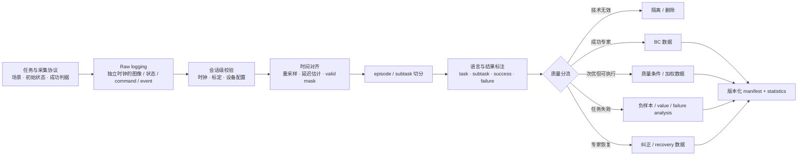
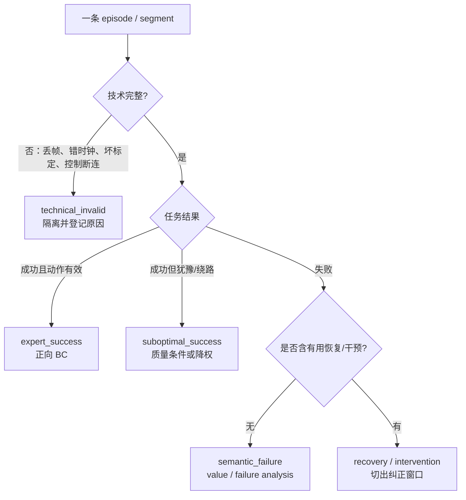
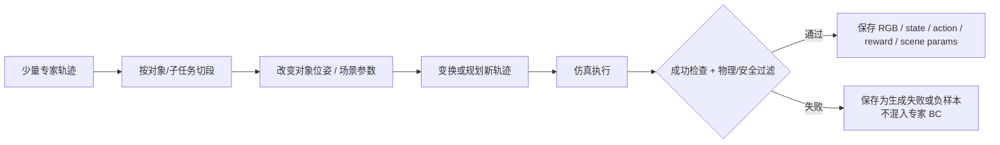
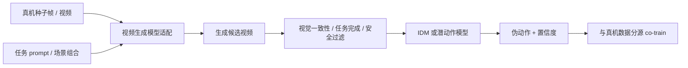

# 数据采集、生成与清洗

本篇从一段尚未整理的机器人日志出发，给出采集合同、时间同步、标注、生成数据和质量分流的方法。目标产物不是“一个视频目录”，而是一组能回答**谁在什么配置下、依据什么观测、发出了什么动作、产生了什么结果**的可审计 episode。

## 1. 先定义数据产品，而不是先启动相机

一次采集项目至少输出四层资产：

| 层级 | 产物 | 用途 |
|---|---|---|
| Raw | 原始传感器流、机器人状态、动作命令、事件日志 | 保留最高保真度，支持重同步和重标定 |
| Canonical | 统一时间轴、字段名、单位和 episode 边界 | 跨 session、跨设备质量检查 |
| Annotated | 指令、子任务、结果、失败、干预和有效性标签 | BC、后训练和评估分流 |
| Training-ready | 过滤后的 trajectory、统计量、split manifest | 样本构造和可复现训练 |

Raw 与 Training-ready 不应互相覆盖。若只保存对齐后的帧，之后发现控制延迟或标定错误时无法重新处理。

## 2. 端到端采集与质量 Pipeline



质量分流应先于训练集拼接。全零动作可能是有效静止、控制器断连或 padding；没有来源标签时，这三种语义无法区分。

## 3. 采集合同：字段、时钟与责任边界

### 3.1 数据集和会话元数据

每次 session 建议固定：

```text
dataset_version
session_id
embodiment_id / robot_serial
operator_id / collection_method
scene_id / environment_id / object_set_id
task_protocol_version
controller_type / control_frequency
state_schema_version / action_schema_version
camera_serials / camera_roles
intrinsics_version / extrinsics_version / robot_calibration_version
software_commit / policy_checkpoint (若为 rollout)
start_time / timezone / clock_source
```

这些字段不必逐帧重复，但必须能从 episode 反查。相机或末端工具一旦移动，应开启新 calibration/session，而不是继续沿用旧外参。

### 3.2 帧级最小记录

| 类别 | 建议字段 | 说明 |
|---|---|---|
| 索引 | `episode_id`、`frame_index`、`timestamp_ref` | 统一时间轴中的位置 |
| 原始时钟 | `timestamp_cam_i`、`timestamp_state`、`timestamp_cmd` | 用于重同步，不被统一时间戳替代 |
| 视觉 | 各相机帧、相机 role、valid flag | role 用语义名，如 base/wrist，而非仅序号 |
| 本体 | joint/EEF/gripper/base state 与单位 | 保存原始状态，不只保存模型拼接向量 |
| 动作 | `action_command`、命令时间、控制模式 | 专家/策略意图 |
| 执行 | 测得的下一状态、控制器状态、饱和/保护标志 | 分析命令是否真正执行 |
| 任务 | task、当前 subtask、标注来源 | 语言可在 episode 或 segment 更新 |
| 结果 | success、reward、termination、failure type | 区分完成、超时、急停、设备故障 |
| 干预 | human takeover、开始/结束、纠正类型 | 后训练时识别 recovery 动作 |

如果训练只需要 RGB、语言和 action，也不应在 Raw 层删除状态与控制器事件；它们常是定位坏标签的唯一依据。

## 4. 时间同步：标签正确性的第一约束

### 4.1 建立参考时间轴

设模型期望频率为 \(f\)，参考时刻为：

\[
t_k=t_0+\frac{k}{f}.
\]

各模态以自身时间戳投影到 \(t_k\)：

- RGB/深度：选择最近有效帧并记录时间差；
- 连续关节/EEF 状态：在相邻样本间插值；
- 旋转：使用适合表示的球面插值或连续旋转插值，避免直接线性插欧拉角跨越 \(\pi\)；
- 离散 gripper/mode：最近邻或 zero-order hold；
- 力觉/触觉：通常下采样并保留峰值/统计，不能只取稀疏瞬时值；
- action command：按控制器消费语义选择当前命令或下一命令。

不存在通用“允许错位多少毫秒”的阈值。可接受范围取决于控制频率、末端速度和任务精度。文档应报告错位分布，而不是只给通过/失败。

### 4.2 区分命令时间与作用时间

策略在 \(t\) 时观察 \(o_t\)，经过感知、网络和控制器延迟后，动作在 \(t+\delta\) 才影响机器人：

\[
o(t)\rightarrow a^{cmd}(t+\delta_{infer})
\rightarrow s^{meas}(t+\delta_{infer}+\delta_{ctrl}).
\]

行为克隆标签究竟配 \(o_t\) 还是更早的 \(o_{t-\delta}\)，取决于专家系统记录的动作语义。推荐保留 command、发送、控制器接收和测量时间，使用交叉相关或已知硬件事件估计延迟；调整标签时将 \(\delta\) 写入数据版本。

### 4.3 时间质量报告

每个 session 至少统计：

- 时间戳是否单调；
- 每模态有效采样率、重复帧率、缺帧率；
- 对齐后 \(\lvert t_k-t_{sensor}\rvert\) 的 median、p95、max；
- command 到 state response 的延迟分布；
- episode 边界附近是否跨 episode 取帧；
- 插值/保持/缺失 mask 各占多少。

只检查最终 MP4 能否播放无法发现视觉—动作监督错位。

## 5. 标定和坐标治理

### 5.1 必须版本化的标定

- 相机内参、畸变模型和分辨率；
- 相机到 base/world/EEF 的外参；
- robot base 在场景中的位姿；
- 关节零点、末端工具和 gripper 标定；
- 深度单位、时间同步参数；
- 每个标定适用的 session 范围。

DROID 的多机构统一采集仍出现相机移动后的外参不一致，后续为约 36k episode 发布自动重标定结果。这说明“同一硬件规范”不能代替 session 级标定审计。

### 5.2 标定 QA

可以使用：

- 标定板重投影误差和多视角一致性；
- 已知机器人关键点投影到图像后的误差；
- 深度点云与桌面/静态几何的一致性；
- wrist 相机相对于 EEF 的稳定性；
- session 间外参变化的聚类与异常检测。

若模型只使用 RGB，标定仍有价值：相机漂移会改变训练分布，且影响跨视角/3D 特征和离线可视化诊断。

## 6. Episode、任务和结果边界

### 6.1 Episode 起止事件

episode 起点应对应策略可消费的合法初始状态，终点必须区分：

| 终止类型 | 语义 | 训练处理 |
|---|---|---|
| `success` | 成功判据满足 | 正向示范或成功 rollout |
| `failure` | 任务目标未达成 | value/失败分析；不直接作为正向 BC |
| `timeout` | 超过时长 | 可视作失败，但单独保留类型 |
| `safety_stop` | 碰撞、越界、急停 | 安全数据，动作标签需谨慎使用 |
| `operator_abort` | 人工中断 | 需附原因，不能默认失败 |
| `technical_abort` | 设备/网络/传感器故障 | 技术无效，通常隔离 |

“最后一帧”不是充分终止语义。RLDS 的 `is_last` 与 `is_terminal`/reward、LeRobot 的 episode 边界与 task 元数据应映射到上述事件合同。

### 6.2 子任务切分

长 episode 可按对象交互或语义变化切成 segment。一个 segment 建议包含：

```text
segment_id, episode_id, start_t, end_t
high_level_task, subtask
relevant_objects / optional boxes
segment_outcome, annotation_source, confidence
```

切分粒度应服务模型接口：高层 planner 需要语义子任务；低层 action policy 更关心连续控制边界。过细切分会造成重复语言和短片段，过粗切分会让同一句指令对应多个阶段的相反动作。

## 7. 语言、子任务与结果标注

### 7.1 语言标签的三种时间尺度

| 标签 | 作用范围 | 例子 | 使用位置 |
|---|---|---|---|
| 总任务 | episode | “整理桌面” | 长程条件、评估单位 |
| 子任务 | segment | “把红杯放入托盘” | 分层策略、高层 token |
| 运动语言 | 短窗口 | “向前移动并闭合夹爪” | RT-H 式中间接口、在线纠正 |

自动重标注应保存原始文本、模型生成文本、模型版本、prompt、人工复核状态和置信度。SmolVLA 数据治理使用 Qwen2.5-VL-3B-Instruct 为缺失/噪声任务描述重标注，并人工统一相机角色；这类 Pipeline 的价值在规模化，但不能假定自动文本与真实动作严格一致。

### 7.2 防止 language shortcut

如果同一视觉状态几乎总配同一动作，模型可能忽略语言。数据侧可以增加：

- 同场景不同指令和不同目标物；
- 语言改写但保持动作语义；
- 反事实指令样本，但动作标签必须由可靠策略/环境生成；
- 指令、对象与动作的互信息审计。

仅靠生成更多语言同义句不会产生新的动作条件差异。

## 8. 清洗不是删除，而是用途分流



### 8.1 技术无效

典型规则包括：

- 视频不可解码、长段重复帧、时间戳倒退；
- 观测与动作流无法对齐；
- 标定版本缺失或明显失效；
- action/state 非有限值、维数变化、单位错误；
- 控制器断连但日志仍记录旧命令；
- episode 边界跨越设备重启或场景重置。

阈值按任务和设备设置，并在 manifest 中版本化。不要用一个全局 `max_action` 替代语义 QA：大动作可能是错误单位，也可能是有效快速动作。

### 8.2 语义失败与次优行为

任务失败、动作犹豫、重复尝试和专家恢复在技术上可能完全完整。处理方式取决于训练目标：

- 纯 BC：只将可靠专家动作计入正向 action loss；
- 质量条件策略：保留质量/速度/错误元数据；
- value/RL：保留完整 outcome 与 reward；
- recovery 学习：明确干预前状态、接管动作和恢复结束点。

RoboMIND 使用多阶段 QA 和 12 类预定义失败模式登记问题；论文正文将不合规样本从高质量训练集过滤，失败数据提升策略的独立证据仍有限。AgiBot World 则把小批训练—部署结果反馈到采集标准，例如清理起始 idle 段。

## 9. 仿真和程序化生成 Pipeline



MimicGen 用对象中心 SE(3) 变换保持末端—对象相对关系，再在新布局执行并以成功检查过滤。仿真生成应保存场景随机化参数、物理引擎版本、控制器参数和成功检查器版本，否则难以解释 sim-to-real 变化。

域随机化不只作用于纹理。建议分组记录：

- 视觉：光照、材质、背景、相机噪声；
- 几何：物体尺寸、初始位姿、相机位姿；
- 动力学：质量、摩擦、阻尼、接触参数；
- 控制：增益、延迟、动作噪声；
- 任务：对象组合、干扰物、语言描述。

评估时一次只 held-out 一组或明确组合，才能知道泛化来自哪类变化。

## 10. 生成视频与伪动作 Pipeline



这一 Pipeline 有两个独立的质量门：视频是否可信，以及伪动作是否可执行。建议记录并分开评估：

1. 生成视频的任务一致性、对象持久性、接触与相机一致性；
2. IDM 在保留真机数据上的动作误差与闭环可用性；
3. 生成数据加入后，在固定真机数据和训练预算下的策略增益；
4. 不同生成/真机混合比例的结果。

DreamGen/GR00T 报告约 88h 真机数据生成约 827h 神经轨迹，但 827h 是从该真机种子扩增而来，不应被写成独立采集的额外真机小时。

## 11. 数据切分与泄漏控制

切分应在样本窗口生成之前完成，以 episode 或更高层 group 为单位。

| 能力声明 | 推荐 group key |
|---|---|
| 同分布拟合 | `episode_id`，仍需避免相邻 episode 高度重复 |
| 新对象实例 | `object_instance_id` |
| 新对象类别 | `object_category` |
| 新场景 | `scene_id` / `environment_id` |
| 新操作者 | `operator_id` |
| 新机器人 | `embodiment_id` / robot serial |
| 新采集配置 | `session_id` / calibration version |

语言改写不应跨 split 复制同一轨迹；同一原始视频生成的多个 caption、crop 或 action window 必须属于同一 split。生成数据也应按源 episode 分组，否则同一初始帧的变体会泄漏。

## 12. 对训练、推理和评估的影响

| 数据决策 | 训练影响 | 推理影响 | 评估影响 |
|---|---|---|---|
| 采样频率 | 决定时序冗余与动作尺度 | 决定模型 horizon 对应物理时间 | 不同频率成功率不可直接比 |
| 延迟校正 | 改善观测—动作因果对齐 | 降低动作滞后 | 应报告端到端时延而非仅前向 |
| 标定版本化 | 支持多视角/3D 特征 | 允许在线几何校验 | 可单独测试相机扰动 |
| 失败分流 | 防止 BC 学习失败动作 | 支持恢复/value 条件 | 可报告失败类型和干预次数 |
| 自动语言标签 | 扩大语言覆盖 | 可能产生语言 shortcut | 需人工抽检和语言 held-out |
| 合成/伪动作 | 扩展状态覆盖 | 可能带来不可执行动作 | 需 sim/生成-only 与真机对照 |

## 13. 常见失败模式

1. **只保存统一时间戳**：无法发现原始模态时钟漂移。
2. **动作只存一个数组**：不清楚它是 command、target、velocity 还是执行后状态。
3. **相机移动但不更新 session**：数据内部形成隐含视觉域和几何错误。
4. **以 MP4 连贯作为同步证明**：视频自身正常，但动作可能整体错开。
5. **删除全部失败**：纯 BC 更干净，却无法训练 value、恢复或安全模型。
6. **失败混入专家 BC**：没有 loss mask/质量条件时污染动作监督。
7. **自动 caption 覆盖原始语言**：失去标签来源，无法回滚和抽检。
8. **按帧随机切分**：同 episode、同视频、同场景泄漏。
9. **生成数据只保留最终 pair**：无法区分生成模型错误与 IDM 错误。
10. **清洗后重新计算统计却不改版本**：checkpoint 的反归一化与数据版本失配。

## 14. 采集与清洗检查点

- [ ] task protocol、成功判据和终止类型已版本化；
- [ ] Raw 层保留每个设备的原始时间戳；
- [ ] command、发送、接收和执行后状态可以关联；
- [ ] 相机、机器人、工具和控制器配置可由 episode 反查；
- [ ] 每模态都有 valid mask 和错位统计；
- [ ] technical invalid、success、suboptimal、failure、recovery 分开；
- [ ] 自动标签保存生成器版本、prompt、置信度和人工复核状态；
- [ ] 仿真/生成数据保存随机化、过滤器与源 episode；
- [ ] split 以场景/会话/本体等目标 group 生成；
- [ ] 清洗报告给出删除/隔离数量和每条规则的影响；
- [ ] 数据版本能够重建对应的 schema、statistics 和 manifest。

## 延伸阅读

- [具身数据来源与能力边界](具身数据来源与能力边界.md)
- [轨迹切分与训练样本构造](轨迹切分与训练样本构造.md)
- [具身数据处理原始调研](../../依赖索引.md)
- [具身数据全景](../../依赖索引.md)
- [SmolVLA 细读](../../依赖索引.md)
- [GR00T N1 细读](../../依赖索引.md)
