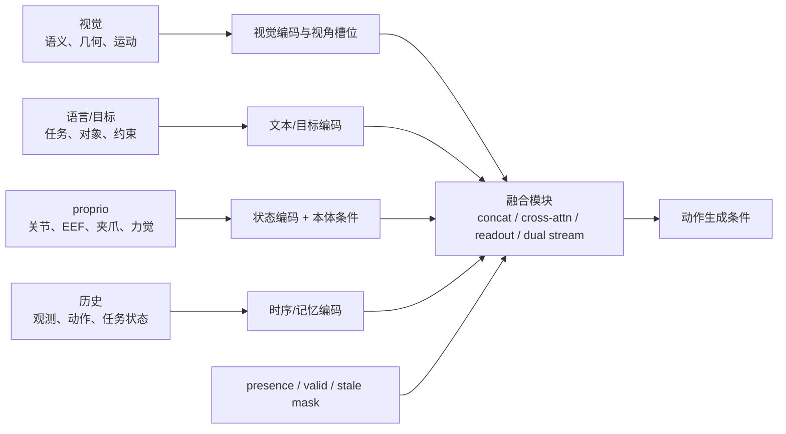
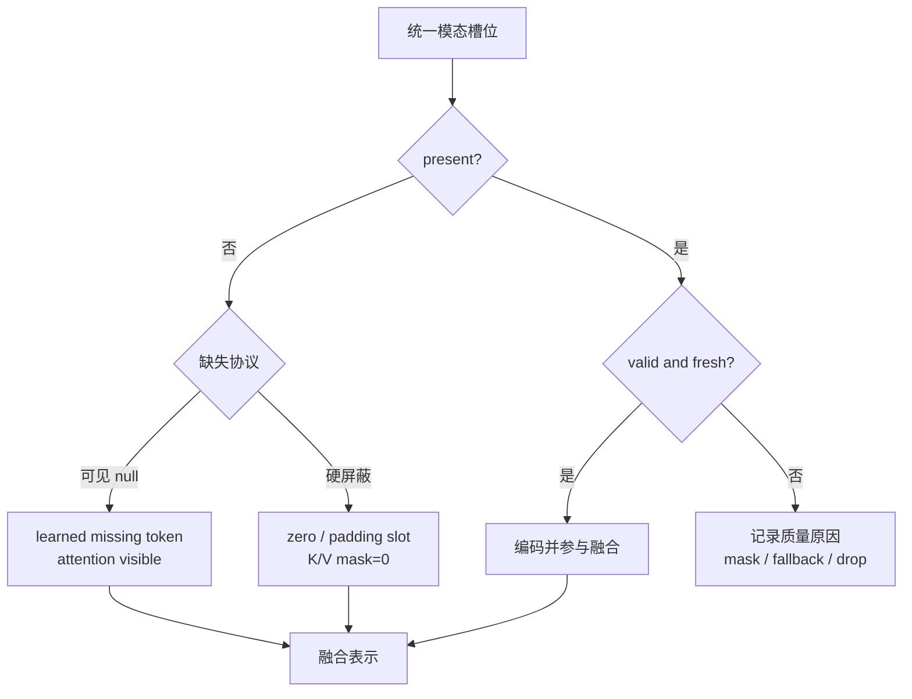

# 语言、视觉与本体特征设计

> VLA 的“多模态”不是把图像、文本和状态拼成一串 token 就结束。每种模态在融合前已经做出信息选择：视觉保留语义还是几何，语言描述整段任务还是当前技能，本体状态采用关节还是末端坐标，历史提供动态线索还是制造 copycat。本文从这些模块级语义出发，说明特征如何选择、缺失与历史如何处理，以及应怎样做消融。

## 1. 特征设计决定策略能看见什么

令当前策略条件为：

\[
h_t=\{V_{t-H_{obs}+1:t},L_t,S_{t-H_{obs}+1:t},A_{<t},G_t,E,M_t\},
\]

其中 \(V\) 为视觉，\(L\) 为语言，\(S\) 为 proprio，\(A_{<t}\) 为可选动作历史，\(G\) 为目标，\(E\) 为本体条件，\(M\) 为各模态有效性，\(H_{obs}\) 为显式观测历史长度。编码器把它们映射到共享条件空间：

\[
z^v=f_v(V),\quad z^l=f_l(L,G),\quad
z^s=f_s(S,E),\quad z^h=f_h(h_{<t}),
\]

再由融合模块得到 \(z_t=F(z^v,z^l,z^s,z^h;M_t)\)。这里最重要的问题不是隐藏维度，而是每个 \(z\) 的语义与可观测范围。



## 2. 融合前的语义合同

| 模态 | 最少说明 | 它主要提供 | 常见误判 |
|---|---|---|---|
| 第三视角 RGB | 相机 id、视场、外参、分辨率、时间戳 | 全局对象、场景与任务进度 | 图像存在就等于有尺度/深度 |
| 腕部 RGB | 与 EEF 的标定、裁剪策略、遮挡状态 | 接触前局部几何、夹爪附近细节 | 与第三视角使用同一增强一定更公平 |
| 深度/点云 | 尺度、坐标系、无效值、相机模型 | 3D 几何、可达性和相机变化鲁棒性 | 增加 3D 模态会自动提升语义 |
| 语言 | 标注作用区间、任务层级、更新时机 | 对象/属性、意图、约束和组合关系 | 多个改写会创造新的动作技能 |
| 目标图像/状态 | 当前与目标视角、可比较字段 | 终态约束和非语言细节 | 目标图像天然与当前观测对齐 |
| proprio | 字段、frame、单位、归一化、时间戳 | 当前可执行状态和闭环误差 | 图像能可靠反演全部关节/接触状态 |
| 历史 | 窗口、采样率、边界与缓存重置 | 速度、遮挡前事实、任务进度 | 上下文越长，记忆越可靠 |
| embodiment | 本体 id、有效自由度、传感能力 | 解释相同 token 在哪个物理系统上生效 | 一个 id 能替代动作 adapter |

特征合同应与[动作坐标、归一化与跨本体统一](动作坐标、归一化与跨本体统一.md)共享 frame、时间戳和本体定义。

## 3. 视觉特征：语义、几何与运动是不同能力

### 3.1 视觉输入应保留什么信息

本节从数据与输入合同规定“需要保留什么”；具体 encoder、projector、注意力访问和梯度路径由[视觉、语言与状态编码模块](../架构与动作生成/视觉、语言与状态编码模块.md)与[多模态融合与 VLM 主干](../架构与动作生成/多模态融合与VLM主干.md)承接。表中的路线是特征来源，不把当前模型内部模块称为 Base。

| 视觉路线 | 擅长的信息 | 适用任务 | 主要代价 |
|---|---|---|---|
| 图文对齐编码器 | 开放词汇对象、属性和语言 grounding | 新物体、新措辞、语义选择 | 局部几何与精细对应未必充分 |
| 自监督视觉特征 | 局部结构、对应、形状和空间关系 | 抓取点、相对位置和空间操作 | 与语言词汇需额外对齐 |
| 轻量 CNN/ViT | 低延迟、目标域适配 | 数据域较窄、边缘部署 | 互联网知识较弱 |
| 视频编码器/历史堆叠 | 运动、接触过程和状态变化 | 动态物体、遮挡、失败恢复 | token、缓存和训练因果更复杂 |
| 深度/点云/3D encoder | 尺度与几何一致性 | 多视角、移动操作、精确空间任务 | 标定、传感噪声和 sim-to-real |

真实模型体现了不同取舍：

- **OpenVLA** 将 DINOv2 与 SigLIP 特征拼接，再经投影进入 Llama 2 主干，试图同时保留局部空间结构和视觉语言语义。其论文使用 224×224 输入；作者报告 384×384 未带来收益且训练约慢 3 倍，这只是该设置结果，不应外推到读数、插孔等细粒度任务。
- **Octo** 用较轻视觉 stem，把图像、任务和 readout token 放进模块化 Transformer；其第三视角与 wrist 图像采用不同增强，腕部视野不随机裁剪，以免破坏夹爪附近几何。
- **RT-1** 使用 TokenLearner 将每帧 81 个视觉 token 压到 8 个；原论文报告约 2.4× 推理加速。它说明视觉 token 压缩是系统选型，不只是感知精度问题。
- **SmolVLA** 控制每帧视觉 token 数并使用小型 VLM，强调消费级部署；轻量化收益与能力结论以其论文协议为准。

以上数字来自[OpenVLA](../../依赖索引.md)、[Octo](../../依赖索引.md)、[RT-1](../../依赖索引.md)与[SmolVLA](../../依赖索引.md)细读；涉及性能增益均为作者实验。

### 3.2 多视角不是简单的 token 拼接

多视角设计要同时决定：

1. 相机槽位是否固定，编码器是否共享；
2. 每个视角是否有 camera-id/外参条件；
3. 缺失相机是 zero image、learned null 还是 masked token；
4. 各相机时间戳如何对齐；
5. wrist 与环境相机是否使用相同裁剪与颜色增强；
6. 推理时相机改变、遮挡或延迟时如何降级。

只有 token mask 没有几何标识时，模型仍可能把“哪个视角看到了什么”学成数据集偏差。需要跨相机遮挡、换位和单相机失效测试。

## 4. 语言与目标：条件粒度要匹配动作时间尺度

| 条件层级 | 示例 | 适合的消费者 | 风险 |
|---|---|---|---|
| 长程任务 | “整理卧室” | Agent、高层策略、记忆模块 | 对下一段毫米级动作约束过弱 |
| 子任务 | “把枕头放回床上” | 分层 VLA、技能策略 | 需要可靠切换与完成检测 |
| 原子指令 | “抓住红杯把手” | 短程动作策略 | 标注成本高、组合能力有限 |
| 约束/否定 | “不要碰蓝杯” | 规划、verifier、动作策略 | 数据中负约束稀少，易被忽略 |
| 目标图像/位姿 | 视觉终态或 waypoint | goal-conditioned policy | 视角、尺度和坐标必须对齐 |

π0.5 是语言分层的具体例子：本地论文细读记录其高层先预测相关物体边界框与自然语言子任务，底层流匹配动作专家再以子任务为条件生成连续动作块；其网络数据和高层标注对 OOD 物体语言跟随的收益为作者自评，精确混合比例未披露。

语言数据处理还需区分：

- **同义改写**提高表达鲁棒性，但动作支持集不变；
- **hindsight relabeling**用轨迹实际终态重写目标，改变可利用样本；
- **分步标注**把长 episode 对齐到子任务区间，直接改变时间监督；
- **无语言样本**需要目标图像、task id 或 modality mask，不能用空字符串冒充有效指令。

## 5. 本体特征：给策略一个可执行的当前状态

图像通常无法可靠恢复被遮挡关节、夹爪开度、接触力和底盘速度。proprio 可包括：

```text
joint position / velocity
EEF pose / twist
gripper width / force / contact
base pose / velocity
torso / head / hand state
IMU / force-torque / tactile summary
```

### 5.1 状态表示与动作必须对齐

- 若动作是 EEF delta，至少应让模型或 adapter 获得当前 EEF/关节状态和标定关系；
- 若动作是 joint target，关节顺序、周期角、限位和缺失自由度应进入状态合同；
- 若动作含底盘或全身控制，只有手臂 proprio 不足以定义可执行状态；
- 力觉/触觉通常需要高频汇聚或事件特征，不能简单与低频图像同下标拼接。

### 5.2 真实模型差异

| 模型 | proprio 处理事实 | 说明 |
|---|---|---|
| 原始 OpenVLA / RT-2 | 本地资料记录主要使用单图与语言，不显式输入 proprio | VLM-as-policy 可工作，但当前关节与接触状态需由视觉/数据分布隐式吸收 |
| π0 论文 | state 经投影作为可缓存条件；论文训练本体最大接口为 18 维双臂移动配置，小本体 padding | 18 维是论文数据口径，不是当前代码接口或通用动作标准 |
| π0.5 论文 | 目标平台约 18–19 DoF，具体字段随控制模式和本体改变 | 不应直接沿用 π0 的 18 维解释所有 π0.5 平台 |
| 当前 openpi | state/action 接口默认 padding 到 32 维 | 32 是当前仓库统一接口上限，仍需真实维度 mask 与 config/stats |
| GR00T N1 | 每种本体可用独立投影把不同 state/action 映射到共享表示 | 以 adapter 分离共享知识和本体接口 |
| Octo | 模块化 readout/task/observation 设计便于微调时增删输入 | “可加模态”仍要求新数据对齐和目标域训练 |

来源见[具身数据处理](../../依赖索引.md)。

## 6. 历史与记忆：更多帧不自动提供更多因果信息

历史窗口可恢复速度、遮挡前状态和任务进度，但也会带来三类问题：

1. **copycat**：模型从上一帧/上一动作推断并复制过去行为，而非响应当前误差；
2. **陈旧条件**：长缓存保留已完成子任务或旧视角，动作专家继续执行过期意图；
3. **episode 泄漏**：切窗跨越 reset 或任务切换，让模型看到不可能的上下文。

本地资料记录 RT-1 使用 6 帧视觉历史，Octo 正式训练使用 2 帧，原始 OpenVLA 主要为单帧；这些是各自数据与架构选择，不构成“短历史总是更好”的规律。部分可观测、动态和长程任务需要单独验证历史收益。

### 历史消融应同时看什么

| 对照 | 目的 | 除成功率外观察 |
|---|---|---|
| 单帧 vs 2/4/8 帧 | 确定信息收益与计算代价 | 延迟、token 数、遮挡恢复 |
| history-shuffled | 检查模型是否利用时序顺序 | 动作变化、闭环退化 |
| action-history on/off | 区分反馈控制与动作复制 | copycat、纠错能力 |
| cache reset 正常/错误 | 检查 episode/子任务边界 | 重复步骤、旧动作持续 |
| 只给 task history vs visual history | 定位长程收益来源 | 子任务完成与物体状态保持 |

## 7. 缺失模态：zero、missing、stale 是三种状态

设模态存在掩码 \(m^{present}\)、内容有效掩码 \(m^{valid}\)、新鲜度掩码 \(m^{fresh}\)。真实内容是否可消费可写为：

\[
m^{data}=m^{present}\land m^{valid}\land m^{fresh}.
\]

| 状态 | 示例 | 正确处理 |
|---|---|---|
| 真实零值 | 关节速度为 0、夹爪闭合编码为 0 | 保留为有效特征 |
| missing：可见 null | 数据集没有 wrist camera 或语言 | 用 learned missing token，保留该 token 的注意力可见性，让模型显式知道“缺失” |
| missing：硬屏蔽 | 固定槽位不存在且不希望模型读取 | zero/padding slot + `present=0`，对应 K/V 完全屏蔽 |
| invalid | 深度无效、图像损坏、状态越界 | `valid=0`，记录原因，必要时丢样本 |
| stale | 图像或 proprio 超过时延阈值 | `fresh=0`，推理降级或停止 |
| padding | 小本体无对应自由度、episode 尾部 | 维度/time mask，不计 loss |

Octo 对缺失语言/相机 token 使用 mask，并可在语言与目标图像条件间训练；本地资料记录 π0 也对缺失视角使用固定槽位与 mask。需要在 manifest 中写清采用哪一种协议：learned null 必须被注意力读取才有意义；硬屏蔽槽位的内容不应被读取。零填充只保持 shape，旁路 mask 或可见 null 才表达“不存在”。



## 8. 融合方式如何选择

| 方式 | 模块关系 | 优点 | 代价与适用条件 |
|---|---|---|---|
| token 拼接 + 单主干 | 所有编码后 token 进入同一 Transformer | 简洁，复用 VLM | 长序列昂贵；不同模态梯度互相影响 |
| projector + VLM | 视觉/state 投到语言嵌入空间 | 易继承预训练语言主干 | projector 可能成为信息瓶颈 |
| cross-attention / 双流 | 动作专家读取 VLM 条件 | 语义与动作模块职责清楚 | 缓存、梯度和同步策略更复杂 |
| readout/query token | 专用 query 汇聚不同条件 | 输出头模块化，便于新增任务头 | query 是否覆盖局部细节需验证 |
| 分层/双系统 | 高层语义条件传给快速动作模块 | 匹配长程语义与短程控制频率 | 接口陈旧、层间错误和训练标注 |

融合位置应由信息共享范围决定：相机之间需要几何关联，本体状态要条件化动作，语言可能只在子任务切换时更新。没有必要让每种模态以相同频率、相同 token 数进入所有层。

## 9. 对训练、推理和评估的影响

### 训练

- 视觉 encoder 冻结成本低但可能不适应机器人局部几何；解冻时应区分收益来自新特征还是更多可训练参数。
- 不同模态缺失率会形成数据集 shortcut；需要按 dataset/embodiment 报告 mask 频率。
- 语言与动作窗口错位会让模型学到任务级相关性而非当前技能条件。
- proprio 与动作统计应共享本体/schema id，不能只按向量长度匹配。

### 推理

- 记录每个视角和状态的时间戳、mask 与缓存年龄；输入完整不等于输入新鲜。
- 多视角/历史显著增加预处理和主干 token，端到端延迟需要与动作队列一起测。
- 本体状态缺失时是否停止、保持动作或退化到视觉策略，需要在系统合同中定义。

### 评估

- 语义能力用新对象/属性/措辞和干扰物测试；空间能力用相机、布局和精确定位扰动测试。
- proprio 价值用 state-off、state-shuffled、state-noise 对照；不能只比较加入状态后参数量更大的模型。
- 历史价值用动态/遮挡任务和顺序打乱验证，静态平均成功率可能看不出差异。
- 缺失模态鲁棒性应主动拔掉相机、延迟状态和替换指令，而不是只在完整输入上评测。

## 10. 选择与消融矩阵

| 假设 | 最小消融 | 需要固定 | 预期证据 |
|---|---|---|---|
| 双视觉特征改善空间 grounding | semantic-only、geometry-only、fusion | 数据、分辨率、动作头、参数预算 | 空间扰动与闭环均改善，而非只 VQA |
| wrist camera 改善接触前控制 | wrist-on/off、遮挡测试 | 第三视角、状态、训练步数 | 局部阶段收益与失败类型变化 |
| proprio 被模型有效利用 | on/off/shuffle/noise | 模型宽度、观测 | shuffle 显著伤害，且精细控制改善 |
| 历史解决部分可观测 | 1/2/4/8 帧 + shuffled | action chunk、控制频率 | 遮挡/动态收益，copycat 不增加 |
| 语言 co-training 保留语义 | web-on/off、instruction paraphrase | 机器人数据与训练预算 | OOD 物体/语言改善，ID 动作不退化 |
| mask 支持异构输入 | mask-on、zero-without-mask | 槽位和数据配比 | 缺失模态下稳定，无 shortcut |

## 11. 失败检查

| 现象 | 优先检查 | 可能的模块问题 |
|---|---|---|
| 换相机后完全失效 | camera id、外参、增强、槽位 | 模型记住视角 shortcut |
| 能识别物体却抓偏 | 局部几何、分辨率、EEF 状态 | 语义强但空间/状态不足 |
| 静态成功、动态失败 | 历史、时间戳、动作反馈 | 单帧无速度，或 history copycat |
| 缺 wrist 时输出异常 | presence mask 与 null token | zero image 被解释成真实观测 |
| 新本体状态输入后幅度爆炸 | state schema 与 stats | 字段/单位/归一化错配 |
| 长程任务重复步骤 | task history、cache reset、完成信号 | 高层条件陈旧或缺少任务状态 |

## 12. 检查点

1. 为什么 DINO/自监督视觉特征与图文对齐特征解决的不是同一个问题？
2. 语言同义改写能提升什么，不能创造什么？
3. “输入为 0”如何区分静止、缺失与 padding？
4. 为什么 state-shuffled 比 state-off 更能证明模型使用了 proprio？
5. 历史窗口提升离线准确率却降低闭环成功时，应优先怀疑什么？

## 延伸阅读

- [任务定义与输入输出协议](../基础/任务定义与输入输出协议.md)
- [动作坐标、归一化与跨本体统一](动作坐标、归一化与跨本体统一.md)
- [多数据集混合与 Co-training](多数据集混合与Co-training.md)
- [具身数据处理](../../依赖索引.md)
- [OpenVLA 细读](../../依赖索引.md)
- [Octo 细读](../../依赖索引.md)
- [π0.5 细读](../../依赖索引.md)
