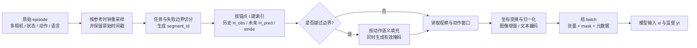
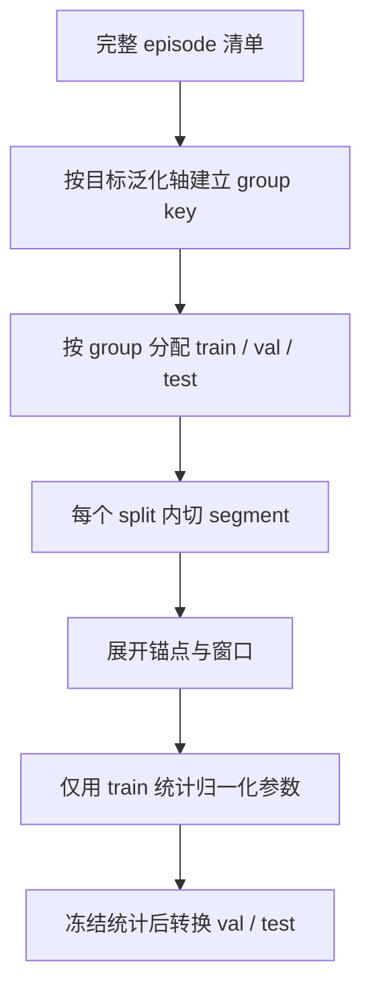

# 轨迹切分与训练样本构造

轨迹文件不是模型样本。数据模块需要把异步采集得到的 episode 转换为具有明确时间语义、边界掩码和动作监督的窗口；这一层决定模型实际看到多长历史、预测多长未来，以及训练目标和部署执行是否对齐。

本文把问题拆成三个对象：episode 是一次任务尝试，transition 是统一时间轴上的一个控制步，window 才是一次前向与反向传播使用的样本。重点不是某个数据类的调用方式，而是三者之间可审计的转换协议。

## 1. 从轨迹到监督样本

设 episode 长度为 \(T\)，控制频率为 \(f\)，在锚点 \(t\) 构造：

\[
x_t=\left(O_{t-H_{obs}+1:t},\,S_{t-H_{obs}+1:t},\,L_t,\,E,\,M_t\right),
\qquad
y_t=A_{t:t+H_{pred}-1}.
\]

其中：

- \(O\)：一个或多个相机的图像/深度序列；
- \(S\)：关节、末端位姿、夹爪和其他 proprioception；
- \(L_t\)：任务指令或当前子任务；
- \(E\)：本体、相机和动作空间元数据；
- \(M_t\)：模态缺失、时间边界和动作维度掩码；
- \(H_{obs}\)：同步后的观察与状态历史长度；
- \(H_{pred}\)：预测动作长度，通常称 action horizon 或 chunk size。

窗口长度必须同时报告步数和物理时间：

\[
\tau_{obs}=\frac{H_{obs}-1}{f},\qquad \tau_{pred}=\frac{H_{pred}}{f}.
\]

这里 \(H_{pred}/f\) 把每条 action 视为覆盖一个控制区间，因此表示整个命令块的执行时长；若只计算首个与最后一个动作采样时刻之间的时间戳跨度，则为 \((H_{pred}-1)/f\)。实验记录应说明采用哪一种口径。

例如同为 50 步的动作块，在 50 Hz 和 10 Hz 下分别覆盖 1 s 和 5 s；只比较 `chunk_size=50` 没有工程意义。部署还要单独定义每次重规划前实际执行的动作数 \(H_{exec}\le H_{pred}\)。\(H_{pred}\) 是训练标签的预测跨度，\(H_{exec}\) 决定开环执行时长和策略查询节奏，两者不能混写。



这条流水线中，切分和索引应先于随机图像增强；数据集划分应先于窗口展开。否则同一 episode 的相邻帧可能分别落入训练集和验证集，形成近重复泄漏。

## 2. Episode、transition 与 window 的最小协议

### 2.1 Episode 级字段

| 字段 | 语义 | 为什么必须保留 |
|---|---|---|
| `episode_id` | 一次完整任务尝试的稳定标识 | 分组切分、去重、失败追踪 |
| `session_id` / `operator_id` | 采集会话与操作者标识 | 检查会话泄漏与操作者偏差 |
| `robot_id` / `embodiment_id` | 本体及控制配置版本 | 选择动作适配器和归一化统计 |
| `task_id` / `instruction` | 规范任务及自然语言表述 | 条件策略训练、语言改写审计 |
| `start_time` / `end_time` | 原始时钟下的边界 | 对齐传感器、定位断流 |
| `fps` / `control_hz` | 存储帧率与控制频率 | 将步数换算为物理时间 |
| `success` / `termination_type` | 成功、失败、超时或人工中止 | 采样、后训练与评测分层 |
| `calibration_version` | 相机内外参和机器人标定版本 | 空间变换可追溯 |
| `schema_version` | 字段和坐标约定版本 | 防止同名字段语义漂移 |

### 2.2 Transition 级字段

一个统一控制步不应只有 `(image, action)`。建议至少保存：

| 类别 | 典型字段与形状 | 说明 |
|---|---|---|
| 时间 | `timestamp: float64`、`frame_index: int64` | 时间戳用于同步，帧号用于快速索引；不能互相替代 |
| 视觉 | `image.<camera>: uint8[H,W,3]`、`image_valid: bool` | 缺帧必须显式标记，不用全零图伪装有效输入 |
| 状态 | `state: float32[D_s]`、`state_mask: bool[D_s]` | 统一维度时保留真实维度掩码 |
| 动作 | `action: float32[D_a]`、`action_mask: bool[D_a]` | 坐标系、绝对/增量语义和执行时刻写入元数据 |
| 任务 | `instruction`、`subtask_id` | 子任务变化点应能形成新的 segment 边界 |
| 事件 | `is_first`、`is_last`、`is_terminal` | 区分文件结束、任务结束和环境终止 |
| 质量 | `sync_error_ms`、`interpolated`、`dropped_sensor` | 允许训练过滤和错误归因 |

本地 LeRobot 实现把 `timestamp`、`frame_index`、`episode_index`、全局 `index` 和 `task_index` 作为默认索引字段；RLDS 常见结构则是 dataset → episode → step，step 中携带 observation、action、reward、首尾标记和语言指令。两者的差别主要在存储和读取接口，不应改变上述时间与边界语义。

### 2.3 Window 级字段

最终样本除模型张量外，还应携带以下掩码和审计信息：

```text
sample = {
  observation:  [H_obs, N_cam, C, H, W],
  state:        [H_obs, D_s],
  action:       [H_pred, D_a],
  obs_valid:    [H_obs, N_cam],
  state_valid:  [H_obs, D_s],
  action_valid: [H_pred, D_a],
  instruction:  string or token ids,
  anchor_time:  float64,
  episode_id, segment_id, embodiment_id,
  transform_version, normalization_version
}
```

维度排列可因框架改变，但字段语义不应改变。尤其不能用“填充后的数值看起来合理”代替 `*_valid`。

## 3. 窗口索引、边界与 loss 掩码

对锚点 \(t\)，历史与未来索引分别为：

\[
I_o(t)=\{t-H_{obs}+1,\ldots,t\},\qquad
I_a(t)=\{t,\ldots,t+H_{pred}-1\}.
\]

有效掩码为：

\[
m^o_i=\mathbb{1}[0\le i<T_{seg}],\qquad
m^a_j=\mathbb{1}[0\le j<T_{seg}],
\]

其中 \(T_{seg}\) 是当前 segment 而非文件的长度。训练 loss 应按有效元素归一化：

\[
\mathcal{L}=\frac{\sum_{b,h,d}m^a_{b,h,d}\,\ell(\hat a_{b,h,d},a_{b,h,d})}
{\max\left(1,\sum_{b,h,d}m^a_{b,h,d}\right)}.
\]

若某个本体只有 \(D_a< D_{max}\) 个动作维度，`action_valid` 还需与维度掩码相乘，避免零填充维度贡献 loss。

### 3.1 Episode 起点

历史不足时常见两种处理：

- 重复第一帧/第一状态，同时把重复位置标为无效；便于保持静态张量形状；
- 丢弃前 \(H_{obs}-1\) 个锚点；没有填充偏差，但短 episode 损失较多样本。

OpenVLA 的本地 RLDS 轨迹变换会为 episode 起点之前的历史生成 `pad_mask`。这说明“重复值”和“有效观察”是两个独立概念：即使 gather 后得到第一帧，注意力或损失仍需要知道它是边界填充。

### 3.2 Episode 终点

未来动作越界时，填充值必须依动作语义决定：

| 动作类型 | 合理的数值填充 | 仍需 mask? | 原因 |
|---|---|---|---|
| 相对位姿/速度/关节增量 | 零增量 | 是 | 零表示不再运动，但不应把填充当真实示范 |
| 绝对关节或绝对末端目标 | 保持最后有效目标 | 是 | 填零可能造成回原点的伪监督 |
| 夹爪绝对开合 | 保持最后状态 | 是 | 末尾凭空开合会污染接触阶段 |
| 离散模式 token | `PAD` 或保持，按词表协议 | 是 | `PAD` 必须从动作 token loss 中排除 |

本地 OpenVLA 实现正是按 `absolute_action_mask` 区分：未来越界的绝对维度重复当前值，相对维度补零；若未提供该掩码，则默认动作维度为相对量。该默认值只在动作协议确实为增量控制时安全。

### 3.3 子任务和失败边界

窗口不能穿越以下边界：机器人复位、控制模式切换、相机重连、任务指令实质改变、遥操作权切换，以及碰撞后人工拖回。它们即使位于同一录制文件，也应拆成不同 `segment_id`。否则模型会学到从失败后的状态直接跳到恢复后的动作，而中间没有可解释因果链。

## 4. 时间同步、重采样与查询索引

多模态窗口应在时间域定义，再映射为帧索引。对模态 \(q\) 的目标偏移 \(\Delta\tau_k^q\)，选择最近观测：

\[
i_k^q=\arg\min_i\left|\tau_i^q-(\tau_t+\Delta\tau_k^q)\right|,
\qquad
\epsilon_k^q=\left|\tau_{i_k^q}^q-(\tau_t+\Delta\tau_k^q)\right|.
\]

仅当 \(\epsilon_k^q\le\epsilon_{max}^q\) 时该位置有效。连续的 proprioception 可插值，但相机帧和离散夹爪事件通常使用最近邻；插值策略要进入样本元数据。

当前本地 LeRobot 数据读取支持按特征设置 `delta_timestamps`，并根据数据集 fps 映射到帧偏移；默认检查偏移是否接近 \(1/f\) 的整数倍，当前代码的时间容差为 \(10^{-4}\) s。这一约束适合定帧率数据，但不能掩盖原始相机或控制流的真实抖动：转换时仍应保存原始时间戳和同步误差分布。

### 4.1 先定物理跨度，再定步数

选择窗口的一般顺序是：

1. 从任务动力学确定需要的历史和预测物理跨度；
2. 选择训练/部署共同支持的参考控制频率；
3. 计算 \(H_{obs},H_{pred}\)，再检查显存、吞吐和标签噪声；
4. 用闭环稳定性和延迟确定 \(H_{exec}\)，而不是默认执行整个 chunk；
5. 把 fps、\(H_{obs},H_{pred},H_{exec}\) 一起写入实验记录。

例如接触操作常需要较小 \(H_{exec}\) 来及时修正，轨迹仍可用较长 \(H_{pred}\) 提供平滑的未来结构监督。相反，网络延迟高的远程部署可能增大 \(H_{exec}\)，但需要额外评估开环漂移。

## 5. 切分必须发生在窗口展开之前

训练/验证/测试的分组单位取决于要测的泛化轴：

| 评测问题 | 最低分组单位 | 还应隔离的因素 |
|---|---|---|
| 同场景同任务模仿 | `episode_id` | 相邻重复尝试和复位片段 |
| 新任务表述 | 规范 `task_id` | 同义改写，避免只测语言模板记忆 |
| 新场景/物体 | `scene_id` / `object_instance_id` | 同一物体的多视角与相邻摆放 |
| 新操作者 | `operator_id` | 同一会话中的动作风格 |
| 跨本体 | `embodiment_id` | 共用遥操作器和标定版本造成的捷径 |
| 时间外推 | `session_date` | 同一天批次、固件与照明条件 |



常见错误是先把 episode 展开成逐帧样本再随机划分。相邻窗口共享绝大多数图像和动作，验证指标会主要反映记忆。另一类泄漏是用全量数据计算均值、方差或分位数；归一化统计本身也属于训练产物。

## 6. 四种存储格式如何映射到同一窗口语义

| 格式 | 原生组织 | 窗口读取方式 | 工程注意点 |
|---|---|---|---|
| RLDS | dataset → episode → step 的嵌套结构 | episode 级变换后切成 step/window | 天然保留 episode 边界；多数据集需先统一 observation/action schema |
| LeRobot v2/v3 | 低维数据为 Parquet，视频按相机存 MP4，另有任务和统计元数据 | 以行索引和时间偏移查询低维与视频帧 | 视频解码与随机窗口采样要做吞吐评测；v3 可将多 episode 打包到文件中，逻辑边界仍不能丢 |
| ACT/ALOHA HDF5 | 常见为一个 episode 一个 group/文件 | 从 episode 数组切定长片段 | 文件数量和随机 I/O 可能成为瓶颈；需显式维护 padding mask |
| Zarr | 按时间拼接的数组，加 `episode_ends` | 由累计边界恢复 episode 后切片 | 高吞吐，但任何 off-by-one 都会让窗口跨 episode |

格式转换的验收不是“能读出 batch”，而是对同一抽样锚点逐字段比较：时间戳、相机帧、状态、动作、语言、边界掩码和归一化前数值均一致。

## 7. 代表实现如何实例化上述协议

以下数字来自当前工作区中的官方/公开代码与配置快照，用于说明协议如何落地，不等同于所有论文实验的统一规格。

### 7.1 OpenVLA：单步监督是窗口协议的特例

本地 OpenVLA 数据配置默认 `window_size=1`、`future_action_window_size=0`，即只读当前观察并监督当前一步动作。其 RLDS 轨迹处理顺序包含：可选过滤、加入 pad mask、目标重标注、任务增强、观察/动作 chunk 和可选降采样。动作通常以分位数边界归一化，当前配置使用 q01/q99 一类边界统计。

因此 OpenVLA 的语言—图像—动作 token 训练仍然依赖完整 episode 语义：单步标签并不意味着可以在转换前丢掉 episode 边界、动作坐标或数据集统计。若把 `future_action_window_size` 调大，还必须为绝对动作维度提供正确掩码和未来填充规则。

### 7.2 π0 当前开源实现：固定最大维度的动作块

当前本地 `openpi` 配置默认 `action_dim=32`、`action_horizon=50`，观察协议包含三个图像槽位及各自有效掩码、`state[B,32]`、token 化指令和 `action[B,50,32]`。π0 默认最大文本长度为 48，π0.5 配置为 200。

这里的 32 是当前开源实现为跨本体适配设置的最大动作/状态宽度，不应与原始 π0 论文中披露的训练本体最大 18 维动作混为一谈。训练样本需要保留真实本体维度及 pad mask，部署前再按本体适配器还原真实动作向量。

### 7.3 SmolVLA 当前本地配置：预测跨度与执行跨度显式分离

本地 SmolVLA 配置显示 `n_obs_steps=1`、`chunk_size=50`、`n_action_steps=50`，最大状态和动作维度均为 32，flow matching 推理步数为 10，文本最大长度为 48。它具体展示了三个不同参数：观察历史、模型预测块长度、动作队列实际使用长度。

即使配置中 `chunk_size` 与 `n_action_steps` 都是 50，部署也应记录真实控制频率、推理耗时以及是否因新观察而提前重规划；否则无法把离线 chunk loss 与闭环成功率关联。上述值是当前本地模型配置，不主张为 SmolVLA 所有训练和部署设置。

### 7.4 对照表

| 实例 | 观察窗口 | 动作标签 | 统一维度策略 | 边界信息 | 需要特别核对 |
|---|---:|---:|---|---|---|
| OpenVLA 当前默认 | 1 步 | 1 步 | 数据集变换后统一动作语义 | RLDS episode 与 pad mask | q01/q99 统计、绝对/相对动作掩码 |
| openpi 当前默认 | 当前观察，3 图像槽 | 50 × 32 | 状态/动作 pad 到 32 | 图像和维度 mask | 论文规格与当前实现规格不要混用 |
| SmolVLA 本地配置 | 1 步 | 50 × 最多 32 | pad 到最大 32 | 模态/维度 mask | `chunk_size`、`n_action_steps`、Hz 同时报告 |

## 8. 参数选择：预测跨度、执行跨度与采样密度

| 参数 | 增大后的收益 | 主要代价 | 适合的验证 |
|---|---|---|---|
| 历史长度 \(H_{obs}\) | 缓解遮挡，识别速度和任务阶段 | 视觉计算、显存、时间对齐误差增加 | 遮挡/动态任务分层成功率；同参数量消融 |
| 动作跨度 \(H_{pred}\) | 提供更长运动结构，利于平滑轨迹生成 | 多模态未来更难拟合，末尾 padding 比例上升 | 分 horizon 的误差与闭环成功率 |
| 执行步数 \(H_{exec}\) | 降低推理和通信频率 | 开环漂移，对接触扰动反应慢 | 延迟—成功率—碰撞率曲线 |
| 锚点 stride | 降低相邻样本冗余和 I/O | 稀有事件样本减少 | 有效样本数、事件覆盖率、吞吐 |
| 失败片段占比 | 学习恢复和负例边界 | 行为克隆可能模仿失败动作 | 恢复率与正常任务成功率分开报告 |

锚点不必均匀采样。抓取闭合、首次接触、任务阶段切换和恢复动作往往持续很短，可在 episode 内做事件分层采样；但要保存采样概率 \(p_i\)。若希望 loss 对原始分布无偏，可使用 \(w_i\propto1/p_i\)，并对极端权重裁剪。没有记录采样概率的“关键帧加权”很难解释训练分布。

## 9. 对训练、推理和评估的直接影响

### 训练

- 窗口重叠率决定“样本数”是否被严重高估；报告 episode 数、控制小时和展开后窗口数。
- 动作 padding、维度 padding、缺失相机三种 mask 的作用域不同，不应合并成单个 batch mask。
- 归一化统计只由训练 split 计算，并按本体/动作协议选择全局、分数据集或分本体统计。
- 图像增强对同一时间窗口应保持可解释的一致性；若每帧独立随机裁剪，模型可能把增强抖动当成真实运动。

### 推理

- 部署输入必须复用训练时的相机顺序、历史间隔、状态坐标、归一化版本和缺失模态协议。
- 推理得到 \(H_{pred}\) 步不代表全部执行；动作队列要定义何时刷新、何时丢弃旧 chunk、是否做重叠融合。
- 训练参考动作的时间定义若是“观测后下一控制步”，在线系统必须补偿感知与推理延迟，否则动作与状态错一拍。

### 评估

- 离线指标按真实有效 mask 计算，并同时给出首步误差、分 horizon 误差和末端动作误差；平均整个 chunk 会隐藏远期退化。
- 闭环评测固定或扫描 \(H_{exec}\)、控制频率和推理延迟；这些属于策略定义而非纯系统细节。
- 测试 split 的 group key、episode/任务/本体数量和成功判定必须与数据清单绑定，防止转换后样本数量替代真实独立试验数。

## 10. 常见失败模式与定位信号

| 现象 | 优先检查 | 可能机制 |
|---|---|---|
| 离线 loss 很低、真机失败 | split group、相邻窗口重叠 | 同 episode 泄漏或背景记忆 |
| 动作块后半段回零 | 终点 padding 与 mask | 绝对动作被当作相对量补零 |
| 接触前后动作错拍 | 相机—动作延迟、标签时刻 | 观测与控制参考时间不一致 |
| 跨本体训练后某本体退化 | 维度 mask、归一化统计 | padding 维度参与 loss 或统计混合 |
| 长 chunk 平滑但遇扰动失控 | \(H_{exec}\) 与重规划条件 | 推理时开环执行过长 |
| 增加历史帧无收益 | 真实物理跨度、帧间重复 | 只增加步数，没有增加有效时间信息 |
| 验证吞吐忽高忽低 | 视频文件布局、随机解码跨度 | 存储 chunk 与训练 window 不匹配 |

## 11. 模块级验收清单

进入模型训练前，逐项产出可检查的证据：

- [ ] 随机抽取至少一个 episode，画出原始时间戳、目标查询时刻和实际匹配误差；
- [ ] 对 episode 首尾和每种终止类型打印窗口索引、填充值与 `obs/action_valid`；
- [ ] 验证任何 window 都不跨 `episode_id`、`segment_id` 或控制模式边界；
- [ ] 把 \(H_{obs},H_{pred},H_{exec},f\) 转换为物理时间并写入实验配置；
- [ ] 统计不同数据源的窗口数、独立 episode 数、padding 比例和有效动作维度分布；
- [ ] 确认 train/val/test 先按目标 group 切分，再生成窗口；
- [ ] 归一化统计只来自训练组，并有版本号和逆变换单元测试；
- [ ] 同一锚点经原格式和转换格式读取后，图像、状态、动作、语言和 mask 一致；
- [ ] 训练 batch 和在线输入逐字段对齐，包括相机顺序、状态坐标和缺失模态行为；
- [ ] 离线评估分 horizon 报告，闭环评估记录实际 \(H_{exec}\)、频率和延迟。

## 12. 站内延伸与事实入口

- [数据与特征总览](index.md)
- [具身数据来源与能力边界](具身数据来源与能力边界.md)
- [数据采集、生成与清洗](数据采集、生成与清洗.md)
- [任务定义与输入输出协议](../基础/任务定义与输入输出协议.md)
- [embodied-ai-learning：数据处理](../../依赖索引.md)
- [embodied-ai-learning：具身数据](../../依赖索引.md)
- [OpenVLA RLDS 数据入口](../../依赖索引.md)
- [OpenVLA 轨迹窗口变换](../../依赖索引.md)
- [openpi π0 配置](../../依赖索引.md)
- [SmolVLA 本地配置](../../依赖索引.md)

数字口径：本文代码规格均指当前工作区快照；论文版本、模型权重和部署配置可能不同。未在论文或当前官方配置披露的采样 stride、在线执行 \(H_{exec}\) 等字段，应在具体 Baseline 页标为“未披露/待核”，而不是由 `chunk_size` 推断。
