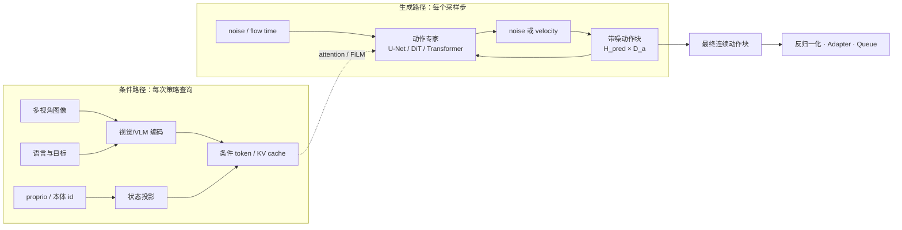
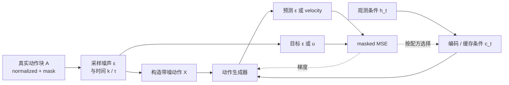

# Diffusion 与 Flow Matching：连续动作分布的生成式建模

> Diffusion 与 Flow Matching 都从简单噪声出发生成连续动作块。它们解决的是条件动作分布、轨迹耦合和多峰性，不负责自动解决视觉语义、坐标统一、动作调度或低层控制。

## 1. 学习目标

- 从行为克隆的条件分布说明为什么需要生成式动作头；
- 写出 DDPM 噪声预测与条件 Flow Matching 的训练/采样过程；
- 解释观测条件、带噪动作、时间条件和动作专家之间的数据流；
- 对比 Diffusion Policy、Octo、π0 与 SmolVLA 的模块位置；
- 根据多峰性、动作维度、推理预算和数据规模选择回归、Diffusion 或 Flow；
- 设计采样步数、缓存、chunk 与闭环调度的消融。

## 2. 从回归到条件生成

VLA 学习条件动作分布

\[
p(\mathbf A_t\mid h_t),
\qquad
\mathbf A_t\in\mathbb R^{H_{pred}\times D_a}.
\]

L1/L2 头给出一个确定性点估计。当相同观测和指令允许“从左绕”与“从右绕”等互斥轨迹时，点估计可能落在两种模式之间。生成式动作头增加随机变量 \(\boldsymbol\epsilon\)，学习

\[
\hat{\mathbf A}_t=G_\theta(\boldsymbol\epsilon,h_t),
\quad \boldsymbol\epsilon\sim\mathcal N(0,I),
\]

从而允许不同噪声样本映射到不同动作模式。生成能力是否带来控制收益，仍需在同一数据、Base 和执行协议下与回归头比较。

## 3. 条件 Diffusion

### 3.1 训练

给真实动作块 \(\mathbf A^0\) 加噪，离散噪声步为 \(k\)：

\[
\mathbf A^k=\sqrt{\bar\alpha_k}\mathbf A^0
+\sqrt{1-\bar\alpha_k}\boldsymbol\epsilon,
\quad \boldsymbol\epsilon\sim\mathcal N(0,I).
\]

网络根据带噪动作、观测条件与噪声步预测噪声：

\[
\mathcal L_{diff}
=\mathbb E\left[
\left\|\boldsymbol\epsilon-
\epsilon_\theta(\mathbf A^k,k,\mathbf c_t)\right\|_2^2
\right].
\]

其中 \(\mathbf c_t=f(h_t)\) 可由视觉编码器、VLM 或 Transformer readout 提供。动作 padding 和跨本体缺失维度仍需 mask；否则网络会把填充值当作真实动作模式。

### 3.2 推理

推理从 \(\mathbf A^K\sim\mathcal N(0,I)\) 开始，按 DDPM 或 DDIM 更新反复调用去噪器，得到 \(\mathbf A^0\)。采样步数减少会降低延迟，但可能增加轨迹误差；调度器、步数与是否随机采样都属于推理协议，必须随结果报告。

## 4. 条件 Flow Matching

Flow Matching 直接学习连续时间向量场。以本地 openpi 实现采用的约定为例：\(\tau=0\) 是数据，\(\tau=1\) 是噪声，线性路径为

\[
\mathbf X_\tau=\tau\boldsymbol\epsilon+(1-\tau)\mathbf A,
\qquad
\mathbf u_\tau=\boldsymbol\epsilon-\mathbf A.
\]

网络回归速度场：

\[
\mathcal L_{flow}
=\mathbb E_{\mathbf A,\boldsymbol\epsilon,\tau}
\left[
\left\|\mathbf v_\theta(\mathbf X_\tau,\tau,\mathbf c_t)
-\mathbf u_\tau\right\|_2^2
\right].
\]

推理从 \(\tau=1\) 的噪声向 \(\tau=0\) 积分，因此数值步长 \(\Delta\tau<0\)：

\[
\mathbf X_{\tau+\Delta\tau}
=\mathbf X_\tau+
\Delta\tau\,\mathbf v_\theta(\mathbf X_\tau,\tau,\mathbf c_t).
\]

有些论文使用“\(0\) 为噪声、\(1\) 为数据”的反向记号；两种写法等价，但速度场符号和积分方向会同时变化。工程实现中应以代码的路径定义为准，不能只复制公式的一半。

## 5. 动作专家的数据流

条件路径和生成路径是否分开，直接决定推理成本。如果每个采样步都重新计算完整视觉/VLM 主干，成本近似“采样步数 × 全模型”；若条件前缀只计算一次并缓存，迭代主要发生在较小动作专家中。

## 6. 条件怎样进入生成器

| 方式 | 机制 | 代表 | 工程影响 |
|---|---|---|---|
| FiLM / AdaLN | 条件产生 scale/shift 调制中间特征 | Diffusion Policy、DiT 系 | 条件计算可放在循环外；需定义每层注入位置 |
| Cross-attention | 动作 token 查询视觉/VLM 条件 token | 多种动作专家、SmolVLA | 条件长度影响每个采样步成本；KV 可缓存 |
| 共享 self-attention | 条件前缀与动作后缀进入统一注意力 | π0 | 交互紧密；需用 mask 保持预训练前缀分布与缓存边界 |
| Readout 条件 | 主干先压成 readout embedding，小头去噪 | Octo | 主干只前向一次；动作头容量决定轨迹表达 |

条件注入方式和生成目标是正交选择。使用 Transformer 动作专家不自动意味着 Flow，使用 DiT 也可以训练 Diffusion 噪声目标。

## 7. 四个代表系统

### 7.1 Diffusion Policy：动作生成路线源头

Diffusion Policy 本身不是 VLA。它以过去 \(T_o\) 步图像与 proprio 为条件，用 ResNet-18 提取视觉特征，通过 FiLM 调制 1D U-Net 或 Transformer 去噪器；预测 \(T_p\) 步并执行 \(T_a\) 步。论文训练使用 100 个扩散步，作者报告推理可用 10 步 DDIM，约 0.1 秒一次。该数字绑定论文硬件与实现，不能视为通用延迟。

它的重要贡献是将“多峰连续动作分布”和“预测一段、执行一截”的滚动时域接口组合起来。

### 7.2 Octo：小扩散头挂在模块化策略主干上

Octo-Small/Base 为 27M/93M Transformer。语言、目标图像和观测进入块式注意力主干，readout token 汇总条件；扩散迭代只在小动作头中进行。论文使用 OXE 25 个子集、约 80 万轨迹。其模块化价值在于新观测或动作头可通过 tokenizer/readout 接入，而不是把大型语言解码器反复放进采样循环。

### 7.3 π0：VLM 前缀与 Flow 动作专家共享注意力

π0 由约 3B PaliGemma 系 VLM 与约 300M 动作专家组成。图像和语言走 VLM 权重，本体状态与 \(50\times18\) 上限的带噪动作块走动作专家权重，两路在 self-attention 中交互。原论文/本地实现采用 10 步积分；条件前缀 KV 只计算一次，迭代时更新动作后缀。

这里的“50 步”是 \(H_{pred}\)，不是 50 次模型查询，也不能单独推出 \(H_{exec}\)。

### 7.4 SmolVLA：紧凑 Flow 专家与异步系统

SmolVLA 总规模约 0.45B，动作专家生成 50 步块并采用 10 步 Flow 采样。动作专家只读取 SmolVLM-2 前半部分层的特征，视觉侧每帧保留 64 token；异步队列又把动作执行与下一块生成并行。这说明模型采样效率与系统调度是两种可叠加优化，异步收益不能全部归因于 Flow。

## 8. Diffusion 与 Flow 的工程差异

| 维度 | Diffusion | Flow Matching |
|---|---|---|
| 学习对象 | 噪声、score 或其他扩散参数化 | 连续时间速度场 |
| 概率路径 | 预定义多步加噪过程和调度 | 可选择线性/OT 等插值路径 |
| 采样 | 随机或确定性反向过程 | ODE 数值积分为主 |
| 训练实现 | 噪声步、调度器、噪声预测 | 时间采样、路径、速度目标 |
| 推理旋钮 | DDPM/DDIM、步数、随机性 | 积分器、步数、时间网格 |
| 共同成本 | 多次调用动作生成器 | 多次调用动作生成器 |
| 共同接口 | 连续 action chunk + 条件表示 | 连续 action chunk + 条件表示 |

Flow 并不天然“一步生成”；π0 与 SmolVLA 仍使用 10 步积分。Diffusion 也不必每步重算大主干；Octo 和 Diffusion Policy 都将视觉条件放在循环外。真实延迟由动作专家规模、条件长度、缓存和采样步数共同决定。

## 9. 训练 Pipeline

训练时需要明确：

- 动作归一化和有效位 mask；
- 时间变量的分布，是否偏向高噪声区域；
- 视觉/VLM 条件模块冻结还是接收动作梯度；
- 条件 dropout、图像增强和缺失模态处理；
- 动作专家从零训练还是从机器人 Base 初始化；
- loss 是按有效元素、时间步还是样本归一化。

## 10. 推理 Pipeline 与延迟预算

一次动作块查询可拆成

\[
T_{query}=T_{encode}+N_{sample}T_{expert}
+T_{decode}+T_{transfer}.
\]

若未缓存条件，近似变为 \(N_{sample}(T_{encode}+T_{expert})\)。实际系统还应加观测采集、网络、队列等待和控制器延迟。需要分别测量：

- 首次查询与稳态查询；
- batch 1 和离线大 batch；
- 条件 KV 缓存命中率；
- 不同采样步数的动作误差与闭环成功率；
- 服务端吞吐与单机器人端到端延迟。

## 11. 怎样判断任务是否需要生成式动作头

优先寻找可观测证据，而不是凭任务名称判断：

1. 对相近上下文的专家动作做聚类，是否存在互斥模式；
2. L1/L2 策略是否输出不可执行的中间轨迹；
3. 失败是否来自模式平均，还是视觉、坐标、延迟或控制器；
4. 在相同 Base 和预算下，生成式头是否改善闭环，而不只是离线 NLL；
5. 采样多次是否产生有意义且可执行的多样性。

若数据高度单峰、目标域窄且首动作延迟严格，连续回归应作为强基线。若动作存在明显多峰、长块耦合或高维灵巧轨迹，Diffusion/Flow 更值得投入。

## 12. 可归因消融

| 变量 | 固定项 | 应报告 |
|---|---|---|
| L1 vs Diffusion vs Flow | Base、条件编码、数据、chunk、训练预算 | 成功率、收敛、采样延迟、动作质量 |
| 采样步数 | checkpoint、积分器/调度器其余设置 | 误差—延迟曲线，而非单点 |
| 缓存 | 相同模型与输出 | 首次/稳态延迟、显存、数值差异 |
| \(H_{pred}\) | 动作采样率、\(H_{exec}\) | 长期一致性与训练难度 |
| \(H_{exec}\) | 同一预测块 | 反馈及时性、查询率、成功率 |
| 随机种子/采样数 | 相同观测 | 多样性、最佳选择机制与额外计算 |

若从多个候选动作中挑最好，还必须说明价值函数、规则或人工筛选。只报告“采样 N 次后的最佳结果”会把额外测试时计算隐藏在模型比较中。

## 13. 常见失败

| 现象 | 可能机制 | 优先实验 |
|---|---|---|
| 轨迹过度平滑 | 头容量不足、卷积偏置、数据平均化 | Transformer 头/回归基线/jerk 对照 |
| 采样结果多样但都失败 | 条件 grounding 或动作坐标错误 | 固定动作头检查条件编码与 round-trip |
| 减少步数后突然退化 | 积分误差或时间分布不匹配 | 绘制步数—重建—闭环曲线 |
| 显存或延迟随步数线性爆炸 | 条件未缓存或反复跑大主干 | 分段 profiler 与 KV cache 对照 |
| 跨本体维度相互污染 | padding/mask/normalization 错误 | 单本体与统一维度对照、无效维梯度检查 |
| Flow 公式实现方向相反 | 路径端点与积分符号不一致 | 对单样本做已知向量场数值测试 |

## 14. 检查点

1. 为什么 Diffusion/Flow 的多峰能力不能由视频或轨迹“看起来更多样”单独证明？
2. π0 的 10 步积分为什么不等于 10 次完整 PaliGemma 前向？
3. 若把采样从 10 步降到 5 步，至少要画哪两条曲线？
4. 同一任务上 L1 胜过 Flow，能否推出该任务的数据分布单峰？还可能有哪些解释？

## 资料来源

- [Diffusion Policy 细读](../../依赖索引.md)
- [Octo 细读](../../依赖索引.md)
- [π0 细读](../../依赖索引.md)
- [SmolVLA 细读](../../依赖索引.md)
- [openpi 本地实现](../../依赖索引.md)
- [连续回归与 Action Chunk](<连续回归与Action Chunk.md>)
