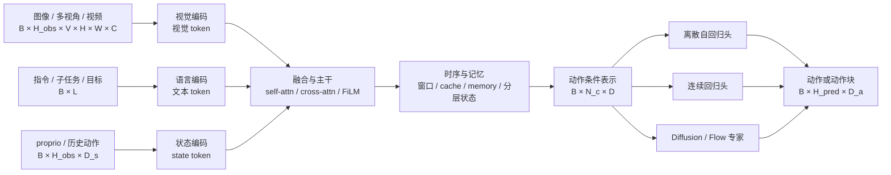

# 架构与动作生成：从多模态输入到动作条件

本目录讨论 VLA 模型内部的模块级工程：视觉、语言、机器人状态怎样成为表示，不同表示怎样通过注意力或条件化接口融合，历史与记忆怎样改变策略可见的信息，以及这些条件最终怎样进入离散、回归、Diffusion 或 Flow 动作模块。

本文档组面向已有 Transformer、VLM 和生成模型经验的研究者。重点是模块职责、语义 shape、训练与推理差异、技术选型和可归因实验；精确类名、逐层配置与运行命令由各 Baseline 和源码承担。

## 1. 整体数据流

下面的图回答一个问题：VLA 的“架构改动”通常落在哪个接口上？

读图时不要把每个方框理解为独立网络。OpenVLA 把视觉前缀、语言和动作 token 放在 Llama 主干内统一处理；π0 在一个注意力序列中使用 VLM 与动作专家两套权重；Octo 用输入 tokenizer、块式注意力和 readout token 形成模块接口；GR00T 则用 VLM 中间层 token 经 cross-attention 条件化 DiT。相同模块职责可以有完全不同的参数组织。

## 2. 阅读顺序

| 顺序 | 文档 | 核心产物 |
|---:|---|---|
| 1 | [视觉、语言与状态编码模块](视觉、语言与状态编码模块.md) | 能为任务选择视觉、语言和 proprio 表示，并说明各自的信息边界 |
| 2 | [多模态融合与 VLM 主干](多模态融合与VLM主干.md) | 能画出 token/条件在主干中的实际交互方式，区分 prefix、共享注意力和 cross-attention |
| 3 | [时序建模与记忆](时序建模与记忆.md) | 能区分观测窗口、动作块、KV cache、外部记忆和分层任务状态 |
| 4 | [离散动作 Token](离散动作Token.md) | 能把量化、词表映射、串行解码和动作精度放在同一个接口中分析 |
| 5 | [连续回归与 Action Chunk](<连续回归与Action Chunk.md>) | 能区分预测长度、执行长度与重规划策略，并设计连续动作头对照 |
| 6 | [Diffusion 与 Flow Matching](<Diffusion与Flow Matching.md>) | 能从条件生成、动作专家和采样预算解释连续多峰策略 |
| 7 | [分层、混合与双系统架构](分层、混合与双系统架构.md) | 能拆开语义层级、表示混合、刷新频率与梯度耦合四类设计轴 |
| 8 | [预测式 VLA 与世界模型辅助](预测式VLA与世界模型辅助.md) | 能区分 future auxiliary、WAM 与模型式决策，并匹配相应评估证据 |

## 3. 本组文档共用的接口语言

统一用以下符号描述模块，不要求具体模型都实现全部字段：

\[
\begin{aligned}
I &\in \mathbb{R}^{B\times H_{obs}\times V\times H\times W\times C},\\
X_v &\in \mathbb{R}^{B\times N_v\times D_v},\qquad
X_l \in \mathbb{R}^{B\times N_l\times D_l},\\
q &\in \mathbb{R}^{B\times H_{obs}\times D_s},\qquad
X_s \in \mathbb{R}^{B\times N_s\times D},\\
A &\in \mathbb{R}^{B\times H_{\mathrm{pred}}\times D_a}.
\end{aligned}
\]

- \(H_{obs}\)：策略显式观察的历史长度，不是动作块长度；
- \(V\)：相机或视觉流数量；
- \(N_v,N_l,N_s\)：进入融合模块的 token 数；
- \(D\)：共享隐空间宽度，必要时由 projector 对齐；
- \(H_{\mathrm{pred}}\)：一次预测的动作 horizon；
- \(H_{\mathrm{exec}}\)：部署时实际执行的动作数，通常不等于 \(H_{\mathrm{pred}}\)。

“语义 shape”比精确 tensor shape 更重要。例如，一个 state token 表示当前构型，和 50 个 action token 表示未来轨迹，在注意力中承担的因果角色不同；即使二者最终宽度都为 \(D\)，也不能视为可交换输入。

## 4. 五类架构接口

| 接口 | 它决定什么 | 常见改动 | 需要控制的对照 |
|---|---|---|---|
| 视觉 → token | 语义、局部几何、视角与 token 成本 | 单/双 encoder、分辨率、pixel shuffle、视频编码 | 同数据与动作头替换视觉端；相机/背景扰动 |
| 语言 → 条件 | 指令粒度、开放词汇与子任务语义 | VLM 内语言、独立 T5、自然语言中介 | language-off、改写、冲突指令与视觉捷径 |
| state → token | 当前机器人构型与接触上下文 | 不输入、prefix、动作专家侧注入、每本体 MLP | state-off、state-shuffled、相同起点/不同姿态 |
| 模态融合 | 谁能看谁、条件怎样传播 | prefix self-attn、block mask、cross-attn、FiLM | 参数/计算匹配；冻结与梯度路径一致 |
| 时间与记忆 | 策略能利用多长的可观测历史 | 帧堆叠、因果窗口、cache、外部 memory、子任务状态 | 单帧、同 token 预算窗口、随机/过期记忆 |

## 5. 代表结构快速定位

| 模型 | 视觉/语言/状态入口 | 融合接口 | 时序假设 | 最值得学习的结构问题 |
|---|---|---|---|---|
| OpenVLA | 单图；DINOv2 + SigLIP；语言；原版不输入 proprio | 视觉 projector 形成 Llama 前缀，语言与动作自回归 | 主要是当前观测，原版无 action chunk | 双视觉特征是否提升空间控制；动作训练为何需要解冻视觉端 |
| Octo | 语言/目标图像、多观测 tokenizer | 块式因果注意力 + readout token | 论文采用 2 帧历史 | 怎样以 mask 和 readout 获得可插拔输入/输出 |
| π0 / openpi | 多视角、语言、state、带噪动作块 | 一个注意力序列、VLM/动作专家双权重 | 当前条件 + 50 步动作块；前缀可缓存 | 状态和动作 token 如何读取 VLM 语义而不改变其因果角色 |
| SmolVLA | 多视角、语言、state prefix | 动作专家读取 SmolVLM-2 前半层特征，交错 CA/SA | 50 步块 + 异步动作队列 | 中间层、视觉 token 压缩与轻量专家怎样共同降本 |
| GR00T N1 | 多图、语言、每本体 state/action encoder | Eagle-2 中间层 token cross-attend 到 DiT | 语义与动作模块不同频率；16 步块 | 组件化双系统怎样定义清晰的条件接口 |

表中频率、参数和 horizon 是论文或作者报告的实现事实，不应脱离硬件、控制协议和评测任务横向排名。

## 6. 选择架构的起点

1. 先定位信息缺口：失败来自语义、几何、机器人构型、历史还是动作生成？
2. 再选择注入位置：进入 VLM prefix、共享 self-attention、动作专家 cross-attention，还是独立记忆模块？
3. 明确训练责任：模块冻结、联合更新还是 stop-gradient；辅助监督是否只在训练存在？
4. 明确推理成本：新增 token 是否每个去噪步重复计算，能否缓存，是否改变动作调度？
5. 设计单变量证据：模块 on/off 不够时，加入 shuffle、过期信息、相同参数量和相同 wall-clock 对照。

## 7. 图示约定

本目录的 Mermaid 遵守以下语义：

- 实线表示前向数据或控制路径；
- 虚线表示训练专属监督、缓存、可选条件或反馈，虚线必须写标签；
- 数据节点注明语义 shape，模块节点注明变换职责；
- **[F]** 表示冻结模块，**[T]** 表示参与当前目标的训练模块；
- 一张图只回答一个结构问题，模型比较使用表格，不用装饰性关系图。

## 资料入口

- [VLA 系统数据流](../基础/VLA系统数据流.md)
- [任务定义与输入输出协议](../基础/任务定义与输入输出协议.md)
- [OpenVLA 细读](../../依赖索引.md)
- [π0 细读](../../依赖索引.md)
- [SmolVLA 细读](../../依赖索引.md)
- [Octo 细读](../../依赖索引.md)
- [GR00T N1 细读](../../依赖索引.md)
