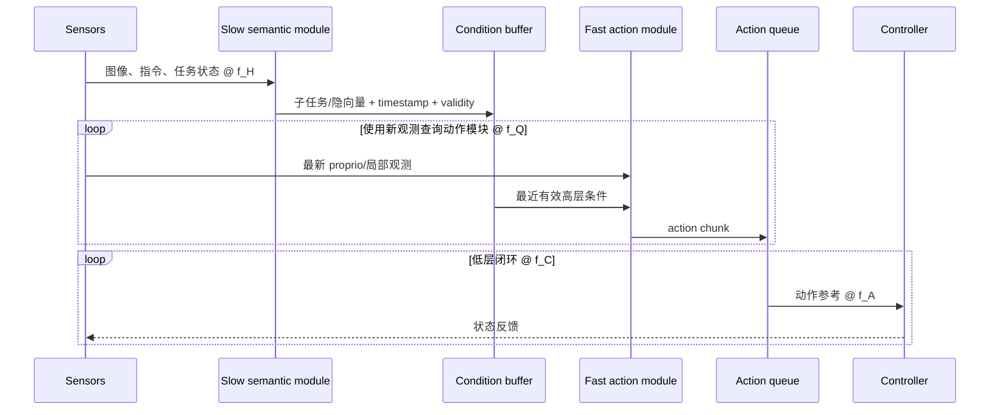
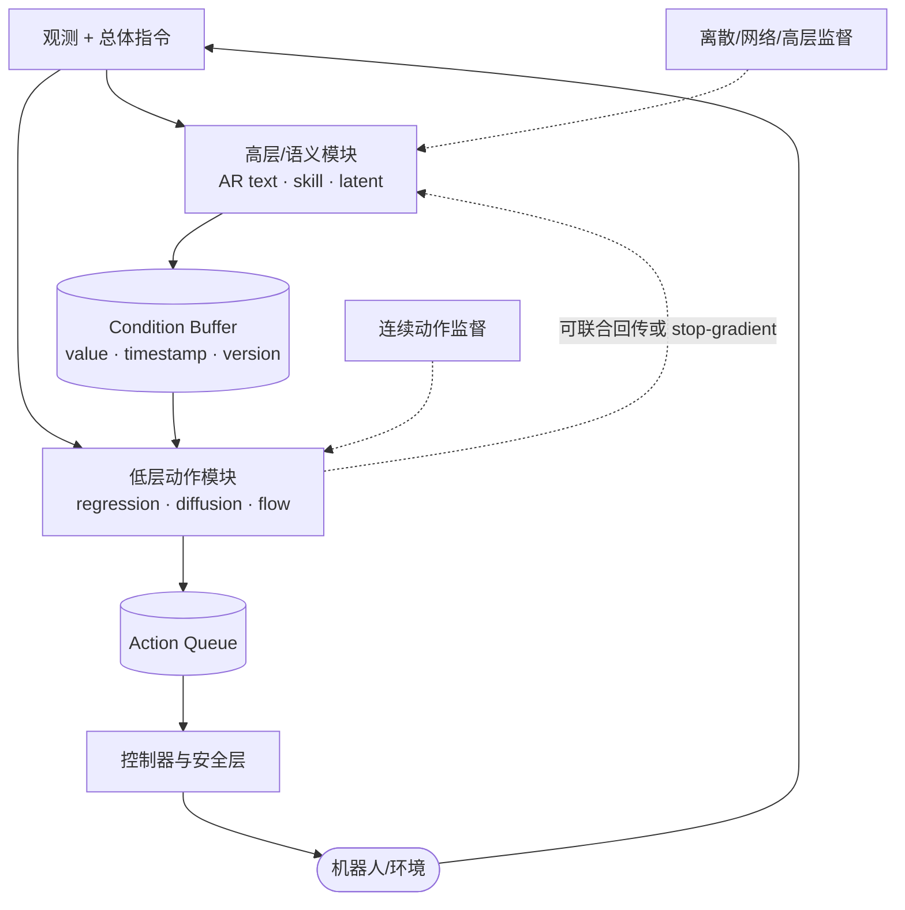
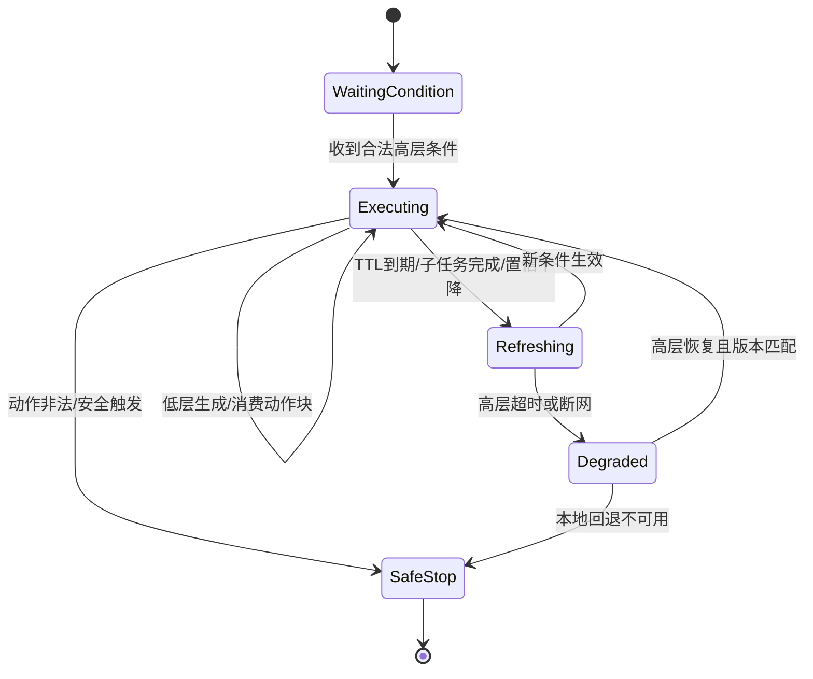

# 分层、混合与双系统架构：语义、频率与梯度怎样解耦

> “有两个模块”“有动作专家”“输出子任务”和“快慢系统”不是同一个概念。本文把语义分层、表示混合、频率解耦、物理部署和梯度隔离拆成可独立设计与验证的工程轴。

## 1. 学习目标

- 用明确判据区分分层策略、混合动作表示、动作专家、双系统和知识隔离；
- 写出高层—低层接口及其刷新、缓存和失效协议；
- 解释 π0、π0.5、GR00T N1、Helix 和 π0.6 分别解耦了什么；
- 设计同步/异步、显式子任务/隐向量和端到端/冻结接口的对照；
- 定位陈旧条件、层间错误、频率误报和梯度冲突。

## 2. 五个正交设计轴

| 轴 | 拆分对象 | 判据 | 典型问题 |
|---|---|---|---|
| 语义分层 | “做什么”与“怎么做” | 是否存在子任务、skill、waypoint 等高层中介 | 长程任务如何分解、何时切换 |
| 表示混合 | 离散语义与连续动作 | 是否同时使用 token 与连续生成目标 | 如何兼顾网络知识与精细控制 |
| 模块专家化 | 图文 token 与动作 token 的参数路径 | 是否有专用动作权重/头 | 大主干是否需在每个动作采样步运行 |
| 频率/部署解耦 | 慢语义计算与快动作流 | 是否以不同刷新率或进程/设备运行 | 条件陈旧、异步同步与故障传播 |
| 梯度隔离 | 动作损失到语义 Backbone 的反向路径 | 是否 stop-gradient、冻结或分阶段训练 | 遗忘、梯度冲突和协同适配 |

一个模型可以同时位于多条轴上。π0 有专用动作专家，但通常仍是一次同步模型调用，不应仅据此称为严格的多速率双系统；π0.5 有显式语言子任务分层，但高低层共享同一个 Transformer；GR00T N1 有 VLM 与 DiT 两个模块和频率分工，同时仍可端到端联合训练。

## 3. 分层策略的理论形式

给定总体指令 \(L\) 和历史 \(h_t\)，高层产生当前子任务 \(g_k\)，低层产生动作块：

\[
g_k\sim\pi_H(g\mid h_{t_k},L),
\qquad
\mathbf A_t\sim\pi_L(\mathbf A\mid h_t,g_k),
\quad t_k\le t<t_{k+1}.
\]

联合分布可分解为

\[
p(\mathbf A_t,g_k\mid h_t,L)
=p(\mathbf A_t\mid h_t,g_k,L)\,p(g_k\mid h_t,L).
\]

若低层接口被设计为“子任务 \(g_k\) 已包含与当前动作有关的全部语言信息”，才进一步采用条件独立假设 \(\mathbf A_t\perp L\mid(h_t,g_k)\)，把第一项简化为 \(p(\mathbf A_t\mid h_t,g_k)\)。这是可验证的接口假设，不是一般链式法则。

关键不是公式本身，而是 \(g_k\) 的工程契约：

- 表示：自然语言、离散 skill id、目标图像、3D waypoint 或隐向量；
- 有效期：固定时间、完成判据、置信度下降或事件触发；
- 可执行域：低层是否见过该子任务分布；
- 失败语义：重试、回退、请求高层重规划还是安全停止；
- 日志：需要保留高层输入、输出、版本和生效时间。

## 4. 多速率双系统

设高层刷新率 \(f_H\)、使用新观测的动作模块查询率 \(f_Q\) 和控制器闭环率 \(f_C\)。在严格多速率实现中常见

\[
f_H < f_Q \le f_C.
\]

这个不等式只描述模块调度，不把动作块内部参考率 \(f_A\) 合并进来：一次 \(f_Q\) 查询可以生成按 \(f_A\) 采样的多个未来 setpoint，低层再以 \(f_C\) 插值或跟踪。若部署没有独立调度日志，就不能只凭两个参数模块宣称满足该不等式。

双系统成立的工程条件不是“图里有两个框”，而是高层条件能被缓存、带版本生效，并由较快路径重复消费。若两个模块每次都同步串行执行，整体刷新率仍由慢模块决定。

## 5. 接口可以传什么

| 接口 | 优点 | 代价 | 验证重点 |
|---|---|---|---|
| 自然语言子任务 | 可解释、可人工修改、可复用网络文本数据 | 语义粒度不稳定，可能超出低层能力 | 子任务词表覆盖、切换、错误恢复 |
| 离散 skill token | 接口稳定、易约束和统计 | 需要定义技能库，开放世界扩展受限 | skill coverage 与参数 grounding |
| 目标图像/状态 | 明确目标结果，减少语言歧义 | 需要目标生成或检索 | 可达性与目标泄漏 |
| 3D waypoint/姿态 | 接近规划控制接口 | 依赖空间估计与坐标精度 | frame、碰撞和运动学可达性 |
| 隐向量/token 序列 | 信息丰富、端到端联合优化 | 难解释、版本耦合、跨模型不可复用 | stale embedding、分布漂移、接口消融 |

显式语言不天然比隐向量更好。语言接口提供可观测性和数据复用，隐向量保留更多连续信息。选择应与调试、跨组件升级和安全需求一起评估。

## 6. 混合离散—连续模型

混合模型可以同时训练离散目标与连续动作目标：

\[
\mathcal L
=\mathcal L_{AR}(y_{text/token})
+\alpha\mathcal L_{cont}(\mathbf A).
\]

需要明确四个问题：

1. 两类样本是否都含动作监督；
2. 不适用的 loss 如何 mask；
3. 两个目标是否更新同一主干；
4. 推理时先生成离散中介，还是直接使用连续动作头。

混合目标不是把两个 loss 相加即可。若网络图文数据没有动作标签，连续分支必须关闭；若连续动作梯度覆盖 VLM 主干，可能改善机器人视觉，也可能破坏语言能力。分阶段训练、损失权重和 stop-gradient 都是解决不同问题的工具。

## 7. 五类代表结构与解耦位置

### 7.1 π0：专家化，但不是严格多速率双系统

π0 在一个 Transformer 中设置 VLM 权重与约 300M 动作专家权重。图文前缀和动作后缀共享注意力，动作采样时可以缓存前缀。它实现的是参数路径与计算路径分工，但高层并不单独输出子任务，也没有两套独立刷新循环。因此更准确的名称是“带专用动作专家的单一 VLA”。

### 7.2 π0.5：显式语言子任务 + 连续底层

π0.5 将总体指令先变成自然语言子任务 \(\hat L\)，再由 Flow action expert 生成 50 步连续动作块：

\[
\pi(\mathbf A,\hat L\mid O,L)
=\pi(\mathbf A\mid O,\hat L)\pi(\hat L\mid O,L).
\]

预训练阶段以 \(\alpha=0\) 统一训练文本、边界框和 FAST 动作 token；后训练加入随机初始化的 action expert，以论文配方 \(\alpha=10\) 联合连续 Flow loss，再专门化约 80k 步。论文披露预训练约 280k 步。这里的数字描述作者 recipe，不是通用最优值。

高层与低层仍在一个组合模型中。其核心是语义层级和表示混合，而不是物理上独立部署的两套网络。

### 7.3 GR00T N1：VLM System 2 + DiT System 1

GR00T N1 约 2.2B，其中 Eagle-2 VLM 约 1.34B。System 2 从中间层取视觉语言 token；System 1 使用交替 cross-attention/self-attention 的 Flow DiT，读取 VLM token、proprio 和带噪动作，生成 16 步块。两者以 cross-attention 桥接并端到端联合优化。

NVIDIA 的公开材料混合了三种口径：System 2/VLM 约 10 Hz 的模块吞吐、L40 bf16 生成一个 16 步动作块约 63.9 ms 的块延迟，以及动作样本/闭环执行流最高 120 Hz 的系统声明。120 Hz 不是 System 1 网络查询率，也不能解释为每秒 120 次完整 2.2B 模型调用；这些数字均缺少独立第三方统一测量。

### 7.4 Helix 与端云拆分

Figure 在 Helix 新闻稿中自报 7B System 2 约 7–9 Hz、80M System 1 约 200 Hz，当前没有论文、权重或独立统一评测。端云系统还可以让云端语义模型异步更新、本地动作 decoder 持续消费缓存条件。此类系统的关键研究问题不是模型总参数，而是网络中断、条件过期和本地降级能否被定义与验证。

### 7.5 Knowledge Insulation：梯度轴

π0.6 的 Knowledge Insulation 对动作专家到语义主干采用 stop-gradient，使主干保留离散/网络数据目标，连续动作梯度不回流。它解决训练干扰，不自动带来独立刷新率或物理双系统。实验应同时测量动作能力和 VLM 能力保持，而不是只看机器人成功率。

## 8. 架构总图

这张图把训练接口和部署接口放在同一视图：condition buffer 是频率解耦的边界，最后一条虚线是梯度耦合的边界。两者是否存在需要分别报告。

## 9. Condition Buffer 契约

| 字段 | 含义 |
|---|---|
| `payload` | 子任务、skill、waypoint 或隐 token |
| `generated_at` | 高层使用的观测时间 |
| `effective_from` | 允许低层开始消费的时间 |
| `expires_at` / TTL | 条件过期规则 |
| `model_version` | 生成条件的高层版本 |
| `confidence/status` | 正常、不确定、完成、失败或需重规划 |
| `scope` | 适用的机器人、任务和控制模式 |
| `fallback` | 过期、断网、非法条件时的动作 |

隐向量接口尤其需要版本绑定：高层升级后，向量分布可能变化，旧低层模型不能假定仍可消费。语言或 skill 接口也需要 schema，而不是任意字符串。

## 10. 训练策略

### 10.1 分开训练

高层由子任务/网络数据训练，低层由动作示范训练。优点是数据来源和归因清晰；代价是接口分布错配，高层生成的条件可能不同于低层训练时的专家标签。

### 10.2 联合训练

动作梯度回传高层，使条件适配低层控制。优点是协同；代价是语义能力遗忘、目标竞争和显存成本。需要语言/VQA 保持评估与机器人评估同时出现。

### 10.3 两阶段训练

先用统一离散目标吸收异构数据，再增加连续动作专家。π0.5 属于此类。需要说明新增模块初始化、旧模块解冻范围、数据混合变化和两个阶段的损失权重。

### 10.4 梯度隔离

连续动作分支读取高层激活但不更新高层。它降低干扰，却也阻止动作任务改善上游表征。应与“完全冻结”“部分解冻”和“联合回传”做受控比较。

## 11. 在线调度与安全

多速率系统至少定义以下状态机：

如果论文或系统没有说明过期、故障和切换行为，“异步双系统”仍不是完整部署方案。

## 12. 可归因实验

### 12.1 分层是否有效

- Flat policy：总体指令直接生成动作；
- Hierarchical-oracle：使用人工正确子任务；
- Hierarchical-predicted：使用模型生成子任务；
- Hierarchical-corrupted：系统性扰动子任务。

oracle 与 predicted 的差距度量高层错误；flat 与 oracle 的差距度量分层接口的潜在收益；corrupted 组检验低层是否真正使用高层条件。

### 12.2 频率解耦是否有效

固定权重和动作块，比较同步串行、缓存同步和真正异步。报告：

- 高层刷新率、动作块生成率、动作采样率、伺服频率；
- 条件年龄分布与过期次数；
- 首动作/稳态延迟、队列耗尽和安全降级；
- 相同任务下的成功率与完成时间。

### 12.3 梯度策略是否有效

固定数据和架构，比较全回传、冻结语义 Backbone、stop-gradient 和分阶段解冻。除闭环成功率外，还应测试语言跟随、对象 grounding、VQA/视觉能力保持和训练稳定性。

## 13. 常见失败

| 现象 | 原因 | 定位方式 |
|---|---|---|
| 低层执行旧子任务 | condition buffer 无 TTL/版本 | 记录条件生成与生效时间 |
| 高层频繁切换 | 完成判据抖动或语义粒度过细 | 加 hysteresis，检查切换统计 |
| oracle 子任务很好、预测子任务很差 | 高层是瓶颈 | 独立评测子任务与 grounding |
| 子任务文本正确但动作错误 | 低层接口覆盖或动作能力不足 | 固定人工条件测试低层 |
| 异步更快但成功率下降 | 条件陈旧或队列覆盖策略 | 按条件年龄分桶分析 |
| 联合训练动作提升、语言退化 | 梯度冲突/遗忘 | 对照 stop-gradient 与 co-training |
| 宣称 120/200 Hz 但端到端很慢 | 混淆执行率与完整模型查询 | 分模块测量并标频率对象 |

## 14. 检查点

1. 为什么 π0 有两个专家仍不能自动称为严格双系统？
2. π0.5 的“分层”与 GR00T N1 的“快慢系统”分别拆了什么？
3. stop-gradient 能解决条件陈旧吗？为什么？
4. 如何用 oracle 子任务实验判断失败来自高层还是低层？
5. 一个云端 VLM 断网后继续执行缓存 chunk，需要哪些安全与过期字段？

## 资料来源

- [双系统/分层架构原理](../../依赖索引.md)
- [π0 细读](../../依赖索引.md)
- [π0.5 细读](../../依赖索引.md)
- [GR00T N1 细读](../../依赖索引.md)
- [Helix 资料与开放边界](../../依赖索引.md)
- [Knowledge Insulation](../../依赖索引.md)
- [推理加速与部署](../../依赖索引.md)
