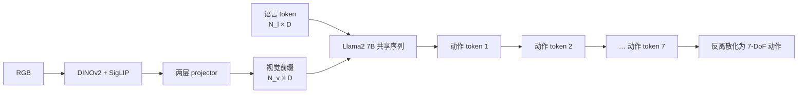
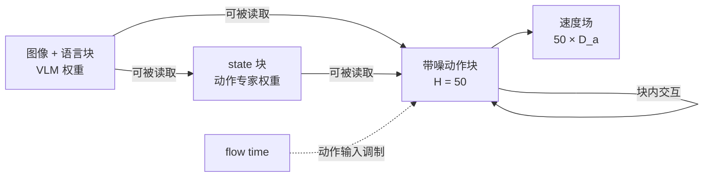
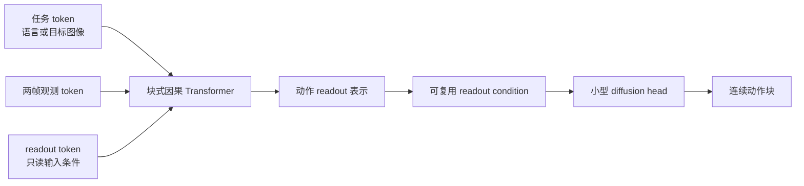
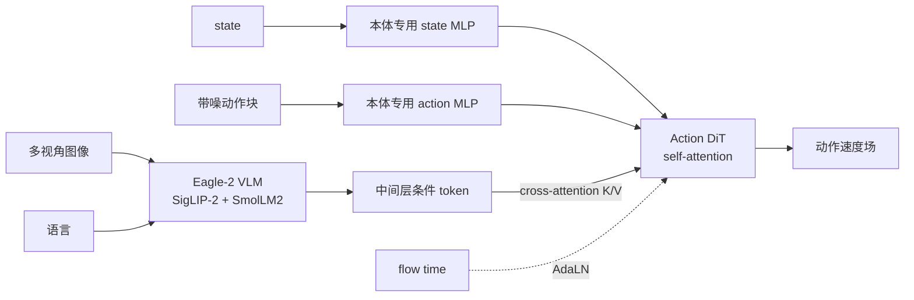

# 多模态融合与 VLM 主干

多模态融合的工程问题不是“把 token 拼起来”，而是定义：哪些 token 可以读取哪些条件、条件在第几层进入、梯度更新哪些参数，以及静态前缀能否在动作生成过程中复用。它直接决定语义主干和动作模块如何分工。

## 1. 用注意力访问图描述融合

标准注意力可写为

\[
\operatorname{Attn}(X)=\operatorname{softmax}
\left(\frac{QK^\top}{\sqrt d}+M\right)V.
\]

其中 \(M\) 不是实现细节，而是因果结构：当 \(M_{ij}=-\infty\) 时，第 \(i\) 个 query 不能读取第 \(j\) 个条件。VLA 的融合设计至少包含四个变量：

- **token 化**：视觉、语言、state、带噪动作分别形成多少 token；
- **访问权限**：全双向、因果、块式因果还是只通过 cross-attention；
- **参数归属**：共享主干、VLM 与动作专家双权重，或完全独立组件；
- **更新路径**：全量反传、冻结、参数高效更新或 stop-gradient。

相同的 \(B\times N\times D\) shape 不意味着相同结构。视觉 token 是条件，动作 token 是待生成变量；若 attention mask 相反，二者在模型中的角色也相反。

## 2. 四类融合接口

| 融合接口 | 条件传播方式 | 优点 | 代价或风险 | 代表实例 |
|---|---|---|---|---|
| 前缀 + 共享 self-attention | 视觉/语言作为动作序列前缀 | 复用 VLM/LLM 生成接口，耦合紧 | 动作占用词表或主干；高频控制成本高 | OpenVLA |
| 块式 mask + 共享序列 | 不同 token 块有显式读取权限 | 因果角色清楚，可容纳 state 与动作块 | mask 和位置编码更复杂 | π0、Octo |
| 组件化 cross-attention | 动作模块用 query 读取 VLM 条件 | 语义/控制解耦，动作生成可轻量迭代 | 接口层选择与信息瓶颈需验证 | GR00T N1、SmolVLA |
| FiLM / AdaLN 条件化 | 条件产生缩放、偏置或门控 | 不增加大量条件 token 交互 | 可能压缩细粒度空间对应 | GR00T 的 flow time 等 |

实际模型会组合这些接口。例如 GR00T N1 的动作 DiT 内既有动作/状态 self-attention，也用 cross-attention 读取 VLM token，并以 AdaLN 注入 flow time。

## 3. 前缀式共享主干：OpenVLA

OpenVLA 将双视觉 encoder 的输出投影为 Llama2 7B 可读取的前缀，语言 token 接在前缀之后，七个动作维度分别离散为动作 token 并自回归生成。

这个结构的强项是接口统一：动作预测可以直接使用语言模型的 next-token 训练。它的限制也来自同一设计：每个动作维度是词表事件，连续相关性主要靠主干上下文学习；原版又没有显式 proprio 或 action chunk。若改成连续动作专家，改变的不只是输出头，还包括生成因子分解和推理次数。

## 4. 块式访问：π0 与 Octo

### 4.1 π0 的三块序列

π0 约由约 3B 的 PaliGemma VLM 与约 300M 的 action expert 构成。二者处在一次联合注意力计算的序列中，但使用两套投影和 FFN 权重。序列包含图像/语言块、state 块和带噪动作块；访问权限保证后面的控制变量读取前面的语义条件，而条件前缀不读取待生成动作。

这不是两个 Transformer 简单串联：它们共享注意力序列和条件可见性，但保留不同参数容量。图像/语言前缀在多次 Euler 积分中不变，因此其 K/V 可缓存；这属于推理复用，不等于跨控制时刻的长期记忆。

### 4.2 Octo 的 readout 接口

Octo 把任务条件与观测 token 放进块式因果 Transformer。学习到的 readout token 可以读取对应条件与观测，但输入 token 不反向读取 readout；动作头只依赖 readout。这样，主干输出接口不绑定某一种动作头。

Octo 的 diffusion 迭代主要发生在小型动作头，而不是每一步重复完整 backbone。缓存的是 readout 形成的条件接口，而不是绕过 readout 直接把任意主干状态送入动作头；这一计算边界是 readout 设计的重要工程意义。

## 5. 组件化 cross-attention：GR00T 与 SmolVLA

GR00T N1 从 Eagle-2 VLM 的中间层（作者实现使用第 12 层）取语义 token，作为 action DiT 的 cross-attention 条件；state 与带噪动作由 embodiment-specific MLP 映射后在动作侧交互。VLM 与控制模块的频率和参数责任因此可以分开。

SmolVLA 也采用语义主干与动作专家的组件化边界，但其动作专家读取 SmolVLM-2 前半段层的表示，并交替使用 cross-attention 与动作侧 causal self-attention。这里“读取中间层”是技术选择：过浅可能语义不足，过深可能更语言化且计算更重，应通过层位消融而不是按直觉固定。

## 6. 模块 I/O 与梯度责任

| 模块 | 输入语义 shape | 输出语义 shape | 训练责任 |
|---|---|---|---|
| VLM 主干 | \(X_v,X_l\)，可选 \(X_s\) | 条件 token \(C\in\mathbb R^{B\times N_c\times D_c}\) | 学习语义、空间和任务条件；可冻结或联合更新 |
| 共享 projector | \(D_v,D_l,D_s\) 的异构 token | 统一宽度 \(D\) | 对齐接口；不能替代上游适配 |
| attention mask | token 类型和时间索引 | 可访问关系 | 无参数，但决定因果结构 |
| cross-attention adapter | 动作 query 与条件 K/V | 条件化动作表示 | 学习控制变量从哪些条件取信息 |
| readout token | 条件与观测 token | 固定数量任务表示 | 把可变输入压成动作头稳定接口 |
| 动作专家 | 条件表示、state、噪声动作与时间 | token logits、动作回归或速度场 | 学习动作分布与跨时间相关性 |

“冻结 VLM”不是一个完整实验描述。至少需要说明视觉 encoder、语言模型、projector、cross-attention adapter 和归一化层分别是否更新。只训练 action expert 时，控制损失仍能更新专家如何读取条件，但不能修正 VLM 本身对机器人几何的表示。

## 7. 训练与推理差异

### 7.1 训练

- OpenVLA 用 teacher forcing 预测真实动作 token，交叉熵只在动作位置计算，但梯度可经过视觉前缀与 Llama 主干。
- π0、SmolVLA 和 GR00T 对真实动作块采样 flow time 与噪声，动作专家预测速度场；条件前缀在一个训练样本内固定。
- Octo 主干产生 readout，diffusion head 在带噪动作上学习去噪目标；条件 dropout 让同一主干兼容缺失任务条件。
- 块式 mask 必须同时作用于训练和推理。训练中意外允许条件读取未来动作，会产生部署时不存在的信息泄漏。

### 7.2 推理

| 结构 | 主干前向次数 | 动作侧迭代 | 可复用内容 | 主要延迟来源 |
|---|---:|---:|---|---|
| OpenVLA 自回归 | 每个新 token 增量生成 | 7 个动作 token | 已生成 token 的 KV | 7B 主干逐 token 解码 |
| π0 flow | 条件前缀一次，专家多步调用 | 作者实现为 10 个 Euler 步 | 图像/语言前缀 KV | 大前缀 + 多次动作专家 |
| SmolVLA flow | VLM 条件提取后专家迭代 | 作者实现为 10 步 | 条件特征、异步队列 | VLM 编码与轻量专家 |
| Octo diffusion | backbone 一次 | 小型头迭代 | readout 表示 | diffusion head 采样 |
| GR00T N1 flow | VLM 条件可缓存，动作模块独立迭代 | 论文/作者配方为 4 个 Euler 步 | VLM 中间条件 | 多视角 VLM + DiT；应分别报告动作块生成延迟与动作样本/执行率 |

迭代次数和延迟是具体实现事实，不能只凭表中步数判断速度；动作维度、硬件、精度、缓存和通信都需同时报告。GR00T N1 材料中的约 63.9 ms 块生成延迟与最高 120 Hz 动作执行声明属于不同口径，均不能直接改写为“VLM 每秒查询 120 次”。

## 8. 如何做架构选择

| 任务或系统约束 | 优先结构 | 选择原因 | 需要承担的验证 |
|---|---|---|---|
| 快速把 VLM 改成单步策略 | prefix + AR/回归 | 改动接口少 | 连续性、推理频率、state 缺失 |
| 需要联合建模 state 与动作块 | 块式共享序列 | 显式控制读取关系 | mask 正确性和参数成本 |
| 语义与控制频率差异大 | VLM + cross-attention 专家 | 条件可缓存，动作模块可独立迭代 | 中间层选择和接口瓶颈 |
| 多任务、多输入协议 | tokenizer + readout | 输入输出可插拔 | mask、缺失模态和数据异质性 |
| 高频控制且算力受限 | 小型动作头或专家 | 不必重复完整 VLM | 条件陈旧、动作头容量 |

## 9. 可归因消融设计

### 9.1 融合类型

在相同视觉/语言 encoder、state、动作目标和训练数据下比较 prefix self-attention 与 cross-attention。用 projector 或专家宽度匹配可训练参数，并同时报告 FLOPs、wall-clock 和缓存后延迟。否则“cross-attention 更好”可能只是额外参数更大。

### 9.2 访问权限

保留相同参数，只改 attention mask：动作能否读取全部条件、state 是否能读取视觉语言、动作块内部是因果还是双向。需要加入信息泄漏检查，例如打乱未来动作后训练指标是否异常不变。

### 9.3 中间层位置

对于 GR00T/SmolVLA 式接口，从浅、中、深层读取条件，保持动作专家不变。报告语义泛化、精细定位和时延，避免只用总成功率掩盖不同层的功能差异。

### 9.4 梯度路径

比较冻结 VLM、只训练 projector/adapter、部分解冻、全量更新。训练 token 数和优化器预算相同，并检查通用视觉语言能力是否退化。这样才能区分“接口学习不足”和“主干需要机器人域适配”。

### 9.5 条件使用测试

对语言、视觉视角和 state 分别做 off、shuffle、contradict 三类干预。仅做模态删除会改变输入分布；shuffle 能保留边缘分布而破坏对应关系，更适合检验融合模块是否真的使用跨模态配对。

## 10. 常见误解

- **有 action expert 就是双系统**：专家只是参数边界；双系统还需要明确不同时间尺度、职责与接口。
- **cross-attention 一定比 prefix 更解耦**：若 VLM 仍被动作损失全量更新，训练责任依旧高度耦合。
- **中间层特征天然更适合控制**：层位需要同时按语义、几何和成本验证。
- **KV cache 是记忆**：它复用固定前缀计算，不表示跨时刻维护任务状态。
- **只画模块框图就说明了融合**：必须标出 query、K/V、mask 和梯度路径中的至少相关部分。

## 11. 代表实现事实与边界

| 模型 | 融合事实 | 需要避免的外推 |
|---|---|---|
| OpenVLA | 视觉前缀进入 Llama2 7B，动作按 token 自回归生成 | 原版结构不代表所有 OpenVLA 后续连续头改造 |
| π0 | PaliGemma 与约 300M action expert 在块式序列中使用双权重；\(H=50\) | 10 步 Euler 是作者实现选择，不是 flow 必需值 |
| Octo | 块式因果主干 + readout；diffusion 迭代位于小型头 | 两帧历史和具体 head 不能直接代表全部下游配置 |
| SmolVLA | 动作专家读取 SmolVLM-2 前半层特征，交错 CA/SA；\(H=50\) | 轻量不等于所有硬件上都达到同一控制频率 |
| GR00T N1 | Eagle-2 第 12 层条件化 action DiT；\(H=16\)，作者实现 4 个 Euler 步 | 作者报告的速度依赖部署栈和硬件 |

## 一手资料与延伸阅读

- [OpenVLA 论文与代码笔记](../../依赖索引.md)
- [π0 论文与代码笔记](../../依赖索引.md)
- [Octo 论文与代码笔记](../../依赖索引.md)
- [SmolVLA 论文与代码笔记](../../依赖索引.md)
- [GR00T N1 论文与代码笔记](../../依赖索引.md)
- [视觉、语言与状态编码模块](视觉、语言与状态编码模块.md)
- [时序建模与记忆](时序建模与记忆.md)
