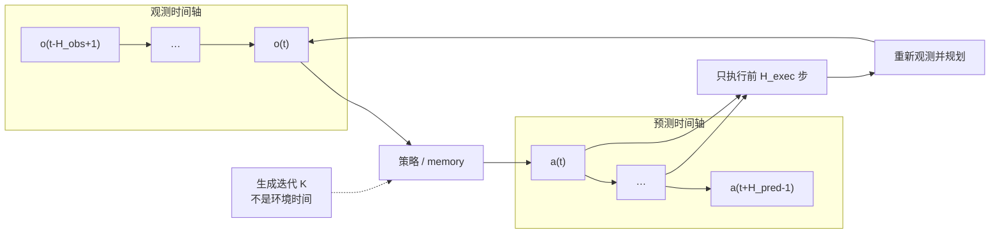
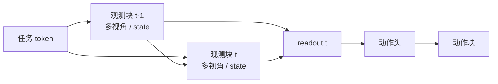
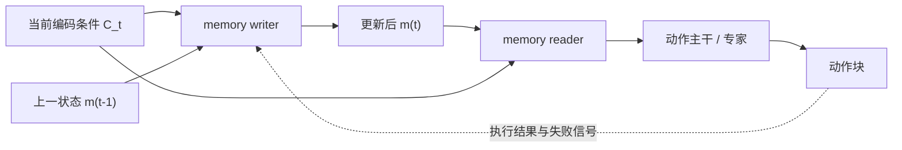
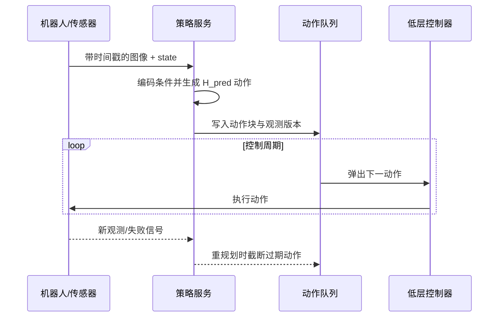

# 时序建模与记忆

VLA 文献中的“时间”至少有四个不同变量：可见的观测历史、一次预测的动作长度、实际开环执行长度，以及生成动作所用的迭代次数。把它们统称为 horizon，会让数据构造、模型设计和部署诊断混在一起。

## 1. 先分清四条时间轴

\[
H_{\mathrm{obs}}=\text{显式观测历史},\quad
H_{\mathrm{pred}}=\text{预测动作长度},\quad
H_{\mathrm{exec}}=\text{本轮实际执行长度},\quad
K=\text{去噪或积分迭代次数}.
\]

通常 \(H_{\mathrm{exec}}\le H_{\mathrm{pred}}\)。若二者相等，动作块完全开环执行；若只执行一小段，系统更能响应新观测，但策略服务和通信频率更高。\(K\) 发生在一次策略调用内部，不能拿来和机器人控制步数相加。

还应区分两个常被叫作“记忆”的机制：

- **KV cache** 保存同一次生成中不变前缀的计算结果，主要减少重复计算；
- **策略记忆** 将过去观测压缩为会影响未来决策的状态，跨控制时刻持续存在。

前者不会自动解决遮挡、长程子任务或失败恢复。

## 2. 理论视角：从观测窗口到 belief

在部分可观测环境中，瞬时观测 \(o_t\) 不足以确定真实状态。理想策略依赖 belief：

\[
b_t=\mathcal U(b_{t-1},o_t,a_{t-1}),\qquad a_t\sim\pi(\cdot\mid b_t,l).
\]

实际 VLA 用不同近似替代 \(\mathcal U\)：

| 近似 | 模块 I/O | 能补的信息 | 主要失败模式 |
|---|---|---|---|
| 单帧 + proprio | \(o_t,q_t\rightarrow C_t\) | 当前外观与构型 | 遮挡后丢失对象状态 |
| 帧堆叠/有限窗口 | \(o_{t-H_{obs}+1:t}\rightarrow C_t\) | 短期运动和最近交互 | token 成本随窗口增长 |
| 视频/时空 encoder | 多帧 \(\rightarrow\) 时空 token | 运动与跨帧对应 | 预训练域与控制频率错配 |
| 循环或 latent memory | \(m_{t-1},o_t\rightarrow m_t\) | 压缩的长历史 | 状态漂移、错误积累 |
| 外部对象/检索记忆 | 当前 query \(\rightarrow\) 历史条目 | 稀疏长程事实 | 检索错误或过期 |
| 分层任务状态 | 任务进度 \(\rightarrow\) 当前子目标 | 长程步骤和恢复点 | 依赖上层状态估计 |

更长历史不是无条件更好。历史中可能包含已失效目标、旧相机位姿和数据集特有的动作节奏；模型也可能只用最近帧而忽略更早信息。需要干预实验确认历史的因果价值。

## 3. 时间 token 怎样进入主干

### 3.1 有限窗口与块式因果注意力

Octo 的论文设置使用两帧观测历史。任务 token 可被各时刻读取，后一个观测块读取前一个观测块，readout 再汇聚可见信息。块式 mask 保留时间顺序，同时允许每个时刻内部的多模态 token 充分交互。

窗口实现需要四类位置标识：时间、相机、模态和 patch 位置。它们不一定都用独立 embedding，但语义必须可恢复。训练中随机切片的 padding/mask 也必须与在线缓冲区开始阶段一致。

### 3.2 动作块不是观测记忆

π0 和 SmolVLA 的作者实现都预测 \(H_{\mathrm{pred}}=50\) 的动作块；GR00T N1 使用 \(H_{\mathrm{pred}}=16\)。这让策略显式建模未来动作相关性，却没有自动增加 \(H_{\mathrm{obs}}\)。如果输入仍是当前观测，遮挡前的信息不会因为输出更长而被恢复。

OpenVLA 原版从当前图像和语言自回归生成七个动作维度，七个 token 表示同一控制时刻的 7-DoF 动作，而不是七个未来时刻。

### 3.3 显式 memory 接口

如果任务需要跨较长遮挡或多阶段进度，可把 memory 设计为独立模块：

writer 决定写什么，reader 决定当前动作读取什么，过期策略决定何时删除。只在 token 序列前追加全部历史不等价于可管理的 memory；它缺少容量、更新和失效机制。

## 4. 真实模型的时间假设

| 模型 | \(H_{\mathrm{obs}}\) 或显式历史 | \(H_{\mathrm{pred}}\) | 推理复用/调度 | 结构解读 |
|---|---|---:|---|---|
| OpenVLA | 原版主要使用当前单图 | 单个 7-DoF 动作 | AR KV cache | 无显式任务记忆或 action chunk |
| Octo | 论文设置为 2 帧 | 由动作头/数据协议确定 | backbone readout 可供小头迭代 | 短窗口与块式因果建模 |
| π0 | 当前多视角、语言、state 条件 | 50 | 固定前缀 K/V 可缓存 | 动作相关性强，不代表长观测历史 |
| SmolVLA | 当前条件为主 | 50 | 异步 action queue | 队列解决服务/执行重叠，不是语义记忆 |
| GR00T N1 | 当前多视角与 state 为主 | 16 | VLM 与动作模块可按不同频率组织 | 组件化频率边界，非自动长期记忆 |

表中是论文/作者实现锚点；具体下游配置可能改变窗口和执行策略。未披露或仓库版本不一致时，应以所复现实验的配置为准。

## 5. 在线推理：策略、队列和控制器

训练样本通常一次给出完整动作块，部署系统却需要决定何时采样、何时执行、何时丢弃旧动作。SmolVLA 的异步推理把策略生成与机器人执行重叠起来，是理解这一边界的好实例。

工程上至少要为每个动作块保存：产生它的观测时间戳、策略版本、动作坐标协议和有效期。否则异步队列可能在环境已经变化后继续执行旧计划。

### 5.1 重规划策略

| 策略 | \(H_{\mathrm{exec}}\) | 优点 | 风险 | 适用场景 |
|---|---:|---|---|---|
| 整块执行 | \(H_{\mathrm{pred}}\) | 策略调用少、动作连贯 | 开环误差与突发变化 | 稳态、慢变化动作 |
| 固定短前缀 | 小于 \(H_{\mathrm{pred}}\) | 平衡响应与吞吐 | 块间切换不连续 | 常规闭环操作 |
| 每步重规划 | 1 | 响应最快 | 算力/网络压力大 | 高动态或高风险阶段 |
| 事件触发重规划 | 动态 | 只在偏差/失败时刷新 | 需要可靠触发器 | 接触、异常恢复 |

动作重叠可直接取新块前缀，也可对重叠区加权平滑。后者改变了实际执行策略，应作为系统模块报告，不能把收益全部归给 VLA 模型。

## 6. 训练与推理的时序差异

| 问题 | 训练数据流 | 在线数据流 | 需要记录的量 |
|---|---|---|---|
| 历史窗口 | 从完整轨迹随机切片 | 环形缓冲区逐步填充 | padding、时间间隔、丢帧 |
| 动作块 | 真实未来动作完整可见 | 只执行前缀，后段可能丢弃 | \(H_{\mathrm{pred}},H_{\mathrm{exec}}\) |
| state/图像同步 | 数据集已有配对 | 不同传感器和通信链路 | 每模态时间戳、最大时差 |
| memory 状态 | 常在 episode 边界清零 | 失败恢复/人工干预可能不断 episode | reset 条件、过期规则 |
| action queue | 通常不在 loss 中出现 | 会形成额外开环延迟 | 队列深度、饥饿率、动作年龄 |
| cache | 不影响目标函数 | 复用同次生成前缀 | 命中率、数值一致性、延迟 |

训练时需要模拟部署会遇到的状态：窗口未填满、非固定帧间隔、观测延迟、动作被提前截断。否则离线 loss 相同的模型，在线稳定性可能完全不同。

## 7. 根据任务约束选择时间结构

| 任务特征 | 先增加什么 | 不应混入的变量 | 关键诊断 |
|---|---|---|---|
| 短暂遮挡后仍需操作 | \(H_{\mathrm{obs}}\) 或 latent memory | 同时增大动作块 | 遮挡长度扫描、历史打乱 |
| 物体持续运动 | 时空 encoder + 高频重规划 | 只增加 KV cache | 速度变化、帧率变化 |
| 接触与精细插入 | 短 \(H_{\mathrm{exec}}\)、高频 state | 仅看总成功率 | 力/位姿误差、约束违反 |
| 多阶段长程任务 | 分层任务状态或外部 memory | 无限帧堆叠 | 子任务完成与恢复率 |
| 策略服务延迟高 | action chunk + 异步队列 | 把队列当成模型能力 | 动作年龄、队列饥饿、突变响应 |
| 视觉主干昂贵 | 条件缓存或分频执行 | 声称获得长期记忆 | 缓存前后输出一致性与时延 |

## 8. 可归因消融

### 8.1 观测历史长度

比较 \(H_{\mathrm{obs}}\in\{1,2,4,\ldots\}\) 时，应匹配总视觉 token 或至少同时报告计算量；否则长窗口同时获得更多信息和更多容量。加入顺序打乱、时间反转、重复当前帧三个对照：若结果几乎不变，模型可能没有利用时间关系。

### 8.2 动作预测与执行长度

对 \(H_{\mathrm{pred}}\) 和 \(H_{\mathrm{exec}}\) 做二维实验，而不是只改一个“chunk size”。报告成功率、重新规划次数、端到端时延、动作 jerk 和突发扰动后的恢复时间。这样能区分动作分布建模收益与闭环频率收益。

### 8.3 memory 的因果价值

至少比较 memory-off、正确 memory、跨 episode 随机 memory、过期 memory。进一步用 oracle 条目给出上限。若正确和随机 memory 相近，额外 token 或参数而非历史事实可能是主要收益来源。

### 8.4 cache 与队列

cache-on/off 应在相同输入下验证数值等价，只将差异归因于时延和显存。队列实验则固定模型权重，扫描服务延迟、队列深度和环境变化速度；报告动作年龄而不只报告平均 Hz。

### 8.5 中断与恢复

在动作块中途移动目标、阻挡机械臂或人工暂停，测量旧动作被丢弃的延迟、恢复成功率和安全约束。这个实验比静态 episode 成功率更能验证 memory reset 与重规划协议。

## 9. 常见误解

- **Action chunk 就是时序记忆**：它建模未来动作，不一定读取更多过去观测。
- **KV cache 能让模型记住上一轮**：通常只复用当前生成的固定前缀。
- **窗口越长越适合长程任务**：长程依赖还涉及任务状态、写入/检索和过期机制。
- **控制频率等于策略模型调用频率**：动作队列和低层插值可让二者不同。
- **平均延迟足以描述部署**：尾延迟、动作年龄、队列饥饿和重规划触发同样关键。
- **训练有两帧就会使用运动信息**：必须用时间打乱和动态诊断确认。

## 10. 复现实验的最小时间协议

即使本文不提供逐命令复现，比较 baseline 时仍应固定并公开以下模块级字段：

1. 每种模态的实际采样时间戳与 \(H_{\mathrm{obs}}\)；
2. 图像帧间隔、相机数量和缺帧处理；
3. \(H_{\mathrm{pred}}\)、\(H_{\mathrm{exec}}\) 与控制周期；
4. 生成迭代 \(K\)、cache 和异步队列状态；
5. episode/memory reset 条件；
6. 平均及尾部端到端延迟；
7. 动态干预、遮挡和恢复评测。

## 一手资料与延伸阅读

- [OpenVLA 论文与代码笔记](../../依赖索引.md)
- [π0 论文与代码笔记](../../依赖索引.md)
- [Octo 论文与代码笔记](../../依赖索引.md)
- [SmolVLA 论文与代码笔记](../../依赖索引.md)
- [GR00T N1 论文与代码笔记](../../依赖索引.md)
- [VLA 系统数据流](../基础/VLA系统数据流.md)
- [多模态融合与 VLM 主干](多模态融合与VLM主干.md)
