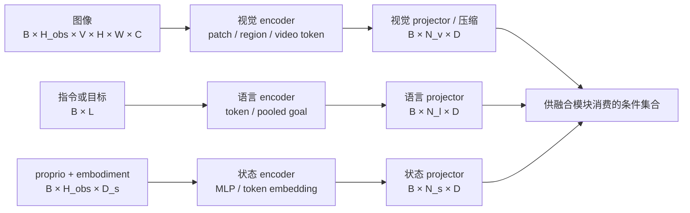
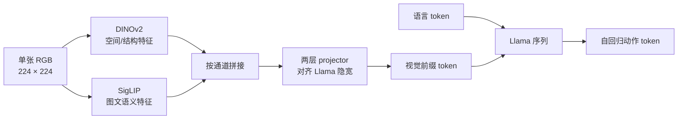
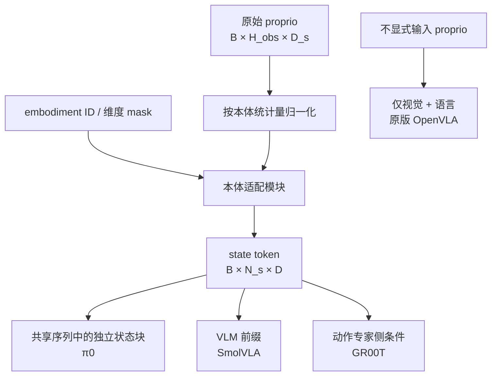

# 视觉、语言与状态编码模块

编码模块不只是把输入变成相同宽度的 token。它首先决定策略能够保留什么信息、丢弃什么信息，以及后续模块能否区分“任务语义”“场景证据”和“机器人当前构型”。本篇的目标是把 encoder 选择转化为可验证的工程假设。

## 1. 模块位置与理论问题

设策略观测为 \(o_t=(I_t,l,q_t,e)\)：图像 \(I_t\)、语言条件 \(l\)、本体状态 \(q_t\) 和 embodiment 标识 \(e\)。编码阶段可写为

\[
X_v=f_v(I_{t-H_{obs}+1:t}),\qquad
X_l=f_l(l),\qquad
X_s=f_s(q_{t-H_{obs}+1:t},e).
\]

这里的核心不是函数符号，而是三个信息瓶颈：

1. **视觉瓶颈**：\(X_v\) 是否同时保留对象语义、局部几何、遮挡和视角信息；
2. **语言瓶颈**：\(X_l\) 表示整句意图、当前子任务，还是可与图像对齐的词元；
3. **状态瓶颈**：\(X_s\) 是否让同一视觉场景下的不同关节构型可区分。

Projector 的职责是对齐宽度和 token 预算，不会自动补回 encoder 已丢失的信息。将低分辨率全局特征投影到更宽的 \(D\)，并不等于恢复精细几何。

## 2. 视觉表示：语义与几何不是同一件事

| 路线 | 主要归纳偏置 | 优点 | 主要风险 | 适合先验证的任务 |
|---|---|---|---|---|
| 图文对齐 encoder | 对象、属性和文字语义 | 与开放词汇指令对齐自然 | 局部位置和接触几何可能不足 | 语义泛化、物体类别替换 |
| 自监督视觉 encoder | 外观、形状和局部结构 | 往往保留更强的空间结构 | 与语言的直接对齐较弱 | 抓取点、精确放置 |
| 双视觉 encoder | 组合语义与空间表征 | 可覆盖单 encoder 的互补缺口 | token、显存和 projector 设计更重 | 同时要求识别与精细操控 |
| 轻量 patch stem | 从策略数据端到端学习 | 结构简单，适合大规模策略训练 | 数据不足时迁移能力弱 | 数据域稳定、规模充分 |
| 视频或时空 encoder | 显式编码运动与跨帧关系 | 动态、遮挡下更有信息 | 计算重，容易混淆时间和动作延迟 | 移动物体、遮挡恢复 |

OpenVLA 是“双视觉 encoder”最清晰的实例：同一张 \(224\times224\) 图像分别经过 DINOv2 与 SigLIP，通道拼接后由两层 MLP 映射为语言模型可消费的视觉前缀。论文消融还表明，策略训练中冻结视觉 encoder 会显著损害操作性能，因此“使用预训练视觉模型”不等于“视觉端无需适配机器人数据”。

SmolVLA 与 GR00T N1 展示了另一种工程约束：先用 SigLIP 系视觉端形成 patch，再通过 pixel shuffle 压缩到每帧 64 个视觉 token。这个数字说明了真实的接口预算，但不构成“64 一定最优”的一般结论；多相机数、分辨率和小物体尺寸变化后应重新验证。

### 2.1 视觉模块的语义 I/O

| 接口 | 输入语义 | 输出语义 | 容易被忽略的变量 |
|---|---|---|---|
| 单图 encoder | 当前场景外观 | 当前帧 patch token | 相机标定、裁剪、纵横比 |
| 多视角 encoder | 同时刻多个视角 | 分视角或合并 token | 相机 ID、视角缺失、时间同步 |
| token compressor | 高密度 patch | 低 token 数表示 | 小物体是否被合并掉 |
| projector | 任意视觉宽度 | 主干隐宽 \(D\) | 是否共享到所有相机、归一化方式 |

多视角不能只在 batch 维拼接，否则主干可能无法知道 token 来自外部相机还是腕部相机。至少需要稳定顺序、相机标识或位置编码，并在训练和部署保持一致。

## 3. 语言表示：条件粒度决定策略学习什么

| 条件形式 | 表示方式 | 能支持的问题 | 常见捷径 |
|---|---|---|---|
| 固定任务短语 | pooled embedding 或少量 token | 多任务区分 | 直接把背景当成任务 ID |
| 自由指令 | VLM/LLM token | 改写、开放词汇组合 | 忽略动词或关系词 |
| 目标图像 | 视觉 goal token | 无文字示范、目标状态 | 只匹配颜色或相机位姿 |
| 子任务状态 | 当前步骤 token | 长程任务推进 | 依赖标注器或上层规划器 |

OpenVLA、π0、SmolVLA 和 GR00T 都保留词元级语言条件；Octo 使用预训练 T5-base 编码语言任务，并允许任务条件缺失或被 mask，以支持不同数据集的条件协议。工程上应把“语言 encoder 是否强”与“策略是否真的使用语言”分开验证：同义改写、名词/动词冲突、无关修饰和视觉相同但指令不同的成对测试，比只比较正常指令成功率更有归因力。

## 4. 状态表示：视觉之外的构型坐标

proprio 通常包含关节角、末端位姿、夹爪状态或其子集。它不是动作的同义副本：状态描述“当前在哪里”，动作描述“接下来怎样改变”。状态维度还随本体变化，因此必须把数值语义、维度 mask 和 embodiment 标识一起考虑。

不同注入位置对应不同责任：

- **共享序列状态块**：状态 token 可读取视觉语言前缀，再为动作块提供条件；π0 采用这一角色划分。
- **VLM 前缀**：状态先进入语义主干；SmolVLA 报告该方案优于只在动作专家侧注入。
- **动作专家侧注入**：VLM 保持语义接口，状态由 embodiment-specific MLP 送入动作模型；GR00T N1 采用此组件化边界。
- **无显式状态**：原版 OpenVLA 依靠图像和语言生成动作，接口简单，但无法直接区分视觉近似而构型不同的情形。

状态归一化必须与动作归一化分开记录。跨本体补零只解决 shape，不解决坐标系、关节含义和量纲差异；若无维度 mask 或本体标识，零既可能表示 padding，也可能是真实状态。

## 5. 训练与推理的数据流差异

| 环节 | 训练时 | 推理时 | 典型不一致 |
|---|---|---|---|
| 图像 | 随机裁剪、颜色增强、批量多帧 | 实际相机流、可能丢帧 | 裁剪改变机械臂或目标可见性 |
| 语言 | 数据集模板、条件 dropout | 用户或规划器生成文本 | 训练短语固定，部署措辞自由 |
| state | 从轨迹同步读取并归一化 | 实时控制状态与时间戳 | 观测和 state 不同相位 |
| encoder 更新 | 冻结、部分或全量反传 | 只前向；静态条件可缓存 | 训练更新 projector 却冻结关键视觉层 |
| 缺失模态 | mask 或 dropout 模拟 | 相机或语言可能真的缺失 | 训练 mask 与部署缺失编码不同 |

这里最重要的训练变量是梯度路径。若比较两个视觉 encoder，却让一个全量微调、另一个冻结，结果同时混入表示质量和适配预算。若比较 state 注入位置，也应让 state encoder 参数量、归一化和数据保持一致。

## 6. 从失败现象反推编码选择

| 失败现象 | 优先怀疑的接口 | 候选改动 | 必要对照 |
|---|---|---|---|
| 识别对但抓取点偏 | 视觉局部几何 | 加空间 encoder、提高分辨率、减少压缩 | 相同主干与动作头，仅换视觉端 |
| 同物体不同指令行为不变 | 语言条件 | 词元级语言、条件 dropout | 指令互换、视觉保持不变 |
| 接近奇异位形时失败 | state 表示 | 加关节或末端状态与 mask | state-off、state-shuffle |
| 腕部相机有用但模型忽略 | 多视角标识或 token 预算 | 相机 embedding、按视角分配 token | 单视角、视角打乱、遮挡测试 |
| 新本体性能骤降 | 状态或动作坐标接口 | embodiment adapter、共享语义状态 | 同数据量的 seen/unseen embodiment |

## 7. 可归因消融

### 7.1 视觉

固定语言主干、动作头、数据与训练步数，对比单 SigLIP、单 DINOv2、双 encoder；同时报告 token 数、可训练参数、每步时延和峰值显存。再加入类别替换、相机扰动、毫米级放置三类诊断集，区分语义收益和几何收益。

### 7.2 语言

建立相同视觉初态的最小对照：只替换名词、动词或空间关系。比较原指令、同义改写、无语言、错误语言。若无语言结果不降但常规成功率高，模型很可能利用了场景捷径。

### 7.3 状态与注入位置

至少比较 state-on、state-off、batch 内 state-shuffle，并使用“图像近似、起始构型不同”的成对轨迹。比较注入位置时固定 state encoder 和参数预算，只改变进入共享前缀、动作专家或两者的位置；同时报告成功率、控制平滑度、约束违反和推理开销。

## 8. 代表实现事实

| 模型 | 编码侧事实 | 开放信息与解读边界 |
|---|---|---|
| OpenVLA | DINOv2 + SigLIP，\(224\times224\)，两层 projector；原版无 proprio | 论文、官方代码与权重开放；视觉微调结论来自作者消融 |
| π0 / openpi | PaliGemma 前缀处理多视角和语言；state 为独立块进入动作专家序列 | openpi 提供推理、训练代码与模型；具体版本需区分 π0、π0-FAST、π0.5 |
| SmolVLA | SmolVLM-2，视觉压缩为每帧 64 token；state 作为 VLM 前缀 | 论文与 LeRobot 实现开放；具体任务是否沿用全部预处理需查配置 |
| Octo | 语言由 T5-base 编码；图像由浅层卷积 patch stem token 化 | 代码和权重开放；论文默认两帧观测历史 |
| GR00T N1 | Eagle-2 使用 SigLIP-2 + SmolLM2；每帧 64 视觉 token；本体状态有专用 MLP | 论文和代码/权重的开放状态应按具体版本核对；性能和时延为作者报告 |

## 9. 常见误解

- **宽度相同就完成了模态对齐**：projector 只保证接口 shape，不保证语义可比。
- **更强的 VLM 必然给出更强控制**：VLM 评测未覆盖接触几何、状态同步和动作坐标。
- **输入 proprio 就能跨本体**：还需要坐标语义、维度 mask、归一化和动作端适配。
- **更多视觉 token 总是更好**：它可能挤压时序窗口、增加每个去噪步的成本，并放大背景捷径。
- **冻结 encoder 更公平**：比较预训练表示时可以冻结；比较最终策略能力时应同时给出可适配结果。

## 一手资料与延伸阅读

- [OpenVLA 论文与代码笔记](../../依赖索引.md)
- [π0 论文与代码笔记](../../依赖索引.md)
- [SmolVLA 论文与代码笔记](../../依赖索引.md)
- [Octo 论文与代码笔记](../../依赖索引.md)
- [GR00T N1 论文与代码笔记](../../依赖索引.md)
- [任务定义与输入输出协议](../基础/任务定义与输入输出协议.md)
- [多模态融合与 VLM 主干](多模态融合与VLM主干.md)
