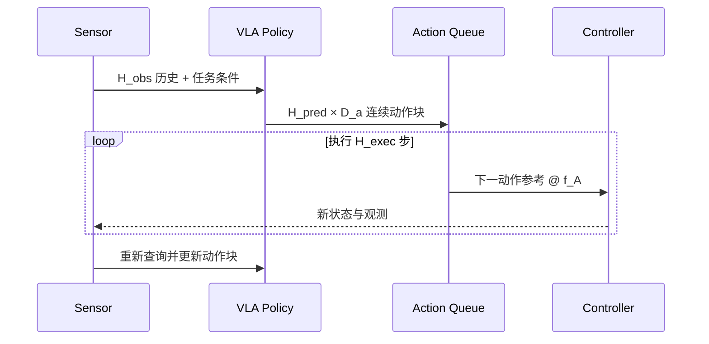

# 连续回归与 Action Chunk：一次预测一段可执行轨迹

> 连续回归回答“隐表示怎样直接变成连续控制量”，Action Chunk 回答“模型一次预测和系统一次执行多少步”。二者经常同时出现，但分别属于动作头与在线调度两个模块，实验中需要拆开归因。

## 1. 学习目标

- 写出连续动作头的输入、输出、损失和反归一化链路；
- 区分 \(H_{pred}\)、\(H_{exec}\)、动作采样率与策略刷新率；
- 解释单步回归、并行动作块、滚动时域和 temporal ensemble 的关系；
- 用 OpenVLA-OFT、Diffusion Policy、Octo 与 π0 理解 Action Chunk 的不同实现；
- 设计能区分“模型更好”和“少查询几次模型”的实验。

## 2. 理论：连续条件策略与点估计

设上下文编码器得到条件表示 \(\mathbf c_t=f_\phi(h_t)\)，回归动作头产生

\[
\hat{\mathbf A}_t=g_\psi(\mathbf c_t)
\in\mathbb R^{H_{pred}\times D_a}.
\]

常见监督目标为

\[
\mathcal L_{L1}
=\frac{1}{\max(1,\sum_{h,d}m_{h,d})}
\sum_{h,d}m_{h,d}
\left|A_{t+h,d}-\hat A_{t+h,d}\right|,
\]

或平方误差

\[
\mathcal L_{L2}
=\frac{1}{\max(1,\sum_{h,d}m_{h,d})}
\sum_{h,d}m_{h,d}
\left(A_{t+h,d}-\hat A_{t+h,d}\right)^2.
\]

\(m\) 是 episode 尾部、缺失自由度和跨本体 padding 的有效位。L1 对离群目标更稳健；L2 对大误差惩罚更强。二者本质上学习条件分布的点估计：当同一观测对应多个互斥动作模式时，输出可能落在模式之间。是否真的发生“均值化”，需要由数据的多峰程度和闭环结果验证，不能只由损失名称推断。

## 3. Action Chunk 的三个时间量

统一记号：

- \(H_{obs}\)：进入策略的历史观测长度；
- \(H_{pred}\)：一次预测的动作长度；
- \(H_{exec}\)：真正执行后才重新查询策略的长度，满足 \(1\le H_{exec}\le H_{pred}\)。

若动作块相邻参考点的名义频率为 \(f_A\)，则预测覆盖时间和开环执行时间分别为

\[
\tau_{pred}=\frac{H_{pred}}{f_A},\qquad
\tau_{exec}=\frac{H_{exec}}{f_A}.
\]

这两个量按“每个 action 覆盖一个控制区间”计算命令执行时长；若报告首末动作采样时刻跨度，应分别写成 \((H_{pred}-1)/f_A\) 与 \((H_{exec}-1)/f_A\)，避免同一张表混用两种定义。

在无重叠、每次恰好消费 \(H_{exec}\) 步的简化调度下，使用新观测的策略查询率约为 \(f_Q\approx f_A/H_{exec}\)；真实 \(f_Q\) 还受采集、网络、模型和队列延迟约束。动作块内部可以按 50 Hz 派发参考点，不代表模型每秒运行 50 次。

这张图表达的是滚动时域接口。若 \(H_{exec}=H_{pred}\)，模型执行完整块后才重规划；若 \(H_{exec}=1\)，反馈最及时但模型查询最频繁。

## 4. 从模型隐状态到物理动作

动作头输出“连续数值”并不意味着它已经输出物理命令。归一化统计、坐标语义、本体 mask 与队列调度仍属于完整策略资产。

## 5. 并行解码：连续动作头不必逐值生成

对于 \(H_{pred}D_a\) 个动作值，常见两种计算路径：

1. **共享表示后一次投影**：一个向量直接映射到展平动作块；
2. **动作槽位**：为每个时间—维度或每个时间步设置 query，允许槽位双向交互后并行输出。

OpenVLA-OFT 采用第二种思路：在 Llama 解码输入中放入空动作占位嵌入，将动作区域从因果注意力改为双向注意力，使所有动作槽位在一次主干前向中同时产生。对于原始 OpenVLA 的单步 7 维动作，这把 7 次串行自回归前向改成一次并行前向；扩展到 chunk 时，只需增加动作槽位，而不是生成 \(H_{pred}D_a\) 次完整 7B 前向。

并行并不自动等于独立：动作槽位之间的双向注意力仍能表达维度和时间耦合。它放弃的是自回归因子分解，不是所有联合建模能力。

## 6. 真实模型事实

| 模型 | 动作块与头 | 训练目标 | 在线执行 | 事实解释 |
|---|---|---|---|---|
| Diffusion Policy | 连续动作块；1D U-Net 或 Transformer 去噪头 | 噪声预测 MSE | 预测 \(T_p\)，执行 \(T_a\)，滚动重规划 | 奠定 receding-horizon 模板；本身不是 VLA |
| Octo | readout token 条件的小型扩散动作头 | DDPM 噪声预测 | 主干一次，扩散头多步采样动作块 | 把连续块接入模块化跨本体策略 |
| OpenVLA-OFT | 空动作槽位 + 4 层 MLP 连续头；LIBERO chunk 8，ALOHA chunk 25 | 默认 L1；另做 diffusion 对照 | 论文配置执行完整块后再查询 | 在近似固定 OpenVLA Base 下展示表示/解码/损失改造 |
| π0 | 50 步、最大 18 维连续块；约 300M 动作专家 | Flow Matching 速度场 MSE | 10 步欧拉积分；实际 \(H_{exec}\) 由部署决定 | VLM 前缀与动作迭代路径分工 |

OpenVLA-OFT 作者在 LIBERO 上报告 \(H_{pred}=8\)，真实双臂 ALOHA 使用 25；动作生成吞吐 108.8 Hz 是 A100 上的作者测量，不应写成机器人闭环控制率。OFT 同时改变并行解码、连续表示、action chunk、L1 目标以及部分输入，完整结果不能只归因于“连续回归”。

## 7. Chunk 调度策略

### 7.1 整块执行

令 \(H_{exec}=H_{pred}\)。优点是查询少、队列简单、段内一致；代价是动作块生成后出现的新扰动只能等下一块处理。适合环境变化慢、动作块短、模型查询昂贵的任务。

### 7.2 前缀执行与滚动重规划

令 \(H_{exec}<H_{pred}\)。只执行前缀，随后用最新观测预测新块。它增加计算，但减少开环时间。Diffusion Policy 的 \(T_o/T_p/T_a\) 正是这一协议。

### 7.3 重叠块与 temporal ensemble

连续查询会为同一未来时刻产生多个预测。可用按预测年龄衰减的权重融合：

\[
\tilde{\mathbf a}_\tau
=\frac{\sum_i w_{\tau,i}\hat{\mathbf a}^{(i)}_\tau}
{\sum_i w_{\tau,i}},
\qquad
w_{\tau,i}=\exp(-\lambda\,\text{age}_{\tau,i}).
\]

它能平滑块边界，但也可能把互斥模式平均化，并增加状态管理。实验中应把“使用 chunk”和“使用 ensemble”分开。

### 7.4 异步队列

策略服务和控制器可并行：控制器消费当前队列时，服务端生成下一块。需要明确：

- 队列低水位何时触发查询；
- 新块覆盖、拼接还是与旧块融合；
- 推理超时继续旧动作还是安全停止；
- 观测时间戳与新块生效时间如何对应；
- 网络抖动是否计入端到端延迟。

## 8. 训练样本如何构造

对每个合法时刻 \(t\)，训练目标为未来窗口 \(A_{t:t+H_{pred}-1}\)。靠近 episode 末端时构造 mask：

\[
m_h=\mathbb 1[t+h<T_{episode}].
\]

以下情况不能静默跨越：

- episode 边界；
- 控制模式切换；
- 相机或动作频率改变；
- 人工接管前后语义不一致；
- done 与 truncated 未区分。

长 chunk 会减少可用窗口还是增加样本重叠，取决于 stride 与尾部处理。比较不同 \(H_{pred}\) 时应固定原始 episode、采样 stride 和总优化步数，避免样本重复率成为隐藏变量。

## 9. 回归与生成式动作头怎样选

| 条件 | 连续 L1/L2 回归 | Diffusion/Flow |
|---|---|---|
| 合理动作近似单峰 | 简单、低延迟，优先作为基线 | 可能增加不必要采样成本 |
| 多个互斥策略都合理 | 点估计可能落在模式之间 | 条件生成更适合表达多峰 |
| 数据少、目标域窄 | 回归头容易训练与诊断 | 生成式头可能更难估计分布 |
| 需要很低首动作延迟 | 一次前向有优势 | 需控制采样步数和缓存 |
| 动作高维、长 chunk | 可并行但需建模耦合 | 联合生成天然，但迭代更贵 |

OFT 的实验说明在其 VLA 微调任务中，L1 可以与扩散相当或更好；这不是“L1 普遍优于扩散”的结论。选型需要先检验条件动作分布是否多峰，并在相同 Base、数据、动作合同和推理预算下比较。

## 10. 受控实验：把四个因素拆开

| 实验 | 表示/头 | \(H_{pred}\) | \(H_{exec}\) | 调度 | 能回答什么 |
|---|---|---:|---:|---|---|
| A | 连续回归 | 1 | 1 | 同步 | 单步基线 |
| B | 连续回归 | H | 1 | 滚动 | 预测更长上下文是否有益 |
| C | 连续回归 | H | K | 前缀执行 | 降低查询率的收益与反馈代价 |
| D | 连续回归 | H | K | temporal ensemble | 平滑来自模型还是融合 |
| E | Flow/Diffusion | H | K | 与 C 相同 | 多峰生成是否值得采样成本 |

所有组应固定：观测、Base checkpoint、数据窗口、动作坐标、归一化、训练预算、控制器和评测 seed。至少报告闭环成功率、首动作延迟、chunk 生成延迟、策略查询率、动作采样率、jerk 和失败类型。

## 11. 故障诊断

| 现象 | 模块原因 | 检查 |
|---|---|---|
| 块内平滑但整体漂移 | \(H_{exec}\) 太长或模型状态陈旧 | 缩短开环段，比较相同模型的调度消融 |
| 块交界抖动 | 独立 chunk 不连续、队列切换 | 观察边界 jerk，测试 overlap/ensemble |
| 训练 loss 低但动作趋中 | 条件多峰、点估计平均化 | 聚类动作模式，换生成式头作对照 |
| 模型吞吐高但机器人卡顿 | 采集、网络、队列或控制器 | 分阶段记录时间戳而非只测 forward |
| episode 尾部出现异常动作 | padding 未 mask | 检查窗口边界与 loss denominator |
| 换本体后幅度错误 | 反归一化/adapter | 做单轴 round-trip 与单位检查 |

## 12. 检查点

1. 50 Hz 动作、\(H_{pred}=50\)、\(H_{exec}=5\) 分别覆盖多长预测和开环时间？
2. 把单步策略改成 \(H_{pred}=16\) 后成功率提高，为什么不能立即归因于“长期预测能力”？
3. 为什么并行动作槽位仍可以表达动作维度之间的关系？
4. 什么任务现象支持从 L1 改成 Flow，而不是只因 Flow 更流行？

## 资料来源

- [OpenVLA-OFT 细读](../../依赖索引.md)
- [Diffusion Policy 细读](../../依赖索引.md)
- [Octo 细读](../../依赖索引.md)
- [π0 细读](../../依赖索引.md)
- [任务定义与输入输出协议](../基础/任务定义与输入输出协议.md)
