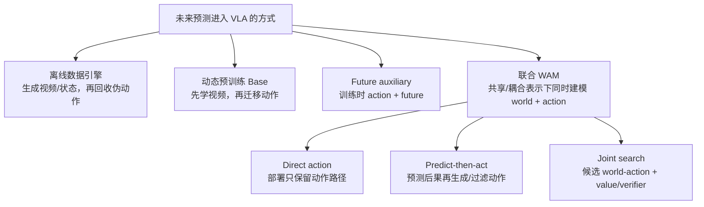
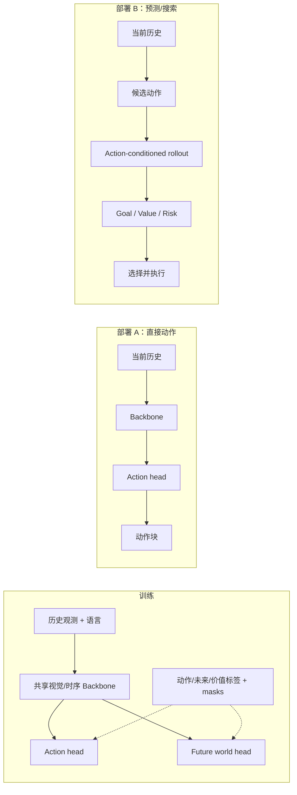

# 预测式 VLA 与世界模型辅助：未来预测在系统中究竟做什么

> “使用视频模型”“训练时预测未来”“联合生成世界和动作”与“推理时 rollout 后果”是四种不同系统。本文用训练目标、动作条件和推理数据流区分它们，并给出从动态预训练到 World-Action Model（WAM）的工程接口。

## 1. 学习目标

- 区分世界模型作为数据引擎、预训练 Base、future auxiliary、联合 WAM 和在线规划器；
- 用形式化目标判断一个模型是否建立了动作—后果 grounding；
- 解释 RynnVLA、VPP、DreamVLA 和 WorldVLA 的系统位置；
- 设计 world loss、共享参数、推理 world branch 和额外计算的受控对照；
- 识别视频质量好但策略无收益、动作条件被忽略和 rollout 幻觉等失败。

## 2. 两条分类轴

判断预测模块时，应分别回答：

1. **训练耦合轴**：系统是否同时生成 action 与 world，二者是否共享或显式耦合；world branch 是否以动作为条件？
2. **推理使用轴**：部署时是直接出动作，还是显式生成/评估未来？

WAM 的资格来自同一系统对 world/action 的联合建模，而不是“有一个动作条件转移模型”本身。纯 action-conditioned WM 可以评估动作后果，却不生成动作，因此是 WAM 或规划器的组件/对照。联合 WAM 不要求推理时一定生成未来；反过来，无动作条件的视频生成器即使部署时生成画面，也不能仅凭“看到了未来”证明动作 grounding。

## 3. 六种形式化对象

### 3.1 直接 VLA

\[
p_\theta(\mathbf A_t\mid h_t,L).
\]

只学习动作，不显式约束未来状态。

### 3.2 无动作视频/世界预训练

\[
p_\phi(z_{t+1:t+H}\mid z_{\le t},L),
\qquad \theta\leftarrow\operatorname{init}(\phi).
\]

它提供动态表征初始化，但没有动作条件，不能单独识别“哪个动作导致哪个未来”。

### 3.3 Future auxiliary VLA

\[
\mathcal L
=\mathcal L_{action}
+\lambda_w\mathcal L_{future}.
\]

世界目标和动作目标共享部分参数；部署可以丢弃 future head。关键实验是 world loss 是否在相同参数/数据预算下改善动作，而不是未来图像是否更清晰。

### 3.4 动作条件世界模型

\[
p_\phi(z_{t+1}\mid z_t,\mathbf A_t,L).
\]

该模型可以评估候选动作后果，但不必自身生成动作；它通常与 policy、planner 或 value model 组合。

### 3.5 联合 WAM

\[
p_\theta(z_{t+1:t+H},\mathbf A_t\mid h_t,L)
\]

或共享表征下的联合损失

\[
\mathcal L_{WAM}
=\lambda_w\mathcal L_{world}
+\lambda_a\mathcal L_{action}
+\lambda_g\mathcal L_{grounding}
+\lambda_v\mathcal L_{value}.
\]

`grounding` 可以是动作条件 latent transition、对象/接触状态变化、未来目标一致性或 action-shuffle 对比目标。

### 3.6 模型式决策

对候选动作 \(\mathbf A^{(i)}\) rollout 未来并选择：

\[
i^*=\arg\max_i
\mathbb E_{z^{(i)}\sim p_\phi(\cdot\mid h_t,\mathbf A^{(i)})}
\left[R(z^{(i)},G)-\beta\,Risk(z^{(i)})\right].
\]

这里的性能不仅来自世界模型，还来自候选生成器、候选数、价值/风险模型和测试时计算预算。

## 4. 训练数据怎样提供不同监督

| 数据 | 可直接训练 | 缺失信息 | 处理方式 |
|---|---|---|---|
| 无动作人类/网络视频 | 时序表征、future prediction | 机器人动作与本体状态 | 只作 Base/辅助，或用 IDM/latent action 伪标注并标质量 |
| 人手关键点视频 | 人类运动中介、未来轨迹 | 机器人运动学 | 作为迁移桥梁，仍需机器人动作落地 |
| 机器人示范 | action、action-conditioned transition | 失败后果与反事实较少 | 直接策略/联合 WAM 主监督 |
| 仿真状态轨迹 | 精确状态、动作、接触与反事实 | reality gap | 用于因果/规划训练，真机验证 |
| 策略 rollout 与失败 | 自身分布下的后果、价值和恢复 | 安全采集成本 | 后训练、verifier/value 与数据回流 |

多源 batch 必须为 `world/action/value/grounding` 分别维护有效 mask。把无动作视频的缺失动作填成零，会把“没有标签”错误解释为“机器人静止”。

## 5. 三种训练—部署数据流

RynnVLA 属于训练期未来先验、部署直接动作；VPP/DreamVLA 将预测表征保留在推理动作路径；模型式搜索还会显式比较多个动作后果。三者的延迟和证据要求不同。

## 6. RynnVLA：视频生成预训练，推理只出动作

RynnVLA-001 从 Chameleon 自回归图像模型扩展 I2V，形成三阶段迁移：

1. 约 1,200 万条第一视角人类操作视频上预测未来帧；
2. 带人手关键点的视频上联合预测未来帧与人手轨迹；
3. 机器人数据上换用新初始化的轻量动作头，预测 ActionVAE 连续隐变量。

ActionVAE 将动作块编码为紧凑连续 latent，再解码为低层序列。部署时模型接收语言、当前 RGB 与状态，只预测动作 embedding；未来视觉 token 被丢弃。因此它证明的是视频动态预训练可作为 VLA Base，不是在线 rollout 规划。

作者在 SO100 三项桌面任务上报告平均 90.6%，对照 π0 70.4%、GR00T N1.5 55.6%；均为作者在自采协议上的微调和自评，且论文报告更严格的 SR@1 优势不明显，不能视为统一基准排名。

## 7. 推理期预测式策略

### 7.1 VPP

VPP 在视频扩散模型内部取得未来视觉表征，再由隐式逆动力学模块映射为动作。预测表征位于在线动作路径中。作者报告 CALVIN ABC-D 相对前方法 +18.6%、真机复杂操作 +31.6%，均为作者口径。

需要验证的不是“未来表征可视化是否合理”，而是：打乱动作/未来配对后动作性能是否下降、冻结或移除预测分支后收益是否保留，以及新增参数的等量对照。

### 7.2 DreamVLA

DreamVLA 预测与操作相关的动态区域、3D 深度和高层语义，再由扩散 Transformer 从共享表示生成动作。它把像素未来改成结构化世界知识，试图减少与控制无关的视觉细节。作者报告真机成功率 76.7%、CALVIN 平均链长 4.44；协议不应与其他模型直接排名。

### 7.3 WorldVLA

WorldVLA 在统一自回归框架中联合动作与图像理解/生成。未来图像既可作为联合训练信号，也可按任务启用生成。当前本地资料对其精确基准和部署 world branch 披露不足，因此相关字段应标“待核”，不能用“统一生成”替代动作因果证据。

## 8. 从 Future Auxiliary 到 WAM 的判据

| 问题 | 预测辅助 VLA | 联合 WAM | 模型式决策 |
|---|---|---|---|
| 训练 world/action 是否共享 | 可以 | 是 | 可以分离 |
| 世界预测是否动作条件 | 不一定 | 应有 action/world grounding；通常动作条件或联合 token | 必须能评估候选动作 |
| 部署是否需要 world head | 否 | 不一定 | 是 |
| 最小对照 | action-only + 等量参数 | 分离 WM+policy、future auxiliary | direct action、相同测试时预算 |
| 主要风险 | 辅助目标只改善表征/画质 | 目标竞争、伪联合、动作被忽略 | rollout 幻觉、延迟、规划器偏差 |

WAM 不是能力等级，而是建模关系。一个部署时只保留 action head 的模型仍可能是联合 WAM；一个部署时生成无动作未来视频的系统仍可能不是 WAM。

## 9. 工程模块接口

### 9.1 World head manifest

| 字段 | 需要声明 |
|---|---|
| prediction target | RGB、latent、depth、object state、contact、reward/risk |
| conditioning | 历史、语言、past action、candidate future action |
| horizon/rate | 预测长度与时间采样率 |
| uncertainty | 随机样本、ensemble 或显式方差 |
| valid mask | 哪些数据有未来、动作或状态标签 |
| gradient path | world loss 更新哪些共享 Backbone/动作模块 |
| deployment mode | off、direct、predict-then-act、joint search |
| latency budget | world 生成、候选数、verifier 与端到端延迟 |

### 9.2 Candidate action contract

模型式搜索中的候选动作必须与世界模型训练动作同语义：坐标、单位、频率、chunk 和本体 adapter 一致。否则 rollout 的“动作”与机器人实际执行不是同一干预，预测再准确也无法用于选择。

## 10. 评估：预测质量不是最终证据

### 10.1 世界预测层

- 像素/latent/state 预测误差；
- 长期漂移、对象永久性、接触与遮挡；
- action-shuffle：打乱动作后预测是否明显改变；
- counterfactual：不同动作是否产生可区分且合理的未来；
- 校准：高不确定状态是否对应更高真实误差。

### 10.2 动作层

- action-only vs future auxiliary；
- 共享 world/action vs 参数量匹配的额外 encoder；
- world branch 开/关时的闭环成功率；
- 预测正确但动作失败、预测错误但动作成功的条件分析。

### 10.3 决策层

- 候选数、rollout 数和测试时计算；
- oracle dynamics / oracle value 上界；
- direct policy、predict-then-act 和 joint search；
- 首动作延迟、持续刷新率与安全事件。

## 11. 受控实验矩阵

| 组 | World loss | Action-conditioned | 部署 world branch | 参数/计算 | 能回答什么 |
|---|---|---|---|---|---|
| A | 无 | — | 无 | 基线 | 直接 VLA |
| B | 有 | 否/弱 | 无 | 与目标模型相同 | 动态辅助监督是否有益 |
| C | 有 | 是 | 无 | 同 B | 动作 grounding 对表示的贡献 |
| D | 有 | 是 | 有，单候选 | 报额外延迟 | 推理预测本身是否有益 |
| E | 有 | 是 | 有，多候选+verifier | 报候选数 | 搜索收益与测试时计算 |
| F | 无 | — | 无 | 等量额外参数 | 收益是否只是模型变大 |

若只比较 A 与 E，无法判断收益来自 world supervision、联合建模、verifier 还是更多测试时计算。

## 12. 常见失败

| 现象 | 机制 | 检查 |
|---|---|---|
| 未来画面好看，动作无提升 | world 目标学习了外观而非干预 | action-shuffle、对象/接触状态和 action-only 对照 |
| 改变候选动作，预测几乎不变 | 世界模型忽略动作条件 | 反事实动作敏感度 |
| 联合训练后动作下降 | world loss 权重/梯度压制动作 | loss 有效样本比、梯度范数、stop-gradient 对照 |
| 在线规划延迟过高 | 生成对象过重、候选/rollout 太多 | 分解 world/candidate/verifier 延迟 |
| 规划偏好视觉上好看但不可执行的未来 | reward/verifier 与控制目标错位 | 可达性、碰撞、控制器回放 |
| 无动作视频导致策略静止 | 缺失动作错误填零 | 分支 mask 与数据 schema |
| 长 rollout 幻觉累积 | 世界模型离开训练分布 | 短 horizon/MPC、uncertainty 与重规划 |

## 13. 技术选型

- 有大量无动作视频、机器人数据少：先做动态预训练或 future auxiliary，并保留 action-only 对照；
- 需要低延迟直接控制：训练期未来辅助、部署关闭 world branch 通常更实际；
- 需要失败预判或安全筛选：action-conditioned latent/state 预测比高保真 RGB 更可能满足延迟；
- 需要长程反事实规划：引入候选、value/verifier 和滚动重规划，同时显式报告测试时计算；
- 目标是证明 WAM：除动作条件敏感性外，还要证明同一系统联合生成/建模 action 与 world，并给出联合、分离 WM+policy 和 future auxiliary 对照。

## 14. 检查点

1. RynnVLA 为什么不属于“推理时 world rollout”的策略？
2. 一个训练时联合预测未来和动作、部署只出动作的模型能否属于 WAM？
3. action-shuffle 实验在检验什么？
4. 搜索 64 个候选后成功率更高，为什么不能只报告最终成功率？
5. 无动作视频进入联合 batch 时需要哪些独立 mask？

## 资料来源

- [预测式 VLA 综述](../../依赖索引.md)
- [RynnVLA-001 细读](../../依赖索引.md)
- [具身数据全景](../../依赖索引.md)
- [World-Action Model](<../../world-model/动作与决策/World-Action Model.md>)
- [VLA、WM、WAM 边界](../基础/定义、边界与能力范围.md)
