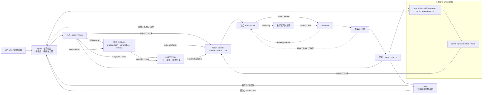
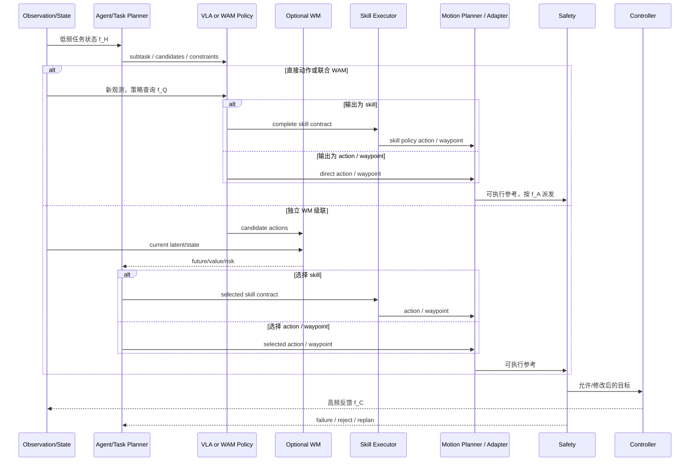

# VLA、WAM、Agent 与控制系统：建模对象、系统责任与证据

这些术语描述不同问题，不是从低到高的能力等级。Agent/任务规划器组织子任务、工具和恢复；运动规划器把 waypoint/目标变成满足几何约束的轨迹；VLA 把视觉语言条件变为动作，WM 预测状态变化，WAM 在同一系统中联合建模 world 与 action，控制器让参考稳定执行，安全监督独立门控执行链。一个网络可以合并多种建模对象，但部署责任不会消失。

## 1. 严格定义

| 对象 | 最小建模关系 | 典型输出 | 不足以取得该名称的情况 |
|---|---|---|---|
| Agent / 任务规划 | 任务状态、工具/技能与决策序列 | 子任务、调用、候选任务计划 | 只输出一段自然语言解释 |
| VLA | \(p(a\mid o,l,q,h)\) | 动作、chunk、waypoint；广义定义下也可输出可执行 skill 合同 | VLM 只回答问题、不连接动作接口 |
| WM | \(p(z_{t+1:t+H}\mid z_{\le t},a,l)\) 或无动作动态 | future state/latent/RGB/reward | 只输出动作而无世界预测 |
| WAM | 同一系统在共享或显式耦合表示下联合建模 world + action | future world + action，部署可只保留 action head | 单独 action-conditioned WM 只评估动作后果、却不生成/联合建模动作 |
| 运动规划 | waypoint/目标怎样满足运动学、碰撞与轨迹约束 | 可行轨迹、IK/QP 结果 | 只做语义任务分解 |
| 控制器 | 参考怎样在动力学与反馈下稳定实现 | 关节/力矩/速度命令 | VLA 输出未经跟踪的目标 |
| 安全监督 | 状态、候选动作与健康信号的独立约束 | allow/modify/reject/stop | prompt 安全提示或训练成功率 |

WAM 的关键是**联合建模关系**，不是推理时是否显示未来视频。训练时共享/耦合 world/action，部署关闭 world head，仍可能是 WAM；反之，把独立 action-conditioned WM 接到 Planner 后面，是“WM + Planner/Policy”级联系统，不因组合就自动改名 WAM。

### 1.1 广义 skill 输出必须是执行合同

把 skill 计入 VLA 的动作空间时，输出不能只有名称或自然语言。最小合同必须使执行器能够判断“执行什么、作用于谁、何时允许开始、何时结束、多久后强制退出、由哪个实现解释参数”：

```yaml
skill_request:
  request_id: req_004216
  skill_id: place_object
  args:
    object_id: plate_2
    target_id: sink_1
    target_pose: {frame_id: base, xyz_m: [0.42, -0.18, 0.21]}
  grounding:
    source_observation_id: obs_004216
    entity_ids: [plate_2, sink_1]
  preconditions: [plate_2_grasped, sink_1_reachable]
  termination: plate_2_inside_sink AND gripper_open
  timeout_s: 12.0
  executor_version: place_object_executor_v5
  policy_checkpoint: policy_v17_sha256
  task_state_version: task_state_0091
```

`Skill Executor` 是这份合同的直接消费者：它验证 preconditions，按 `executor_version` 解释 `args/grounding`，调用 skill policy 或运动原语，并负责 termination 与 timeout。运动规划器只消费 waypoint、pose 或几何约束，不负责把自然语言任务分解成 skill；控制器只消费可跟踪参考。

## 2. 系统责任与信息流



虚线安全反馈可触发重规划，但急停本身必须直接门控执行，不应等待 Agent 回复。

## 3. 责任矩阵

| 问题 | Agent/任务规划 | VLA | WM | 联合 WAM | Skill Executor | 运动规划 | 控制器 | Safety |
|---|---:|---:|---:|---:|---:|---:|---:|---:|
| 长程任务分解 | 主责 | 可辅助 | 提供预测 | 可联合 | 消费合同 | 否 | 否 | 约束 |
| 视觉语言 grounding | 消费/推理 | 主责 | 可条件化 | 主责之一 | 校验实体/参数 | 消费几何目标 | 否 | 只读风险 |
| 候选动作/skill 生成 | 可组织/生成合同 | 主责 | 否 | 主责之一 | 实例化 skill | 不生成语义动作 | 否 | 不生成正常策略 |
| 动作后果预测 | 使用 | 可隐式 | 主责 | 主责之一 | 记录执行后果 | 局部可行性 | 局部动力学 | 风险判定 |
| 搜索/候选选择 | 任务级主责 | 可直接策略 | 提供 rollout | 可内置 | skill 内部可选择 | 轨迹级主责 | 否 | 否决 |
| IK/轨迹/反馈稳定 | 否 | 输出目标 | 否 | 输出目标 | 调用下游 | IK/轨迹主责 | 跟踪主责 | 门控 |
| 终止/超时 | 选择恢复分支 | 可给谓词 | 可预测 | 可联合 | 主责 | 否 | 执行 hold | 强制上限 |
| 硬碰撞/急停 | 否 | 否 | 不保证 | 不保证 | 不保证 | 几何约束 | 部分 | 主责 |
| 故障降级 | 编排 | fallback 候选 | 风险信息 | fallback 候选 | 报告失败原因 | 可行回撤 | hold/retreat | 最终授权 |

“主责”是工程验收对象，不等于必须由独立进程实现。

## 4. 四种部署形态

| 形态 | 在线路径 | 适用条件 | 核心风险 |
|---|---|---|---|
| 直接 VLA | observation → action → control | 低延迟、短程反应任务 | 无显式后果检查 |
| Agent/任务规划 + VLA | goal → subtask/skill contract → skill executor/VLA → control | 长程、多技能、工具调用 | 层间错误与状态陈旧 |
| VLA/任务规划 + 独立 WM | candidates → action-conditioned WM → rerank | 需要反事实、风险筛选 | rollout 幻觉与测试时计算 |
| 联合 WAM | 共享/耦合 world-action 表示直接动作或搜索 | 研究联合 grounding 与表征迁移 | 多目标冲突、归因困难 |

四种形态都需要 adapter、控制器和 safety；它们不是可选的第五种模型能力。

## 5. 一次在线决策与频率



时间和频率必须按接口定义，而不是都写成“模型频率”：

| 符号 | 接口含义 | 换算与报告要点 |
|---|---|---|
| \(f_H\) | Agent/任务状态更新频率 | 由阶段完成、失败或超时触发时，应同时报告事件触发规则 |
| \(f_{obs}\) | 历史窗口内观测样本的时间采样频率 | 与相机原始帧率不同；应按真正送入策略的时间戳计算 |
| \(f_Q\) | 策略使用新观测发起推理的查询频率 | 异步流水线还需报告 observation age 与 query-to-dispatch 延迟 |
| \(f_A\) | chunk 内相邻动作参考点的名义采样/派发频率 | 它不是策略查询频率，也不是 servo 频率 |
| \(f_C\) | 低层反馈控制闭环频率 | 通常 \(f_Q\le f_A\le f_C\)，但事件触发和非均匀轨迹可打破该关系 |
| \(H_{obs}\) | 一次策略查询使用的观测样本数 | 等间隔观测覆盖的时间戳跨度为 \((H_{obs}-1)/f_{obs}\) |
| \(H_{pred}\) | 一次查询生成的未来动作点数 | 名义命令时长为 \(H_{pred}/f_A\)；首末参考点时间戳跨度为 \((H_{pred}-1)/f_A\) |
| \(H_{exec}\) | 采用新观测重查询前最多执行的动作前缀点数 | \(1\le H_{exec}\le H_{pred}\)，名义执行时长为 \(H_{exec}/f_A\) |

若系统无重叠推理、固定执行完 \(H_{exec}\) 个点后才查询，近似有

\[
f_Q\approx \frac{f_A}{H_{exec}}.
\]

异步预取、temporal ensembling、事件触发重规划或提前清空队列时不能使用这个等式，必须从日志统计真实 query interval、动作年龄与丢弃率。世界 rollout 的候选数 \(N\) 和 horizon \(H_w\) 又构成测试时计算预算；它们增加时，不能把收益全部归给模型权重。

### 5.1 逐事件版本合同

异步系统不能只记录“用了哪个模型”。每次决策/执行事件至少应能还原输入、规划、skill 解释、几何变换、控制和安全规则的版本：

```yaml
decision_event:
  event_schema_version: decision_event_v3
  event_id: evt_004216_dispatch_02
  parent_event_id: evt_004216_query_01
  episode_id: home_03_session_012
  timestamp: 1730000123.420
  clock_timebase: robot_monotonic_v2
  observation_id: obs_004216
  task_state_version: task_state_0091
  planner_version: task_planner_v7
  perception_model_version: detector_v12
  policy_checkpoint: policy_v17_sha256
  skill_contract_id: skill_req_0038       # 无 skill 时显式为 null
  skill_contract_schema_version: skill_contract_v2
  skill_executor_version: place_object_executor_v5
  action_chunk_id: chunk_204
  action_schema_version: eef_delta_7d_v4
  action_adapter_version: adapter_v3
  motion_planner_version: motion_planner_v6
  completion_detector_version: stage_detector_v9
  controller_version: controller_v8
  safety_policy_version: safety_rules_2026_07_14
  calibration_version: handeye_2026_07_11
  normalization_version: action_norm_rlds_v4
  effective_from: 1730000123.430
  expires_at: 1730000123.630
```

不经过某模块时，相应字段应显式为 `null/not_applicable`，而不是删除字段；这样才能区分“路径未经过”与“日志遗漏”。字段名可随工程变化，但事件 schema、父事件、时间基准、输入/任务状态、感知与策略、skill 合同/执行器、动作 schema/adapter/运动规划、完成检测、控制/安全、标定/归一化和生效区间这些版本域不能丢。队列切换必须以 `event_id/parent_event_id` 为原子边界，禁止把旧 observation、旧 skill executor 和新 safety rule 拼成无法复现的混合事件。

## 6. 训练数据与目标

| 数据 | VLA/动作目标 | world 目标 | Agent/Planner 目标 |
|---|---|---|---|
| 机器人示范 | 有 | 有真实后继，但反事实少 | 可由子任务标注 |
| 策略 rollout/失败 | 行为动作、干预动作 | 自身分布后果、value/risk | 恢复与重规划 |
| 仿真 | 精确动作 | 状态/接触/奖励、可反事实 | oracle plan/goal |
| 无动作视频 | 无，必须 mask | 无动作动态 | 任务阶段可弱标注 |
| 网络图文 | 无，必须 mask | 通常无时序 | 语义/工具知识 |

联合 WAM 的示意目标为

\[
\mathcal L=\lambda_a\mathcal L_{action}
+\lambda_w\mathcal L_{world}
+\lambda_g\mathcal L_{grounding}
+\lambda_v\mathcal L_{value}.
\]

只有把 loss 相加还不足以证明联合：应说明 world/action 共享或显式耦合哪些表示、梯度怎样流动、无动作样本如何 mask，以及动作变化是否真的改变预测未来。

## 7. 真实模型与边界锚点

| 实例 | 更准确的位置 |
|---|---|
| OpenVLA / π0 / SmolVLA | 直接 VLA；π0 的 action expert 不因模块分开自动成为 Agent 或 WAM |
| π0.5 | VLA 内语言子任务分层；是否另有独立 Agent 取决于部署 |
| RynnVLA | 视频动态预训练迁移到动作，部署只出动作；不等于在线 WM 规划 |
| action-conditioned WM | 可供候选评估的组件；单独不构成 WAM |
| WorldVLA 等联合模型 | 若共享/耦合表示下联合建模 action/world，可归为 WAM；具体部署 world branch 需按论文核对 |
| GR00T N1 | VLM + Action DiT 的多速率 VLA；没有 world 联合目标时不是 WAM |

模型名称不能替代接口审计。未披露共享层、梯度或部署分支时，应标“待核”。

## 8. 证据层级

| 声称 | 最小证据 | 不充分证据 |
|---|---|---|
| Agent 改善长程 | flat、oracle subtask、predicted subtask、corrupted subtask | 只展示成功视频 |
| WM 有动力学价值 | action-shuffle/counterfactual、长 horizon 校准 | 未来画面清晰 |
| 联合 WAM 优于级联 | action-only、future auxiliary、独立 WM+policy、参数/计算匹配 WAM | 联合模型更大且候选更多 |
| 控制接口有效 | round-trip、oracle intent、tracking/频率 | normalized action loss |
| 安全有效 | 故障注入、漏检/误拒绝、detection-to-stop | 零事故的小样本演示 |

## 9. 可归因消融

1. **A：直接 VLA**，相同 Base、动作数据和控制协议；
2. **B：future auxiliary**，部署关闭 future head，参数量匹配；
3. **C：独立 action-conditioned WM + VLA/Planner**，报告候选数与 rollout 预算；
4. **D：联合 WAM direct action**，不开在线 world branch；
5. **E：联合 WAM + rollout/search**，与 C 使用相同候选数和 verifier；
6. **F：oracle dynamics/value/subtask**，分别给出系统上限。

同时做 action-shuffle、world-head stop-gradient、共享层替换为等量独立 encoder，以及 safety/控制器固定。这样才能分开 world supervision、联合 grounding、搜索和更多测试时计算。

## 10. 常见误解

- **能预测动作后果就是 WAM**：纯 action-conditioned WM 是动力学组件；WAM 还需同一系统联合建模 action。
- **Agent 比 VLA 更高阶**：二者分工不同，Agent 输出最终物理动作时边界才重叠。
- **联合训练等于在线规划**：部署可以关闭 world head；在线搜索是另一维度。
- **端到端模型无需控制器**：动作接口仍需跟踪、限位和硬安全。
- **模型 50 Hz 等于安全闭环 50 Hz**：必须区分 \(f_Q,f_A,f_C\) 与端到端延迟。

## 延伸阅读

- [定义、边界与能力范围](../基础/定义、边界与能力范围.md)
- [预测式 VLA 与世界模型辅助](../架构与动作生成/预测式VLA与世界模型辅助.md)
- [VLA 与机器人控制栈](../系统与部署/VLA与机器人控制栈.md)
- [安全过滤、失败检测与恢复](../系统与部署/安全过滤、失败检测与恢复.md)
- [World-Action Model](<../../world-model/动作与决策/World-Action Model.md>)
- [WM、WAM、VLA 与 SLAM](../../world-model/系统与研究/WM、WAM、VLA与SLAM.md)
