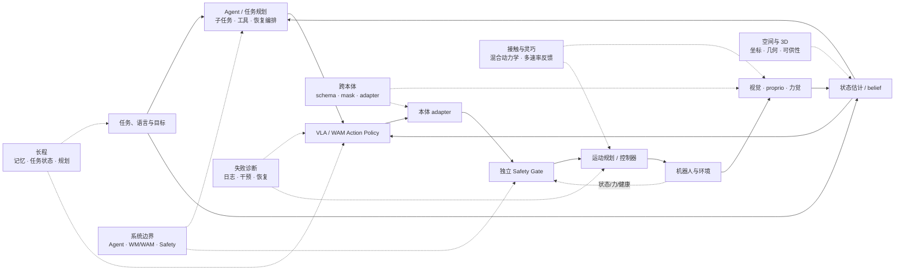
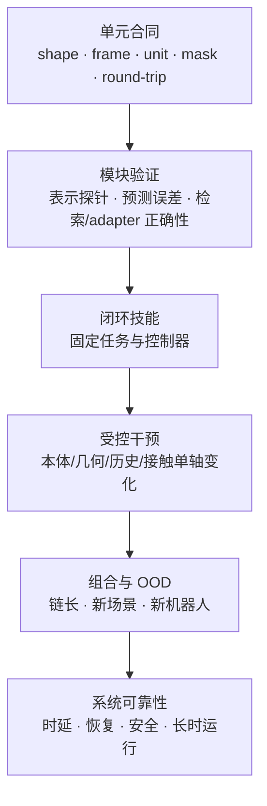

# 横切专题：把能力问题还原成系统约束

数据、架构、训练和部署按实现阶段分章；跨本体、空间、长程和接触却不会只落在其中一层。本目录把这些“能力词”拆成可检查的状态变量、模块接口和证据协议，回答两类问题：

1. 研究者提出“跨本体、空间推理、长程规划、灵巧操作”时，真正改动了系统的哪一部分？
2. 工程现场出现漂移、遗忘、误抓、接触过载或循环动作时，应先检查数据、策略、adapter、控制器还是安全监督？

这里不建立新的模型排行榜。代表模型只作为机制实例；定量结果沿用作者自评、官方统一评测和独立复现的证据分级。

## 1. 六个专题在 VLA 闭环中的位置



图中的虚线不是额外模块，而是横穿多个模块的约束。例如“跨本体”既要求输入字段可对齐，也要求动作能经本体 adapter 落到真实控制器；只做 action padding 不能证明跨本体泛化。

## 2. 文档分工

| 专题 | 核心理论对象 | 工程落点 | 最小证据 |
|---|---|---|---|
| [跨本体泛化](跨本体泛化.md) | 条件策略与 held-out embodiment | canonical schema、mask、adapter、采样 | 新本体 split + 适配预算 + 同任务闭环 |
| [空间、3D 与可供性](空间、3D与可供性.md) | 坐标、几何状态与可执行区域 | 标定、3D 表示、affordance、可达性检查 | 几何干预 + 闭环成功 + 误差分解 |
| [长程任务、记忆与规划](长程任务、记忆与规划.md) | 部分可观测 belief 与分层决策 | memory contract、任务状态、planner 接口 | 随链长曲线 + 历史干预 + 恢复评测 |
| [接触、力觉与灵巧操作](接触、力觉与灵巧操作.md) | 接触模态与混合动力学 | 多速率传感、力/位混合接口、顺应控制 | 接触阶段指标 + 峰值/滑移 + 安全事件 |
| [失败模式与研究机会](失败模式与研究机会.md) | 失败的模块归因 | trace、failure code、反事实重放 | 可定位、可复现、可恢复的 incident |
| [VLA、WAM、Agent 与控制系统](VLA、WAM、Agent与控制系统.md) | 策略、预测、规划和执行责任 | 模块合同、频率、共享表示与安全门控 | 按系统形态分别验证各责任 |

## 3. 从现象选择阅读入口

| 现场现象或研究主张 | 先读 | 再核对 |
|---|---|---|
| 同一策略换机器人后方向、幅度或夹爪语义错误 | [跨本体泛化](跨本体泛化.md) | [动作坐标、归一化与跨本体统一](../数据与特征/动作坐标、归一化与跨本体统一.md)、[本体适配](../系统与部署/本体适配与动作执行接口.md) |
| 语言理解正确，但目标点、抓取面或避障错误 | [空间、3D 与可供性](空间、3D与可供性.md) | [视觉、语言与本体特征](../数据与特征/语言、视觉与本体特征设计.md) |
| 单步技能成功，组合任务重复、跳步或忘记进度 | [长程任务、记忆与规划](长程任务、记忆与规划.md) | [时序建模与记忆](../架构与动作生成/时序建模与记忆.md) |
| 自由空间轨迹正常，插接、旋拧、布料任务失败 | [接触、力觉与灵巧操作](接触、力觉与灵巧操作.md) | [控制栈](../系统与部署/VLA与机器人控制栈.md)、[安全监督](../系统与部署/安全过滤、失败检测与恢复.md) |
| 指标下降，但无法判断是模型、接口还是执行问题 | [失败模式与研究机会](失败模式与研究机会.md) | [消融与公平比较](../训练与评估/消融实验与公平比较.md) |
| 想加入 Agent、世界模型、预测辅助或经典规划 | [系统关系](VLA、WAM、Agent与控制系统.md) | [预测式 VLA 与世界模型辅助](../架构与动作生成/预测式VLA与世界模型辅助.md) |

## 4. 横切问题的共同分析模板

面对任何能力主张，先填一张“约束—机制—证据”卡，而不是先选模型名。

```text
Task scope        : 任务、环境、对象、初始状态、终止条件
Changed axis      : 本体 / 几何 / 链长 / 接触 / 系统形态中的哪一轴
Hidden state      : 哪些决策变量无法从当前输入直接得到
Interface         : 输入字段、坐标、动作语义、时间戳、mask、版本
Mechanism         : 新增/修改的数据、表示、模块、目标函数或控制器
Training budget   : 数据曝光、更新参数、优化步数、外部预训练
Deployment budget : 延迟、频率、缓存、内存、通信、低层控制
Control variables : 对照实验中固定的 Base、数据、adapter、控制器
Evidence          : 离线、仿真、真机、OOD、统计区间、安全事件
Failure trace     : 原始输入、模块输出、执行命令、反馈与 failure code
```

能力词只有在前四项可以写成明确接口、后六项可以形成可检验实验时，才从概念变成工程对象。

## 5. 跨专题共享 message envelope

跨本体、空间、长程、接触与失败诊断可以扩展不同 payload，但不能各自发明互不兼容的时间和版本字段。Observation、condition、action chunk、executable command 与 feedback 都应包在同一个 envelope 中；payload 保存模型或任务专有张量，envelope 保存跨模块重放所需的身份、语义和生命周期：

```yaml
envelope:
  message_type: observation | condition | action_chunk | command | feedback
  message_id: msg_0187_action
  episode_id: task_042
  tick_id: 0187
  source_observation_id: obs_0187
  parent_message_ids: [msg_0187_observation]
  timestamps:
    captured_at: 1730000001.204
    generated_at: 1730000001.292
    effective_at: 1730000001.306
    deadline_at: null
    expires_at: 1730000001.492
    TTL_ms: 200
    clock_domain: robot_monotonic
  contract:
    schema_version: eef_delta_v3
    action_space: normalized_q01_q99 | physical_eef_delta
    shape: [50, 7]
    frame: robot_base
    unit: [m, rad, binary_gripper]
    valid_mask_ref: action_mask_0187
  versions:
    policy: policy_v17
    checkpoint: ckpt_184000
    norm_stats: bridge_q01_q99_v6
    adapter: franka_eef_adapter_v5
    calibration: cell03_2026-08-10T09:00Z
    controller: impedance_v12
    safety_rule: tabletop_rules_v8
  temporal:
    H_obs: 2
    H_pred: 50
    H_exec: 5
    f_H_f_Q_f_A_f_C_hz: [2, 10, 50, 500]
  status:
    valid: true
    confidence: null
    fault_code: null
    fallback: safe_stop
  payload_ref: action_0187_norm
  provenance: policy_server_03
```

`source_observation_id` 与 parent ids 建立因果链；captured/generated/effective/expires 区分“看见、生成、生效、过期”，request deadline 与 payload TTL 分栏保存；schema、frame、unit、mask 和 `action_space` 防止同 shape 异义；版本集合保证 checkpoint、统计、Adapter、标定、控制器和安全规则可以作为一个部署 bundle 回放。三种 horizon 的统一含义是：$H_{obs}$ 为输入历史窗口，$H_{pred}$ 为一次生成长度，$H_{exec}$ 为下一次重查询前最多承诺执行的长度，并满足 $1\le H_{exec}\le H_{pred}$。四频率依次是高层条件刷新 $f_H$、新观测策略查询 $f_Q$、动作参考点 $f_A$ 和低层闭环 $f_C$。

专有字段可以增加，公共字段不能静默改义。某消息不适用的字段应显式为 `null` 或由对应 schema 声明省略，不能用默认值猜测。详细逐 tick 示例见[失败模式与研究机会](失败模式与研究机会.md)，在线请求与动作合同见[系统与部署](../系统与部署/index.md)。

## 6. 共同的验证阶梯



- 单元合同失败时，不能用增加训练数据掩盖接口错误。
- 模块指标改善但闭环不变，说明中间量可能不是当前瓶颈，或下游没有消费该信息。
- 闭环平均成功率提高但 worst-group、安全事件或恢复时间恶化，不能概括为系统能力全面提升。
- 多个轴同时变化时，只能证明整个 recipe 有效，不能把收益归因到单一模块。

## 7. 与主线目录的边界

- 数据的采集、清洗、窗口和混合配方归 [数据与特征](../数据与特征/index.md)；本目录只讨论这些配方如何受跨本体、空间、长程和接触约束。
- encoder、融合、动作头和时序结构归 [架构与动作生成](../架构与动作生成/index.md)；本目录解释能力问题为何需要这些模块。
- loss、微调、RL、评测和统计归 [训练与评估](../训练与评估/index.md)；本目录给出每类横切能力应改变的实验轴。
- action server、adapter、控制器和安全归 [系统与部署](../系统与部署/index.md)；本目录把它们与研究主张对应起来。
- 具体模型的参数、数据量、结果和开放状态归第四批 Baseline 文档；本文中的模型名仅作实现锚点。

## 8. 推荐阅读顺序

第一次阅读可按：

1. [VLA、WAM、Agent 与控制系统](VLA、WAM、Agent与控制系统.md)，先锁定系统责任；
2. 根据任务选择[跨本体](跨本体泛化.md)、[空间](空间、3D与可供性.md)、[长程](长程任务、记忆与规划.md)或[接触](接触、力觉与灵巧操作.md)；
3. 用[失败模式与研究机会](失败模式与研究机会.md)建立日志和验证闭环；
4. 回到对应数据、架构、训练或部署专题实现模块改动。

如果目标只是快速建立领域地图，先读[领域的理解](../领域的理解.md)与[历史沿革](../历史沿革.md)，不必从本目录开始。
