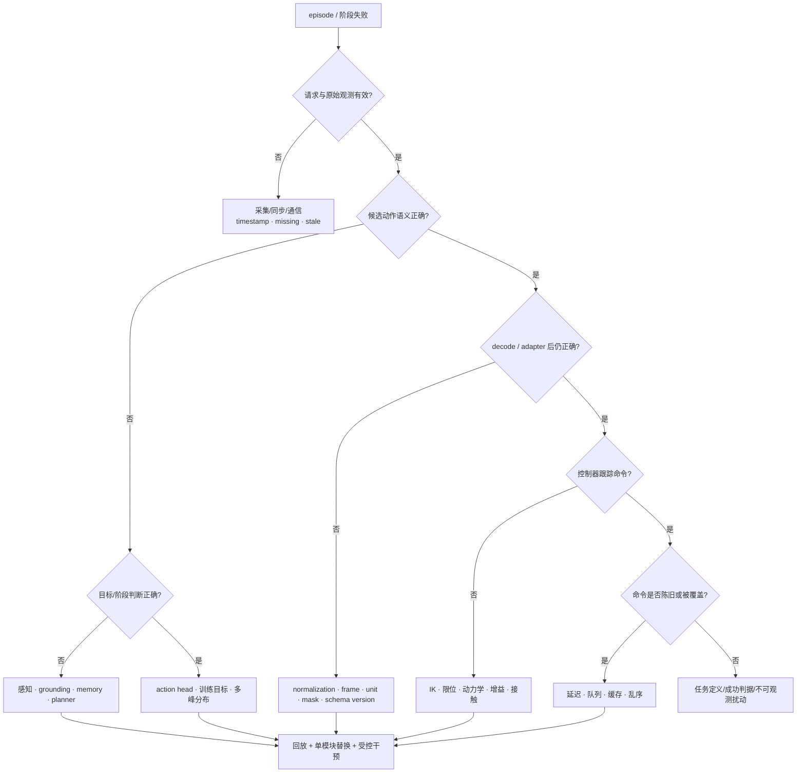
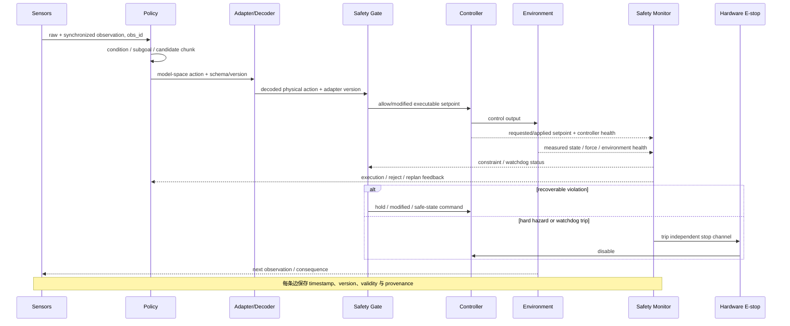
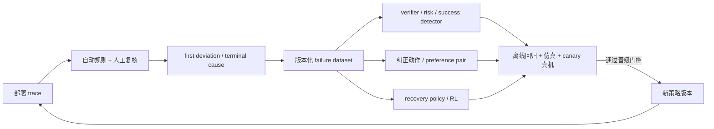

# 失败模式与研究机会

VLA 的一次失败往往只留下“episode success = 0”，但研究和工程需要知道：模型是否看错、语言是否被忽略、动作是否解码错、控制器是否没跟上、通信是否让动作过期，还是任务本身不可达。本篇给出一套从现象到模块的故障分类、日志合同、重放方法和实验协议，并据此定义可验证的研究问题。

运行时保护、急停和恢复状态机见[安全过滤、失败检测与恢复](../系统与部署/安全过滤、失败检测与恢复.md)。本篇不重复安全规则，而是回答“失败怎样被定位、归因并转化为数据或研究假设”。

## 1. 理论起点：失败是执行链上的首次偏离

令期望任务状态为 $x_t^*$，真实状态为 $x_t$。最终失败事件 $F$ 可能由多个模块共同造成：

\[
F=\Phi(\epsilon_{obs},\epsilon_{sync},\epsilon_{repr},
\epsilon_{plan},\epsilon_{act},\epsilon_{decode},
\epsilon_{control},\epsilon_{system},\epsilon_{safety}).
\]

最终时刻的 $F=1$ 不能唯一反推出哪个 $\epsilon$ 先出现。更有用的对象是“首次可观测偏离”：

\[
t^*=\min\{t:d(m_t,m_t^*)>\delta_m\},
\]

其中 $m_t$ 可以是目标 grounding、任务阶段、候选动作、可执行轨迹、跟踪误差或接触状态。这里的 $m_t^*$ 是**比较参考**，不等于在线系统随时可见的真实状态。它通常来自三类来源：

| $m_t^*$ 的来源 | 例子 | 能怎样使用 | 主要限制 |
|---|---|---|---|
| oracle | 仿真真值、动捕、特权相机、人工逐帧标注 | 离线定位首次偏离、给模块上限 | 部署时通常不可用，不能泄漏进策略输入 |
| reference | 专家轨迹、脚本计划、任务状态机、验收轨迹 | 对齐阶段、动作或终态 | 可行解可能不唯一，偏离参考不一定失败 |
| invariant | frame/unit、限位、前置条件、单调任务事实、控制误差界 | 在线检查合同和硬约束 | 只能覆盖已写出的约束，不能给出完整最优行为 |

在线检测器实际比较的是可观测残差、估计参考 $\hat m_t^*$ 或 invariant，而非直接读取 oracle $m_t^*$。因此“在线未报警”只表示现有观测与规则没有发现偏离；定位 $t^*$ 时还应注明参考来源、可见性和容差。定位后再检查上下游因果链，比只看失败末帧更接近工程根因。

还需要区分三类结论：

- **现象**：夹爪错过物体、动作振荡、任务循环；
- **故障位置**：坐标 adapter、目标 grounding、动作队列或控制器首次偏离；
- **原因**：训练数据缺覆盖、损失权重、模型容量、部署延迟或硬件异常。

日志通常能定位故障位置；要宣称原因，还需要受控干预或反事实对照。

## 2. 故障树：先切系统边界，再切模型模块



“候选动作语义正确”不能只靠肉眼看七个归一化数。应把动作解码到明确 frame、unit 和控制模式后，在相同状态上与专家动作、可达性和下游控制结果比较。

## 3. 九层失败分类

| 层 | 典型现象 | 直接可观测量 | 首个低成本检查 | 不应立刻归因于 |
|---|---|---|---|---|
| 数据标签 | 学到错误夹爪/方向、边界处异常 | raw→target trace、质量标签 | 随机抽 episode 做 round-trip | 模型容量 |
| 采集与同步 | 动态物体跟不上、接触前后错相 | 各模态 timestamp、sync gap | 时间轴可视化与延迟扫描 | 时序架构 |
| 感知/grounding | 抓错对象、目标位置错 | attention/probe、框/pose、置信度 | oracle grounding 替换 | action head |
| 语言/任务状态 | 忽略属性、重复/跳步 | 子目标、阶段、语言敏感性 | 指令反事实与 oracle stage | 控制器 |
| 动作分布 | 抖动、平均两种可行轨迹、接触过冲 | raw action distribution、chunk | fixed-observation 多次采样 | 坐标 adapter |
| 解码与本体适配 | 方向/幅度/关节语义错误 | normalized/raw/executable 三份动作 | 恒等 round-trip、单轴测试 | Base |
| 控制与动力学 | 命令正确但跟踪差、碰撞、滑移 | desired/actual、力矩、IK 状态 | 轨迹播放器/脚本命令 | VLA 语义 |
| 系统调度 | 偶发旧动作、断续、长尾卡顿 | action age、queue、p99 latency | 固定策略替换与压力测试 | 平均推理 Hz |
| 评测/成功判据 | 人看成功但计分失败，或反之 | detector trace、终态记录 | 人工复核盲测 | 策略优劣 |

一个 episode 可以有多个 failure code，但应标一个 `first_deviation` 和一个 `terminal_cause`。例如策略先抓偏，随后安全层因过力急停：前者是首次偏离，后者是终止原因；只记录“急停”会误导数据回流。

failure code 应描述**在哪个可观察边界违反了什么判据**，而不是把尚未验证的原因写进标签。推荐使用 `layer.object.failure` 形式，例如 `perception.target.wrong_instance`、`adapter.action.frame_mismatch`、`scheduler.chunk.stale`、`control.trajectory.tracking_error`。每次事件同时记录：

- `detected_at`、`detector/version` 与触发证据；
- `first_deviation`、`terminal_cause` 和事件严重度；
- `cause_hypothesis`，与 failure code 分栏保存，待干预实验后再确认；
- `recovered`、恢复动作和最终任务结果。

“模型幻觉”“泛化不好”“策略不稳定”不是可回归的 failure code；它们没有指出可观察边界，也不能直接生成单元测试。

## 4. 最小可追溯 Trace



Gate 位于 Adapter 与 Controller 之间，决定候选命令是否可执行；Monitor 同时观察控制器 setpoint、实际反馈与系统健康，并能触发 Gate 或独立急停链。两者可以属于同一安全进程，但日志中必须分开“执行前拒绝”和“执行中触发”。

建议每个策略 tick 保存：

```yaml
trace:
  episode_id: task_042
  tick_id: 0187
  policy:
    policy_version: policy_v17
    checkpoint_id: ckpt_184000
  versions:
    observation_schema: obs_multiview_state_v4
    action_schema: eef_delta_v3
    norm_stats: bridge_q01_q99_v6
    adapter: franka_eef_adapter_v5
    calibration: cell03_2026-08-10T09:00Z
    controller: impedance_v12
    safety_rule: tabletop_rules_v8
  timestamps:
    capture: 1730000001.204
    policy_start: 1730000001.229
    policy_end: 1730000001.291
    chunk_generated_at: 1730000001.292
    execute_start: 1730000001.306
    feedback_at: 1730000001.326
  observation:
    observation_id: obs_0187
    raw_refs: [cam_front_0187, cam_wrist_0187]
    sync_gap_ms: 7
    valid_mask: [1, 1, 1]
    H_obs: 2
    observation_period_ms: 100
  condition:
    instruction: place the red block in the bowl
    subgoal: grasp red_block_2
    memory_version: mem_0186
  action:
    chunk_id: chunk_0187
    source_observation_id: obs_0187
    generated_at: 1730000001.292
    TTL_ms: 200
    action_space: normalized_q01_q99
    candidate_model_space_ref: action_0187_norm
    decoded_physical_ref: action_0187_eef_base
    safety_gated_ref: action_0187_safe
    H_pred: 50
    H_exec: 5
    action_sample_rate_f_A_hz: 50
  rates_hz:
    semantic_refresh_f_H: 2
    policy_query_f_Q: 10
    action_sample_f_A: 50
    controller_f_C: 500
  execution:
    queue_age_ms: 15
    requested_setpoint_ref: setpoint_0187_requested
    applied_setpoint_ref: setpoint_0187_applied
    measured_feedback_ref: feedback_0187_joint_eef_force
    tracking_error_ref: track_0187
    safety_modification: none
  outcome:
    stage_before: approach
    stage_after: approach
    failure_codes: [task.progress.no_progress]
    first_deviation: task.progress.no_progress@tick_0187
    terminal_cause: null
```

大体量图像、token 和张量可存引用而非内嵌；关键是能够用同一个 `obs_id` 重建从输入到执行反馈的路径。隐私或存储约束下也应保存哈希、schema、统计摘要和采样策略。

## 5. 从 Trace 到可复现 Incident

一份合格的 incident 记录至少包含：

| 字段 | 内容 |
|---|---|
| scope | 任务、本体、场景、策略/adapter/控制器版本 |
| symptom | 可观察现象，不夹带原因判断 |
| first deviation | 最早异常 tick、模块与证据 |
| terminal state | episode 为什么终止 |
| reproducibility | 固定初态/回放能否重现，出现频率 |
| comparison | 同输入旧版本、oracle 模块或脚本控制结果 |
| impact | 成功率、安全、硬件、数据污染、时延 |
| containment | 禁用版本、降低速度、回退策略、过滤数据 |
| hypothesis | 可证伪原因与所需实验 |
| resolution | 改动、验证集、回归测试与残余风险 |

不要把“模型幻觉”“泛化不好”当作 failure code；它们无法直接映射到模块或回归测试。更合适的 code 是 `perception.target.wrong_instance`、`planner.subgoal.stale`、`adapter.action.frame_mismatch`、`scheduler.queue.overwrite` 等。

## 6. 模块级回放与反事实替换

### 6.1 五种回放

| 回放类型 | 输入 | 运行到哪里 | 能证明什么 |
|---|---|---|---|
| 数据回放 | 原始传感与时间戳 | 预处理/同步 | schema、裁剪、同步是否稳定 |
| 策略回放 | 固定模型输入 | 候选动作 | checkpoint 的确定性/采样分布 |
| adapter 回放 | 保存的模型空间动作 | 解码后的物理参考 | 反归一化、坐标和本体映射 |
| safety 回放 | 物理参考、状态与健康信号 | 门控后的 setpoint/stop | 规则、阈值与修改归因 |
| hardware-in-loop | 轨迹或策略服务 | 控制器/硬件 | 延迟、跟踪、watchdog；风险最高 |

离线策略回放不能证明闭环成功，因为它没有改变后续状态；hardware-in-loop 又可能造成碰撞。工程顺序通常是先数据和 adapter，再仿真/数字孪生，最后受限速度真机。

### 6.2 Oracle replacement

将一个模块换成 oracle 或脚本，并保持其余链不变：

- oracle 目标框/3D pose：测试感知是否是瓶颈；
- oracle 子任务：测试 planner 与低层执行器边界；
- expert action：测试 adapter、控制器和系统调度；
- oracle success detector：测试任务循环和恢复；
- recorded fresh action：测试队列陈旧与服务尾延迟。

如果替换后故障消失，只能说明该模块或其接口参与了故障，仍需进一步区分模块内部错误与上下游合同错误。

### 6.3 Counterfactual perturbation

对同一 episode 改一个变量：语言属性、相机位姿、目标位置、历史顺序、动作 frame、延迟、负载或摩擦。绘制性能随扰动强度的曲线，能揭示阈值和脆弱方向；只给一个“加噪后分数”难以定位机制。

## 7. 失败数据怎样进入训练



失败轨迹有四种不同用途：

1. **排除错误监督**：传感损坏、坐标错、操作员误操作不应作为正向模仿标签；
2. **训练检测器**：用失败前兆训练 risk、success 或 no-progress；
3. **训练纠正**：保存失败状态上的专家动作、成对偏好或人工接管；
4. **训练恢复**：从失败分布出发，学习回撤、重抓、重观察或重新规划。

直接把失败动作与成功动作混在相同 behavior cloning loss 中，可能让模型模仿失败。每条轨迹需要 outcome、action provenance、valid mask 和用途标签。

RoboMIND 的本地资料记录了 12 类预定义微观失败标注，并特别指出部分失败轨迹在质检后被过滤；“有失败标签”不等于这些数据已被有效用于反思训练。引用任何失败数据集时，需要核对它是过滤、分类、负样本、纠正还是 RL 初态。

## 8. 常见失败模式的机制与实验

### 8.1 分布外视觉与 sim-to-real

**机制假设**：策略使用背景、相机或对象纹理捷径；仿真视觉/动力学未覆盖真机。

**实验**：对象/背景/光照/相机/动力学单轴 held-out；oracle grounding；冻结控制器；按扰动强度报告曲线和 worst-group。仿真成功率高而真机低不能自动归因于“视觉 domain gap”，还应比较动作接口、控制器和延迟。

### 8.2 语言被忽略

**机制假设**：视觉位置足以预测训练动作，模型对语言没有因果依赖。

**实验**：同图像更换互斥指令、同指令更换目标；遮掉语言；打乱语言—动作配对；测动作分布变化和闭环结果。OpenVLA-OFT 的本地论文笔记将多相机虚假相关与语言调制作为设计动机，可作为具体案例，但不能外推为所有多相机策略都忽略语言。

### 8.3 长程重复与崩塌

**机制假设**：任务状态未写入、终止器错误、旧动作未清、局部误差累积。

**实验**：oracle stage/completion；链长扫描；中途移动目标；正确/过期/随机 memory；记录 full success、progress、恢复率与首次失败阶段。详见[长程任务、记忆与规划](长程任务、记忆与规划.md)。

### 8.4 精细接触失败

**机制假设**：几何误差、动作量化/归一化、低频反馈、控制器刚度或缺少力觉。

**实验**：先在无接触空间验证 frame/unit；随后分阶段测 approach、first contact、insertion、release；记录末端误差、峰值力、滑移和 tracking error。动作头对比需固定控制器和执行频率。详见[接触、力觉与灵巧操作](接触、力觉与灵巧操作.md)。

### 8.5 跨本体退化

**机制假设**：共享表示有效，但 state/action schema、尺度、相机或动力学未对齐。

**实验**：canonical action round-trip；冻结 backbone 只训 adapter；seen/few-shot/held-out 分开；固定目标本体数据预算；按本体报告 macro/worst。详见[跨本体泛化](跨本体泛化.md)。

### 8.6 延迟与队列故障

**机制假设**：平均吞吐足够但 p99 延迟、动作年龄或乱序破坏闭环。

**实验**：固定策略输出，在仿真/回放中注入延迟、抖动、丢包和重排；扫描 $H_{exec}$、队列深度和 TTL；报告动作年龄、清队列时间、恢复和安全事件。吞吐 Hz 不等于策略刷新率或低层控制率。

## 9. 指标：从成功率扩展到故障统计

| 指标 | 定义 | 用途 |
|---|---|---|
| episode-normalized failure incidence | 每 100 个 episode 的某类故障数；同时报告 episode 数与任务构成 | 比较任务试验中的故障概率 |
| time-normalized failure incidence | 每个 operating hour 的某类故障数；同时报告有效运行小时 | 比较连续部署可靠性 |
| first-deviation distribution | 首次偏离所在模块/阶段的分布 | 找主要瓶颈 |
| mean time between failures | 连续运行到故障的时间 | 系统部署 |
| detection latency | 故障发生到被发现的时间 | 检测器 |
| recovery success | 进入恢复后继续完成的比例 | 恢复策略 |
| time/cost to recover | 时间、额外动作、人工介入 | 实用代价 |
| false intervention | 本可成功却被安全/恢复中断 | 保护策略副作用 |
| regression recurrence | 已修复 code 在新版本复发率 | 发布质量 |
| unsafe-event rate | 分别按每 100 episode 与每 operating hour 报告碰撞、过力、限位、急停 | 安全，不可被平均成功掩盖 |

episode 分母回答“每次任务尝试有多容易出错”，operating-hour 分母回答“系统运行多久遇到一次错误”；任务时长变化时二者会给出不同结论，不能写成“每 100 episode/小时”这一混合单位。operating hour 还应声明是否扣除初始化、人工接管、急停后锁定和计划维护时间。二元成功的区间、cluster bootstrap 与多任务聚合见[泛化、鲁棒性与统计协议](../训练与评估/泛化、鲁棒性与统计协议.md)。failure code 稀疏时应同时报告事件计数、episode 数、有效运行小时和置信区间，不能只给百分比。

## 10. 回归测试集与发布门槛

每次修复都应产生最小回归样例：

```text
case_id           : action_frame_camera_to_base_001
input_bundle      : observation + candidate action + schemas
expected_invariant: +x_camera maps to calibrated base direction
failure_code      : adapter.action.frame_mismatch
versions          : checkpoint / norm / adapter / calibration / controller / safety rule
tolerance         : position, rotation, latency
test_levels       : unit → replay → sim → restricted real
```

发布门槛同时包含：

- 旧 benchmark 不显著退化；
- 目标 failure code 的发生率下降；
- 相邻 failure code 未转移性增加；
- p95/p99 延迟和资源预算满足；
- 安全事件不增加；
- 新模型、adapter、控制器和 schema 版本组合已验证。

只在失败集合上调参会过拟合事故样本，应保留独立的 canary 和常规任务集。

## 11. 从失败假设得到研究问题

研究机会不应只写“提升鲁棒性”。下面每一项都给出可证伪形式：

| 研究问题 | 机制假设 | 最小方法改动 | 关键对照 | 成功证据 |
|---|---|---|---|---|
| 语言捷径 | 模型未使用区分性语言 | 反事实语言训练/融合门控 | 同视觉互斥指令 | language intervention 下动作和成功一致改变 |
| 记忆污染 | 错误/旧历史压制当前证据 | 带置信度与 TTL 的 memory | 正确/随机/过期/oracle | 长程提升且污染压力测试稳定 |
| 接触状态缺失 | 视觉无法观测滑移/力 | force/tactile encoder | 同数据预算 vision-only | 接触阶段与安全指标改善 |
| adapter 瓶颈 | canonical schema 丢失本体结构 | morphology-conditioned adapter | 固定 backbone/data | held-out 本体提升且 seen 不退化 |
| 世界预测失真 | rollout 被当作确定事实 | 不确定性校准 + risk-aware selection | 无校准/随机 candidate | 预测误差与决策风险同时下降 |
| 尾延迟脆弱 | 旧动作而非模型精度导致失败 | deadline-aware queue/replan | 同模型、同平均吞吐 | 延迟注入下恢复与安全改善 |
| 失败数据利用 | 纯过滤丢失恢复信息 | consequence/纠正/recovery 目标 | 过滤-only | 相同成功数据下恢复率提升 |

## 12. 常见误解

- **离线 action loss 下降说明故障修复**：它不能覆盖 adapter、控制器、队列和闭环状态分布。
- **最后一帧就是失败原因**：真正的首次偏离通常更早。
- **安全层拒绝说明策略一定错**：也可能是标定、规则版本或状态估计错误；保留原始与修改后动作才能判断。
- **加入失败轨迹就会学会恢复**：需要区分负样本、纠正标签、恢复目标和 RL 信号。
- **提高平均成功率即可关闭问题**：目标 failure code、worst-group、尾延迟或安全事件可能恶化。
- **一个模型的失败数字可以横比另一个模型**：数据、任务、动作空间、控制器和 trial 协议不同，不能直接排名。

## 一手资料与站内延伸

- [原论文库：VLA 共性失败模式聚合](../../依赖索引.md)
- [原论文库：具身数据处理与 RoboMIND 质检](../../依赖索引.md)
- [动作坐标、归一化与跨本体统一](../数据与特征/动作坐标、归一化与跨本体统一.md)
- [离线、仿真与真机评估](../训练与评估/离线、仿真与真机评估.md)
- [消融实验与公平比较](../训练与评估/消融实验与公平比较.md)
- [推理加速、缓存与 Action Server](<../系统与部署/推理加速、缓存与Action Server.md>)
- [安全过滤、失败检测与恢复](../系统与部署/安全过滤、失败检测与恢复.md)
