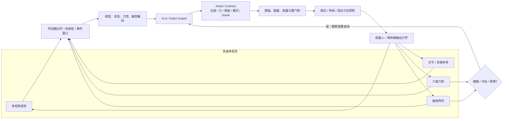
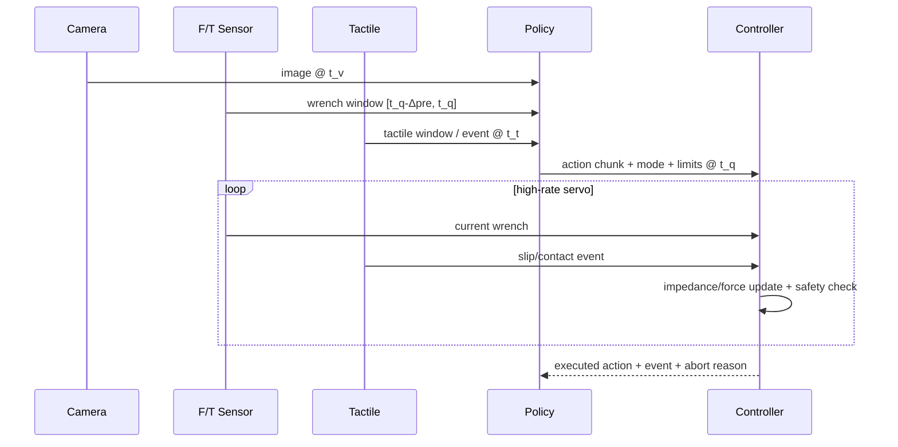
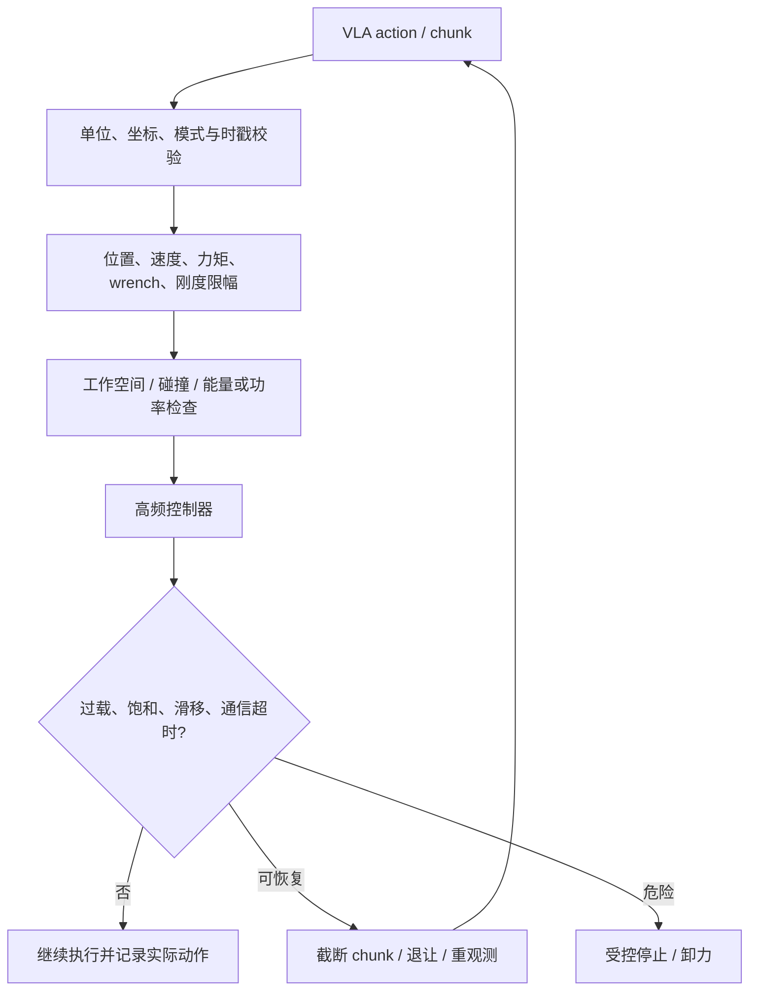

# 接触、力觉与灵巧操作

> 本文讨论 VLA 从“把末端移动到目标附近”进入“与环境交换力并保持稳定接触”后，系统接口发生了什么变化。重点不是给模型多接一种传感器，而是把接触动力学、多速率观测、动作块、控制器与安全证据组成一个可验证的闭环。

对于插接、擦拭、旋拧、双手操作和灵巧手内操作，视觉成功定位并不等于任务成功。接触发生后，毫米级几何误差可以转化为大力，作用力又会改变物体与机器人状态。VLA 的动作输出若没有声明力、刚度、模式和底层控制器语义，单看策略网络无法解释真实执行结果。

## 1. 学习目标与闭环地图

读完后，应能：

1. 区分自由空间、接触建立、持续接触、滑移和释放等混合模式；
2. 为视觉、本体、六维力矩和触觉写出多速率 Observation Contract；
3. 判断 VLA 应输出位置、增量、目标力、刚度、控制模式还是它们的组合；
4. 说明 action chunk 与高频控制器如何衔接，以及接触事件为何要求重规划或截断；
5. 用成功率、力/冲量、滑移、损伤和干预等联合指标验证接触策略；
6. 正确解读 ForceVLA、GR-Dexter、$\pi_0$、GR00T 等模型关于接触能力的证据边界。



图中策略频率、动作更新频率和伺服控制频率是三个不同量。模型输出动作块并不意味着模型或通信链路以底层伺服频率运行；高频稳定性通常由控制器承担。

## 2. 接触是混合动力学问题

### 2.1 自由空间与接触模式

令 $m_t$ 表示接触模式，例如自由空间、单点接触、双点接触、粘着或滑动，则系统可抽象为：

$$
x_{t+1}=f_{m_t}(x_t,u_t),
\qquad m_{t+1}=h(x_t,u_t,\mathcal E).
$$

同一个位姿动作 $u_t$ 在不同 $m_t$ 下会产生完全不同的结果：自由空间中主要改变位姿；接触后可能转化为法向力、摩擦力、形变或物体运动。单边接触的理想化约束常写作：

$$
\phi(q)\ge 0,\qquad \lambda_n\ge 0,\qquad \phi(q)\lambda_n=0,
$$

其中 $\phi(q)$ 是物体间隙，$\lambda_n$ 是法向接触力；库仑摩擦近似满足 $\|\lambda_t\|\le\mu\lambda_n$。这些式子不是要求 VLA 显式求解互补问题，而是解释了两个工程事实：

- 接触建立是离散模式切换，固定开环 action chunk 可能跨过切换点；
- 接触后的安全和成功不仅由目标位姿决定，还依赖刚度、速度、摩擦、力限制和控制周期。

### 2.2 “有触觉硬件”不等于“策略使用触觉”

接触信息可能存在于四个不同层级：

1. 硬件装有力矩/触觉传感器；
2. 数据集记录了该模态；
3. 策略以该模态作为输入或监督；
4. 控制器用该模态闭环调节动作。

论文或系统报告只证明其中一层时，不能外推到其他层。比如机器人手上有触觉阵列，但策略输入只包含视觉、语言和本体状态，应称为“触觉装备平台上的视觉—本体策略”，而不是“触觉 VLA”。

## 3. 力矩、触觉与坐标语义

### 3.1 六维力矩不是六个无坐标的数

六维 wrench 写作 $w=[F^\top,\tau^\top]^\top$。当从传感器坐标 $s$ 变换到任务坐标 $a$ 时：

$$
w^a=\operatorname{Ad}_{T^a_s}^{-\top}w^s.
$$

力矩随参考点改变，因此必须声明坐标轴和力矩原点。传感器原始值还混有工具重力、载荷、零偏、温漂、线缆作用和机械振动。进入模型前至少记录：

| 字段 | 语义 | 若缺失会发生什么 |
|---|---|---|
| `frame_id` 与参考点 | sensor / tool / base / task/contact frame | 方向或力矩含义随姿态变化 |
| 单位与量程 | N、N·m、饱和上限 | 归一化错误或过载被截平而不知 |
| 原始时间戳与采样率 | 独立传感时钟 | 冲击峰值对到错误图像/动作 |
| bias / gravity compensation | 补偿版本与有效区间 | 静态载荷被当作接触 |
| `valid` / `saturated` / `stale` | 缺失、饱和、陈旧 | 零填充被误解为零接触力 |
| 滤波元数据 | 截止频率、群延迟或窗口 | 不同滤波延迟使因果关系倒置 |

六维力矩只能给出工具处的**合 wrench**，通常不能唯一恢复多点接触分布。触觉阵列能提供局部压力、接触形状、剪切或滑移线索，但分辨率、迟滞、漂移、封装和标定高度依赖硬件。两者不是简单替代关系。

### 3.2 多速率 Observation Contract

不要先把所有模态硬采样到视频帧率再称为“同步”。推荐保留原始流和显式窗口：

```text
ContactObservation at policy query t_q:
  vision:      frames, camera_id, timestamps, valid_mask
  proprio:     q/dq/EEF/gripper, timestamps, frame_id
  wrench:      raw_or_compensated 6D samples, timestamps,
               sensor_frame, bias_id, saturation_mask
  tactile:     maps/events/features, taxel geometry,
               timestamps, calibration_id, valid_mask
  action_hist: issued action, actually executed action,
               controller mode and timestamps
  event_state: free/contact/onset/stick/slip/release + confidence
```

各频率应在实验清单中分别报告，而非默认某个固定值：

- `policy_query_hz`：模型多久查询一次；
- `action_update_hz`：新目标多久交给控制器一次；
- `control_hz`：阻抗、力或关节伺服循环频率；
- `sensor_hz`：每个相机、力矩、触觉和本体流的采样频率。

这些量可能不同。相关系统综述中常见策略推理处于较低频、机器人伺服处于数百赫兹或更高，但不能把这一经验区间当作某篇模型未披露的规格。具体报告应以论文和硬件日志为准。

## 4. 事件窗口与时序同步

接触任务的关键样本往往集中在很短的事件附近。可将轨迹按物理语义切为：

$$
\mathcal W_e = [t_e-\Delta_{pre},\;t_e+\Delta_{post}],
$$

其中 $t_e$ 可以是接触起点、冲击、滑移或释放时刻。窗口内保留高频力/触觉序列，再由编码器压缩；不要只取离视频帧最近的单个力值，因为峰值、斜率、冲量和振荡模式可能决定成败。



### 4.1 因果和延迟检查

训练窗口只允许使用动作决策时刻可见的信息。滤波器的群延迟、相机曝光时间和网络缓冲要计入时间戳。若使用以事件为中心的双向窗口训练接触识别器，它可以用于离线分析；若直接输入在线策略，事件之后的样本构成未来信息泄漏。

同步误差的验证不应只看平均绝对时间差，还应注入人工延迟并观察闭环退化。需要区分：传感器时钟偏移、传输延迟、滤波延迟、模型推理延迟和控制执行延迟。

## 5. 力觉与触觉特征设计

| 表示 | 内容 | 优点 | 风险 / 对照 |
|---|---|---|---|
| 当前 wrench | 补偿后的 $F_x,F_y,F_z,\tau_x,\tau_y,\tau_z$ | 简单、延迟低 | 对冲击和滑移历史不足；对照窗口编码 |
| 手工时序特征 | 均值、峰值、斜率、RMS、冲量、频带能量 | 易审计，适合小数据 | 参数依赖任务；与同预算学习编码器比较 |
| 原始序列编码 | 1D 卷积、时序 Transformer、状态空间编码 | 可学事件形状和滞后 | 需要严格因果 mask 与延迟评估 |
| 触觉图像/压力图 | taxel 空间结构、接触面积、质心 | 保留局部分布 | 跨硬件几何不一致；需要传感器 adapter |
| 接触 token | onset/stick/slip/release、法向与切向摘要 | 便于与 VLM/action expert 融合 | 离散器错误会形成信息瓶颈 |
| 跨模态 latent | 视觉、力、触觉经注意力或 MoE 动态融合 | 能按阶段选择模态 | 难解释；必须做模态置乱、延迟和缺失测试 |

归一化应分本体、传感器与工具载荷统计，保留物理阈值所在的原始单位。对力值做逐数据集标准化有利于优化，却可能抹掉“5 N 安全阈值”的跨数据含义；常见做法是模型输入使用标准化值，同时安全层读取校准后的物理值。

缺失模态应有显式 mask 和传感器身份。把缺失力填为零会与“已校准且确实无接触”混淆；把损坏 taxel 当低压力会系统性改变接触质心。

## 6. Action Contract：策略到底控制什么

接触系统至少有四类动作接口：

| 动作接口 | 策略输出 | 底层职责 | 适用条件与代价 |
|---|---|---|---|
| 位姿/增量 chunk | 末端或关节目标序列 | 轨迹插值、IK、位置/阻抗控制 | 兼容演示数据；接触力只被隐式决定 |
| 位姿 + 刚度/阻尼 | 目标轨迹及 $K,D$ | 笛卡尔/关节阻抗闭环 | 能调顺应性；参数必须限幅并保证稳定 |
| 位姿 + 目标 wrench | 运动轴和期望力 | 混合力位或导纳控制 | 适合擦拭、插接；需任务/接触坐标 |
| 模式/技能参数 | approach/contact/search/insert 等模式及参数 | 状态机/技能控制器执行 | 易加安全语义；依赖模式标注和切换逻辑 |

一个可审计的 Contact Action Contract 可写为：

```text
ContactActionChunk:
  pose_or_joint_targets[H]: frame, unit, absolute_or_delta
  desired_wrench[H]?: task/contact frame, unit
  stiffness_damping[H]?: controlled axes and bounds
  control_mode[H]?: position / impedance / force / hybrid
  gripper_or_hand[H]: command semantics
  valid_horizon / exec_horizon: H_pred and H_exec
  stop_replan_conditions: force, slip, timeout, saturation
  safety_envelope: max force/torque/speed/workspace
```

不是每个模型都必须输出所有字段，但未输出的量由谁确定必须明确。训练标签是遥操作位姿而部署控制器是高刚度位置环时，接触表现可能主要由控制器设置决定，而非策略“学会了力”。

### 6.1 阻抗、导纳与混合力位接口

笛卡尔阻抗的一种简化表达是：

$$
F_{cmd}=K(x_d-x)+D(\dot x_d-\dot x)+F_{ff}.
$$

混合力位控制不能把“米制位姿命令”和“牛顿制力命令”直接相加。先把运动误差与力误差分别映射为**同一任务坐标、同一参考点、同一单位的笛卡尔 wrench 命令**。例如令 $F_m$ 为运动误差经阻抗律得到的 wrench，$F_f$ 为力控制器得到的 wrench，则：

$$
F_{cmd}=S F_m+(I-S)F_f,
\qquad
\tau_{cmd}=J(q)^\top F_{cmd}+\tau_{null}.
$$

$S$ 选择运动控制轴，$I-S$ 选择力控制轴；两项都已是 wrench，因此维度闭合，随后由雅可比转置映射为关节力矩。$S$ 的轴必须定义在任务或接触坐标中。例如插孔轴向控力、横向控位与在机器人基座坐标逐轴混合不是同一件事。若硬件只接受位置目标，导纳模块应先把力误差变成位姿修正，再与位姿目标组合，而不是把 N 与 m 直接相加。若接触法向会变化，坐标估计本身也是闭环的一部分。

导纳控制则把测得的力转换为位姿/速度修正，适用于只能接收位置目标的机器人接口，但其虚拟质量、阻尼和饱和同样影响稳定性。论文比较若更换了控制器、刚度或安全阈值，不能把全部差异归因于 VLA。

### 6.2 Action chunk 遇到接触事件

若策略一次预测 $H_{pred}$ 步、实际开放执行 $H_{exec}$ 步，接触可能在 chunk 中途发生。继续执行自由空间段可能造成过载。常见系统选择是：

- 减小 $H_{exec}$，以更多策略查询换响应性；
- 控制器在高频环内依据力/触觉约束修正；
- 接触 onset、滑移或过载触发 chunk 截断和重查询；
- 用模式条件 chunk，使接触前后使用不同控制语义；
- 对新旧 chunk 做时间一致的平滑，但安全停止不应被平滑延迟。

因此必须分别报告 $H_{pred}$、$H_{exec}$、查询频率、动作更新频率和控制频率。只报告“输出 50 步”不足以判断闭环响应。

## 7. 代表系统：事实与证据边界

下表性能均为**作者自评/官方报告**，协议、硬件和任务不同，不构成横向排行榜。来源与开放状态于 **2026-08-10** 按论文链接及本地一手资料索引复核；若本地资料最后一次远端实查日期更早，则保留该日期并将当前状态标为“待核”，不根据项目名或新闻推测发布情况。

| 系统 | 接触相关机制与事实 | 时域合同：已披露 / 未披露 | 证据与开放边界 |
|---|---|---|---|
| [ForceVLA](https://arxiv.org/abs/2505.22159) | Force-aware VLMoE 在动作解码时融合预训练视觉语言表示与实时六维力反馈；ForceVLA-Data 同步视觉、本体与力矩，含 5 个接触密集任务；论文报告相对强 $\pi_0$ 系基线平均成功率提升 23.2%，插接最高成功率 80% | “实时”描述不能替代频率字段；本文所据来源未核到 $H_{pred}$、$H_{exec}$、`policy_query_hz`、`action_update_hz`、`control_hz` 与 F/T `sensor_hz`，均标待核 | NeurIPS 2025 论文作者自评；[项目页](https://sites.google.com/view/forcevla2025)曾表述代码/数据将发布，2026-08-10 未确认可下载的代码、权重与数据，当前开放完整性待核 |
| [GR-Dexter](../../依赖索引.md) | 高自由度双臂灵巧手系统；硬件指尖有高密度压阻触觉阵列，输出动作经参数化轨迹优化器平滑；约 4B MoT、88D 冗余动作，数据含 800 小时以上人类第一视角轨迹 | $H_{pred}$、$H_{exec}$、查询、动作更新、控制与触觉采样频率均未披露 | 真机结果为作者自评；本地资料记录策略输入未确认使用触觉，故不能称为触觉闭环 VLA；本地资料截至 2026-06 实查无代码、权重和数据，2026-08-10 未重新验证远端 |
| [$\pi_0$](../../依赖索引.md) | VLM + flow-matching action expert，连续 action chunk 可覆盖快速操作；未披露显式力/触觉策略输入 | $H_{pred}=50$；作者资料称部分任务支持“最高 50 Hz 控制”，这里记作动作目标/轨迹采样口径，不能外推为 50 Hz 模型查询；$H_{exec}$、`policy_query_hz` 与底层伺服 `control_hz` 未分项披露 | 高频连续动作不等于显式力感知；本地论文笔记记录原论文发布时自有数据与权重未完全开放，2026-08-10 的当前开放完整性未重新核验 |
| [GR00T N1](../../依赖索引.md) | 双系统：较慢 VLM 语义系统与 flow-matching 动作 DiT；本体 adapter 统一不同机器人，采用相对末端动作 | $H_{pred}=16$；作者口径称 System 2 约 10 Hz、动作侧闭环最高 120 Hz，并报告 L40 上生成一块约 63.9 ms。故 120 Hz 不能解释为 120 次/s 的完整块查询；$H_{exec}$、动作 setpoint 更新与底层伺服频率未分项披露 | 核心性能多为作者自评，未因此证明显式力觉/触觉闭环；本地资料记录权重、训练数据与仿真基准有公开入口（2025-03 口径），2026-08-10 未重新测试远端可用性 |

这里故意保留两个“负事实”：GR-Dexter 有触觉硬件但策略使用触觉未获本地资料支持；$\pi_0$/GR00T 能生成快速连续动作但不自动具有力感知。它们帮助建立正确比较轴：**接触成功可能来自数据覆盖、动作频率、顺应控制、显式力输入或触觉反馈，必须用消融拆开。**

此外，仓库中的 [`force-vla.md`](../../依赖索引.md) 介绍的是名为 FORCE 的强化学习后训练方法，并非本文引用的 ForceVLA 力感知模型；检索和引用时不要因文件名相似而混淆。

## 8. 数据与训练 Pipeline

### 8.1 接触数据最小字段

接触轨迹除了视觉、语言、机器人状态和动作，还应保存：

- 原始与补偿后的 wrench、触觉原始/压缩数据及各自时间戳；
- 工具、载荷、传感器、标定和控制器版本；
- 实际执行动作，而不只保存策略目标；
- 控制模式、刚度/阻尼、力阈值和安全停止原因；
- 接触 onset、滑移、释放等事件标签或可追溯原始信号；
- 成功阶段、失败类型、过载/碰撞/人工干预；
- 对象材质、刚度、摩擦、装配间隙等任务元数据（可测则记录，未知则标未知）。

本地资料记载 RH20T 包含 RGB-D、力与音频等多模态，AgiBot 数据包含多视角 RGB-D、视触觉与本体，但“数据集含该模态”不等于任何具体 baseline 已使用全部模态。多源混合时要为缺失监督和不同传感器建 mask/adapter，参见[多数据集混合与 Co-training](../数据与特征/多数据集混合与Co-training.md)。

### 8.2 训练目标

接触策略可在动作损失之外加入力、事件或安全辅助目标：

$$
\mathcal L = \mathcal L_{act}
+\lambda_w m_w\mathcal L_{wrench}
+\lambda_e m_e\mathcal L_{event}
+\lambda_s m_s\mathcal L_{slip}
+\lambda_{safe}\mathcal L_{constraint}.
$$

需要区分三种用法：

1. **力作为观测**：帮助动作解码响应接触；
2. **力作为预测/辅助监督**：帮助学习物理状态，但推理可不输入力；
3. **力作为动作目标**：策略输出期望 wrench，由控制器闭环执行。

三者的推理依赖、数据要求和安全含义不同。辅助预测损失降低不代表闭环作用力更安全；力作为动作目标也不代表实际作用力等于目标值，仍需控制带宽和稳定性证据。

### 8.3 训练阶段和采样

- 先用大规模视觉—动作数据获得语义和运动能力，再用同步接触数据适配，是数据稀缺时的常见路线；但要检查接触微调是否遗忘自由空间能力。
- 接触事件在长轨迹中占比低，可做事件窗口过采样；评估时仍按完整轨迹分布统计，避免训练采样改变测试先验。
- 成功数据教“做什么”，失败、过载与恢复数据教边界；若安全原因不能探索失败，应使用控制器日志、仿真和受限扰动补充。
- 多触觉硬件共享策略时，传感器几何、量程和安装位置应通过 adapter 或明确 token 表达，不能只统一成相同长度向量。

## 9. 安全闭环

安全不能仅依赖模型理解自然语言中的“小心”。至少要在模型外保留可审计约束：



需要记录“策略想做什么”和“安全层实际执行什么”。若安全层频繁裁剪，任务成功可能来自保守控制，也可能说明动作分布不适配；两种情况都要报告裁剪率、停止率和恢复成功率。

对人机协作或易损对象，应将最大力、力矩、速度、刚度、功率/能量、工作空间和通信超时设为独立配置的安全包络。阈值来自硬件、对象和风险分析，不能从论文平均成功率推断。

## 10. 评估与统计协议

### 10.1 任务成功之外的指标

| 维度 | 指标 | 解释 |
|---|---|---|
| 任务 | 完整成功率、阶段成功率、完成时间、重试次数 | 是否完成以及卡在哪个接触阶段 |
| 力控制 | 力（N）与力矩（N·m）分别报告峰值/RMS、目标带内时间、稳态误差 | 是否平稳达到期望作用力，且避免混合不同单位 |
| 冲击 | 接触冲量、峰值上升率、过载次数 | 接触建立是否温和 |
| 触觉 | 滑移检测/恢复、接触面积稳定性、掉落率 | 局部接触是否稳定 |
| 安全 | 碰撞、损伤、急停、人工干预、安全层裁剪率 | 成功是否以危险代价获得 |
| 系统 | 查询/动作/控制频率、端到端延迟、事件响应时间 | 是否足以在接触模式变化前响应 |

若目标力为 $F_d(t)$、测量力为 $F(t)$，可以报告：

$$
\mathrm{RMSE}_F=\sqrt{\frac{1}{T}\int_0^T\|F(t)-F_d(t)\|^2dt},
\qquad
J_F=\int_{t_{on}}^{t_{off}}\|F(t)\|dt,
$$

以及 $F_{peak}=\max_t\|F(t)\|$。对力矩另以 N·m 定义 $\mathrm{RMSE}_{\tau}$、$J_{\tau}$ 与 $\tau_{peak}$，不要把 N 与 N·m 未经尺度化地拼成一个六维欧氏范数。冲量 $J_F$、峰值和任务成功互补；仅用平均力会掩盖短时危险冲击。不同任务还应在任务坐标中分解法向/切向力，并声明力矩参考点。若确需一个综合 wrench 分数，必须先用任务容许力与容许力矩分别无量纲化，再说明聚合方式。

### 10.2 分层和扰动轴

至少按以下因素分层：对象材质/刚度/摩擦、装配间隙、接触方向、初始位姿误差、工具/载荷、传感器类型、本体、速度、视觉遮挡。OOD 轴应一次改变一个主要因素，再设计组合 OOD。

每种设置报告 episode 数、随机种子或任务实例、置信区间和失败类型。真机实验要将对象磨损、重新装夹和传感器零偏漂移纳入随机化/区组设计。统计总原则见[泛化、鲁棒性与统计协议](../训练与评估/泛化、鲁棒性与统计协议.md)。

## 11. 必做消融与因果诊断

### 11.1 感知消融

1. 力/触觉正常、置零、显式缺失、时间置乱、跨 episode 置换；
2. 人工加入 1、2、4 个动作周期的延迟，绘制成功和峰值力退化曲线；
3. 原始序列、当前值、手工统计和同预算学习编码器；
4. 原始传感坐标与正确任务坐标，对坐标旋转/参考点错误做压力测试；
5. 仅辅助预测力与推理时真正输入力分开比较。

“置零”和“缺失”必须分别测：置零仍可能落在训练分布中的无接触状态，不能代表传感器故障。

### 11.2 动作与控制消融

1. 在同一控制器、刚度、限幅和频率下比较不同策略；
2. 位姿-only、位姿+刚度、位姿+目标力、模式化动作合同；
3. 固定 $H_{pred}$ 扫描 $H_{exec}$，再固定查询预算比较事件触发截断；
4. 控制器有/无高频力反馈，区分模型力感知与控制器力闭环贡献；
5. 安全层开关或阈值扫描，同时报告成功、峰值力、裁剪和停止，不能只报成功率；
6. 相同演示数据下比较自由空间预训练、接触微调与混合回放，检查知识保持。

### 11.3 Oracle 与失败定位

- oracle 接触事件：检验瓶颈是否在 onset/slip 检测；
- oracle 目标力/接触法向：检验几何和任务坐标估计；
- oracle 高速控制器回放：检验策略动作与底层稳定性的边界；
- recorded-force replay：只能检验编码与离线动作预测，不能替代真实闭环，因为动作改变会改变后续力。

公平比较必须携带 baseline manifest：模型/权重、数据、动作合同、$H_{pred}/H_{exec}$、四类频率、控制器与增益、安全阈值、传感器和标定、评测 episode。参见[消融实验与公平比较](../训练与评估/消融实验与公平比较.md)。

## 12. 常见失败模式与排查顺序

| 现象 | 优先检查 | 机制 |
|---|---|---|
| 未接触就显示恒定力 | 零偏、工具重力、坐标、温漂 | 传感基线未补偿 |
| 插入时峰值力高但视觉轨迹正常 | $H_{exec}$、刚度、控制频率、事件延迟 | 自由空间动作跨过接触模式仍继续执行 |
| 离线动作误差降低，真机无提升 | 力窗口未来泄漏、控制器差异、离线分布 | 离线指标不含动作—力闭环 |
| 触觉模型换手后失效 | taxel 几何、量程、封装、adapter | 触觉表示强硬件绑定 |
| 模型声称用力但置乱力无影响 | 融合旁路、模态塌缩、时序错位 | 网络没有利用该模态或标签不可辨识 |
| 平均力正常但对象受损 | 峰值/冲量未统计、采样/滤波漏峰 | 均值掩盖短时冲击 |
| 安全层频繁停止 | 动作尺度/坐标、阈值、策略分布 | 安全模块替策略承担了主要决策 |
| 柔顺控制稳定但任务失败 | 力轴/任务坐标、摩擦、目标力 | 安全不等于任务语义正确 |

推荐排查顺序：**传感器原始波形与时间戳 → bias/坐标/单位 round-trip → 实际执行动作 → 控制模式与增益 → 接触事件响应 → 模型融合 → 任务语义**。这能先排除可测的系统错误，再讨论模型容量。

## 13. 技术选型速查

- 自由空间为主、偶发轻接触：位置/增量 chunk + 保守阻抗与过载停止通常是合理起点。
- 持续擦拭、打磨或恒力按压：需要任务坐标中的目标力/顺应接口，单纯末端位置误差难以定义质量。
- 小间隙插接：需要高频力反馈、事件触发重规划或搜索技能；视觉只提供接近不能覆盖接触后误差。
- 灵巧手抓持与在手操作：局部触觉有价值，但必须处理硬件 adapter、滑移事件和多接触不可观测性。
- 接触数据很少：先复用视觉—动作 base，再做事件窗口采样和接触适配；用模态置乱确认模型确实使用力/触觉。
- 安全约束严格：策略之外保留独立限幅、监控和受控停止，并记录策略目标与实际执行差异。

## 14. 检查点与练习

### 检查点

- 能否分别写出 `sensor_hz`、`policy_query_hz`、`action_update_hz` 和 `control_hz`？
- 六维力矩是否声明了坐标、参考点、单位、bias、时间戳和饱和？
- 动作 chunk 中途发生接触时，谁负责截断、卸力和重查询？
- 一篇论文“有触觉硬件”“数据含触觉”“策略输入触觉”“控制器使用触觉”分别有何证据？
- 比较两个 VLA 时，控制器、刚度、安全阈值和实际执行动作是否一致？

### 练习

1. 为插头插接写一份 Contact Action Contract，明确接近、搜索、插入三个阶段的坐标、目标力、刚度和停止条件。
2. 设计一个延迟消融：分别给视觉、力矩和策略输出加入延迟，预测峰值力、成功率和恢复率会如何变化，并规定统计协议。
3. 对“GR-Dexter 硬件有触觉，因此其策略是触觉 VLA”这一结论做证据审计，列出还需要哪些输入、架构和消融信息。
4. 给位置-only 策略和力感知策略设计公平比较清单，确保二者使用相同演示、控制器、增益、限幅和 episode。

## 15. 延伸阅读

- [任务定义与输入输出协议](../基础/任务定义与输入输出协议.md)：VLA 通用 Observation/Action Contract。
- [轨迹切分与训练样本构造](../数据与特征/轨迹切分与训练样本构造.md)：异步多模态窗口和泄漏检查。
- [连续回归与 Action Chunk](<../架构与动作生成/连续回归与Action Chunk.md>)：动作预测长度、执行长度和重规划。
- [本体适配与动作执行接口](../系统与部署/本体适配与动作执行接口.md)：adapter、控制器和安全边界。
- [安全过滤、失败检测与恢复](../系统与部署/安全过滤、失败检测与恢复.md)：部署闭环与恢复协议。
- [离线、仿真与真机评估](../训练与评估/离线、仿真与真机评估.md)：证据层级和频率口径。
