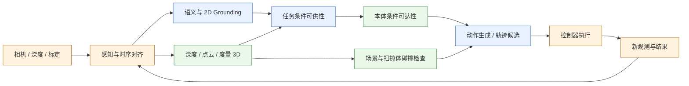
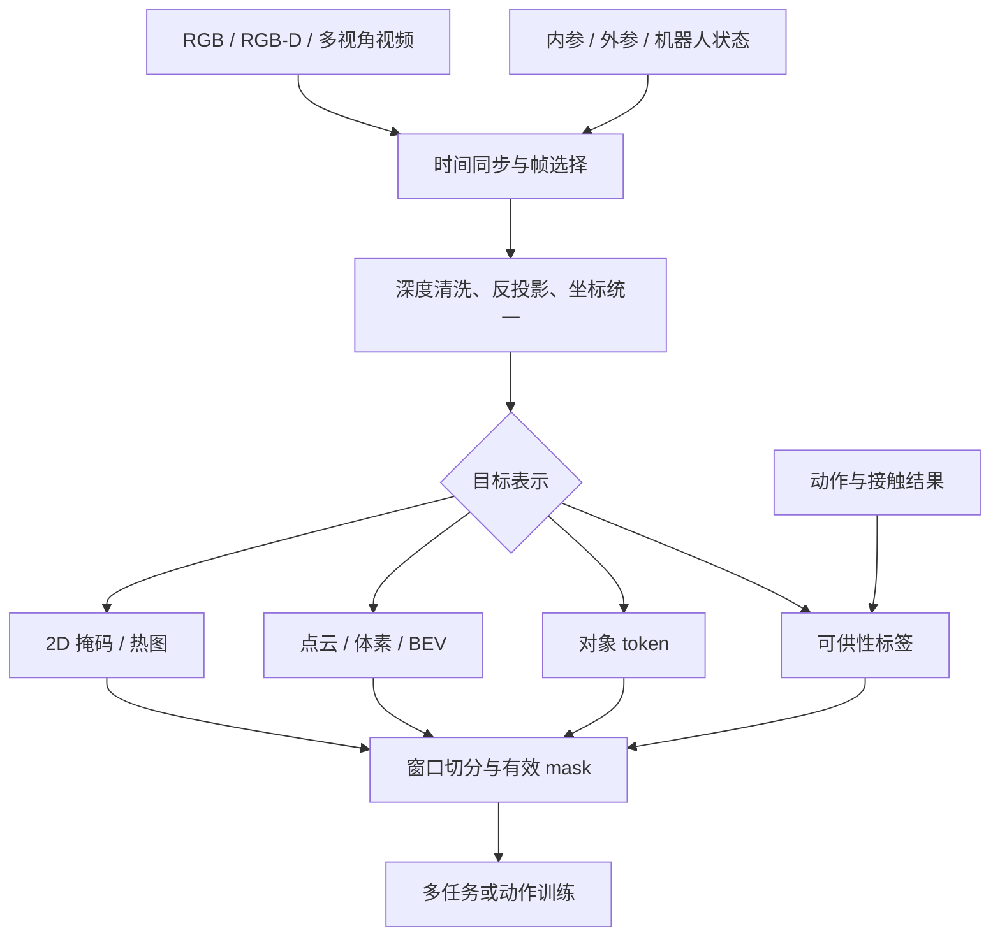

# 空间、3D 与可供性

> 本文回答一个工程问题：VLA 说“找到杯子并抓住把手”时，系统究竟需要知道什么，以及这些信息应在哪个模块中产生、以什么语义进入动作生成、又该如何证明它真的改善了闭环操作。

空间能力不是一个单一分数。语义识别、二维定位、度量三维、可供性、可达性与无碰撞分别回答不同问题；只完成前一层，不能自动推出后一层。本文按“理论对象 → 真实模型事实 → 模块工程 → 验证协议”组织，粒度止于模块和接口，不展开类、函数或安装配置。

## 1. 学习目标与系统位置

读完后，应能：

1. 用可检验的输出区分六类空间能力，而不是笼统称为“空间理解”；
2. 根据传感器、标定条件和任务精度选择 2D、点云、体素、BEV、对象 token 或可供性表示；
3. 说明几何信息应注入视觉编码、融合层、动作专家还是控制前过滤器；
4. 设计能区分“识别变好”“几何变准”和“执行更安全”的消融与闭环评估；
5. 判断 SpatialVLA、PointACT、AffordanceVLA 分别把空间先验放在何处，以及其证据边界。



图中的边界很重要：可供性可以由网络预测，可达性和碰撞也可以由学习模型近似，但二者仍应保留明确的机器人状态、环境几何和安全语义，不能被一个“空间 token”含混替代。

## 2. 六个容易混淆的理论对象

设观测为 $o_t$，语言任务为 $l$，机器人状态为 $q_t$，相机内参为 $K$，相机到机器人基座的外参为 $T^b_c$，候选轨迹为 $\xi$。

| 能力 | 典型输出 | 回答的问题 | 不能推出什么 |
|---|---|---|---|
| 语义识别 | 类别、属性、对象 token | “这是什么？” | 不保证像素位置、距离或可操作性 |
| 2D Grounding | 框、掩码、关键点、热图 | “它在图像哪里？” | 不保证度量深度、机器人可达 |
| 度量 3D | 相机/基座坐标中的点、姿态、形状 | “它在三维空间哪里、多大？” | 不保证该处适合某个动作 |
| 可供性 | $a(x,l,e)$：位置/方向/动作类型及置信度 | “为完成任务，哪里、以何种方式可交互？” | 不保证当前本体能到达或路径安全 |
| 可达性 | $r(x,q_t,e)\in[0,1]$ 或 IK 可行集 | “给定本体和当前状态，能否达到？” | 不保证沿途无碰撞或接触后稳定 |
| 碰撞与约束 | 碰撞指示量 $\chi_{\mathrm{coll}}(\xi,\mathcal O)\in\{0,1\}$（1 表示碰撞）、最小间隙、约束违例 | “整条轨迹和扫掠体是否安全可执行？” | 不保证任务语义正确 |

这里 $e$ 表示本体与末端执行器，$\mathcal O$ 表示环境占据或障碍模型。可供性必须是任务条件的：同一杯把对“抓取”可能可供，对“擦拭桌面”未必是目标交互区。可达性则是本体条件的：同一个三维抓取点，对不同臂长、关节限位或夹爪尺寸可能有不同结论。

一个完整候选动作可写成：

$$
\xi^* = \arg\max_{\xi}\; s_{\text{task}}(\xi\mid o_t,l)
\quad \text{s.t.}\quad
r(\xi,q_t,e)=1,\; \chi_{\mathrm{coll}}(\xi,\mathcal O)=0.
$$

VLA 可以直接生成 $\xi$，也可以生成若干候选后由几何/控制模块约束。上式不是要求所有系统都显式优化，而是规定评估时至少要区分“任务评分”和“执行约束”。

## 3. 从像素到机器人坐标：几何合同

### 3.1 反投影与坐标变换

若像素 $(u,v)$ 的度量深度为 $Z$，针孔相机下的相机坐标点为：

$$
X^c = ZK^{-1}\begin{bmatrix}u\\v\\1\end{bmatrix},
\qquad
\begin{bmatrix}X^b\\1\end{bmatrix}
= T^b_c\begin{bmatrix}X^c\\1\end{bmatrix}.
$$

第二式使用齐次坐标：$T^b_c\in SE(3)$ 将相机坐标中的齐次点 $[X^{c\top},1]^\top$ 映射到基座坐标中的 $[X^{b\top},1]^\top$；真正交给下游的位置仍是前三维 $X^b$。

这两个式子对应两种不同合同：

- **相机自我中心合同**：特征在相机坐标中表达，适合视角内空间关系和视觉 token 增强；
- **机器人执行合同**：目标、路径或动作在基座、工具或任务坐标中表达，必须知道相机—机器人变换，或由系统以等价方式完成坐标对齐。

因此，“不显式使用外参的自我中心表示”不等于“执行时不需要相机到机器人坐标的关系”。前者可以降低跨相机外参依赖，后者仍受标定、本体状态和控制接口约束。

### 3.2 旋转、尺度与单位

空间模块输出姿态时至少要声明：

| 字段 | 必须声明的语义 | 常见隐患 |
|---|---|---|
| `frame_id` | camera / base / world / tool / object | 同一数值在不同坐标系含义不同 |
| `position_unit` | m、cm 或归一化工作空间 | 训练标签和控制器尺度不一致 |
| `rotation_repr` | 四元数、轴角、6D、旋转矩阵 | 插值、归一化和奇异性处理不同 |
| `timestamp` | 观测或估计对应时刻 | 运动相机下旧外参造成系统误差 |
| `valid_mask` | 深度、标定、对象是否有效 | 缺失值被当成零坐标 |
| `confidence` | 预测置信或协方差 | 下游无法决定重观测、降速或拒绝 |

若最终动作采用增量末端位姿，空间目标仍不能只交付一个三维点；还要给接近方向、末端姿态容差、夹爪占据尺度和允许接触区域，否则控制层无法判断候选轨迹是否合法。动作坐标和归一化的统一见[动作坐标、归一化与跨本体统一](../数据与特征/动作坐标、归一化与跨本体统一.md)。

### 3.3 不确定性不是一个装饰字段

深度、内外参和检测误差会共同传到三维点。线性近似下，若 $X=g(u,v,Z,K,T)$，则：

$$
\Sigma_X \approx J_g\,\Sigma_{u,v,Z,K,T}\,J_g^\top.
$$

工程上未必需要在线计算完整协方差，但至少应保留来源可区分的不确定性：深度无效、对象遮挡、标定版本、时间陈旧度、模型置信。对透明/反光物体、视野边缘和远距离区域，单点估计尤其危险。可选处理包括置信加权融合、多视角一致性、候选采样、保守膨胀碰撞体，以及超过阈值时主动换视角。

## 4. 空间表示如何选

| 表示 | 接口语义与优势 | 主要代价 | 适合位置 |
|---|---|---|---|
| 2D 框/掩码/热图 | 保留预训练 VLM 的图像接口，标注和推理成本较低 | 缺少尺度、遮挡后拓扑和度量距离 | 语义 grounding、候选对象筛选 |
| 深度图 | 与 RGB 像素对齐，便于位置编码 | 单目尺度和 RGB-D 无效点会直接传入动作 | 视觉 token 的几何增强 |
| 彩色点云 | 显式三维邻域、对视角变化更自然 | 密度不均、裁剪/采样敏感，算力随点数增长 | 独立 3D 分支或动作专家 |
| 体素 / 稀疏体素 | 规则邻域，便于卷积、占据和碰撞推理 | 分辨率—显存矛盾，量化小物体 | 局部几何、占据和可供性体积 |
| BEV | 将地面场景压到统一平面，适合导航和大场景融合 | 对桌面操作的高度、遮挡和细接触信息损失 | 移动操作、场景级规划 |
| Object token | 压缩对象身份、属性、位置与关系 | 检测漏失和追踪漂移会使 token 断裂 | 长程任务状态、对象级推理 |
| Affordance map / token | 直接表达任务条件交互区域和方式 | 标签生成偏差；可能与真实动作分布不一致 | 动作生成前的结构化中间变量 |

选择原则不是“3D 一定优于 2D”，而是信息是否与任务瓶颈匹配。桌面上颜色区分明确、相机固定的粗抓取可能从 2D 足够学习；透明插接、小间隙放置、移动相机或跨视角操作更依赖可靠几何。3D 表示若来自噪声深度，且数据处理、动作坐标或网络容量不匹配，也可能比 RGB 更差。

## 5. 三条代表路线：真实模型事实与边界

下表数字均来自对应论文/本地论文笔记，属于**作者自评**，不可跨协议直接排名。开放状态于 **2026-08-10** 按表中链接和本地一手资料索引复核；本轮没有重新测试远端下载可用性，因此只确认“存在公开入口”，不把入口存在等同于训练全流程可复现。

| 模型 | 空间信息放在哪里 | 数据与动作事实 | 作者自评与开放状态 | 能说明 / 不能说明 |
|---|---|---|---|---|
| [SpatialVLA](../../依赖索引.md) | Ego3D 用单目深度反投影得到相机自我中心 3D 位置编码，经 MLP 后加到 SigLIP token；动作使用自适应离散网格 | PaliGemma2 约 3.5B；约 110 万条 OXE 子集与 RH20T 真实轨迹；7D 末端动作，预测未来 4 步，局部资料记载约 8194 个动作 token | SimplerEnv Google VM 71.9、LIBERO 四套件均值 78.1；本地资料列有 GitHub 代码与 Hugging Face 权重入口；是否另行发布完整训练数据和可复现配方未核 | 说明几何位置编码可嵌入 VLM token；不证明单目深度等于可靠度量 3D，也不替代机器人坐标变换与碰撞检查 |
| [PointACT](../../依赖索引.md) | 冻结 Qwen2.5-VL，独立 PTv3 点云编码器与约 3 亿参数 point-action expert；在多尺度层级进行点—动作交互 | 工作空间裁剪、1 cm 体素化、最多 4096 个彩色点；LIBERO 用 $H=16$ 增量末端动作，RLBench 关键点分类 $H=1$，UR5 真实任务用 8D 绝对末端关键点 | LIBERO 均值 96.0、RLBench-10 82.3；本地资料在 2026-06-11 实查为代码 “coming soon”、无权重入口；2026-08-10 未重新验证远端，当前状态待核 | 说明把 3D 几何放在动作侧可避免把点云粗暴塞进 VLM；不同 benchmark 动作合同不同，数字不可当同协议排序 |
| [AffordanceVLA](../../依赖索引.md) | Which2Act 对象、Where2Act 二维交互图、How2Act 三维体素形状与空间布局；三个专家通过渐进注意力服务动作生成 | 自动可供性标签由 Qwen3-VL-235B 生成；三阶段训练；动作由 flow matching 生成 | LIBERO 95.8、CALVIN ABC→D 平均链长 4.33；本地资料在 2026-06-11 实查 GitHub 代码入口存在；预训练/分阶段 checkpoint 完整性未核，总参数量未披露 | 说明结构化中间表征只有与动作联合对齐才有价值；论文中去掉第二阶段甚至弱于无可供性版本，提示“多一个监督”不等于更好 |

这些模型分别代表三种注入位置：**视觉 token 的几何位置编码、独立点云—动作专家、显式任务可供性中间变量**。它们不是互斥分类；一个系统可以同时有深度位置编码、对象 token、可供性头和控制前安全过滤器，但每增加一层都需要独立证据，避免把收益全部归因于“空间能力”。

## 6. 模块级工程教程

### 6.1 先写 Spatial Contract

在选网络前，先固定以下合同：

```text
SpatialObservation:
  rgb/depth_or_points: 数据及有效掩码
  camera_intrinsics/extrinsics: 数值、frame_id、标定版本
  timestamp: 各传感流原始时间戳
  workspace: 机器人基座坐标中的有效范围

SpatialOutput:
  target_id / 2d_region: 语义对象与图像区域
  geometry: 3D 点、姿态、形状或占据，附 frame_id 与单位
  affordance: 动作类型、区域、方向、尺度、置信度
  uncertainty: 深度/标定/预测有效性
  reachability_collision: 可行标记、余量或失败原因
```

这不是具体数据类，而是跨数据、模型、控制模块必须一致的字段语义。训练样本即使没有全部标签，也要用 supervision mask 区分“未标注”和“负样本”。

### 6.2 数据 Pipeline



工程检查顺序：

1. **同步**：RGB、深度、机器人位姿要对同一物理时刻；移动相机时错一帧就会产生系统性空间偏移。
2. **标定**：保存标定版本和重投影误差；训练/部署相机裁剪、缩放后必须同步更新内参。
3. **深度清洗**：保留无效掩码，不用零值伪装有效平面；记录截断范围和单位。
4. **工作空间裁剪**：应在明确坐标系内进行；裁剪能降算力，也可能删掉接近路径或长物体的一部分。
5. **标签来源**：人工、几何程序、接触轨迹回推或大模型生成要分开记录；生成标签同时保存置信和抽检结果。
6. **负样本**：失败接触、不可达点和会碰撞的候选对学习边界有价值，不能只保留成功轨迹。

数据构造的一般方法见[数据采集、生成与清洗](../数据与特征/数据采集、生成与清洗.md)与[轨迹切分与训练样本构造](../数据与特征/轨迹切分与训练样本构造.md)。

### 6.3 架构注入位置

| 注入位置 | 典型做法 | 选择原因 | 风险与必须做的对照 |
|---|---|---|---|
| 输入/视觉位置编码 | 深度或 3D 编码加到 patch token | 最大化复用预训练 VLM | 几何噪声污染全部高层特征；对照 RGB-only、oracle/noisy depth |
| 独立 3D 分支 | 点云/稀疏体素编码器，再与动作 latent 交互 | 保持语言语义与度量几何职责分离 | 参数与算力增加；对照同参数 RGB 分支及简单晚融合 |
| 对象级 token | 检测、追踪后压缩成对象状态 | 适合长程记忆和关系推理 | 漏检、身份切换；对照逐帧与带追踪版本 |
| 显式可供性头 | 先预测区域/姿态/形状，再条件化动作 | 可解释、可单独监督和替换 | 中间目标与动作不对齐；对照无头、停止梯度、oracle affordance |
| 动作后过滤 | IK、碰撞检测、候选重排、安全层 | 明确执行约束，可独立审计 | 可能拒绝过多或破坏策略分布；报告拒绝率和恢复方式 |

空间模块与动作模块间不应传递只有模型自己理解的匿名向量而完全丢弃语义；即便内部使用 latent，也应同时产出可审计的坐标系、有效性和候选/约束结果。

### 6.4 训练目标与权重

一个多任务目标可写为：

$$
\mathcal L = \mathcal L_{\text{act}}
+ \lambda_{2D}m_{2D}\mathcal L_{2D}
+ \lambda_{3D}m_{3D}\mathcal L_{3D}
+ \lambda_{aff}m_{aff}\mathcal L_{aff}
+ \lambda_{occ}m_{occ}\mathcal L_{occ},
$$

其中 $m_k$ 是逐样本监督有效 mask。关键并非损失名称，而是四个问题：

- 辅助标签来自真实测量还是生成模型，噪声如何进入梯度；
- 空间损失是否改善动作，还是只改善一个容易的离线头；
- 不同数据集缺失深度/标定/可供性时是否被误当负例；
- 联合训练是否破坏 VLM 语义知识，需不需要冻结、分阶段或低权重协同训练。

AffordanceVLA 的本地记录给出一个有用反例：缺少动作对齐阶段时，显式可供性监督可能弱于无可供性版本。因此应同时报告中间指标与闭环结果，不把中间标签拟合当作最终证据。

## 7. 评估：为每一层提供对应证据

| 层级 | 指标示例 | 最小分层 | 不能替代的证据 |
|---|---|---|---|
| 语义 | 分类准确率、对象召回 | 类别、属性、遮挡 | 2D/3D 定位误差 |
| 2D Grounding | IoU、点距、PCK | 小物体、遮挡、指代类型 | 度量位置和抓取成功 |
| 3D | 平移误差、角度误差、Chamfer/占据 IoU | 距离、视角、材质、深度有效性 | IK、碰撞与闭环成功 |
| 可供性 | 区域 IoU、接触点误差、姿态容差内召回 | 任务、对象部位、工具 | 本体可达和实际接触质量 |
| 可达/碰撞 | IK 成功率、关节余量、最小间隙、碰撞率 | 本体、初始姿态、障碍密度 | 完整任务成功 |
| 闭环操作 | 成功率、阶段成功、重试、碰撞/干预率 | ID/OOD、对象、布局、相机扰动 | 真实部署外推 |

三维误差最好同时用物理单位和任务容差报告。例如 2 cm 对粗推物体可能无关紧要，对插孔则可能完全失败。闭环评估还要固定 policy query、action update 与底层 control frequency 的定义，见[离线、仿真与真机评估](../训练与评估/离线、仿真与真机评估.md)。

### 7.1 必做消融矩阵

1. RGB-only、预测深度、传感器深度、oracle 深度；
2. 深度噪声、外参平移/旋转扰动、时间错位的独立扫描；
3. 几何特征正常、置乱、置零，并保留有效 mask；
4. 无可供性、预测可供性、oracle 可供性、停止梯度可供性；
5. 单体融合与独立 3D 动作分支，在参数、数据和训练预算尽量对齐；
6. 可达/碰撞过滤开关，同时报告成功率、拒绝率、重规划率和延迟；
7. 对象、视角、布局、相机参数、本体分别做 OOD，不用一个“泛化集”混合解释。

公平比较与统计报告参见[消融实验与公平比较](../训练与评估/消融实验与公平比较.md)及[泛化、鲁棒性与统计协议](../训练与评估/泛化、鲁棒性与统计协议.md)。

## 8. 常见失败与定位顺序

| 现象 | 优先检查 | 机制 |
|---|---|---|
| 2D 框正确但抓取偏移稳定 | 内参随裁剪缩放、外参方向、深度单位 | 语义正确但几何合同错误 |
| 相机固定时好，移动后崩溃 | 时间同步、手眼标定、坐标 frame | 旧位姿与新图像组合造成系统偏差 |
| 透明/反光对象失败 | 深度有效掩码、单目尺度、点云孔洞 | 深度错误被当成确定几何 |
| 可供性热图漂亮但闭环无提升 | 标签与动作对齐、可达性、控制容差 | 中间表征优化了易指标而非任务瓶颈 |
| 点云模型小物体丢失 | 体素尺寸、最大点数、工作空间裁剪 | 预处理已删除关键结构 |
| 对象 token 长程漂移 | 检测漏失、身份切换、遮挡后的重关联 | 压缩表示失去连续身份 |
| 加安全过滤后成功率下降 | 拒绝率、几何膨胀、恢复策略 | 过滤器保守且策略不知道如何重试 |
| 仿真 3D 很强，真机掉点 | 深度噪声模型、相机材质域、标定漂移 | 仿真几何过于干净 |

推荐定位顺序是：**坐标与时间 round-trip → 传感有效性 → 中间指标 → 动作候选 → 可达/碰撞 → 控制执行**。不要先通过扩大模型来掩盖可直接测量的几何错误。

## 9. 技术选型速查

- 任务主要是对象选择、粗放置，视角固定且容差大：先验证 2D grounding + 动作策略是否已经足够。
- 需要跨视角、小间隙、精确接近：优先加入度量深度/点云，并将标定扰动纳入评估。
- 任务需要选择对象部位或工具作用区域：引入任务条件可供性，但必须做 oracle 与动作对齐消融。
- 场景动态、长程且对象多：对象 token/追踪有价值，同时保留图像或几何回查路径。
- 真实部署有严格安全边界：学习式空间表示之外，保留本体可达、碰撞和控制安全模块。
- 资源有限：先确认瓶颈来自几何而非数据动作合同；点云分支的收益要与额外参数、预处理和延迟一起报告。

## 10. 检查点与练习

### 检查点

- 能否为每个空间输出写出 frame、单位、时间戳、有效 mask 和置信字段？
- 能否说明某模型解决的是 2D、3D、可供性、可达性还是碰撞，而不是只说“空间更强”？
- 能否从一个像素和深度写出相机点，并说明何时需要 $T^b_c$？
- 能否为所选表示给出一个 oracle 上界、一个噪声敏感性和一个闭环对照？

### 练习

1. 选择“抓杯把”“把插头插入插座”“把盒子放到区域”三个任务，为其分别填写六层能力表，指出最可能的瓶颈。
2. 为单目深度增强 VLA 设计 $3\times3$ 扰动网格：深度尺度、外参角度和时间错位；定义中间与闭环指标。
3. 将同一可供性预测分别接到 action expert 与控制前候选过滤器，写出二者不同的梯度路径、失败恢复和公平对照。

## 11. 延伸阅读

- [领域的理解](../领域的理解.md)：VLA 工程主线与专题地图。
- [语言、视觉与本体特征设计](../数据与特征/语言、视觉与本体特征设计.md)：多模态输入进入融合前的语义合同。
- [多模态融合与 VLM 主干](../架构与动作生成/多模态融合与VLM主干.md)：空间表示在模型中的注入位置。
- [动作坐标、归一化与跨本体统一](../数据与特征/动作坐标、归一化与跨本体统一.md)：执行坐标与 adapter。
- [VLA 与机器人控制栈](../系统与部署/VLA与机器人控制栈.md)：学习策略与几何、规划、控制模块的边界。
