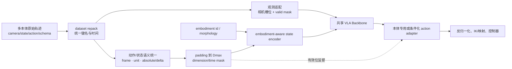
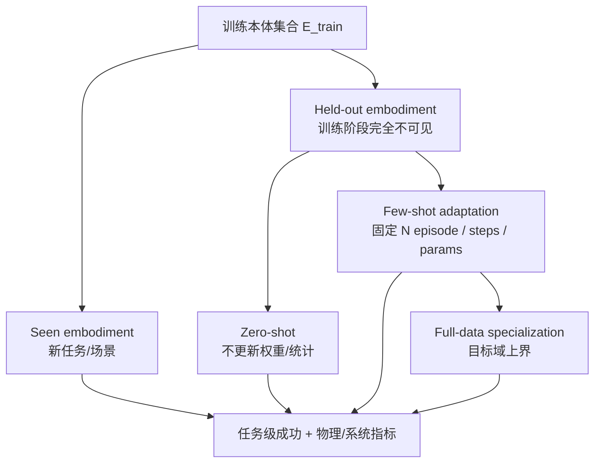

# 跨本体泛化：共享能力与本体接口的可归因教程

跨本体泛化不是把不同机器人的 state/action 补到同一长度。它要求共享任务与感知能力，同时显式隔离坐标、自由度、传感器、控制器和动力学差异，并用 held-out 本体协议验证迁移，而不是只在训练见过的机器人上做多任务评测。

## 1. 理论分解

把本体 \(e\) 的策略写为

\[
\pi_e(a_t\mid o_t,l,q_t)
=D_e\!\left(\pi_{shared}
\left(E^o_e(o_t),E^s_e(q_t),l\right)\right),
\]

其中 \(E^o_e\) 处理相机/传感接口，\(E^s_e\) 处理本体状态，\(\pi_{shared}\) 学共享语义和动作先验，\(D_e\) 把共享动作表示解码为本体动作。跨本体研究至少有四个正交问题：

| 轴 | 问题 | 不能被什么替代 |
|---|---|---|
| 观测 | 相机、状态和缺失模态怎样对齐 | 相同图像 resize |
| 动作 | frame、单位、自由度和控制模式怎样统一 | padding 到 \(D_{max}\) |
| 条件 | 模型怎样知道当前是哪种本体 | 仅由向量长度猜测 |
| 泛化 | 共享参数是否迁移到未见本体 | 训练本体上的平均成功率 |

## 2. 模块数据流

数据侧负责保存真实语义和 mask；模型侧负责共享/专用参数边界；部署侧负责把公共动作恢复成可执行命令。三者使用同一个 embodiment/schema/norm-stat id。

## 3. 状态、动作与本体条件

设统一维度 \(D_{max}\)，本体 mask 为 \(m_e\)。动作损失为

\[
\mathcal L_e=
\frac{\sum_{h,d}m^{time}_h m^e_d
\ell(\hat a_{h,d},a_{h,d})}
{\sum_{h,d}m^{time}_h m^e_d+\epsilon}.
\]

mask 必须同时用于 loss 和执行；否则 padding 会把模型推向零动作，或在部署时激活不存在的自由度。

### embodiment 条件的选择

| 条件 | 优点 | 局限 |
|---|---|---|
| 离散 robot id | 简单、适合已知集合 | 无法描述新本体相似性 |
| state/action schema token | 直接表达字段和有效位 | 仍缺运动学/外形 |
| morphology/URDF embedding | 可表达结构关系 | 编码与训练协议复杂 |
| 本体专用 adapter | 隔离接口差异、易少样本适配 | 新本体需新增参数 |
| 公共 EEF 空间 | 多机械臂可共享局部运动 | 对移动、人形、灵巧手表达不足 |

本体 id 不能替代动作合同；adapter 也不能修复训练数据中相互矛盾的 frame。

## 4. 真实模型与代码锚点

| 系统 | 跨本体机制 | 事实边界 |
|---|---|---|
| OXE / RT-X | RLDS 聚合约 60 个数据集、22 类本体，常整理为粗 7D EEF 接口 | 公共 schema 不彻底统一原始 frame/频率/夹爪 |
| Octo | 从 OXE 选 25 个子集、约 80 万轨迹；模块化 tokenizer/readout/action head | 通用预训练仍需目标域 action head/适配 |
| OpenVLA | OXE 约 97 万演示；按数据集统计反归一化，7D EEF 动作 token | 原版动作接口主要适合相近操作臂，不等于任意本体零样本 |
| π0 原论文 | 7 种机器人配置；state/action 最大 18 维，低维补零并 mask；task-robot 按 \(n^{0.43}\) 重加权 | 18 是论文训练集合上限，非通用规范 |
| openpi 当前代码 | 默认 action_dim=32、horizon=50，三个图像槽及 mask，state/action 为 32 维 | 代码配置与论文 18 维必须分版本报告 |
| GR00T N1 | embodiment-aware state/action encoder、相对 EEF、cross-attention DiT | 作者跨本体收益与频率为自评；具体 adapter 随版本核对 |

openpi 的三段式数据变换把 dataset repack、robot-specific data transform 和 model transform 分开，是迁移新本体时很有价值的责任边界。

## 5. 数据采样与训练

数据域应至少按 dataset、task、robot、control schema 分组。令域 \(i\) 有 \(n_i\) 个有效窗口，可用

\[
p_i\propto w_i n_i^\alpha
\]

定义采样，其中 (w_i) 是人工域权重。只有所有 (w_i) 相等时，\(\alpha=1\) 才退化为按规模、\(\alpha=0\) 才退化为域等权；权重不等时两者仍保留人工先验。π0 的 \(0.43\) 是特定数据混合的经验配方，不应直接移植。

训练中要分别监控：

- 每本体 realized sampling frequency 和 unique episode 曝光；
- 各本体 action/state 有效维比例及 loss denominator；
- shared Backbone 与 adapter 的梯度/更新量；
- 每本体动作范围、裁剪率和控制频率；
- 大本体是否因有效维更多而贡献更大 loss；
- 小域过采样是否只造成重复记忆。

### 训练配方阶梯

1. 目标本体单独训练，建立本体专用 baseline；
2. 相同动作语义的多任务/多场景混合；
3. 加入相近本体并保留专用 adapter；
4. 加入异构本体和共享表示；
5. held-out 本体少样本适配；
6. 零样本只作为最高难度单列，不与 few-shot 混称。

## 6. 三层评测协议

| 协议 | 必须冻结/限制 | 能证明什么 |
|---|---|---|
| seen | 本体已见，held-out 任务/场景 | 同本体泛化，不是跨本体 |
| adapter-only few-shot | 只更新 adapter，固定 N 条轨迹与步数 | 共享 Backbone 可重用性 |
| full few-shot | 允许全量更新但预算固定 | 实际适配效率 |
| held-out zero-shot | 本体数据、统计、权重更新均不可见 | 真正零样本，但动作接口必须预先可解释 |
| full-data target | 目标数据充分 | 目标本体性能上界 |

若 zero-shot 使用了目标本体 normalization statistics、相机标定样本或手工调参，应明确这些是否算适配信息。

## 7. 可归因消融

| 假设 | 对照 | 固定项 | 证据 |
|---|---|---|---|
| embodiment id 有效 | id-on/off/shuffle | schema、参数量 | shuffle 明显损害且 held-out 有益 |
| adapter 促进迁移 | shared-only、adapter-only、full FT | 数据/步数 | few-shot 曲线与遗忘 |
| 跨本体数据正迁移 | target-only、+same robot、+cross robot | target 曝光、总预算 | 目标与 held-out 同时提升 |
| padding/mask 正确 | mask、zero-target、随机无效位 | 其余数据 | 无效位不影响合法动作/梯度 |
| 公共 EEF 足够 | EEF adapter vs 原生 joint | Backbone、任务 | 精度、可达性和跨本体收益 |
| 采样配方改善长尾 | \(\alpha\) sweep / uniform / size | 总 token | 宏平均、最坏本体和大域退化 |

## 8. 常见误解与故障

- **多本体训练就是跨本体泛化**：若评测本体都在训练中，只证明联合拟合。
- **padding 解决了统一**：它只统一 shape；语义、frame 和 mask 仍未解决。
- **统一 checkpoint 就无需 adapter**：部署仍需统计、坐标、IK 和控制器。
- **zero-shot 不需要本体信息**：模型仍需知道有效传感/动作接口，只是不使用目标动作示范更新。
- **总平均提升代表正迁移**：大数据本体可能掩盖小本体退化。

| 现象 | 优先检查 |
|---|---|
| 新本体动作爆炸 | schema/norm-stat id、死维 |
| 只在大本体上好 | loss 有效维归一化、采样 |
| few-shot 很快但旧本体遗忘 | shared 参数更新与 adapter 隔离 |
| 图像理解正常、动作方向错 | frame、adapter、控制模式 |
| zero-shot 宣称无法复核 | 是否使用目标统计/标定/调参 |

## 延伸阅读

- [动作坐标、归一化与跨本体统一](../数据与特征/动作坐标、归一化与跨本体统一.md)
- [多数据集混合与 Co-training](../数据与特征/多数据集混合与Co-training.md)
- [本体适配与动作执行接口](../系统与部署/本体适配与动作执行接口.md)
- [数据处理综述](../../依赖索引.md)
- [Octo 细读](../../依赖索引.md)
- [π0 细读](../../依赖索引.md)
- [GR00T N1 细读](../../依赖索引.md)
- [openpi 当前模型配置](../../依赖索引.md)
