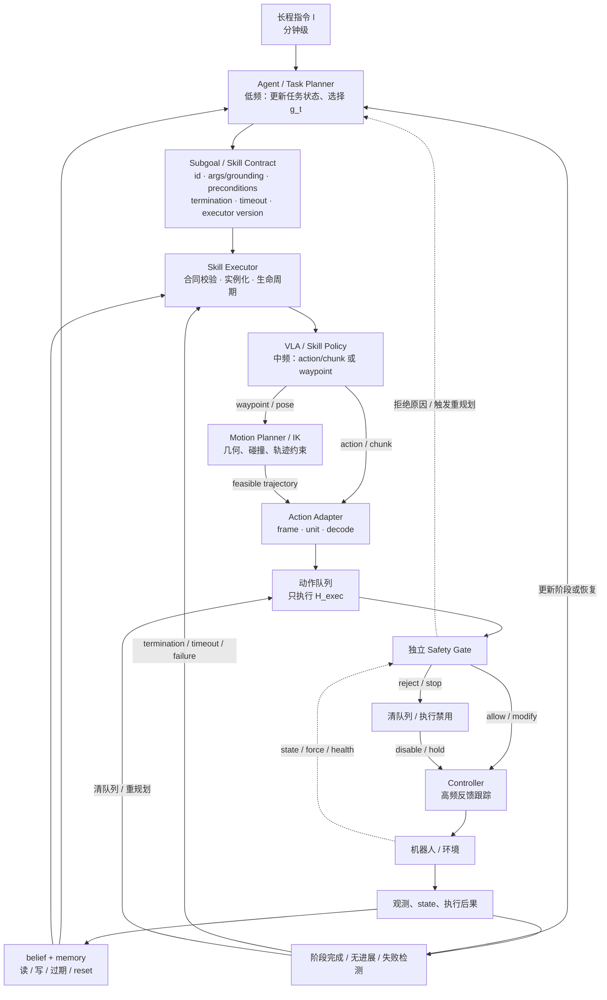
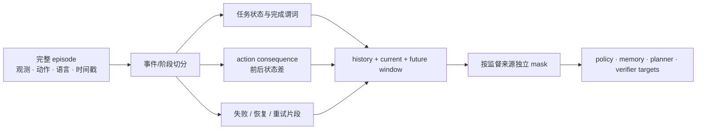

# 长程任务、记忆与规划

单步抓放的核心变量通常能从当前观测恢复；整理房间、移动操作和多阶段装配则要求策略回答“已经做了什么、现在处于哪一步、上一步是否奏效、下一步应完成什么”。本篇把长程能力拆成 belief、任务状态、记忆、规划和执行五个模块，并给出能落到数据、接口和实验的工程协议。

动作块、KV cache 和多帧输入的实现细节见[时序建模与记忆](../架构与动作生成/时序建模与记忆.md)。本篇关注更高一层的问题：如何让多个短时技能形成可验证、可恢复的任务过程。

本文固定以下责任边界，后文即使由一个网络共享参数，也不混用这些验收对象：

| 模块 | 输入 | 输出与责任 |
|---|---|---|
| Agent / Task Planner | 长程目标、任务状态、可用 skill、执行反馈 | 分解阶段、选择下一 skill、生成/更新子目标合同、编排恢复 |
| Skill Executor | 完整 skill 合同、观测与执行反馈 | 校验 preconditions，按指定版本实例化 skill policy，管理 termination/timeout |
| Motion Planner | waypoint/pose、碰撞体与运动学约束 | 生成几何与运动学可行轨迹；不做语义任务分解 |
| Controller | 已通过安全门控的参考轨迹/设定值 | 高频反馈跟踪、hold/retreat；不决定下一任务阶段 |
| Safety Supervisor | 状态、候选参考、力/健康信号 | allow/modify/reject/stop，并直接门控 Controller |

## 1. 理论对象：长程不是把 horizon 写大

### 1.1 部分可观测与任务状态

设环境真实状态为 $x_t$，观测为 $o_t$，任务指令为 $l$。策略真正需要的是从历史更新的 belief 与任务进度：

\[
b_t=U_\phi(b_{t-1},o_t,a_{t-1},r_{t-1}),
\qquad
z_t=G_\psi(z_{t-1},b_t,l),
\]

\[
g_t\sim p_\eta(g\mid z_t,b_t,l),
\qquad
A_{t:t+H_{pred}-1}\sim
\pi_\theta(\cdot\mid b_t,g_t,E).
\]

- $b_t$ 是关于物体、机器人和环境的状态估计；
- $z_t$ 是任务阶段，例如“盘子已拿起，但尚未放入水槽”；
- $g_t$ 是当前子目标、语言子任务、视觉目标或 skill identifier；
- $E$ 是本体、传感器和动作接口条件；
- $r_{t-1}$ 不一定是强化学习奖励，也可以是 success detector、阶段完成信号或执行后果。

这不是规定每个系统都要显式实现四个网络。它提供了模块责任：若系统没有显式 $b_t,z_t,g_t$，这些变量就隐式压在上下文 token 或策略隐状态中，仍需通过干预实验判断是否被正确表达。

### 1.2 复合任务的可靠性为什么快速下降

若一条任务链包含 $N$ 个必要阶段，用 $S_i$ 表示第 $i$ 阶段成功，定义 $S_{<i}=\bigcap_{j=1}^{i-1}S_j$，则完整成功率的链式分解为：

\[
P\!\left(\bigcap_{i=1}^{N}S_i\right)
=P(S_1)\prod_{i=2}^{N}P\!\left(S_i\mid \bigcap_{j=1}^{i-1}S_j\right).
\]

若进一步作独立且同成功率 $P(S_i)=p=0.95$ 的教学近似，十个阶段全部成功约为 $0.95^{10}=59.9\%$。真实阶段不独立：前一阶段的位姿误差会改变后续条件成功率，因此边际 $\prod_i P(S_i)$ 一般既不是上界也不是下界。工程目标不仅是提高局部成功率，还包括检测阶段失败、回到可恢复状态和重新规划，降低一次错误导致整条 episode 终止的概率。

### 1.3 Option / skill 视角

长程控制可写成半马尔可夫 option：

\[
\omega=(I_\omega,\pi_\omega,\beta_\omega),
\]

其中 $I_\omega$ 是启动条件，$\pi_\omega$ 是 skill policy，$\beta_\omega$ 是终止条件。若 VLA 以广义动作空间输出 skill，它必须输出 `skill_id`、带 grounding 的 `args`、`preconditions`、`termination`、`timeout` 和 `executor_version`；`Skill Executor` 是合同的直接消费者，而不是把一个 skill 名称直接交给控制器。若 VLA 直接输出连续动作块，option 边界也可能隐式存在于语言子任务或任务状态中。

## 2. 六种常被混称为“长程”的机制

统一时间符号：$H_{obs}$ 是一次查询输入的观测样本数，$H_{pred}$ 是一次生成的未来动作点数，$H_{exec}$ 是使用新观测重查询前最多执行的动作前缀点数，满足 $1\le H_{exec}\le H_{pred}$。定义 $f_{obs}$ 为真正送入策略的历史观测采样频率，$f_Q$ 为使用新观测的策略查询频率，$f_A$ 为 chunk 内相邻动作参考点的名义采样/派发频率，$f_C$ 为低层反馈控制频率。等间隔采样下：

\[
T_{obs,span}=\frac{H_{obs}-1}{f_{obs}},\qquad
T_{pred,cmd}=\frac{H_{pred}}{f_A},\qquad
T_{exec,cmd}=\frac{H_{exec}}{f_A}.
\]

若固定执行完 $H_{exec}$ 个点后才查询且推理不重叠，近似有 $f_Q\approx f_A/H_{exec}$。异步预取、temporal ensembling、事件触发重规划或提前清队列时不成立，应从日志报告真实 query interval、observation age 和动作丢弃率。通常 $f_Q\le f_A\le f_C$，但这不是定义约束。Action chunk 跨未来动作时刻，却不保存已经发生的任务历史。

| 机制 | 保存或预测什么 | 时间方向/生命周期 | 解决的问题 | 不能自动解决 |
|---|---|---:|---|---|
| 多帧窗口 $H_{obs}$ | 最近图像/state | 过去；有限窗口 | 短遮挡、速度、最近接触 | 十分钟任务进度 |
| Action chunk $H_{pred}$ | 未来动作相关性 | 未来；在线只执行前 $H_{exec}$ | 平滑、延迟摊销、多峰动作 | 已完成哪些子任务 |
| KV/条件 cache | 重复前缀的计算 | 一次/若干次生成的计算生命周期 | 推理加速 | 语义记忆 |
| Latent/retrieval memory | 历史状态或事件 | 跨控制时刻 | 遮挡、对象状态、过去动作后果 | 正确的任务分解与终止判定 |
| 任务状态/子目标 | 当前阶段和下一步 | 跨阶段 | 组合顺序、可解释与干预 | 低层接触控制 |
| 世界预测/rollout | 候选动作的未来后果 | 候选未来 horizon | 预演、排序、约束检查 | 无偏预测、实时性和安全保证 |

把这些变量分开，才能设计有效消融。例如 action chunk 变长后长程成功率提高，可能只是动作更平滑；若要证明任务记忆，需要保持 $H_{pred}$ 不变并干预历史内容。

## 3. 三时间尺度的系统结构



三个循环可以由一个端到端模型共享参数，也可以由独立服务实现；参数共享不等于责任相同。每个循环需要自己的频率、输入版本、超时与证据。

图中 Safety Gate 是 Controller 前唯一的授权门：正常参考、Motion Planner 轨迹和 Skill Executor 产生的动作都不能旁路。`reject/stop` 直接清队列并向 Controller 发出 disable/hold；发回 Task Planner 的原因只用于后续恢复，不能成为急停生效的前置条件。

## 4. 模块合同：长程系统需要传什么

### 4.1 Memory Event

```yaml
memory_event:
  event_schema_version: memory_event_v3
  event_id: evt_004216_consequence_01
  parent_event_id: evt_004216_dispatch_02
  episode_id: home_03_session_012
  observation_id: obs_004216
  timestamp: 1730000123.420
  clock_timebase: robot_monotonic_v2
  source: perception | action | consequence | human | verifier
  entity_ids: [plate_2, sink_1]
  event_type: observed | grasped | released | failed | completed
  payload_ref: latent-or-structured-record
  confidence: 0.86
  frame_id: base
  task_state_version: task_state_0091
  planner_version: task_planner_v7
  policy_checkpoint: policy_v17_sha256
  perception_model_version: detector_v12
  skill_contract_id: skill_req_0038
  skill_contract_schema_version: skill_contract_v2
  skill_executor_version: place_object_executor_v5
  action_chunk_id: chunk_204
  action_schema_version: eef_delta_7d_v4
  action_adapter_version: adapter_v3
  motion_planner_version: motion_planner_v6
  completion_detector_version: stage_detector_v9
  controller_version: controller_v8
  safety_policy_version: safety_rules_2026_07_14
  calibration_version: handeye_2026_07_11
  normalization_version: action_norm_rlds_v4
  effective_from: 1730000123.430
  valid_until: episode_end
```

未经过某模块时，对应版本字段应显式写为 `null/not_applicable`，不能省略。最小审计要求是：事件 schema、事件身份与父事件、时间基准、输入 observation、任务/规划版本、感知与 policy checkpoint、skill 合同/schema 与 executor、动作 schema/adapter/运动规划、完成检测、控制/安全、标定与归一化版本，以及生效和失效规则。只保存一个无版本的 embedding，事后无法区分它来自旧观测、旧策略还是人工修正。

### 4.2 Task State

```yaml
task_state:
  task_id: tidy_kitchen
  task_state_version: task_state_0091
  previous_version: task_state_0090
  updated_by_event_id: evt_004216_consequence_01
  planner_version: task_planner_v7
  source_observation_id: obs_004216
  current_stage: place_plate_in_sink
  completed: [open_dishwasher, grasp_plate]
  active_entities: [plate_2, sink_1]
  preconditions: {plate_grasped: true, sink_visible: true}
  termination: plate_inside_sink AND gripper_open
  retry_count: 1
  recovery_state: none
  effective_from: 1730000123.425
  valid_until: stage_transition
```

结构化状态适合确定性流程和审计；latent 状态容量高但不易验证。二者可组合：结构字段承载控制流，latent memory 保留难以枚举的视觉细节。

### 4.3 Subgoal Contract

一个可执行子目标不应只有一句文本。Task Planner 产生合同；只要合同选择的是 skill，直接消费者就是 `Skill Executor`，而不是 Motion Planner 或 Controller。完整合同包含：

| 字段 | 例子 | 下游消费者 |
|---|---|---|
| `contract_id` | `skill_req_0038` | scheduler、trace |
| `semantic_goal` | `place plate in sink` | Skill Executor、verifier |
| `skill_id` | `place_object` | **Skill Executor**；用于选择已注册执行实现 |
| `args` | `{object_id: plate_2, target_id: sink_1}` | **Skill Executor**；按 schema 解释参数 |
| `grounding` | 实体 ID、可选框/3D pose、`frame_id`、单位、source observation | Skill Executor、感知校验器；waypoint/pose 可继续传给 Motion Planner |
| `preconditions` | `plate_2_grasped AND sink_1_reachable` | Skill Executor 在启动前校验；Planner/Verifier 可预检 |
| `termination` | `plate_2_inside_sink AND gripper_open` | Skill Executor/Completion Detector；满足后停止并回报 Planner |
| `timeout` | `12 s`，含使用的 clock/timebase | Skill Executor；到期清队列并触发恢复 |
| `executor_version` | `place_object_executor_v5` | Skill Registry 与 Skill Executor；禁止静默切换实现 |
| `output_interface` | EEF delta chunk / waypoint / pose | chunk → Action Adapter；waypoint/pose → Motion Planner |
| `failure_policy` | reobserve → retry → ask human | Planner/Recovery Manager |
| `provenance` | planner、task-state、policy、observation、safety 版本 | 原子切换、trace 与回放 |

如果终止条件不明确，系统常出现同一动作重复执行；如果 grounding 不随子目标传递，语言规划正确也可能抓错实例；如果省略 `executor_version`，相同 `skill_id,args` 在升级前后可能具有不同动力学含义，使离线回放无法解释线上结果。

## 5. 四条实现路线

### 5.1 单策略隐式长程

把长指令、历史观测与动作放进长上下文，由同一策略直接生成动作。优点是接口少、能端到端优化；代价是上下文成本增长、任务状态难审计、错误恢复依赖模型在训练中见过相似分支。适合链短、环境变化有限或已有大量轨迹覆盖的任务。

### 5.2 显式记忆增强策略

memory writer 将历史写入 latent/object/event bank，reader 依当前观测检索。需要回答：写什么、容量多大、何时合并、何时遗忘、episode 中断是否 reset。MemoryVLA 的本地论文笔记给出感知—认知双记忆库实例：当前感知/认知 token 检索历史并经门控融合，再条件化 DiT 生成 16 步 7-DoF 动作块。其 LIBERO、SimplerEnv 与真机数字主要来自作者/论文口径，不能仅凭平均分证明记忆是因果来源。

### 5.3 显式子任务 / 分层策略

上层生成语言子任务、视觉子目标或完整 skill contract；选择 skill 时，`Skill Executor` 消费 `skill_id,args/grounding,preconditions,termination,timeout,executor_version`，再调用对应 skill policy 或运动原语。π0.5 用高层自回归子任务与底层 flow action expert 组合，论文描述的动作块为 50 步、约 1 秒；其约 100 个训练环境、约 400 小时移动操作以及全新住宅 10—15 分钟任务均为作者自评口径。该路线的工程优势是子目标可缓存、可人工修改、可分别评测；风险是上层输出看似合理但不满足可达性和终止条件。

### 5.4 预测/搜索辅助决策

世界模型可以预测候选动作后果，planner 据任务价值、约束或 verifier 选择动作。它适合不可逆操作和动态对象，但需要额外推理预算与校准。只预测未来而不生成动作的是 action-conditioned WM；同一系统在共享或显式耦合表示下联合建模 world 与 action 才属于 WAM。进一步边界见[系统关系](VLA、WAM、Agent与控制系统.md)。

## 6. 代表方法作为事实锚点

| 方法 | 长程机制 | 数据/输出事实 | 可支持的结论 | 不能直接推出 |
|---|---|---|---|---|
| Octo | 两帧窗口、任务 token/readout | 93M/27M 两档、OXE 多数据集；动作头可替换 | 短历史和模块化任务条件 | 显式任务记忆 |
| ECoT | 动作前生成 TASK/PLAN/SUBTASK/grounding 等文本 | Bridge V2 超过 250 万 transition 合成标注；约 350 推理 token vs OpenVLA 约 7 | 结构化推理监督可作为中间接口 | 文本解释必然忠实或实时 |
| π0.5 | 高层语言子任务 + 底层 flow chunk | 50 步连续动作；异构 co-training；作者真机长程自评 | 分层和多源数据的系统实例 | 高层模块单独带来的净增益，除非看消融 |
| MemoryVLA | 感知—认知记忆库 + memory-conditioned DiT | 16 步 7-DoF chunk；论文报告 LIBERO 96.5% 等 | 显式读写记忆的具体实例 | 跨本体或生产级长时可靠性 |
| Reflective VLA | observation-action-consequence 上下文 | 当前本地材料只给机制与论文入口，详细配置待核 | 执行后果可作为下一步上下文 | 已解决稀疏反馈或因果归因 |
| MemoryVLA++ | 过去记忆 + 冻结视频世界模型的未来想象 | 2026 preprint；本地笔记称代码/权重/数据尚未释放 | memory 与预测分支的组合实例 | 作者数字已经独立复现 |

ECoT 的作者报告约 28 个百分点的泛化绝对提升、MemoryVLA 的成功率、π0.5 的新住宅表现都来自各自协议；它们的数据、动作接口和评测环境不同，不能横向排名。

## 7. 数据 Pipeline：从 episode 生成长程监督



### 7.1 阶段切分

可用人工事件、状态机、夹爪/接触变化、物体跟踪和语言标注联合生成边界。自动边界应保存置信度；把低置信度伪标签当确定事实会训练出错误终止条件。

### 7.2 Consequence

动作后果不是简单的下一帧。可定义：

\[
c_t=\Gamma(o_{t+\Delta},s_{t+\Delta})-\Gamma(o_t,s_t),
\]

其中 $\Gamma$ 提取任务相关状态，例如物体是否移动、是否进入容器、抓取是否保持。时间间隔 $\Delta$ 应覆盖执行延迟；过短会把“尚未产生效果”误标为失败，过长会混入后续动作影响。

### 7.3 失败与恢复数据

只保留成功示范会让策略从未学习“前置条件不成立时怎么办”。至少保留：失败发生前窗口、候选动作、执行后果、人工干预、恢复动作与最终状态。训练时将失败数据用于 verifier、value/risk、纠正策略或离线偏好目标，不等于把所有失败动作作为模仿标签。

### 7.4 防泄漏

同一家庭/场景、同一长 episode 的所有窗口、自动改写语言和合成子任务必须在同一 split。先展开窗口再随机切分会让几乎相同的历史同时进入训练和测试。

## 8. 训练目标与梯度责任

长程系统可能同时包含：

\[
\mathcal L=\lambda_a\mathcal L_{action}
+\lambda_g\mathcal L_{subgoal}
+\lambda_m\mathcal L_{memory}
+\lambda_c\mathcal L_{consequence}
+\lambda_v\mathcal L_{value/verifier}.
\]

每项 loss 需要独立 mask、样本计数和梯度路由。网络图文数据可训练语义/grounding，但没有机器人动作时必须屏蔽 $\mathcal L_{action}$；短技能轨迹可训练动作，却未必有合法的长程 subgoal 标签。联合训练时若只报告总 loss，无法判断高频的短样本是否压制稀缺长程监督。

常见阶段化方案是：

1. 先用大规模视觉—语言和短技能数据建立表征与动作先验；
2. 用带阶段/终止标注的长轨迹训练 memory、subgoal 或 verifier；
3. 用失败、纠正和 on-policy 数据做恢复后训练；
4. 在保持控制器和执行协议不变的前提下做闭环验证。

具体优化和冻结策略见[训练 Pipeline](../训练与评估/训练Pipeline与目标函数.md)与[后训练、强化学习与数据回流](../训练与评估/后训练、强化学习与数据回流.md)。

## 9. 在线执行与状态生命周期

### 9.1 Reset 不是一个布尔量

需要区分：

- 新 episode：清任务状态、短期 memory 和动作队列；
- 同 episode 重试：保留已完成事实，清过期动作与失败局部状态；
- 人工接管：记录接管前后 provenance，并决定是否把人工动作写入 memory；
- 服务重启：从可验证 checkpoint 恢复结构化状态，latent memory 若不可恢复则显式降级；
- 任务修改：旧任务相关 memory 应失效，环境事实可按作用域保留。

### 9.2 版本一致性

subgoal、动作块、memory 条目和执行反馈应沿同一 `event_id/parent_event_id` 链携带：`event_schema_version`、`observation_id`、`task_state_version`、`planner_version`、`perception_model_version`、`policy_checkpoint`、`skill_contract_id/schema_version`、`skill_executor_version`、`action_chunk_id/schema_version`、`action_adapter_version`、`motion_planner_version`、`completion_detector_version`、`controller_version`、`safety_policy_version`、`calibration_version`、`normalization_version`、`timestamp/clock_timebase`、`effective_from/valid_until`。未经过的模块显式标 `null/not_applicable`。异步系统中，上层可能在低层仍执行旧 chunk 时发出新子目标；scheduler 必须以事件链为原子边界切换，或拒绝把旧 observation/skill executor 与新 safety/controller 组成混合版本。

### 9.3 事件触发

高层不必每个 servo tick 运行。常见触发包括：阶段完成、超时、无进展、目标消失、动作被安全层拒绝、人工语言修正。触发器的 precision/recall 会直接影响重复动作和过早切换，应作为独立模块评测。

## 10. 评测：同时看完成、进度和恢复

| 层 | 指标 | 回答的问题 |
|---|---|---|
| 子技能 | success、耗时、终态误差 | 单个执行器是否可靠 |
| 阶段识别 | completion precision/recall、切换延迟 | 系统是否知道做完了 |
| 任务链 | full success、normalized progress、最长连续阶段 | 能否组合 |
| 历史依赖 | 遮挡长度/延迟/链长曲线 | 是否真正使用历史 |
| 规划 | subgoal validity、precondition violation、replan 次数 | 上层是否给出可执行计划 |
| 恢复 | recovery success、time-to-recover、重试成本 | 错误后能否继续 |
| 系统 | p95/p99 延迟、动作年龄、memory 增长 | 能否长时运行 |
| 安全 | 拒绝、碰撞、力限、人工接管 | 完成任务的代价是否可接受 |

任务进度有信息价值，但不能替代完整成功率；完整成功率也会把失败发生在哪个阶段完全压平。两者应同时报告，并按链长、任务、场景和本体分层。

## 11. 可归因实验

### 11.1 Memory 四联对照

固定参数量与输入 token 预算，比较：memory-off、正确 memory、时间打乱 memory、跨 episode memory；再加入 oracle memory 给出上限。若正确与打乱接近，收益可能来自额外容量而非历史事实。

### 11.2 Planner 与执行器解耦

用四个组合测试接口：

| 上层 | Skill Executor / 下层策略 | 用途 |
|---|---|---|
| 学习 planner | 学习 executor + policy | 完整系统 |
| oracle skill contract | 学习 executor + policy | 下层上限与瓶颈 |
| 学习 planner | oracle/脚本 executor | 上层有效性 |
| 打乱/破坏 skill contract | 学习 executor + policy | 下层是否真正消费 id、args、grounding 和终止条件 |

### 11.3 链长扫描

从 1、2、4、8 个阶段逐步增加，固定原子技能集合，报告 full success、progress、恢复率和执行时间。随机组合与训练中完整出现过的组合应分开。

### 11.4 终止器干预

比较 oracle、learned、固定时长和无终止器；注入假阳性与假阴性，测量重复操作、过早切换与安全事件。这样才能判断长程收益是否实际来自更好的 stage detector。

### 11.5 预算匹配

显式推理/记忆模型通常拥有更多 token、参数和延迟。比较时至少匹配或报告：视觉 token、上下文长度、策略调用数、训练样本曝光、推理 FLOPs、动作执行协议。

## 12. 常见失败与定位

| 现象 | 优先检查 | 对照实验 |
|---|---|---|
| 重复已经完成的步骤 | completion detector、task state 写入 | oracle completion |
| 跳过必要步骤 | precondition、planner 训练标签 | 脚本 plan |
| 遮挡后抓错对象 | object identity、memory 过期 | oracle object memory |
| 失败后继续旧动作 | action queue version、replan trigger | 中途移动目标 |
| 子任务文本正确但动作无变化 | 下层是否读取 $g_t$、条件 dropout | 打乱子目标 |
| memory 越长越差 | 检索、容量、时间编码、旧事实 | 容量/TTL 扫描 |
| 解释看似合理但动作错误 | 中间文本忠实性 | 固定动作、干预解释 token |
| 长时间运行显存/延迟增长 | memory/cache 生命周期 | 小时级 soak test |

## 13. 研究机会应怎样落到实验

- **可校准任务状态**：不是生成更长解释，而是让完成谓词给出可信度并能用传感证据校准。
- **失败条件化策略**：把“为何失败、还能做什么”变成明确 consequence 和 recovery target。
- **层级接口联合优化**：研究语言、视觉子目标、latent skill 哪一种接口在可解释性、带宽和可执行性之间更合适。
- **记忆污染与遗忘**：建立跨 episode 泄漏、错误写入和陈旧事实的压力测试。
- **预测的不确定性参与决策**：世界预测应把 epistemic/aleatoric 不确定性传给 planner，而不是只输出一段好看的未来。
- **长时系统证据**：从几十次 episode 扩展到小时/天级运行，报告恢复、人工接管和安全事件，而非只报告平均成功率。

## 一手资料与站内延伸

- [π0.5 论文细读](../../依赖索引.md)
- [ECoT 论文细读](../../依赖索引.md)
- [MemoryVLA 论文细读](../../依赖索引.md)
- [MemoryVLA++ 论文细读](../../依赖索引.md)
- [Reflective VLA 论文入口](../../依赖索引.md)
- [时序建模与记忆](../架构与动作生成/时序建模与记忆.md)
- [分层、混合与双系统架构](../架构与动作生成/分层、混合与双系统架构.md)
- [训练与评估](../训练与评估/index.md)
- [系统与部署](../系统与部署/index.md)
