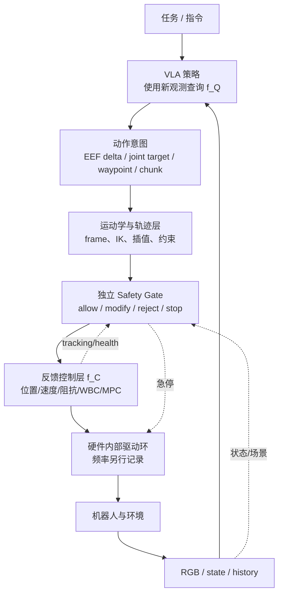
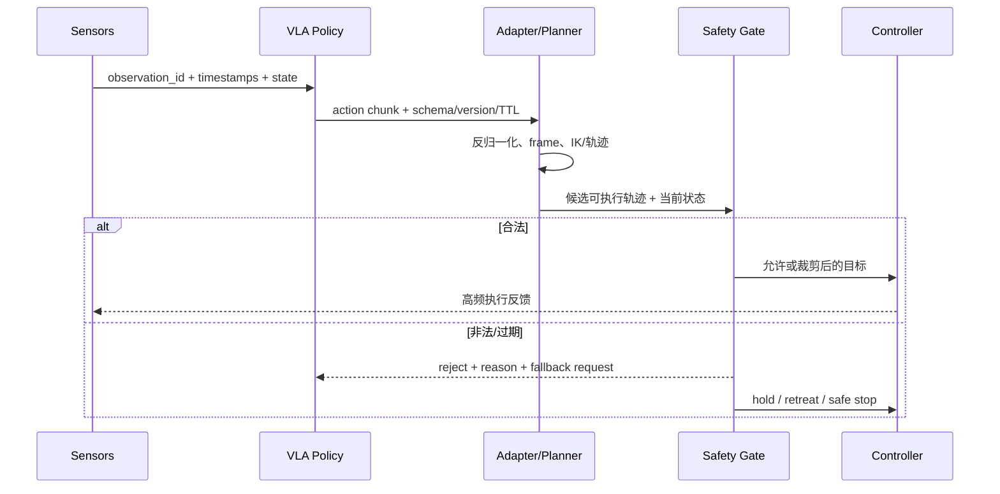

# VLA 与机器人控制栈

VLA 负责从观测和任务条件生成动作意图或短期动作分布；控制栈负责把该意图变成满足运动学、动力学、接触和实时约束的命令。两者的边界由 action contract 决定，不由“端到端”这个标签决定。

## 1. 分层责任

| 层 | 主要输入 | 主要输出 | 不应推给它的责任 |
|---|---|---|---|
| VLA | 感知、语言、proprio、历史 | 候选动作/目标 | 电机稳定性、硬碰撞保证 |
| 适配/规划 | 动作合同、机器人状态、约束 | 可跟踪轨迹/关节目标 | 开放词汇任务理解 |
| 反馈控制 | 目标与高频反馈 | 速度、力矩、阻抗命令 | 长程任务分解 |
| 安全监督 | 状态、候选动作、故障 | allow/clip/reject/stop | 用成功率代替安全证明 |

## 2. 一次在线 tick

动作块只在生成时刻绑定观测；控制器则在每个伺服周期读取新状态。因此执行链应保存 source observation、目标生效时间和 tracking error，避免把“模型输出正确、控制跟踪失败”归为同一种策略错误。

## 3. 四种接法

| VLA 输出 | 下游模块 | 优点 | 主要代价 |
|---|---|---|---|
| 关节/EEF 单步动作 | 限幅 + 关节/IK 控制 | 接口直接 | 查询慢时卡顿，安全责任重 |
| action chunk | 队列 + 重规划 + 控制器 | 摊薄模型成本、段内连续 | 开环漂移、旧块过期 |
| waypoint/目标位姿 | 轨迹规划、IK/MPC | 易加入碰撞和可达性 | 手工控制栈更重 |
| skill/子任务 | 技能库或低层策略 | 长程结构清楚 | skill coverage、切换和层间错误 |

连续 Diffusion/Flow 已学习部分轨迹结构，但仍不替代坐标变换、限位、控制器和 watchdog。

skill 输出的最小合同还包含 skill id、参数/grounding、前置条件、终止条件、timeout 与执行策略版本；skill 先进入 skill executor/policy，再由其动作经过 adapter、Safety 与控制器。详见[长程任务、记忆与规划](../横切专题/长程任务、记忆与规划.md#13-option--skill-视角)。

## 4. 真实系统事实

- 原版 OpenVLA 输出单步 7 维动作且未使用 action chunk；官方 README 建议目标数据约 \(5\!-\!10\) Hz，若机器人控制器是 50 Hz，先验证降采样后任务仍可完成。该建议绑定原版 recipe。
- OpenVLA-OFT 用并行动作槽和 chunk 提高吞吐，但作者报告的 108.8 Hz 是 A100 上动作生成口径，不是完整机器人伺服率。
- π0 一次生成 50 步动作块并用 10 次 Euler 积分；动作采样频率、实际执行步数和低层 PD/控制器仍由部署协议决定。
- SmolVLA 把策略生成与客户端队列消费并行；论文自评异步方案平均任务时间由 13.75 s 降至 9.70 s，但收益依赖队列和硬件。
- GR00T N1 把 VLM 条件与 DiT 动作模块拆分；作者材料同时给出约 63.9 ms 的 16-step 块生成延迟与最高约 120 Hz 的动作执行/样本率。二者是不同口径，后者不能改写成 DiT 查询率。

## 5. 故障定位

| 现象 | 模型侧检查 | 控制侧检查 |
|---|---|---|
| 方向稳定错误 | 预测分布、训练标签 | frame、左/右乘、维度顺序 |
| 离线动作正确、真机振荡 | chunk/动作频率 | 插值、增益、控制延迟 |
| 接触前成功、接触后失败 | 视觉/state 信息 | 阻抗、力限、接触检测 |
| 块内平滑但整体漂移 | \(H_{exec}\)、历史 | tracking error、重规划触发 |
| 偶发大动作 | OOD/反归一化 | norm version、限幅、watchdog |

## 6. 验证与消融

1. **Open-loop replay**：同一观测固定模型输出，分别经过 adapter、IK 和控制器仿真，定位首次偏差模块。
2. **Oracle intent**：用人工正确 EEF/waypoint 替代 VLA；若仍失败，瓶颈在控制栈。
3. **Oracle execution**：在仿真中直接施加模型目标；与真实控制器差距反映执行链。
4. **频率矩阵**：固定权重，扫描 \(f_Q,f_A,f_C,H_{exec}\)，报告成功率、tracking error、jerk 和尾延迟。
5. **扰动恢复**：动作执行中移动目标或施加轻扰动，测重规划和控制恢复时间。

## 最小报告字段

VLA 输出类型与物理单位、\(f_Q/f_A/f_C\)、\(H_{pred}/H_{exec}\)、坐标 frame、控制器类型与增益版本、IK/规划器、限制条件、安全层、端到端延迟和失败分类。

## 延伸阅读

- [本体适配与动作执行接口](本体适配与动作执行接口.md)
- [安全过滤、失败检测与恢复](安全过滤、失败检测与恢复.md)
- [运控算法基础](../../依赖索引.md)
- [连续回归与 Action Chunk](<../架构与动作生成/连续回归与Action Chunk.md>)
