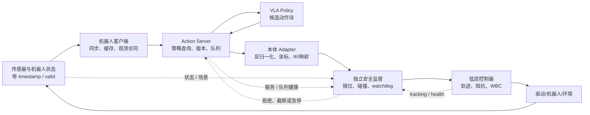

# 系统与部署：把候选动作变成可控执行

本目录从模型边界向机器人执行链展开。VLA 的直接产物通常是归一化动作、物理动作块、路点或子任务；它们只有经过版本匹配、本体适配、安全门控和低层闭环后，才成为真实机器人命令。反归一化只能有一个 owner：本手册默认图采用“Action Server 返回 normalized action、Robot Adapter 反归一化”的 profile；openpi 等服务端返回物理动作的实现属于另一 profile，客户端必须按 `action_space` 跳过反归一化，不能凭 shape 猜测。

## 1. 系统责任图

图中安全监督必须能观察当前状态、候选动作、控制器状态和通信健康，并处在可门控执行链的位置。只在 prompt 中写“安全操作”不构成独立安全机制。

## 2. 对外可观察的频率与三个延迟

| 量 | 定义 | 常见误读 |
|---|---|---|
| 模态观测率 \(f_O^m\) | 相机、proprio、力觉等模态 $m$ 的原始/有效采样率 | resize 或窗口长度等于采样率 |
| 语义/高层刷新率 \(f_H\) | 指令、子任务或语义条件更新速度 | 有 action expert 就自动有独立 \(f_H\) |
| 策略查询率 \(f_Q\) | 每秒用新观测请求模型的次数 | chunk 内 50 Hz 等于模型查询 50 Hz |
| 动作参考率 \(f_A\) | 动作块相邻 setpoint 的时间频率/客户端派发参考的名义频率 | 把离线张量长度或策略查询率当物理时间 |
| 低层闭环率 \(f_C\) | 部署合同中 IK/轨迹/阻抗/WBC 等控制闭环的更新率 | 把硬件内部电机驱动率写成 VLA 控制率 |
| TTFA | 新观测到首个可执行动作 | 用整个 chunk 吞吐代替 |
| query latency | 请求到完整动作块可用 | 忽略排队与网络 |
| action age | 动作执行时距其条件观测的年龄 | 只测服务端 forward |

这些量没有跨系统通用的固定范围。一个 query 可以生成按 $f_A$ 采样的长 chunk，控制器再以 $f_C$ 插值/跟踪；硬件内部电流环或驱动率若另报，应明确记为设备内部量，不并入 $f_C$。高层分层系统还可能满足 $f_H<f_Q$，但必须由真实日志而不是模型名称证明。

时间长度统一为：$H_{obs}$ 是输入历史窗口，$H_{pred}$ 是一次生成的动作长度，$H_{exec}$ 是使用新观测重查询前最多承诺执行的动作数，满足 $1\le H_{exec}\le H_{pred}$。三者都需要配套采样间隔/频率和时间戳；只给整数不能恢复物理时长。

## 3. 文档顺序

1. [VLA 与机器人控制栈](VLA与机器人控制栈.md)：明确策略、规划、控制与安全责任。
2. [本体适配与动作执行接口](本体适配与动作执行接口.md)：把模型空间恢复为本体可执行目标。
3. [推理加速、缓存与 Action Server](<推理加速、缓存与Action Server.md>)：定义在线请求、队列、缓存和性能口径。
4. [端云协同与双系统部署](端云协同与双系统部署.md)：处理跨设备频率、网络和降级。
5. [安全过滤、失败检测与恢复](安全过滤、失败检测与恢复.md)：建立独立门控、watchdog 和恢复状态机。

## 4. 共用在线消息合同

| 消息 | 必备字段 |
|---|---|
| Observation | episode/observation id、capture timestamp + clock/timebase、各模态 timestamp/valid/stale、robot state、calibration/task version |
| Policy request | request id、observation id、$H_{obs}$、requested $H_{exec}$、policy/checkpoint version、action schema、deadline |
| Action chunk | chunk id、source observation、generated at、`action_space=normalized\|physical`、\(f_A,H_{pred}\)、norm-stat/schema version、TTL、confidence |
| Executable command | command id、actual $H_{exec}$、target times、frame/unit、adapter/controller/safety-rule version、安全裁剪记录 |
| Feedback | measured state/setpoint、tracking error、queue depth、fault code、intervention、outcome、provenance |

消息只有 shape 没有版本和时间语义时，异步系统会把“格式正确的旧动作”当成合法新动作。

## 5. 最小系统验证

- 同一观测重复查询的模型数值与缓存一致性；
- 动作 round-trip、单轴方向、frame 与单位检查；
- 策略查询、动作采样、伺服频率分别测量；
- 网络抖动、服务超时、队列耗尽和版本错配注入；
- 安全层 on/off 只用于隔离诊断，真机不得绕过硬急停；
- 报告平均与尾部延迟、action age、队列深度、拒绝/急停原因和闭环成功率。

## 资料入口

- [任务定义与输入输出协议](../基础/任务定义与输入输出协议.md)
- [VLA 系统数据流](../基础/VLA系统数据流.md)
- [动作坐标、归一化与跨本体统一](../数据与特征/动作坐标、归一化与跨本体统一.md)
- [运控算法基础](../../依赖索引.md)
- [推理部署资料](../../依赖索引.md)
