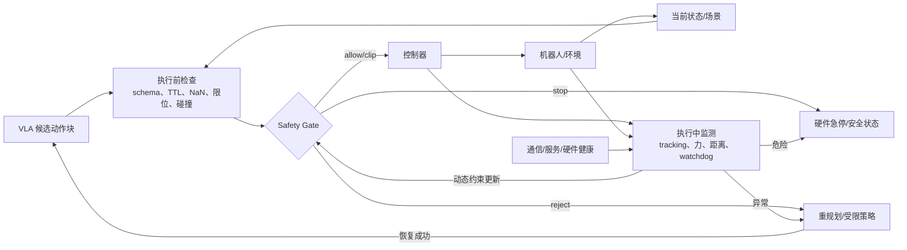
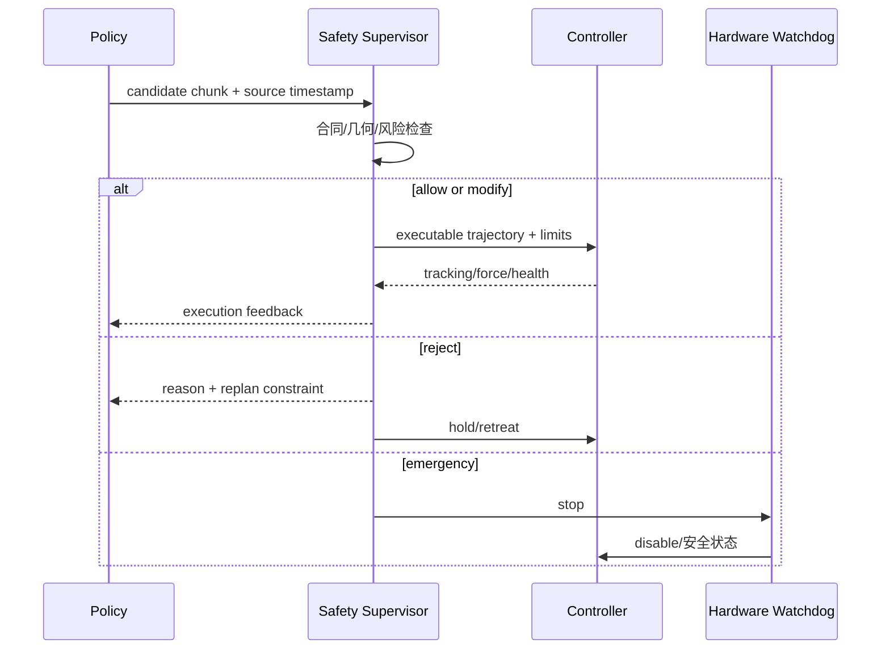
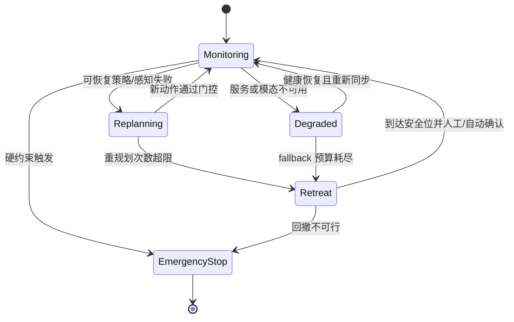

# 安全过滤、失败检测与恢复

安全监督不是动作后处理中的一个 clip 函数。它是独立、可观察并能门控执行链的运行时模块：读取机器人/环境状态、候选动作、控制器与通信健康，输出 allow、modify、reject、fallback 或 emergency stop。

## 1. 安全闭环

安全层必须在模型服务失联时仍可工作，硬急停路径不应依赖 GPU、云端或语言模型。

## 2. 三类检测

| 层 | 可观测信号 | 检测对象 | 典型动作 |
|---|---|---|---|
| 请求/动作合同 | version、TTL、NaN、range、mask | 非法或陈旧输出 | reject、清队列 |
| 几何/动力学 | 关节限位、碰撞距离、速度/加速度、力矩 | 不可达/碰撞/过快 | 投影、缩放、重规划 |
| 执行与任务 | tracking error、接触力、无进展、重复步骤、success | 控制失败或策略失败 | 回撤、刷新条件、人工接管 |
| 系统健康 | heartbeat、网络、队列、温度、急停 | 计算/通信/硬件故障 | fallback 或安全停止 |

规则/约束适合明确硬边界；学习到的 risk/value/verifier 可覆盖复杂语义风险，但其输出只能作为证据之一，不能替代硬件限位和急停。

## 3. 动作门控协议

修改动作时必须同时保存原始候选、修改后命令和规则版本，否则无法判断成功来自策略还是安全投影，也无法用执行日志改进模型。

## 4. 失败分类与恢复层级

| failure code | 判据例 | 恢复 |
|---|---|---|
| stale_action | action age > TTL | 丢弃并新查询 |
| schema_mismatch | checkpoint/schema/norm 不一致 | 拒绝并回退兼容 bundle |
| planning_infeasible | IK/碰撞无解 | 缩短 horizon、换 waypoint |
| tracking_error | 误差持续超阈值 | 清队列、减速、回撤 |
| excessive_contact | 力/力矩或接触时间异常 | 顺应/释放/急停 |
| no_progress | 物体/任务状态长时间不变 | 重观察、改子任务、人工接管 |
| repeated_subtask | 完成状态与条件陈旧 | reset memory/刷新高层 |
| server_timeout | deadline/heartbeat 失败 | 本地 fallback；预算耗尽停止 |

恢复应从低风险到高授权逐级升级：重观察 → 丢弃旧 chunk → 受约束重规划 → 回撤安全位 → 人工接管/急停。不是所有失败都应“让 VLA 再试一次”。

## 5. 状态机与 reset

进入 Replanning/Degraded 时应明确哪些状态清零：动作队列通常清空；KV cache 按 observation 失效；任务 memory 可保留已确认事实，但陈旧子任务需撤销。急停后的恢复需要重新建立机器人状态、标定和控制模式，不能直接续接旧 chunk。

## 6. 训练数据回流

安全日志可形成后训练数据，但不同片段应分开：

- 原始候选动作：用于风险预测和策略诊断，不当作专家动作；
- 安全层修改/拒绝：用于 constraint/risk 标签；
- 人工接管动作：可作为恢复示范，需标接管区间；
- 最终 outcome：训练 value/verifier；
- technical fault：用于系统可靠性，不应混入语义失败。

每条回流记录绑定 behavior policy、safety rule、controller、adapter 和环境版本，避免把旧规则下的拒绝当成新模型的客观真值。

## 7. 真实系统边界

- 原版 OpenVLA/openpi/SmolVLA 代码提供策略与数据/服务入口，不自动提供适配所有机器人的碰撞、力控和急停方案。
- action chunk 与异步队列提高吞吐，也增加旧动作继续执行的风险；TTL 和队列清空必须在客户端/安全进程实现。
- GR00T、Gemini 等作者频率报告不等于安全认证；高频 action decoder 仍需独立监督和低层控制。
- 世界模型/value 可用于候选后果或风险评分，但预测误差和分布外失效要求保留确定性硬边界。

## 8. 验证与消融

1. **规则单测**：边界值、NaN、错版本、过期、无效维必须确定触发。
2. **故障注入**：网络断开、服务超时、传感器 stale、队列耗尽、控制器 fault。
3. **动态安全场景**：人/障碍进入、目标移动、异常接触；测 detection-to-stop latency。
4. **恢复阶梯**：无恢复、只重规划、回撤、人工接管，分别报告成功、二次风险和耗时。
5. **门控归因**：离线回放比较 raw/modified/rejected，但真机硬安全不可关闭。
6. **阈值曲线**：风险阈值—任务成功—误拒绝—漏检—干预率，而非只报零事故。
7. **独立通道**：冻结策略，验证 GPU/云端失效时 watchdog 与急停仍生效。

## 最小安全报告

风险模型/规则版本、可观察信号、门控位置、最大检测延迟、硬/软约束、fallback、急停链、人工接管、拒绝与裁剪率、按 failure code 的任务结果、近失事件和测试覆盖。

## 延伸阅读

- [VLA 与机器人控制栈](VLA与机器人控制栈.md)
- [端云协同与双系统部署](端云协同与双系统部署.md)
- [运控算法基础](../../依赖索引.md)
- [预测式 VLA 与世界模型辅助](../架构与动作生成/预测式VLA与世界模型辅助.md)
