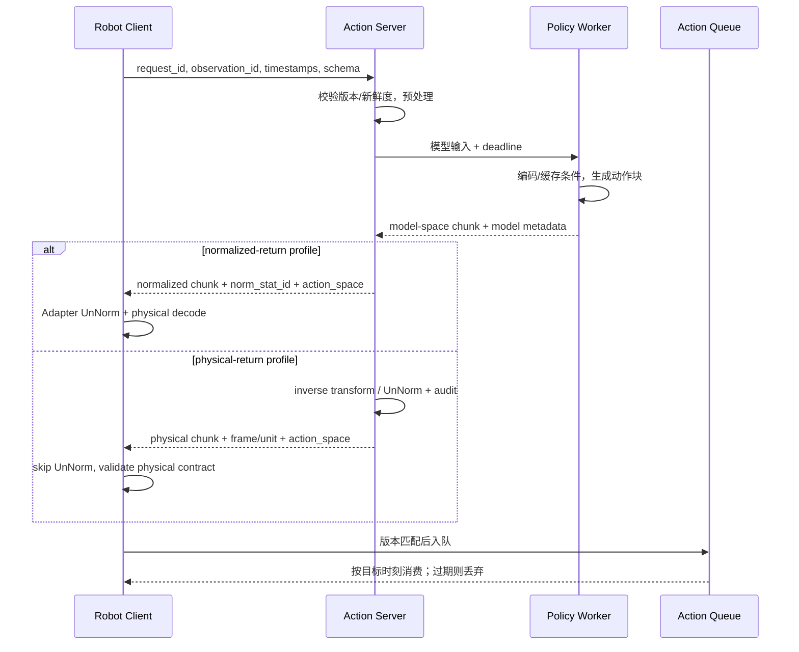
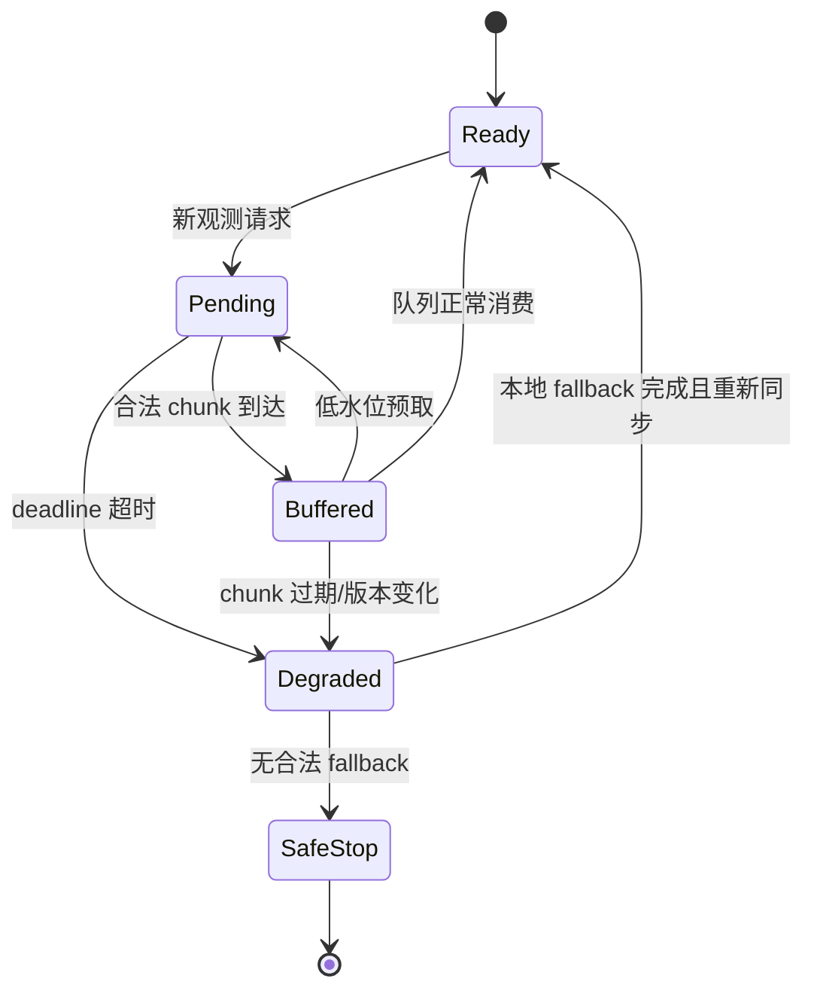

# 推理加速、缓存与 Action Server

Action Server 是策略模型与机器人实时进程之间的协议边界。它负责请求验证、预处理、batch/调度、模型执行、响应 profile、版本与可观测性；机器人客户端负责采集、队列消费、deadline 和安全回退。响应必须显式声明 `action_space=normalized|physical`：前者由机器人 Adapter 反归一化，后者由服务端执行 inverse transform，二者不能同时做。不能靠一个“返回 actions 数组”的 RPC 隐式约定。

## 1. 在线数据流

openpi 官方本地文档提供 WebSocket policy server：客户端可先缩放图像降低带宽，发送未归一化 state，服务端 policy/data transforms 完成输入归一化与输出 inverse transform 后返回动作块，可视为 physical-return profile。这个事实说明预处理和反变换位置都是协议的一部分；自建服务若改变 owner，必须同时版本化统计和 `action_space`。

## 2. 请求与响应合同

| 字段 | 服务端用途 | 客户端用途 |
|---|---|---|
| request/observation id | 去重、追踪、乱序检测 | 关联生成动作与观测 |
| capture/send timestamp | 估计输入年龄和网络延迟 | 计算端到端 action age |
| checkpoint/schema/norm version | 选择兼容 worker | 拒绝错误响应 |
| action space + frame/unit | 选择 normalized/physical response profile | 跳过或执行 UnNorm，拒绝双重解码 |
| deadline/priority | 排队和丢弃策略 | 超时触发 fallback |
| chunk rate/horizon | 正确解码物理时间 | 调度动作 |
| generated_at/TTL | 服务审计 | 丢弃过期 chunk |
| valid/confidence/fault | 禁止非法返回 | 安全门控与降级 |

幂等性要按 request_id 定义：网络重试不应让同一请求生成两段同时入队的动作。

## 3. 缓存不是一个概念

| 缓存 | key | 生命周期 | 失效条件 | 收益 |
|---|---|---|---|---|
| 模型权重/编译缓存 | checkpoint + shape + precision | 进程/版本 | 权重或运行时变化 | 启动与 kernel 开销 |
| 图像/语言前缀 KV | observation/task + model version | 一次动作生成 | 新观测/条件 | π0 多步 flow 少重复主干 |
| 静态语言/任务 embedding | task version | 多次查询 | 指令或 tokenizer 变化 | 减少重复文本编码 |
| 动作队列 | chunk + source timestamp | 数个控制周期 | TTL、重规划、故障 | 推理与执行重叠 |
| 策略结果缓存 | 完整输入哈希 | 极短 | state/图像变化 | 去重，不适合作长期复用 |

KV cache 是计算复用，不是跨时刻任务记忆。cache key 缺少 checkpoint、模态有效位或 task version 时，命中反而会制造错误条件。

## 4. 性能分解

\[
T_{e2e}=T_{capture}+T_{\mathrm{client-pre}}+T_{uplink}+T_{queue}
+T_{model}+T_{post}+T_{downlink}+T_{dispatch}.
\]

对 Diffusion/Flow，进一步有

\[
T_{model}=T_{\mathrm{model-cond}}+K\,T_{expert},
\]

缓存失败时可能变成 \(K(T_{\mathrm{model-cond}}+T_{expert})\)。这里 client preprocess/serialize 与模型条件编码互斥计时，避免把图像处理重复加总。TTFA 从 capture 到首个合法 executable setpoint；完整 chunk latency 到全部 chunk 可用；action age 到该 setpoint 实际执行。应分别报告冷启动/稳态、P50/P95/P99、query throughput 和队列等待。

| 加速方式 | 改变的模块 | 不能自动证明 |
|---|---|---|
| 并行动作解码 | 串行 token → 并行槽位 | 闭环频率等于模型吞吐 |
| action chunk | 摊薄每动作模型成本 | 新观测响应更快 |
| 减少 flow/diffusion 步数 | \(K\) | 动作质量不变 |
| 前缀 KV cache | 重复条件计算 | 获得长期记忆 |
| 量化/编译 | 权重带宽/kernel | 动作协议正确 |
| 异步队列 | 执行与生成重叠 | 旧动作仍安全 |

作者口径锚点：原版 OpenVLA 在 A100 约 4.2 query Hz；OFT 并行与分块报告 108.8 Hz；π0 在 RTX 4090、10 步 flow 约 100 ms/chunk；SmolVLA 给出异步任务吞吐收益但统一端到端延迟未披露。这些数字不能跨硬件排名。

## 5. 队列与故障状态

fallback 可以是短时 hold、完成已承诺安全前缀、受限本地策略、退回安全位或停止；必须按任务风险预先定义，不能在异常发生后临时选择。

## 6. 验证与消融

1. cache on/off 在相同输入下验证输出数值一致，只归因延迟/显存；
2. 固定权重扫描 batch、精度、\(K\)、chunk 与队列低水位，报告质量—延迟曲线；
3. 注入 P50/P99 网络抖动、乱序、重复请求和服务重启；
4. 热切 checkpoint/schema，旧响应必须被客户端拒绝；
5. 扫描 action age 与成功率，确定 TTL 而非拍脑袋设常数；
6. 同步与异步使用相同模型和动作执行规则，隔离调度收益。

## 延伸阅读

- [openpi 远程推理文档](../../依赖索引.md)
- [推理部署资料](../../依赖索引.md)
- [时序建模与记忆](../架构与动作生成/时序建模与记忆.md)
- [端云协同与双系统部署](端云协同与双系统部署.md)
