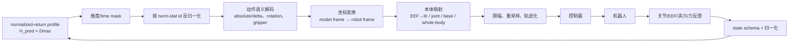
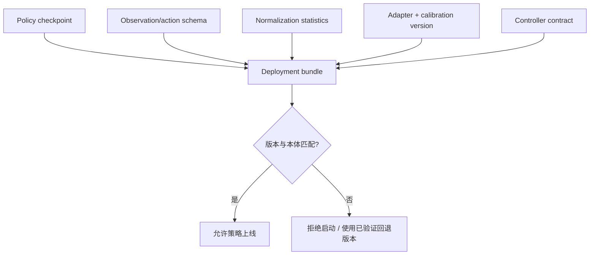

# 本体适配与动作执行接口

本体 Adapter 的作用不是“把 32 维切成 7 维”，而是恢复动作的物理含义，并把执行反馈重新编码为策略所需状态。它与 action schema、normalization statistics 和控制器版本共同构成 checkpoint 的部署资产。

## 1. 双向模块接口

### 输入合同

| 字段 | 例子 | 错配后果 |
|---|---|---|
| action schema/version | EEF delta + gripper | 同 shape 不同语义 |
| action space | `normalized` 或 `physical` | 双重反归一化或完全漏解码 |
| norm-stat id | dataset/embodiment q01/q99 | 幅度整体错误 |
| frame/composition | base frame、left-multiply | 方向或旋转错误 |
| rate/horizon | \(f_A,H_{pred},H_{exec}\) | 位移/速度语义与开环时长变化 |
| valid mask | 手臂、底盘、躯干有效位 | padding 被执行 |
| source timestamp/TTL | 观测时刻、最长年龄 | 旧动作作用于新状态 |

## 2. 一次动作转换

对 normalized-return profile 的模型输出 \(\hat a\)，先按本体 \(e\) 的统计和 mask 得到规范动作：

\[
a^{canon}_{h,d}=m^e_d\,
\operatorname{UnNorm}_{e,d}(\hat a_{h,d}).
\]

再按 frame 和动作类型映射：

\[
T^{base}_{target}
=T^{base}_{camera}T^{camera}_{target},\qquad
T^{base}_{eef,t+1}=\Delta T^{base}_tT^{base}_{eef,t}.
\]

若输出是末端目标，IK/轨迹模块还需结合当前关节 \(q_t\)、关节限位和碰撞约束求可跟踪参考。逆解失败不能静默返回零动作，应产生结构化 reject reason。

若 Action Server 声明 `action_space=physical`，服务端已经执行对应 model transform 的 inverse/UnNorm；机器人侧 validator 仍检查 schema、frame、unit、range、TTL 和版本，但跳过 `UnNorm`。normalized 与 physical 两种 profile 都合法，同一条消息链只能选择一种，且 `norm_stat_id`/变换版本仍用于审计。

## 3. 跨本体的三种边界

| 路线 | 共享部分 | 本体专有部分 | 适用情况 |
|---|---|---|---|
| 公共 EEF 空间 | 任务/末端运动 | frame、IK、gripper、控制器 | 多种相近机械臂 |
| padded joint/action | 最大向量与 mask | 关节顺序、有效维、统计 | 训练本体集合固定 |
| embodiment adapter | 共享语义/动作 latent | state/action MLP、head 或 decoder | 双臂、移动、人形异构 |

OpenVLA 常用 7 维 EEF 公共接口；其本地 OXE 配置对前 6 维连续动作使用归一化 mask，夹爪按独立语义变换。openpi 当前公开配置把 state/action pad 到 32 维，而原始 π0 论文最大本体规格为 18 维；两种版本不能混写。GR00T N1 使用本体专用 state/action 投影连接共享表示。

## 4. 训练与部署必须共用的资产

Bundle 应在启动时校验哈希或不可变版本号。只热更新权重、不更新统计或 adapter，是最危险的“成功部署”：服务正常返回数组，但数组已没有正确物理语义。

### 训练与推理差异

| 环节 | 训练 | 推理 |
|---|---|---|
| 坐标转换 | 离线标签统一 | 实时使用当前标定/状态 |
| 统计 | 仅由 train split 拟合 | 只加载，不在线重估 |
| mask | 进入 loss | 阻止无效维执行 |
| IK/控制器 | 常不在 loss 内 | 决定可达性和跟踪 |
| 延迟 | 标签按参考时钟对齐 | 需把 action age 纳入生效判断 |

## 5. 故障状态与 fallback

| 故障 | 检测 | 默认处理 |
|---|---|---|
| schema/version 不匹配 | 启动/每请求校验 | 拒绝动作 |
| norm-stat 缺失或死维 | 范围与分母检查 | 拒绝启动 |
| IK 无解/碰撞 | 规划器状态 | 缩短目标、重规划或安全停止 |
| frame/标定过期 | calibration version/残差 | 停止几何动作 |
| 轨迹跟踪误差过大 | measured-target error | 清队列并进入恢复 |
| 控制模式切换 | controller mode version | 使旧 chunk 失效 |

## 6. 验证与消融

1. **数值 round-trip**：raw → canonical → normalized → decoded，分别报告各物理维误差和裁剪率。
2. **单轴脉冲**：每次只激活一个动作维，确认方向、单位、左右臂和夹爪。
3. **mask 污染**：给 padding 位注入大随机值，合法输出和 loss 应不变。
4. **版本错配注入**：故意替换统计、frame 或 adapter，系统必须拒绝而非执行。
5. **Oracle adapter**：同一策略比较公共 adapter 与人工校准本体 adapter，隔离跨本体瓶颈。
6. **频率桥接**：固定动作轨迹，扫描重采样和伺服率，比较路径、jerk 与 tracking error。

## 延伸阅读

- [动作坐标、归一化与跨本体统一](../数据与特征/动作坐标、归一化与跨本体统一.md)
- [VLA 与机器人控制栈](VLA与机器人控制栈.md)
- [安全过滤、失败检测与恢复](安全过滤、失败检测与恢复.md)
- [OpenVLA 本地数据入口](../../依赖索引.md)
- [openpi 模型配置](../../依赖索引.md)
