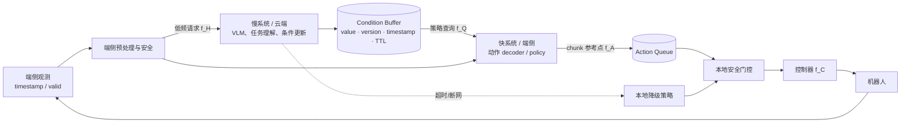
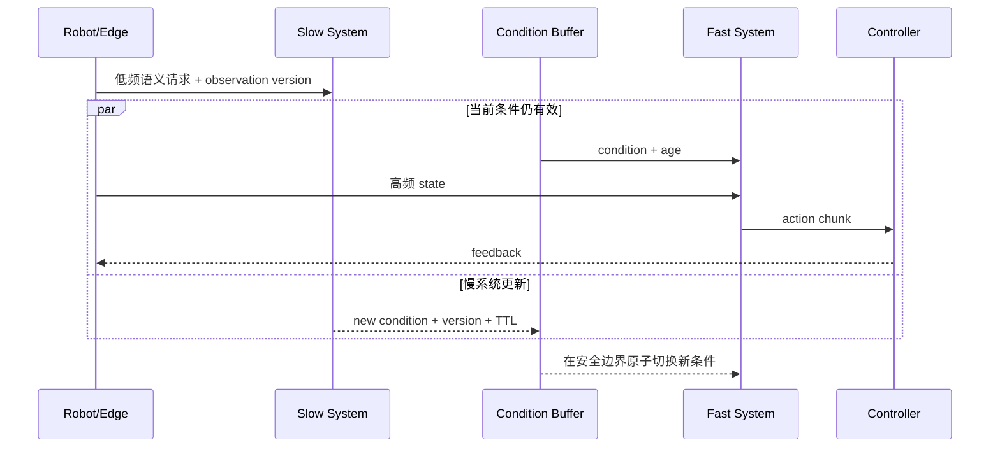
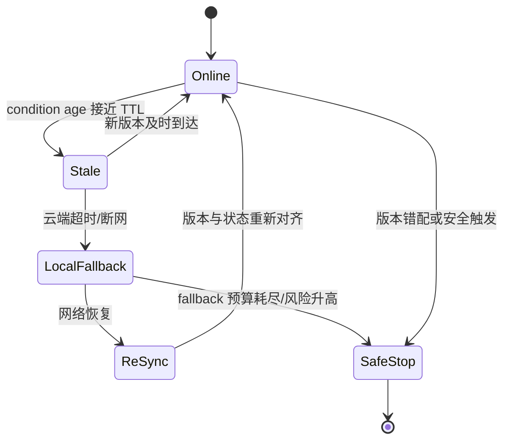

# 端云协同与双系统部署

端云拆分回答“计算在哪里运行”，双系统回答“不同职责是否以不同频率独立运行”。二者可组合但不等价：远程运行一个同步单体 VLA 仍不是多速率双系统；本机两套不同频率网络也可以完全不依赖云。

## 1. 慢—快接口

双系统至少要求：

1. 慢、快模块能独立调度，而不是每个动作 tick 串行等待；
2. 接口有稳定语义、版本、时间戳和过期规则；
3. 快模块可在慢模块未更新时有限期运行；
4. 新旧条件切换和故障有确定行为。

π0 的 VLM/action expert 虽有双权重，但通常在同一模型调用中同步执行，不能仅据此称为严格多速率部署。

## 2. Condition contract

| 字段 | 作用 |
|---|---|
| condition type | 文本子任务、skill、waypoint、latent 或 VLM token |
| source observation/task | 说明条件基于哪次观测与指令 |
| generated/effective time | 区分生成和开始生效 |
| producer + consumer model version | 防止快模块消费不兼容表示 |
| representation schema/tokenizer version | 锁定 latent/token 的形状与语义 |
| compatibility hash | 启动和热切换时做精确兼容校验 |
| TTL/freshness | 决定何时必须刷新或降级 |
| confidence/completion | 支持切换、失败检测和重规划 |
| scope | 适用本体、任务、控制模式 |
| fallback | 过期、断网或非法条件时的动作 |

隐向量接口带宽低，但最依赖版本；语言接口可审计但粒度较粗；waypoint 便于规划约束，但需要共同坐标系。

## 3. 一次异步闭环

“原子切换”表示同一动作块不能前半使用旧 latent、后半使用新 latent。可以在 chunk 边界切换，或由控制器在安全事件点切换。

## 4. 真实结构锚点

| 系统 | 慢/快边界 | 作者报告与口径 |
|---|---|---|
| GR00T N1 | Eagle-2 VLM 条件 → cross-attention Action DiT | 作者报告约 63.9 ms 生成 16-step 动作块，并给出最高约 120 Hz 的动作执行/样本率口径；不能写成 DiT 每秒查询 120 次 |
| Helix | 7B System 2 → 80M System 1 | 7–9 Hz / 200 Hz；新闻稿口径，训练耦合待核 |
| Gemini Robotics | 云端语义 backbone → 本地 action decoder/chunk | 作者报告 query-response <160 ms、端到端约 250 ms；50 Hz 指本地 chunk 的动作流/样本口径，不是每秒 50 次云端闭环决策 |
| π0.5 | 自回归语言子任务 → Flow 动作块 | 语义分层明确，但可共享同一主干，不自动证明物理拆分 |
| openpi remote | WebSocket policy server → 机器人客户端 | 官方代码支持远程动作流；未定义通用端云安全协议 |

频率不能跨行排名。必须说明是模块 forward、query、动作样本、闭环更新还是伺服率。

## 5. 网络与降级状态机

| 故障 | 不安全做法 | 建议行为 |
|---|---|---|
| 网络抖动 | 无限执行旧 chunk | 按 action age/TTL 截断 |
| 响应乱序 | 后到的旧版本覆盖新条件 | 单调 version + source observation 校验 |
| 云端重启 | 默认接受空/初始 condition | 重新握手并清队列 |
| 带宽下降 | 静默降图像质量 | 协议化分辨率/视角降级并重新验证 |
| 本地算力不足 | 队列耗尽后 hold last action | 受限 fallback 或安全停止 |

## 6. 隐私、带宽和可观测性

端侧可做图像 resize/crop 降低带宽，但该变换必须与训练预处理一致。日志至少包含 uplink/downlink 字节、网络 P50/P99、条件年龄、队列耗尽、fallback 次数、云端/端侧版本和安全事件。敏感视频是否上传、保存多久、谁可访问属于部署合同，不应被模型精度讨论覆盖。

## 7. 验证与消融

1. 固定模型权重，比较同步串行、缓存同步和真正异步，隔离调度收益；
2. 扫描慢系统刷新率、TTL 与环境变化速度，画 condition age—成功率曲线；
3. 注入延迟、丢包、乱序、带宽下降、服务重启和版本错配；
4. 比较本地完整模型、远程完整模型、云慢/端快拆分，分别报告 TTFA、P99 和能耗；
5. oracle condition 与 predicted condition 对照，分离高层错误和低层动作能力；
6. fallback 在完整任务、受限任务和停止三种结果上单独计分，不能把安全停止当普通失败隐藏。

## 延伸阅读

- [双系统架构资料](../../依赖索引.md)
- [openpi 远程推理](../../依赖索引.md)
- [分层、混合与双系统架构](../架构与动作生成/分层、混合与双系统架构.md)
- [推理加速、缓存与 Action Server](<推理加速、缓存与Action Server.md>)
