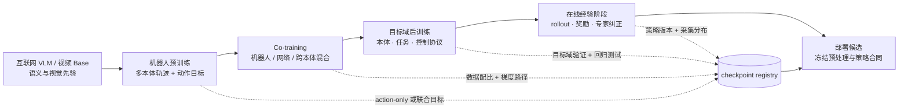

# 训练与评估：从数据混合到可部署策略

本目录把 VLA 训练视为一组带版本边界的阶段，而不是一次 `fit`。每个阶段都要说明：从哪个 checkpoint 开始、消费什么样本、哪些参数接收哪种梯度、优化预算怎样计量、以什么证据决定进入下一阶段。这样才能区分收益来自数据、初始化、训练目标、参数更新范围，还是额外的真机交互。

目录前半部分覆盖训练主线、参数更新策略和后训练/强化学习，后半部分把模型输出放进离线—仿真—真机证据链，并给出泛化统计与可归因消融协议。

## 1. 训练阶段不是能力标签



图中的阶段可以合并，也可以跳过。例如 RT-2 直接把网络视觉语言数据和机器人数据做 co-fine-tune；π0 采用大规模机器人预训练后再做目标任务后训练；π0.5 先以离散统一目标预训练，再新增连续动作专家；RECAP 则在强基座之后引入 on-policy 经验。是否称为“预训练”取决于 checkpoint 的预期复用范围，不由数据量大小单独决定。

## 2. 七篇文档的职责

| 文档 | 核心问题 | 阅读后应能产出的工程对象 |
|---|---|---|
| [训练 Pipeline 与目标函数](训练Pipeline与目标函数.md) | batch 怎样形成 loss，阶段怎样衔接，预算怎样比较 | stage manifest、loss mask、采样与优化预算表 |
| [冻结、微调与参数高效训练](冻结、微调与参数高效训练.md) | 哪些参数需要适配，梯度应到哪里停止 | 参数组清单、可训练参数比例、梯度路径与消融矩阵 |
| [后训练、强化学习与数据回流](后训练、强化学习与数据回流.md) | 怎样从目标域数据、失败和奖励继续改进策略 | rollout schema、版本化回流闭环、安全与离线验收门槛 |
| [离线、仿真与真机评估](离线、仿真与真机评估.md) | 模型、策略和系统分别需要什么证据 | E0—E5 证据层级、benchmark/trial 协议与 sim-real 边界 |
| [泛化、鲁棒性与统计协议](泛化、鲁棒性与统计协议.md) | OOD 轴、扰动曲线和不确定性怎样报告 | held-out manifest、分层指标、置信区间与配对统计 |
| [消融实验与公平比较](消融实验与公平比较.md) | 改动收益怎样与数据、Base、预算和控制器解耦 | baseline manifest、阶梯/交互消融和归因结论 |

推荐顺序是先读 Pipeline，再选择参数更新范围，最后判断是否真的需要在线经验；得到候选 checkpoint 后，再沿离线、仿真和真机逐级验证。直接从 RL 算法或最终成功率开始，都无法回答基座是否已有非零成功率、奖励是否可识别、以及失败究竟来自策略还是控制栈。

## 3. 所有训练实验共用的最小记录

### 3.1 Stage manifest

```text
stage_id / parent_checkpoint / code_commit
dataset_manifest[] / mixture_weights / sampler_version
action_contract / normalization_version / tokenizer_version
trainable_parameter_groups / frozen_groups / stop_gradient_edges
loss_terms / loss_weights / valid_masks / reduction_rule
global_batch / micro_batch / accumulation / sequence_or_window_count
optimizer / lr_by_group / schedule / warmup / weight_decay / grad_clip
max_steps / consumed_samples / consumed_action_steps / wall_clock / hardware
validation_protocol / promotion_metric / rollback_checkpoint
```

这些字段不要求写进一行配置，但必须能从 checkpoint 附件与实验日志恢复。尤其要区分“优化器 step”“窗口样本数”“原始 episode 数”和“机器人动作步数”：VLA 中相邻窗口高度重叠，单报 step 数不能代表看过多少独立经验。

### 3.2 数据与梯度的审计键

每个 batch 至少应能按以下键分桶：

| 键 | 用途 |
|---|---|
| `dataset_id / embodiment_id / task_id` | 检查混合权重、负迁移和长尾覆盖 |
| `sample_type` | 区分网络 VL、机器人动作、失败、纠正、仿真和无动作视频 |
| `action_valid / world_valid / text_valid / value_valid` | 防止缺失标签被解释成零目标 |
| `policy_version / collector_type` | 区分示范、旧策略和当前 on-policy 分布 |
| `success / termination / intervention` | 后训练、价值学习和失败归因 |
| `normalization_version / action_contract` | 保证训练目标能被同一控制接口执行 |

## 4. 训练预算的统一口径

有效全局 batch 为

\[
B_{global}=B_{micro}\times N_{data\ parallel}\times N_{accum}.
\]

若一个样本是长度为 \(H_{pred}\) 的动作块，则一个 step 消费的监督动作元素约为

\[
N_{action}=\sum_{b=1}^{B_{global}}\sum_{h=1}^{H_{pred}}\sum_{d=1}^{D_a}m_{b,h,d},
\]

而不是简单的 \(B_{global}H_{pred}D_a\)，因为 episode 尾部、跨本体 padding 和缺失标签会被 mask。跨模型比较至少同时报告：优化器 steps、窗口数、有效动作步数、训练 FLOPs 或 wall-clock、硬件与精度。

## 5. 代表训练路线的定位

| 路线 | 阶段组织 | 这里关注的训练问题 | 事实边界 |
|---|---|---|---|
| RT-2 | 网络 VL + 机器人数据共同微调 | co-fine-tune 如何保留网络知识 | 闭源主干；配比细节披露有限 |
| OpenVLA | VLM 初始化 → OXE 动作训练 → 下游全量/LoRA | 视觉端是否解冻、动作 CE、PEFT | 主训练与 LoRA 消融使用的模型变体需区分 |
| Octo | OXE 从零训练策略 Base → 目标域全模型微调 | 模块接口与小数据适配 | 论文配方约 100 轨迹/50k step 为作者设置 |
| π0 | 大规模混合机器人预训练 → 高质量目标域后训练 | Flow loss、动作专家和阶段数据质量 | 训练数据主要非公开，结果为作者自评 |
| π0.5 | 离散统一预训练 → 新增连续动作专家后训练 | 组合 loss 与阶段切换 | 约 280k/80k steps、α=0/10 为论文配方 |
| KI / π0.6 | 离散主干监督 + 连续专家，反向梯度隔离 | 防遗忘与专家收敛 | KI 效率与性能为作者自评 |
| RECAP / SimpleVLA-RL | 基座 → rollout/奖励/纠正 → 策略更新 | on-policy 分布、稀疏奖励和安全回流 | 均缺统一第三方真机复现 |

## 6. 阶段晋级而非只看训练 loss

每次从一个阶段进入下一阶段，至少设置四类门槛：

1. **数据门槛**：动作 round-trip、时间同步、mask 与 split 已验收；
2. **优化门槛**：loss 有限、梯度范数与有效样本比稳定，各数据源无长期饥饿；
3. **能力门槛**：目标域闭环指标达到预设下限，同时语义、跨任务或旧本体没有不可接受回归；
4. **系统门槛**：checkpoint、预处理、归一化、动作 adapter 和推理协议形成同一版本资产。

预训练 loss 更低不保证更适合后训练；后训练成功率更高也可能伴随基础语义遗忘。阶段之间应保留可回滚 checkpoint，并在固定 probe suite 上持续回归。

## 7. 资料入口

- [embodied-ai-learning：训练全流程](../../依赖索引.md)
- [OpenVLA 细读](../../依赖索引.md)
- [Octo 细读](../../依赖索引.md)
- [π0 / π0.5](../../依赖索引.md)
- [Knowledge Insulation](../../依赖索引.md)
- [π0.6 / RECAP](../../依赖索引.md)
- [数据与特征](../数据与特征/index.md)
- [架构与动作生成](../架构与动作生成/index.md)

数字口径：本目录中的论文结果均注明作者自评或独立协议；“当前代码快照”只描述工作区配置，不外推为论文统一设置。论文或代码未披露的学习率、总样本量、真实在线执行预算等字段明确写“未披露/待核”。
