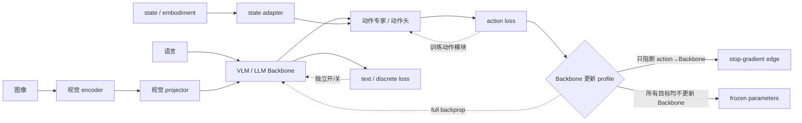
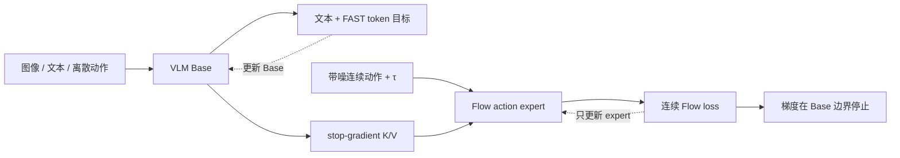

# 冻结、微调与参数高效训练

“冻结 Base”不是一个二元开关。VLA 通常包含视觉 encoder、视觉 projector、语言/VLM 主干、state/embodiment adapter、动作专家或动作头，以及归一化层和新 token embedding。选择更新范围，本质上是在控制任务适配能力、预训练知识保持、优化状态显存和数据需求之间的权衡。

## 1. 先画清参数组和梯度边

一次实验至少列出每组参数的 `train/frozen/LoRA/stop-gradient` 状态。`requires_grad=false`、优化器未包含该参数、前向中 `stop_gradient` 和使用缓存特征，都会阻止更新，但机制和可扩展性不同：

- **冻结参数**：所有进入该参数的梯度都不更新它；
- **stop-gradient 边**：只阻断某条 loss 路径，参数仍可由其他目标更新；
- **PEFT**：冻结原权重，但在指定线性层、卷积或 token 上增加可训练增量；
- **预计算特征**：连前向适配也固定，省算力但无法使用输入增强后重新编码。

## 2. 更新范围的四种基本策略

| 策略 | 可训练对象 | 优点 | 主要风险 | 适用起点 |
|---|---|---|---|---|
| 只训练新头 | action head / adapter | 成本低、旧能力稳定 | Base 表征无法适应机器人几何 | 数据少、输入域接近预训练、先做接口验收 |
| 冻结 Base + PEFT | LoRA/adapter + 新头 | 优化器状态小，可保留知识 | rank/target layer 成为容量瓶颈 | 7B 级 Base 的目标域适配 |
| 部分解冻 | projector、后若干层、视觉后段 + 头 | 兼顾适配与成本 | 分层学习率和断点复杂 | 已定位表征瓶颈在特定模块 |
| 全量微调 | 视觉、Base、动作模块 | 最大适配能力 | 显存、过拟合、遗忘和梯度冲突 | 数据充分、目标域差异大、已有保持评测 |

“数据少所以一定 LoRA”不是充分判断。若新任务依赖预训练视觉端没有保留的毫米级几何，只训练语言层 LoRA 可能无效；若任务主要改变动作坐标和本体接口，先训练 state/action adapter 反而更合理。

## 3. LoRA 的容量与成本语义

对冻结线性层 \(W\in\mathbb R^{d_{out}\times d_{in}}\)，LoRA 学习低秩增量：

\[
y=(W+\Delta W)x,
\qquad
\Delta W=\frac{\alpha}{r}BA,
\]

\[
A\in\mathbb R^{r\times d_{in}},
\quad B\in\mathbb R^{d_{out}\times r}.
\]

该层新增参数为 \(r(d_{in}+d_{out})\)，而不是 \(d_{in}d_{out}\)。但总显存不只由可训练参数决定：冻结权重仍需前向驻留，激活仍需为穿过的可训练层保留，量化格式、优化器状态、梯度检查点和序列长度都会改变峰值。

需要一同记录的 PEFT 参数包括：rank \(r\)、scale \(\alpha\)、dropout、target modules、是否训练 bias/norm/embedding、adapter 初始化和合并方式。只写“LoRA 微调”不能复现实验的参数更新空间。

## 4. 真实实现事实与正确解读

### 4.1 OpenVLA：视觉适配与 LoRA 是两个不同结论

OpenVLA 主训练发现，机器人动作训练中微调视觉 encoder 对性能关键；作者还报告 224×224 相比 384×384 没有收益而训练约慢 3 倍。这个结论说明互联网视觉表征需要机器人域适配，不等于所有下游都必须全量更新双视觉主干。

其 LoRA 消融在所有线性层使用 rank 32，约训练 97.6M / 7,188M 参数（约 1.4%）。作者在 Franka-Tabletop 报告 68.2% vs 全量微调 69.7%，LoRA 单卡约 60 GB，而全量微调需要多卡 FSDP 和 160+ GB。关键限定是：这些 LoRA/量化数字来自只用 SigLIP、采用较小 OXE 混合的简化变体，不是最终 DINOv2+SigLIP 主模型上的等价比较。

当前本地 OpenVLA 微调脚本默认启用 LoRA、rank 32、target 为全部线性层，默认 batch 16、最大 200k steps、LR 5e-4；量化训练只与 LoRA 组合。它们是当前代码快照默认值，不是论文对所有下游任务的推荐常数。

### 4.2 Octo：接口可插拔不等于 Base 应冻结

Octo 的 tokenizer/readout 结构允许新增传感器或动作头而保留预训练接口；但论文目标域微调实验沿用扩散目标并更新整个模型，作者报告优于只冻结部分预训练参数。常用作者配方约为 100 条目标域轨迹、50k steps。这里要分开两个问题：结构是否允许只加模块，以及最终性能是否需要 Base 适配。

### 4.3 SmolVLA 与 openpi 当前代码快照

当前本地 LeRobot SmolVLA 配置默认 `freeze_vision_encoder=true`，同时动作专家和其余允许更新模块仍可训练。该默认值体现轻量训练的工程取舍，不代表论文证明“冻结视觉永远最好”。实验应显式比较冻结与解冻，并报告视觉梯度、显存和目标任务的空间精度。

当前本地 openpi 提供 PaliGemma 与动作专家都使用 LoRA 变体的微调示例，并通过冻结过滤器只更新 LoRA 参数；示例同时关闭 EMA。LoRA 配置、冻结过滤器与 checkpoint 权重结构必须匹配，否则会出现看似加载成功、实际可训练参数不完整的静默错误。具体示例中的 batch、horizon 和学习率属于当前代码配置，不替代论文配方。

### 4.4 GR00T N1.5：冻结也可以是知识保持选择

本地论文整理记录 GR00T N1 端到端联合训练 VLM 与动作 DiT，而 N1.5 冻结 Eagle VLM，以改善语言指令跟随和语义稳定性。这类版本变化不能简化为“冻结更省显存”：它改变了动作梯度是否能重塑视觉语言表示，评估必须同时包含机器人任务和语言/grounding 保持。

## 5. Knowledge Insulation 与普通冻结的区别

Knowledge Insulation（KI）保留两条训练责任：主干继续用文本、FAST 离散动作 token 和网络数据训练；连续动作专家读取主干 K/V，但其 Flow loss 通过 stop-gradient 不回传主干。可写为：

\[
c=f_{\theta_B}(x),\qquad
\hat A=g_{\theta_A}(\operatorname{sg}(c),\epsilon,\tau),
\]

\[
\nabla_{\theta_B}\mathcal L_{flow}=0,
\qquad
\nabla_{\theta_B}\mathcal L_{text/discrete}\ne0.
\]

普通“冻结 Base”会使 Base 不能从任何当前任务目标更新；KI 则允许离散/网络目标继续训练 Base，只隔离随机初始化连续专家的梯度。作者自评 KI 相对 π0 约有 7.5× step efficiency，训练计算增加约 20%，并报告 LIBERO-90 96.0%、LIBERO-Spatial 95.6%、DROID 0.55±0.09 vs π0 0.49±0.09。全部是作者协议，不能据此推导任意 Base 都应采用 KI。

## 6. 怎样选择更新范围

从“失败对应哪个表示层”开始，而不是从显存开始：

| 观察到的瓶颈 | 首选可训练模块 | 必须有的对照 |
|---|---|---|
| 动作幅度/坐标错，语义正确 | action head、normalizer、embodiment adapter | 固定 Base 的动作 round-trip 与单轴测试 |
| 新相机或视角不适配 | vision projector、视觉后段或视觉 LoRA | 相同动作头，冻结 vs 解冻视觉 |
| 指令改写/新物体失败 | VLM 后层或语言/视觉 PEFT + co-training | VL probe、无语言与冲突指令测试 |
| 新本体 state 语义不同 | state encoder、embodiment adapter | state-off/shuffle、同任务跨本体 |
| 连续专家早期拖坏语义 | KI、阶段式新增专家 | full backprop、完全冻结、stop-gradient |
| 小数据快速适配 | LoRA + 新头，必要时逐层解冻 | 从零头、全量微调和参数量匹配 adapter |

可采用逐级解冻：先验证数据和动作接口，只训练头；若训练/验证均欠拟合，再开放 projector 或后层；只有证据指向上游表示不足时才解冻视觉/语言 Base。每次增加更新范围都改变容量和优化状态，需要新的学习率组和过拟合监控。

## 7. 分层学习率与优化器状态

设参数组 \(g\) 使用学习率 \(\eta_g\)：

\[
\theta_g^{t+1}=\theta_g^t-\eta_g\,\widehat m_g/(\sqrt{\widehat v_g}+\epsilon).
\]

新初始化动作头、LoRA 和预训练 Base 通常承受不同可接受更新幅度。若全部使用同一 LR，Base 可能遗忘，或新头学习太慢。实验记录应列每个组的 LR、weight decay、warmup、grad clip 与 optimizer state 大小。中途解冻参数时，新参数组的 optimizer moments 从零开始，不能假装与已训练参数处在相同优化阶段。

## 8. 可归因实验矩阵

| 组 | Base | 视觉 | projector/state | action expert | 目的 |
|---|---|---|---|---|---|
| A | frozen | frozen | train | train | 最小接口基线 |
| B | LoRA | frozen | train | train | 测语言/主干 PEFT 增益 |
| C | LoRA | unfreeze/vision LoRA | train | train | 测机器人视觉适配 |
| D | full | full | train | train | 全量能力上界与遗忘风险 |
| E | discrete loss 更新 | 由主目标决定 | train | Flow train，stop-grad 到 Base | KI 梯度隔离 |

所有组固定数据窗口、动作目标、总优化 step 和 batch；同时报告可训练参数、峰值显存、吞吐、wall-clock、目标任务、旧任务和 VL probe。若全量组每步更慢，只对齐 step 会给它更多或更少实际计算，最好同时提供等 step 与等 wall-clock 曲线。

## 9. 常见失败与检查点

| 现象 | 可能原因 | 首先检查 |
|---|---|---|
| loss 不变 | 可训练参数为空或冻结过滤器错 | 按组打印参数数、梯度非零比例 |
| LoRA 训练正常、合并后退化 | scale/target/量化权重不匹配 | 合并前后固定 batch 数值等价 |
| 新任务升、语言跟随降 | Base 更新过强或无 co-training | 固定 VL probe 与梯度范数 |
| 解冻视觉后不稳定 | LR 过高、增强或 norm 状态变化 | 分层 LR、BN/norm 模式、clip 触发率 |
| KI 下动作不学 | stop-gradient 放错位置或专家没接收条件 | Base K/V 前向敏感性、expert 梯度 |
| 冻结节省参数却不省显存 | 激活/序列/冻结权重仍占主导 | 显存按权重、激活、梯度、optimizer 分解 |

- [ ] 参数组清单与 optimizer group 一一对应；
- [ ] 记录冻结、LoRA 和 stop-gradient 的不同语义；
- [ ] 合并 adapter 前后做固定输入数值测试；
- [ ] 目标任务与旧能力/VL probe 同时评估；
- [ ] 所有论文数字保留模型变体与作者口径；
- [ ] 当前代码默认值明确标为快照，不写成通用最优。

## 资料来源

- [OpenVLA 细读](../../依赖索引.md)
- [OpenVLA-OFT](../../依赖索引.md)
- [Octo](../../依赖索引.md)
- [Knowledge Insulation](../../依赖索引.md)
- [GR00T N1](../../依赖索引.md)
- [当前 OpenVLA 微调入口](../../依赖索引.md)
- [当前 openpi 训练配置](../../依赖索引.md)
- [当前 SmolVLA 配置](../../依赖索引.md)
- [训练 Pipeline 与目标函数](训练Pipeline与目标函数.md)
