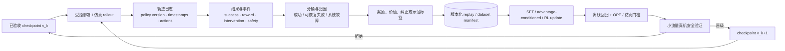

# 后训练、强化学习与数据回流

后训练的目标是把通用 VLA 变成目标本体和任务上可用的策略；强化学习与数据回流则让策略接触自身部署分布中的状态、失败和纠正。二者的边界不在于是否使用“新数据”，而在于数据由谁产生、是否有奖励/偏好信号、以及更新后的策略是否改变下一轮采集分布。

## 1. 四种后训练信号

| 信号 | 数据产生方式 | 训练对象 | 能解决的问题 | 主要局限 |
|---|---|---|---|---|
| 目标域 SFT/行为克隆 | 人类或脚本示范 | \(p(a\mid o,l)\) | 本体、相机、动作协议和技能适配 | 仍受示范状态分布限制 |
| 失败/纠正监督 | 策略 rollout 中人工接管或重做 | 失败邻域中的恢复动作 | 修复部署时真实错误 | 干预时刻与责任归因复杂 |
| 离线价值/优势条件 | 已有成功、失败和次优轨迹 | value 或条件策略 | 从混合质量数据中提取更优行为 | 依赖价值估计与覆盖 |
| 在线 RL | 当前策略与环境交互 | policy/value/reward | 优化任务结果、发现示范外策略 | 成本、安全、稀疏奖励和分布非平稳 |

SFT、DAgger 式纠正、优势条件策略和 policy-gradient RL 可以出现在同一系统中，但不能把所有新增数据统称为“RL”。是否使用梯度意义上的强化学习，需要说明优化目标怎样依赖奖励和策略概率。

## 2. 为什么示范之外的数据重要

行为克隆最小化示范分布 \(d_E(s)\) 上的动作误差：

\[
\min_\theta\ \mathbb E_{s\sim d_E}
[\ell(\pi_\theta(s),a_E)].
\]

部署时策略错误会改变后续状态，实际访问的是 \(d_{\pi_\theta}(s)\)。如果两者差异大，离线动作误差很小也可能在闭环中累积失败。数据回流的关键价值是把监督或奖励放到 \(d_{\pi}\) 覆盖的失败邻域，而不只是继续增加同分布成功示范。

这不意味着任何 on-policy 数据都有效。若任务成功率接近 0、奖励只有终局 0/1，采集可能几乎没有正信号；若成功率已接近饱和，在线 RL 的边际收益又可能不抵真机成本。先测基座的成功率、失败类型和奖励可识别性，再选择算法。

## 3. 从部署到训练的版本化闭环



循环中必须把系统故障与策略失败分开。相机断流、动作队列过期、控制器饱和和人工急停不能直接作为策略的负奖励样本；否则模型会学习补偿一个部署栈错误。每条回流轨迹至少绑定 `policy_version`、模型输入版本、动作合同、奖励版本和干预来源。

## 4. 目标域后训练：先完成本体和任务对齐

目标域后训练通常仍使用与预训练相同的动作目标，但改变数据质量、任务分布和参数更新范围。一个最小阶段包括：

1. 冻结父 checkpoint 和原预处理资产；
2. 用目标本体数据重新核对 action contract 与归一化，而不是直接沿用跨本体统计；
3. 定义目标域 train/validation/test group，先切分 episode 再构造窗口；
4. 选择只训头、LoRA、部分或全量微调，并保留旧能力 probe；
5. 以固定闭环协议晋级，不用训练 loss 代替真机证据。

π0 论文采用约 700k-step 大规模预训练后，再用高质量、精挑的小到中等数据适配叠衣、收桌等任务；精确下游数据量和完整优化参数披露不足。π0.5 后训练新增随机初始化动作专家，以作者配方继续约 80k steps，并把连续 Flow loss 权重设为 10。它同时改变模块、loss 和数据组合，因此不能只把收益归因于“后训练更久”。

## 5. 失败与纠正数据：动作标签的责任边界

人工干预轨迹常包含三段：策略自主执行、接管过渡、专家纠正。直接拼成一条行为克隆轨迹会造成两个问题：接管前的失败动作被当作专家标签，接管切换瞬间的动作又可能不连续。建议字段为：

```text
collector_type: demo | policy | intervention | recovery
policy_version / operator_id
intervention_start / intervention_end
action_source per step
failure_type / safety_event / termination
reward / reward_version
counterfactual_or_comment (optional)
```

训练时可对不同来源设置独立 mask/权重。若要学习恢复，只保留专家接管后的动作还不够：输入窗口必须包含导致失败的状态，但不能把失败动作本身误标为应模仿目标。干预触发策略也会选择性采样“人类容易看见”的错误，需要记录未干预失败作为对照。

## 6. RECAP：优势条件策略而非经典 actor-critic

RECAP（RL with Experience and Corrections via Advantage-conditioned Policies）在 π0.6 基座上组合三类数据：人类示范、当前策略的 on-policy 成功/失败经验、专家遥操作纠正。每轮包括采集、价值训练和优势条件训练。

本地论文整理给出的优势估计为：

\[
A(o_t,a_t)=r_{t:t+N}+V(o_{t+N})-V(o_t).
\]

再二值化为条件：

\[
b_t=\mathbb 1[A(o_t,a_t)>\varepsilon],
\qquad
\pi_\theta(a_t\mid o_t,l,b_t).
\]

推理时把条件设为“高优势”，从混合质量数据中抽取更优行为。价值函数是独立的小型 VLM 路线，作者将价值归一化到 \((-1,0)\)，0 表示成功；本地资料记录其初始化包含 SigLIP-400M、Gemma-270M 和 value head。RECAP 不直接套经典 policy-gradient，而用价值估计产生条件监督，以兼容大模型和异构真机数据。

作者自评在最难的真实家庭任务上吞吐超过 2×、失败率约减半，并展示多轮迭代收益；数据、策略权重和价值函数未开放，缺少独立复现。正确的复现实验单位应是整轮采集预算：机器人小时、专家干预分钟、成功/失败比例、价值模型训练计算和策略更新计算都需要报告。

## 7. 在线策略梯度路线：SimpleVLA-RL 作为实例

SimpleVLA-RL 使用结果级 0/1 奖励和 GRPO，对同一任务的一组 rollout 做组内相对优势并进行 PPO 式裁剪更新，不额外训练 reward model。作者报告采用非对称裁剪 \(\epsilon_{low}=0.2,\epsilon_{high}=0.28\)，并去掉 KL 正则以鼓励探索。这些是该论文的稳定化选择，不是 VLA RL 的通用默认值。

作者自评结果包括：LIBERO-Long 86.5→98.5，RoboTwin 1.0 39.8→70.4，四项真机任务 17.5→38.5；均为单团队协议。论文整理还强调两条边界：每任务一条示范冷启动后可获得明显提升，但基座初始成功率接近 0 时，稀疏奖励几乎无法启动学习；对 Flow/Diffusion VLA 的适配证据不足、待核。

当前本地二手整理对该方法的具体 action parameterization 与可计算 log-prob 分解存在未决口径，尚不足以形成可执行的复现合同。本节只保留“作者报告用结果奖励和 GRPO 后训练 VLA”这一机制与自评数字；基座、动作概率分解和官方实现入口统一标为待一手论文/代码核验。本页不据此推断 GRPO 可直接复用到连续回归、Diffusion 或 Flow 动作头。

## 8. 在线 RL 的目标与稳定性

对策略梯度路线，常见裁剪目标可概括为：

\[
\mathcal L_{PG}=-\mathbb E_t
\left[
\min\left(
r_t(\theta)\hat A_t,
\operatorname{clip}(r_t(\theta),1-\epsilon_l,1+\epsilon_h)\hat A_t
\right)
\right],
\]

\[
r_t(\theta)=\frac{\pi_\theta(a_t\mid s_t)}{\pi_{old}(a_t\mid s_t)}.
\]

对离散自回归 token，log-probability 有直接定义；对 deterministic regression、Diffusion 或 Flow policy，需要定义可计算概率、score surrogate 或其他策略更新方式，不能只把行为克隆 loss 乘一个 reward 就称为同一种 PPO/GRPO。

稳定性至少依赖：初始成功率、组内奖励方差、rollout freshness、更新幅度、熵/探索、动作安全约束和环境并行度。离线训练吞吐高并不代表在线样本效率高，机器人/仿真 rollout 往往是主瓶颈。

## 9. Replay 与数据混合

数据回流后，训练分布可以写为：

\[
p_{train}=w_Ep_{demo}+w_\pi p_{rollout}+w_Cp_{correction}+w_Fp_{failure},
\qquad w_i\ge 0,\quad \sum_i w_i=1.
\]

这里四项要求按 `label_source` 形成互斥采样桶；例如一条“失败后被专家纠正”的轨迹需要在 manifest 中指定本轮作为 `correction` 还是 `failure` 使用，不能重复计入两个概率质量。若实现允许多标签并分别计算 loss，上式应解释为加权 measure 而非互斥概率混合，并独立记录每个目标的有效曝光。这些权重既不能仅按样本量设定，也不能把失败全部升权。建议先按任务、策略版本、结果和失败类型分层，再确定目标 exposure。每轮训练记录：

- 新旧数据占比与实际 batch 曝光；
- 轨迹新鲜度和 policy lag；
- 成功、失败、纠正的 episode 数与动作时长；
- 重复采样率与每类有效 loss；
- 数据去重、奖励重算和 schema 迁移版本。

旧 rollout 可以防遗忘并提高覆盖，但过旧策略的失败分布可能不再代表当前策略；只保留最新成功又会产生幸存者偏差。使用滑动窗口、reservoir 或按版本分层都可以，关键是让策略版本成为显式采样轴。

## 10. 安全与晋级协议

在线真机更新前至少经过：

1. **日志回放**：动作解码、限幅、坐标和时间戳一致；
2. **离线回归**：旧任务、语言/视觉 probe 和安全分类不退化；
3. **仿真/数字孪生**：扰动、超时、碰撞和恢复状态机；
4. **shadow 或低权限运行**：策略输出不直接执行，先与安全控制器比较；
5. **小流量真机**：限定任务、速度、空间和人工急停；
6. **逐级扩展**：达到置信区间和安全事件阈值后才扩大部署。

RL 目标不能替代硬安全层。奖励设计再完整，也无法保证未见状态下不越界；关节、速度、工作空间、碰撞和通信超时仍由独立控制/安全接口约束。

## 11. 可归因实验

| 对照 | 固定项 | 回答的问题 |
|---|---|---|
| 继续 SFT vs 加失败/纠正 | 总新轨迹时长、更新预算 | 收益是否来自 on-policy 状态而非更多数据 |
| 成功-only vs 成功+失败 | 采集策略、价值/条件方法 | 失败数据是否被有效利用 |
| 无 value vs value filtering vs advantage condition | 同一 replay | 收益来自价值估计还是额外采样 |
| offline replay vs online fresh rollout | 数据量和任务 | 当前策略分布是否关键 |
| RL vs 最佳行为克隆重加权 | 同一奖励与数据 | policy-gradient 是否必要 |
| 无干预 vs 专家纠正 | on-policy episode 数 | 专家时间的边际价值 |

报告最终成功率之外，还要给 learning curve 横轴的机器人小时/环境步、专家干预时间、失败率、安全事件、吞吐、完成时间和策略版本数。最佳 checkpoint 的单点比较会隐藏在线训练的采集成本和中途风险。

## 12. 常见失败与检查点

| 现象 | 可能机制 | 优先检查 |
|---|---|---|
| RL 完全不提升 | 初始成功率为零、奖励无方差 | 组内成功分布、SFT 冷启动 |
| 成功率升但动作危险 | reward hacking 或安全项未覆盖 | 独立安全指标与动作限幅触发 |
| 价值高但任务失败 | value 偏差或分布外外推 | 价值校准、按 policy version 分桶 |
| 干预数据训练后更差 | 切换段动作不连续、责任标签错 | `action_source` 与接管边界 |
| 新轮次遗忘旧任务 | replay 只保留最新任务 | 旧数据配比与固定 probe |
| 离线指标升、真机不升 | replay 分布或模拟器捷径 | fresh on-policy 验证与系统故障分桶 |
| 策略在旧日志上“改进” | off-policy 选择偏差 | 新策略受控 rollout，不只做行为重放 |

- [ ] 每条回流轨迹绑定 policy/reward/schema 版本；
- [ ] 系统故障与策略失败分开；
- [ ] 报告采集成本、干预时间和真实 exposure；
- [ ] 优势/value 在独立策略版本上做校准；
- [ ] 连续生成式策略的 RL 概率/目标定义明确；
- [ ] 真机更新经过离线、仿真和小流量安全晋级；
- [ ] 作者自评与未开放字段不推断为可复现配方。

## 资料来源

- [训练全流程](../../依赖索引.md)
- [π0](../../依赖索引.md)
- [π0.5](../../依赖索引.md)
- [π0.6 / RECAP](../../依赖索引.md)
- [SimpleVLA-RL](../../依赖索引.md)
- [Knowledge Insulation](../../依赖索引.md)
- [训练 Pipeline 与目标函数](训练Pipeline与目标函数.md)
- [冻结、微调与参数高效训练](冻结、微调与参数高效训练.md)
- [数据采集、生成与清洗](../数据与特征/数据采集、生成与清洗.md)
