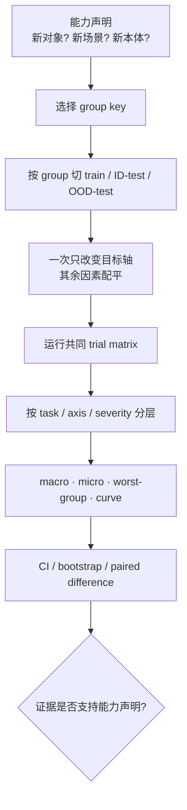

# 泛化、鲁棒性与统计协议

> “在测试集上成功”只有在测试分布、抽样单位和不确定性都明确时才有意义。本篇把泛化写成可操作的分布变化，把鲁棒性写成扰动—性能曲线，并给出适用于二元成功、阶段进度和多任务评测的统计协议。

## 1. 理论对象：从一个平均数拆成条件风险

设评测条件

\[
c=(\text{task},\text{object},\text{scene},\text{robot},
\text{camera},\text{language},\text{dynamics},\text{operator}),
\]

策略损失为 \(\ell(\pi,c)\)。训练与部署风险分别是：

\[
R_{train}=\mathbb E_{c\sim P_{train}}\ell(\pi,c),
\qquad
R_{deploy}=\mathbb E_{c\sim P_{deploy}}\ell(\pi,c).
\]

IID 评测近似采样 \(P_{train}\) 的留出部分；OOD 评测有意改变一个或多个条件，使 \(P_{test}\ne P_{train}\)。所以“泛化”必须写成一个箭头，例如：

- 已见任务 + 新物体实例；
- 已见技能 + 新对象类别；
- 已见房间类型 + 新住宅；
- 已见本体 + 新相机位姿；
- 已见原子技能 + 新组合顺序；
- 已见本体集合 + 新机器人或新 adapter；
- 名义动力学 + 新摩擦、负载或控制延迟。

只写“OOD success”无法判断究竟改变了什么。

## 2. OOD 轴与 held-out 单位

| 泛化轴 | held-out 最小单位 | 需要固定 | 典型捷径 |
|---|---|---|---|
| 语言 | 语义模板/组合，而非单句字符串 | 任务、物体、初始状态 | 只换同义词却称新任务 |
| 对象实例 | object instance | 类别、任务、场景 | 同一对象的 crop 泄漏 |
| 对象类别 | category | 动作可达性、尺寸范围 | 颜色/背景提示类别 |
| 空间布局 | scene/layout group | 对象集合、指令 | 固定目标坐标 |
| 相机 | camera pose/session | 场景、控制器 | 记忆 wrist/第三视角槽位 |
| 环境 | building${USER_HOME} | 本体、任务定义 | 同一房间不同 episode |
| 任务组合 | skill sequence | 原子技能覆盖 | 测试链在训练中完整出现 |
| 本体 | embodiment/robot serial | 任务与 adapter 预算 | 同型号不同序列号被称跨本体 |
| 动力学 | payload/friction/gain/delay | 视觉与目标 | 只改变渲染而称动力学鲁棒 |
| 时间 | collection/deployment period | 固件和任务 | 同日相邻 session 泄漏 |

OOD split 应在 episode/window 展开前生成，并与训练数据 manifest 做去重。对象图像、语言改写、生成变体和同一源 episode 的所有窗口必须留在同一 split。



## 3. 鲁棒性：报告曲线，而不只报告一个扰动点

设扰动族为 \(g_\delta\)，\(\delta\) 是相机偏移、遮挡比例、延迟、负载或视觉噪声强度。成功率曲线为：

\[
S(\delta)=
\mathbb E_{c\sim P_{test}}
\left[\mathbf 1\{\pi \text{ 在 }g_\delta(c)\text{ 下成功}\}\right].
\]

至少报告：

\[
\Delta S(\delta)=S(\delta)-S(0),
\]

\[
\operatorname{AUC}_{rob}
=\frac{1}{\delta_{max}-\delta_{min}}
\int_{\delta_{min}}^{\delta_{max}}S(\delta)\,d\delta,
\]

\[
S_{worst}=\min_{\delta\in\mathcal D}S(\delta).
\]

若扰动强度是离散档位，用梯形法计算 AUC，并公开每一档结果。normalized AUC 只在同一扰动物理量、参数化和强度区间内可比；相机厘米偏移与遮挡比例的 AUC，或两个不同上限的 $\delta$ 区间，不能直接排名。单个“随机扰动平均”会混淆模型是在所有条件下中等，还是在某一条件彻底崩溃。

### 3.1 扰动按机制分组

| 组 | 例子 | 主要测试模块 |
|---|---|---|
| 视觉 | 光照、纹理、背景、遮挡、模糊 | 视觉表示与数据增强 |
| 几何 | 相机外参、物体位置、桌高 | 空间特征、坐标与标定 |
| 语言 | 同义改写、属性、否定、干扰指令 | grounding 与任务条件 |
| 状态 | proprio 噪声、延迟、缺失 | 状态编码与 fallback |
| 动力学 | 摩擦、质量、柔顺、负载 | action policy 与控制器 |
| 系统 | 推理延迟、丢帧、网络抖动 | 缓存、动作队列与安全接口 |
| 交互 | 人为移动对象、失败后恢复 | 闭环纠错与记忆 |

多扰动组合应在单轴曲线之后测试。否则失败时无法区分主效应和交互效应。

## 4. 真实 benchmark 给出的教训

### 4.1 泛化 split 不同，数字含义不同

- **LIBERO** 的 Spatial、Object、Goal 和 Long 分别强调不同知识轴；4 套件与 5 套件平均也不是同一分母。
- **CALVIN** 的 D→D、ABCD→D 与 ABC→D 分别对应同环境、见过目标环境和未见目标环境，不能把 avg-len 放进同一排行。
- **VIMA-Bench** 按 Placement、Combinatorial、Novel-Object、Novel-Task 分级；等级是能力条件，不是一个可忽略的表格脚注。
- **COLOSSEUM** 按多个视觉/环境扰动因子报告退化；其价值在分因子结果，而非压成一个总平均。

### 4.2 高 ID 成功率可能依赖位置和视角捷径

[本地 benchmark 细读](../../依赖索引.md)汇总的 LIBERO-PRO、LIBERO-Plus 维护方/提出方评测显示，多种在标准 LIBERO 上高分的策略在相机、机器人初态和对象位置扰动下出现大幅退化；其中部分设置接近失效。这些数字属于相应 benchmark 的统一或作者协议，不应外推成所有 VLA 的固定退化比例，但足以说明：

1. 标准 ID 分数不能单独支持空间、语言或对象泛化；
2. 扰动必须按轴报告，不能只给随机化平均；
3. black-view、camera swap、language mismatch 等反事实可暴露模型依赖哪个输入槽位；
4. 高分 benchmark 饱和后，应提高分布变化而不是继续比较小数点后差异。

### 4.3 SimplerEnv 的两种协议回答不同问题

Visual Matching 尽量缩小真实图像与仿真图像的视觉差异，目标是复现目标真机排序；Variant Aggregation 对背景、光照和干扰物求平均，更接近视觉鲁棒性测试。两者的分数和 sim-real 相关不能混成一个“SimplerEnv 总分”。

## 5. 二元成功率与 Wilson 置信区间

对 \(n\) 个独立 trial，成功数为 \(k\)，点估计为 \(\hat p=k/n\)。普通正态区间在 \(n\) 小或 \(\hat p\) 接近 0/1 时表现差，优先使用 Wilson 区间。令 \(z=z_{1-\alpha/2}\)：

\[
\operatorname{center}
=\frac{\hat p+\frac{z^2}{2n}}{1+\frac{z^2}{n}},
\]

\[
\operatorname{halfwidth}
=\frac{z}{1+\frac{z^2}{n}}
\sqrt{
\frac{\hat p(1-\hat p)}{n}
+\frac{z^2}{4n^2}
}.
\]

报告为 center \(\pm\) halfwidth，或给出上下界。95% 区间使用 \(z\approx1.96\)。

在最不利的 \(p=0.5\) 附近，二项标准误约为：

\[
\operatorname{SE}(\hat p)
\approx \sqrt{\frac{p(1-p)}{n}}
=\frac{1}{2\sqrt n}.
\]

因此 50 个独立 trial 的标准误约 7.1 个百分点，95% 区间半宽仍约十余个百分点。少量 trial 下，3—5 个百分点的榜单差异通常不能仅凭点估计下结论。

### 5.1 独立 trial 的条件

以下情形会让名义 \(n\) 高估有效样本量：

- 同一 reset 状态重复运行；
- 同一对象/场景中的 trial 高度相关；
- 同一随机种子派生大量并行 episode；
- 同一机器人 session 受共同标定或光照影响；
- 先观察结果再选择是否重跑。

此时 trial 是观测单位，task/scene/session 才可能是推断单位。应按层级做 cluster bootstrap 或混合效应分析。

## 6. Seed、episode 与层级统计

### 6.1 三种随机性

| 随机性 | 示例 | 应怎样报告 |
|---|---|---|
| 训练 seed | 初始化、数据顺序、dropout | 每 seed 完整评测；seed 间均值和区间 |
| 环境 seed | 初始物体位姿、纹理、动力学 | 两模型共享 seed，形成配对 |
| 物理/系统随机性 | 真机摩擦、网络、操作者 | session/operator 分层，按顺序平衡 |

更多 episode 不能替代更多训练 seed；更多训练 seed 也不能替代场景多样性。

### 6.2 Macro、micro 与 worst-group

设任务 \(j\) 有 \(n_j\) 个 trial、成功率 \(\hat p_j\)：

\[
S_{micro}
=\frac{\sum_j n_j\hat p_j}{\sum_j n_j},
\qquad
S_{macro}
=\frac{1}{J}\sum_{j=1}^{J}\hat p_j,
\qquad
S_{worst}=\min_j\hat p_j.
\]

- micro 回答“随机抽一个已运行 trial 的成功概率”，大任务占比高；
- macro 回答“随机抽一个任务的平均表现”，每任务等权；
- worst-group 暴露长尾，但对小样本任务极敏感，必须连同区间报告。

若 benchmark 有套件、任务和 episode 三层，建议同时给：

```text
overall micro
suite macro
task macro and per-task denominator
worst task / worst perturbation
seed-level distribution
```

### 6.3 Cluster bootstrap

当希望把结论推广到任务集合时，bootstrap 应先抽 task，再在 task 内抽 episode；若只在所有 episode 上平铺重采样，会把固定任务集合误当成独立样本。

一个可复用流程：

1. 按 task/scene/session 选择最高层 cluster；
2. 有放回抽取 cluster；
3. cluster 内按原设计保留或重采样 trial；
4. 计算 macro/micro/difference；
5. 重复 \(B\) 次，取 2.5% 和 97.5% 分位数。

必须记录 bootstrap 层级和 \(B\)，不能只写“95% CI”。

## 7. 两个策略怎样比较

### 7.1 配对优先

若模型 A/B 在相同 task、seed、初始状态上运行，定义配对差：

\[
d_i=Y_i^A-Y_i^B,\qquad
\hat\Delta=\frac{1}{n}\sum_i d_i.
\]

对 \(d_i\) 做 paired cluster bootstrap，通常比两个独立比例的差更有检验力，并消除“某批 reset 更难”的噪声。真机无法完全重放同一状态时，至少使用 block randomization 或 round-robin 顺序，避免电池、温度、操作者熟练度和场景漂移与模型身份共线。

### 7.2 报效应量，不只报显著性

至少报告：

\[
\Delta_{pp}=100(\hat p_A-\hat p_B)
\]

的百分点差与置信区间。相对提升

\[
\Delta_{rel}=\frac{\hat p_A-\hat p_B}{\hat p_B}
\]

在基线接近 0 时会夸大效果，不能替代绝对百分点。

若同时比较多个模型、多个套件和多个扰动，应预先指定主指标，并对探索性多重比较使用 FDR 等校正；不要从大量切片中只挑显著项。

## 8. Sim-real 相关性的统计协议

Sim-real 评估的观测单位是“策略 × 任务/变体”，不是仿真 episode 数。建议：

1. 选覆盖不同架构和性能区间的多个策略，避免只比较两个近似 checkpoint；
2. sim 与 real 使用对应的任务、初始状态分层和成功定义；
3. 同时报 Pearson、Spearman、绝对 gap 和散点图；
4. 按策略 cluster bootstrap 相关系数；
5. 做 leave-one-model-out，检查相关性是否由单个模型支撑；
6. 报告仿真是否能排序模型、估计绝对成功率，还是只能发现失败模式。

高相关不代表无偏；所有 sim 分数都比 real 高 30 个百分点仍可有高排序相关。低平均 gap 也不代表排序正确。

## 9. 预注册式评估表

正式运行前固定：

| 项 | 必填内容 |
|---|---|
| 主假设 | 具体 OOD 轴或鲁棒性机制 |
| 主指标 | success、avg-len、progress 或安全指标 |
| 次指标 | 效率、jerk、collision、intervention |
| 评测单位 | task、scene、session、episode、training seed |
| 分层键 | object、camera、robot、severity 等 |
| 预算 | 每层 trial 数、训练 seed 数、停止规则 |
| 配对 | 共享 seed/reset 或 block 规则 |
| 判据 | success/timeout/intervention 的机器可读定义 |
| 排除 | 技术无效 trial 的预先规则 |
| 统计 | Wilson、cluster bootstrap、macro/micro |
| 多重比较 | 主比较与探索性比较的处理 |

Pilot 用于检查流程和估计方差，不用于不断修改假设直到出现正结果。协议冻结后发生的改变应新建评测版本。

## 10. 失败诊断

| 现象 | 先看哪一层 | 可能原因 |
|---|---|---|
| 总平均升、某套件归零 | macro/worst-group | 大任务权重掩盖负迁移 |
| seed 均值稳定、真机日间波动大 | session/operator | 标定、光照、硬件漂移 |
| 轻微相机移动即崩 | 几何扰动曲线 | 位置/视角捷径 |
| 改写语言不影响动作 | language counterfactual | 模型忽略语言或任务单一 |
| 仿真排序与真机相反 | paired sim-real 点图 | 视觉/接触/控制 gap |
| 只在一个训练 seed 有提升 | seed-level distribution | 初始化或 checkpoint 选择偏差 |
| 置信区间异常窄 | 推断单位与 cluster | 把相关 episode 当独立样本 |
| 相对提升巨大、绝对只增 1 次成功 | 分子/分母 | 小基线导致相对数膨胀 |

## 11. 交付检查点

- [ ] 能用“已见 X → 未见 Y”写出每项泛化声明；
- [ ] 每个 OOD 轴有对应 held-out group，窗口生成前已切分；
- [ ] 扰动报告强度曲线、名义点、AUC 和 worst-group；
- [ ] success 给出分子/分母与 Wilson 区间；
- [ ] task/scene/session 相关性用 cluster 方法处理；
- [ ] training seed、environment seed 和 trial 数分别报告；
- [ ] 同时给 macro、micro 和任务级结果；
- [ ] 模型比较尽量共享 seed/reset 并报告配对差；
- [ ] sim-real 同时报排序、绝对 gap 和不确定性；
- [ ] 作者自评、官方统一和独立复现不混写。

公平基线和消融设计见[消融实验与公平比较](消融实验与公平比较.md)，三层评估数据流见[离线、仿真与真机评估](离线、仿真与真机评估.md)。

## 延伸阅读

- [VLA 评测基准全景](../../依赖索引.md)
- [具身数据来源与能力边界](../数据与特征/具身数据来源与能力边界.md)
- [数据采集、生成与清洗](../数据与特征/数据采集、生成与清洗.md)
- [轨迹切分与训练样本构造](../数据与特征/轨迹切分与训练样本构造.md)
- [OpenVLA-OFT 细读](../../依赖索引.md)
- [π0.5 细读](../../依赖索引.md)
