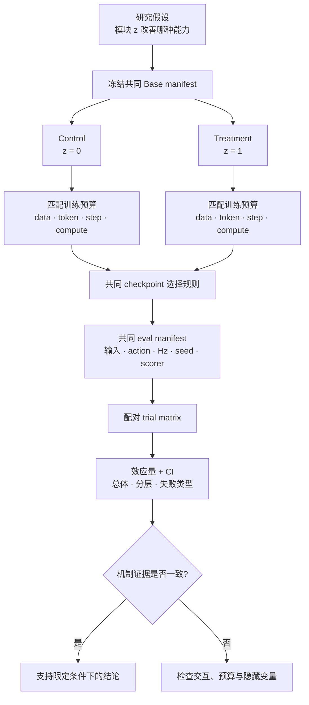

# 消融实验与公平比较

> 消融的目的不是证明“删掉我的模块会掉点”，而是估计一个明确改动在其余条件相同下造成的效果。公平比较也不是要求所有模型完全相同，而是把不可相同的资源、输入和系统条件暴露出来，使读者知道差异可能来自哪里。

## 1. 理论对象：要估计哪个改动的效果

设实验因素 \(z\) 表示是否启用某模块，结果为 \(Y(z)\)。目标效应是：

\[
\Delta=\mathbb E[Y(1)-Y(0)].
\]

同一次 rollout 不可能同时观察两个反事实，因此通过随机种子、数据、训练预算、评测状态和系统协议匹配，使实验组与对照组尽量只在 \(z\) 上不同。

VLA 中常见的处理因素不只包括网络模块：

- 数据：加入某数据源、重标注、过滤、采样权重；
- 特征：增加 wrist、proprio、历史或 3D 表示；
- 架构：融合方式、动作专家、记忆、future auxiliary；
- 动作：token/回归/flow、chunk、坐标和归一化；
- 训练：冻结、LoRA、全量微调、多阶段、co-training、RL；
- 系统：量化、缓存、异步推理、\(H_{exec}\)、控制器和安全过滤。

若同时改变数据、模型和执行队列，实验估计的是一个 package effect，不能归因到其中任一模块。

## 2. 比较数据流：从 manifest 到配对结果



这条流程要求先写共同项，再生成两个变体；不是训练结束后根据已有日志寻找看起来公平的对照。

## 3. Baseline manifest：一张表定义比较对象

每个 baseline/variant 至少记录以下字段。未知项写“未披露/待核”，不能用默认值猜测。

### 3.1 模型与初始化

| 字段 | 示例口径 | 为什么影响比较 |
|---|---|---|
| model family / commit | OpenVLA、openpi、具体 commit | 同名模型可能实现不同 |
| checkpoint / selection | base、best-val、last、step | 挑最好 checkpoint 会引入选择偏差 |
| VLM/vision initialization | 预训练来源和版本 | Base 知识可能主导结果 |
| total/trainable parameters | 总参数与可训练参数 | LoRA 与全量微调容量不同 |
| module change | 新增、替换、冻结、stop-gradient | 定义实际处理因素 |

### 3.2 数据与训练

| 字段 | 必须写明 |
|---|---|
| datasets/version/split | 数据资产、版本、train/val group |
| mixture | 每域最终采样概率、有效曝光 |
| preprocessing | 相机、语言、动作、过滤、增强 |
| normalization | stats id、范围、按数据集/本体/global |
| objective | action/VL/future/value loss 与权重 |
| optimizer schedule | 优化器、峰值 LR、warmup/decay |
| batch and tokens | global batch、有效 action/VL token |
| training budget | step、epoch/曝光、GPU-hours 或 FLOPs |
| random seeds | 数据顺序、初始化、训练 seed |

### 3.3 策略与系统

| 字段 | 必须写明 |
|---|---|
| observations | 相机槽、分辨率、proprio、历史、语言 |
| Action Contract | 维度、坐标、单位、absolute/delta、adapter |
| \(H_{obs},H_{pred},H_{exec}\) | 历史、预测和实际执行长度 |
| \(f_Q,f_A,f_C\) | 使用新观测的策略查询、动作参考/派发、低层控制闭环频率 |
| inference | dtype、量化、采样/积分步数、缓存 |
| queue | 同步/异步、刷新、重叠融合、超时 |
| controller | IK/PD/WBC、增益、限幅和安全过滤 |

### 3.4 评测

| 字段 | 必须写明 |
|---|---|
| benchmark/version | 环境、资产、harness commit |
| split/tasks | 套件、任务列表、OOD 轴 |
| trial matrix | 每 task/seed/setting 的分母 |
| reset/order | 初始状态、共享 seed、round-robin |
| success | 判据、时限、提前终止 |
| statistics | macro/micro、CI、cluster 层级 |
| evidence source | 作者自评、官方统一、独立复现 |

一张成绩表缺少这些字段时，只能作为候选线索，不能支持严格排名。

## 4. 公平不等于所有预算都只匹配一种量

### 4.1 四类常见公平问题

| 比较目的 | 应优先匹配 | 仍需披露 |
|---|---|---|
| 组件是否有效 | 数据、初始化、训练 step/token、参数预算 | 组件额外 FLOPs/延迟 |
| 实用系统谁更好 | 目标硬件、时延/内存限制、数据许可 | 参数和训练成本可不同 |
| 数据源是否有效 | 模型、目标域曝光、总训练 token | 新数据自身 token 与采样 |
| scaling 是否有效 | 数据配方、目标和训练规则 | 参数/FLOPs 随规模变化 |

例如“LoRA 是否匹配全量微调”有两种问题：

1. 固定训练 step 与数据，比较参数高效性；
2. 固定显存/时间预算，比较可部署效果。

两者都合理，但估计量不同。不能在文字中把资源效率结果写成架构上限。

### 4.2 训练预算的多种分母

- optimizer steps：简单，但 batch 不同时无意义；
- samples/episodes：忽略序列长度和有效 mask；
- action tokens：适合动作监督曝光；
- total tokens：适合 robot + web co-training；
- FLOPs/GPU-hours：适合算力效率，但依实现和硬件；
- wall-clock：适合工程成本，但受 I/O 和集群影响。

至少选择一个“学习信号预算”和一个“资源预算”。只写 epoch 在多数据集/重采样设置中通常无法比较。

## 5. 一次一因素、阶梯消融与因子实验

### 5.1 最小阶梯

以“视觉历史改善动态操作”为例：

1. 单帧共同 baseline；
2. 增加历史帧，但固定视觉 encoder、参数量和训练 token；
3. history-shuffled，检查收益是否来自时序顺序；
4. 静态任务与动态/遮挡任务分层；
5. 同时报告 token、延迟和闭环成功。

若第 2 步提升、第 3 步不下降，证据更像“更多图像/参数”而非时序建模。

### 5.2 两因素交互

若模块 A 只有配合训练目标 B 才生效，应使用 \(2\times2\) 因子实验：

| 组 | 模块 A | 目标 B |
|---|---:|---:|
| 00 | 0 | 0 |
| 10 | 1 | 0 |
| 01 | 0 | 1 |
| 11 | 1 | 1 |

交互效应为：

\[
\Delta_{AB}
=\left(Y_{11}-Y_{01}\right)
-\left(Y_{10}-Y_{00}\right).
\]

例如 stop-gradient 与主干 FAST 动作监督、future auxiliary 与预测式表示、长 chunk 与 action queue 都可能有强交互。只比较 00 与 11 无法知道是哪部分生效。

## 6. VLA 常见改动的最小对照

| 假设 | 最小对照 | 必须固定 | 机制证据 |
|---|---|---|---|
| 双视觉 Backbone 改善空间能力 | semantic-only、geometry-only、fusion | 分辨率、数据、动作头、参数预算 | 空间扰动与闭环提升 |
| proprio 改善精细控制 | state-on/off/shuffled/noise | 图像、参数量、动作合同 | shuffle 退化且接触阶段改善 |
| 历史缓解部分可观测 | 1/2/4 帧 + shuffled | 物理跨度、频率、chunk | 遮挡/动态改善，copycat 不增 |
| action chunk 改善平滑/吞吐 | 多 \(H_{pred}\) 与 \(H_{exec}\) 网格 | action Hz、控制器、总数据 | 延迟—成功—jerk 曲线 |
| q01/q99 优于 mean/std | 同 split、同动作语义 | stats scope、死维 mask | 尾部、饱和、闭环均检查 |
| web co-training 保持语义 | web-on/off，同机器人曝光 | 总 token 或明确追加预算 | OOD 语言改善且 ID 动作不退 |
| 跨本体数据正迁移 | target-only、same robot、cross robot | 目标域曝光、adapter | 新本体/新场景收益 |
| future auxiliary 改善表示 | auxiliary on/off + 参数匹配 | 视觉数据与动作目标 | future 指标和闭环共同改善 |
| 异步推理改善系统 | sync/async，同 checkpoint | \(H_{exec}\)、控制器、硬件 | queue idle、延迟、成功率 |

“相同配置文件只开一个布尔量”并不自动公平；模块可能改变参数、序列长度、显存，从而迫使 batch 或训练步数变化。

## 7. 真实协议中的不可比实例

### 7.1 同一 benchmark，输入不同

[本地 benchmark 细读](../../依赖索引.md)记录，LIBERO 表格中有模型使用额外 proprio 和 wrist camera，而其他对照可能只有外部相机。即使任务和成功率列相同，这也是 input-budget comparison，不是纯模型比较。

### 7.2 同一模型族，执行策略不同

动作块模型的 \(n\_action\_steps\)、\(H_{exec}\)、重规划和动作队列设置会显著改变闭环结果。本地材料还记录过同一 π0/π0.5 复现因动作执行步数设置得到明显不同结果；相关二手记录对具体“正确值”的表述并不完全一致，因此工程手册不替读者指定数值，而要求：

- 从对应 checkpoint 的官方评测配置核对；
- 同时记录 \(H_{pred}\) 与 \(H_{exec}\)；
- 扫描执行步数并给延迟—成功率曲线；
- 不把某一执行配置下的失败归因于权重本身。

### 7.3 同名模型，变体与 checkpoint 不同

Base/Large、预训练/后训练、OFT/原始动作头、不同数据混合都可能共用模型族名。表格应写完整变体；若只拿论文中最优变体与本地默认 checkpoint 比，结论是无效的。

### 7.4 同一 CALVIN，输入和 split 不同

CALVIN 的 D→D、ABCD→D、ABC→D 已是不同问题。若第三方评估还移除 proprio、改变相机或状态统计，就只能称“在修改后的 CALVIN 协议上评估”，不能直接排列到原协议榜单。

### 7.5 同一 RoboCasa，任务集合不同

RoboCasa 的 300-task multitask、30-demo、24 atomic 和仓库示例任务不是同一分母。模型 A 的 30-demo 分数与模型 B 的 300-task 分数不能通过“都叫 RoboCasa”建立优劣。

## 8. Checkpoint 选择也是实验因素

常见策略包括：

- 固定训练 step；
- 按 validation action loss 选最优；
- 按仿真 success 选最优；
- 多 checkpoint 报曲线或预注册窗口平均。

用测试成功率挑 checkpoint 再在同一测试集报告，会产生选择偏差。若不同模型保存 checkpoint 的频率不同，“各挑最好”也不公平。

推荐记录：

```text
checkpoint candidate steps
selection split and metric
selection seed
whether evaluator saw test results
final selected checkpoint hash
```

资源足够时，先用独立 validation 选择，再一次性运行隐藏/真机 test。

## 9. 效应量与不确定性

对相同 task/seed/reset 的配对结果，百分点效应为：

\[
\hat\Delta_{pp}
=100\cdot\frac{1}{n}\sum_{i=1}^{n}(Y_i^{new}-Y_i^{base}).
\]

用 task/scene cluster bootstrap 得到区间。多训练 seed 时，可先在每个 seed 内得到完整 task 平均，再报告 seed 间分布；不要把所有 episode 平铺后制造极窄区间。

对相同 task/seed/reset 的配对连续指标，先定义原单位差 $d_i=x_i^{new}-x_i^{base}$。如确需无量纲标准化，可报告配对效应：

\[
d_z=\frac{\bar d}{s_d},
\]

其中 $s_d$ 是配对差 $d_i$ 的样本标准差。独立组设计才使用组内 pooled standard deviation，不能与配对 trial 混用。物理量明确时优先报告原单位差，如节省秒数、减少碰撞次数或降低 \(m/s^3\) jerk。标准化效应不能取代工程意义；区间、cluster bootstrap 和独立组公式统一见[泛化、鲁棒性与统计协议](泛化、鲁棒性与统计协议.md)。

对于非劣比较，应预先定义容忍界 \(\delta\)。例如量化模型在显存减半时，成功率下降不超过 \(\delta\) 才称为非劣；不能看到结果后再选择界限。

## 10. 从结果回到机制

一个有说服力的消融通常同时满足：

1. 主指标在预期任务切片上改善；
2. 机制代理发生预期变化；
3. 反事实/扰动能关闭该收益；
4. 成本和副作用被报告；
5. 多 seed 或配对区间不支持“仅一次幸运运行”；
6. 非目标能力没有明显退化。

例如增加 wrist camera：

- 接触前阶段成功上升；
- wrist 遮挡时增益消失；
- 第三视角任务不一定提升；
- token/延迟成本增加；
- 缺 wrist 的本体需要 mask/fallback。

这比“总体成功率 +2.1”更能证明模块作用。

## 11. 失败诊断

| 现象 | 先检查 | 可能原因 |
|---|---|---|
| 新模块只在一个任务提升 | 任务级结果、选择过程 | 挑切片或任务特定捷径 |
| 参数更多的模型更好 | 参数/FLOPs/训练 token | 容量而非模块机制 |
| 加数据后提升 | 目标域曝光、总 token | 更多训练而非数据协同 |
| 离线提升、闭环不升 | action 单位、\(H_{exec}\)、状态分布 | 代理指标不对应控制 |
| 量化吞吐升、成功降 | dtype 之外的 queue/采样配置 | 系统设置随量化改变 |
| 第三方复现大幅偏低 | checkpoint、输入、stats、执行步数 | manifest 缺字段 |
| 消融方差异常小 | seed/trial 推断单位 | 把相关 episode 当独立样本 |
| “提升 300%”但只多成功一次 | 绝对分子/分母 | 低基线放大相对提升 |

## 12. 审稿式检查清单

- [ ] 假设写明改动影响哪个模块、哪类任务和哪个指标；
- [ ] control/treatment 只改变预声明因素，或明确称 package comparison；
- [ ] Base、初始化、数据、stats 和 checkpoint 选择规则对齐；
- [ ] 同时匹配并报告学习信号预算与资源预算；
- [ ] 输入相机、proprio、语言和历史完全列出；
- [ ] \(H_{obs},H_{pred},H_{exec},f_Q,f_A,f_C\) 可核对；
- [ ] benchmark version、split、任务分母和成功判据一致；
- [ ] 使用共享 seed/reset 或说明为何不能配对；
- [ ] 报告分子/分母、效应量、置信区间和分层结果；
- [ ] 作者自评、官方统一、独立复现分别标记；
- [ ] 未披露字段不由默认配置或模型名推断；
- [ ] 结论限制在实际比较的预算、任务和本体范围。

评估证据层级见[离线、仿真与真机评估](离线、仿真与真机评估.md)，统计和 OOD 协议见[泛化、鲁棒性与统计协议](泛化、鲁棒性与统计协议.md)。

## 延伸阅读

- [VLA 评测基准全景](../../依赖索引.md)
- [训练 Pipeline](../../依赖索引.md)
- [多数据集混合与 Co-training](../数据与特征/多数据集混合与Co-training.md)
- [动作坐标、归一化与跨本体统一](../数据与特征/动作坐标、归一化与跨本体统一.md)
- [OpenVLA 细读](../../依赖索引.md)
- [OpenVLA-OFT 细读](../../依赖索引.md)
- [π0 细读](../../依赖索引.md)
- [SmolVLA 细读](../../依赖索引.md)
