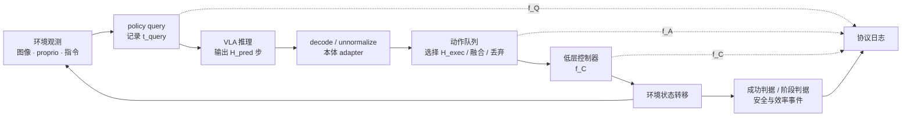
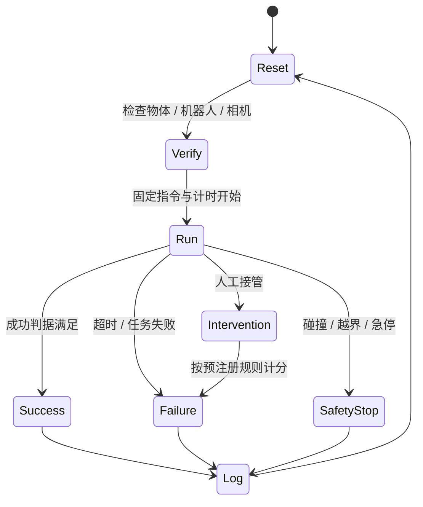

# 离线、仿真与真机评估

> 评估 VLA 不是给 checkpoint 计算一个总分，而是验证一条因果链：输入是否按合同进入策略，策略输出是否按正确节奏执行，环境是否按预先声明的判据计分，以及该证据能支持多强的结论。离线、仿真和真机回答的是不同问题，不能互相替代。

## 1. 评估对象：模型、策略与系统不是同一个对象

令策略在查询时刻 \(t_k\) 接收观测历史 \(o_{\le t_k}\)、语言 \(l_k\) 和本体状态 \(s_{\le t_k}\)，预测长度为 \(H_{pred}\) 的动作块：

\[
\hat A_k=\pi_\theta(o_{\le t_k},l_k,s_{\le t_k})
=\{\hat a_{k,0},\ldots,\hat a_{k,H_{pred}-1}\}.
\]

部署系统通常只执行其中 \(H_{exec}\le H_{pred}\) 步，然后重新查询策略。必须区分三个频率：

| 量 | 定义 | 常见误读 |
|---|---|---|
| policy query rate \(f_Q\) | 每秒使用新观测调用策略多少次 | 等同模型单次前向吞吐 |
| action reference rate \(f_A\) | 动作块相邻 setpoint 的时间频率或客户端派发参考的名义频率 | 等同查询频率 |
| low-level control rate \(f_C\) | 部署合同中 IK、轨迹、阻抗或 WBC 闭环的更新频率 | 等同 VLA 直接控制频率或硬件内部驱动率 |

在不重叠执行、每次恰好消费 \(H_{exec}\) 个动作的简化情形，

\[
f_Q\approx \frac{f_A}{H_{exec}},\qquad
\tau_{open}=\frac{H_{exec}}{f_A}.
\]

异步推理、重叠 chunk 融合、提前重规划和动作丢弃会打破这个等式，因此评测日志应记录实际查询时刻和实际执行动作，而不是只抄模型配置中的 chunk size。



评估对象至少有三层：

1. **模型层**：固定输入能否输出数值有效、语义正确的动作分布；
2. **策略层**：观测—动作闭环能否完成任务；
3. **系统层**：加入预处理、网络、队列、adapter、控制器与安全过滤后是否仍能稳定完成任务。

模型层改善不保证策略层改善；策略层成功也不代表系统延迟、安全性或恢复能力合格。

## 2. 证据类型、递进关系与能支持的结论

| 层级 | 典型证据 | 可以回答 | 不能回答 |
|---|---|---|---|
| E0 接口与回放检查 | shape、mask、反归一化、固定样本回放 | 数据流是否自洽 | 策略是否会闭环纠错 |
| E1 离线 held-out | action error、NLL、token accuracy、ECE/Brier/coverage（适用时） | 对专家分布的拟合；概率或覆盖率校准需专门指标 | 扰动后的状态分布、最终成功 |
| E2 仿真闭环 | success、progress、collision、链长 | 在给定模拟器与协议下的控制能力 | 真机接触、成像与时延 |
| E3 real-to-sim 代理校准 | 视觉匹配与扰动聚合、sim-real 排序相关 | 仿真能否作为目标真机的代理 | 所有任务和本体的通用相关性 |
| E4 受控真机 | 固定本体、场景、重置和成功判据的 rollout | 目标系统上的任务能力 | 开放环境长期可靠性 |
| E5 部署评测 | 长时运行、人员变化、失败恢复、安全事件 | 真实运行分布的可靠性 | 未覆盖环境的普遍能力 |

E0、E1、E2、E4、E5 可以作为逐步增加闭环与部署真实性的主阶梯；E3 是一条交叉的代理校准支线，需要多个策略在仿真与真机上的成对结果，通常复用 E4 类真机 trial，不是天然位于 E2 与 E4 之间的单调等级。

证据来源至少拆成 evaluator identity 与 protocol 两轴，而不是使用互斥的单标签：

| 轴 | 取值示例 | 需要说明 |
|---|---|---|
| evaluator identity | 模型作者、benchmark 维护方、其他第三方 | 谁选择 checkpoint、运行硬件并处理失败 |
| protocol | 作者自有协议、维护方统一 harness、官方实现重跑、第三方重实现 | split、输入、控制器、版本与代码路径是否一致 |

因此 benchmark 维护方统一运行外部模型，既是“维护方 evaluator”，又可相对于模型作者构成第三方证据；它不等于第三方从头重实现。

“第三方引用作者表格”不属于独立复现；“同名 benchmark 但 split、相机或动作步数不同”也不是直接复现。

## 3. 离线评估：适合查接口和分布，不等于闭环

### 3.1 动作指标

连续动作应在反归一化后的物理空间报告。对有效维度 mask \(m_{t,d}\)，可计算：

\[
\operatorname{MAE}
=\frac{\sum_{t,d}m_{t,d}\lvert \hat a_{t,d}-a_{t,d}\rvert}
{\sum_{t,d}m_{t,d}},
\]

并分别报告位置、旋转、夹爪、底盘和各本体。旋转应使用 \(SO(3)\) 测地角，而不是直接把 Euler 三轴误差相加：

\[
e_R(R,\hat R)
=\cos^{-1}\left(
\operatorname{clip}\!\left(
\frac{\operatorname{tr}(R^\top\hat R)-1}{2},-1,1
\right)\right).
\]

离散动作 token 可报告 token accuracy、每维 accuracy 和反量化后的物理误差。连续策略的 NLL、扩散 loss、flow-matching loss 依赖参数化与噪声日程，不能拿原始 loss 跨模型排名。

动作块需要分 horizon 报告：

\[
e(h)=
\frac{\sum_{b,d}m_{b,h,d}\ell(\hat a_{b,h,d},a_{b,h,d})}
{\sum_{b,d}m_{b,h,d}},
\quad h=0,\ldots,H_{pred}-1.
\]

首步好、远期差与整块平均好是两种不同策略；末尾 padding 未正确 mask 会制造虚假的低误差。

### 3.2 离线还应检查什么

| 检查 | 工程用途 | 失败信号 |
|---|---|---|
| 固定样本 round-trip | 验证 schema、坐标、统计与 adapter | 反归一化后方向/幅度错误 |
| action distribution | 检查饱和、塌缩和越界 | 大量落在 bin 边界或安全限位 |
| language counterfactual | 检查是否读取指令 | 换目标后动作几乎不变 |
| state/image shuffle | 检查是否利用对应模态 | 打乱后指标不降 |
| time-shift sweep | 检查观测—动作对齐 | 非零偏移反而最好 |
| held-out group | 检查 episode/scene/robot 泄漏 | 随机帧切分远高于分组切分 |

离线专家数据只覆盖 \(d^E(s)\)。闭环策略访问的是 \(d^\pi(s)\)，两者不同：

\[
\mathbb E_{s\sim d^E}\ell(\pi(s),a^E)
\not\Rightarrow
\mathbb E_{s\sim d^\pi}\mathbf 1[\text{task success}].
\]

因此离线指标应被用作回归测试、模型选择的弱代理和失败定位，不应写成“策略成功率”。

## 4. 仿真评估：先锁定 benchmark 的完整协议

### 4.1 代表基准的事实与口径

| 基准 | 评测对象 | 关键协议 | 不能直接横比的分叉 |
|---|---|---|---|
| [SimplerEnv](https://github.com/simpler-env/SimplerEnv) | 真机策略的 real-to-sim 闭环代理 | Google Robot 与 WidowX 两套本体；Visual Matching 与 Variant Aggregation | 两个本体、3/4 任务子集、视觉匹配/扰动聚合 |
| [LIBERO](https://github.com/Lifelong-Robot-Learning/LIBERO) | 语言条件桌面操作与知识迁移 | 130 个任务；Spatial、Object、Goal、LIBERO-100/Long 等套件 | 4 套件或 5 套件均值；输入相机/proprio；训练 demo 数 |
| [CALVIN](https://github.com/mees/calvin) | 长程语言链 | 34 个子任务；1000 条唯一 5 子任务链；报告 avg-len 和逐前缀成功率 | D→D、ABCD→D、ABC→D 三种 split |
| [RoboCasa](https://robocasa.ai/) | 厨房与长程操作 | 大规模任务、原子与复合任务 | 300-task multitask、30-demo、24 atomic、仓库 25-task 等口径 |

上述事实来自[本地 VLA benchmark 细读](../../依赖索引.md)。其中成绩表含作者、维护方和第三方多种来源；引用任何数字时必须把“模型变体—split—输入—训练数据—评测 harness”与数字放在同一行。

CALVIN 的平均链长可由前缀成功率表示。若 \(I_{i,k}\) 表示第 \(i\) 条链至少完成 \(k\) 个子任务，则：

\[
\operatorname{avg\mbox{-}len}
=\frac{1}{N}\sum_{i=1}^{N}\sum_{k=1}^{5}I_{i,k}.
\]

它不是百分比，也不能与单任务 success 直接相减。

### 4.2 仿真 harness 必须固定的模块

- 环境与资产版本、物理引擎、渲染器和驱动；
- task/split、初始状态集合与随机种子；
- 相机位姿、分辨率、图像预处理和 proprio 字段；
- action contract、控制器、控制/查询/执行频率；
- \(H_{pred}\)、\(H_{exec}\)、动作队列和重规划规则；
- episode 时限、成功判据、提前终止和 reset；
- 并行环境数、确定性选项以及失败重试规则。

成功标志必须来自任务判据，而不是“模型输出 terminate”或视频看起来完成。若环境的 terminated 表示瞬时成功而非真正 episode 终止，提前停止会系统性抬高分数。

## 5. Real-to-sim：相关性本身也需要评估

对相同的 \(M\) 个策略/变体，分别得到仿真分数 \(s_i\) 与真机分数 \(r_i\)。可报告 Pearson 线性相关和 Spearman 排序相关：

\[
\rho_P=\frac{\sum_i(s_i-\bar s)(r_i-\bar r)}
{\sqrt{\sum_i(s_i-\bar s)^2\sum_i(r_i-\bar r)^2}},
\qquad
\rho_S=\operatorname{corr}(\operatorname{rank}s,\operatorname{rank}r).
\]

还应报告每个策略的 sim-real gap：

\[
g_i=s_i-r_i,\qquad
\operatorname{MAE}_{sr}=\frac{1}{M}\sum_i\lvert g_i\rvert.
\]

本地 SimplerEnv 细读记录其提出方在特定策略集合上报告 Visual Matching 的相关/误差优于 Variant Aggregation；这只支持该任务、本体、策略集合内的代理有效性。样本策略很少时，单个异常模型即可显著改变相关系数，必须给出点图、模型名和 bootstrap 区间。

## 6. 真机评估：把人的操作也写进协议

### 6.1 一次 trial 的状态机



每个 trial 至少保存：

```text
model/checkpoint + adapter + normalization id
task/scene/object/robot/session/operator ids
reset seed or initial-state description
instruction and all observations used by policy
query timestamps, inference latency, queue length
predicted chunk and actually dispatched actions
success/progress/failure/safety events with timestamps
human intervention and adjudication record
```

### 6.2 成功、质量和安全指标

二元成功率为：

\[
\hat p=\frac{1}{n}\sum_{i=1}^{n}Y_i,\qquad Y_i\in\{0,1\}.
\]

但只报 \(\hat p\) 会把勉强成功与稳定成功混在一起。建议按任务选择：

| 维度 | 指标例 | 解释 |
|---|---|---|
| 完成 | success、stage completion、平均链长 | 是否完成以及完成到哪一步 |
| 效率 | time-to-success、路径长度、策略查询数 | 成功用了多少时间/动作 |
| 控制质量 | jerk、动作总变差、过冲、重抓次数 | 是否平滑且可控 |
| 安全 | 碰撞、越界、急停、力/速度超限 | 是否以可接受代价完成 |
| 人工成本 | intervention rate、接管时长、重置时间 | 自主性与评测运营成本 |
| 恢复 | 扰动后恢复率、失败后继续完成率 | 是否能离开名义轨迹 |

自动成功检测器应与盲审人工标签抽样对齐，报告一致率和争议处理。不能在看过模型身份后临时放宽成功标准。

## 7. 从离线到真机的最小评估阶梯

1. 固定样本做 schema、mask、反归一化和动作限幅检查；
2. held-out episode 做物理单位误差、分 horizon 指标与模态反事实；
3. 最小仿真任务做闭环 smoke test，核对终止和 reset；
4. 在完整 benchmark 上固定 split、输入、频率和种子；
5. 对目标本体做 real-to-sim 配对任务，检查排序与 gap；
6. 小规模真机 pilot 只验证接口、安全和方差；
7. 冻结协议后运行正式真机 trials；
8. 将失败按感知、语义、动作、控制、系统和判据分层归因。

升级证据层级时不要顺手改变模型、输入或动作执行设置，否则无法知道差异来自环境还是系统配置。

## 8. 常见失败与定位

| 现象 | 优先检查 | 可能机制 |
|---|---|---|
| 离线 MAE 下降、闭环不升 | \(d^E/d^\pi\)、首步方向、动作延迟 | expert-distribution 拟合不等于纠错 |
| 仿真高、真机低 | 相机、接触、延迟、控制器、成功判据 | sim-real gap 或协议不一致 |
| 同 checkpoint 分数差很多 | \(H_{exec}\)、输入模态、reset、时限 | 隐藏设置改变策略 |
| 成功率高但视频抖动 | jerk、路径、重抓和安全事件 | 二元指标掩盖执行质量 |
| 增大 chunk 后吞吐升、成功降 | \(\tau_{open}\)、队列陈旧度 | 开环执行太久 |
| 只在固定初始位姿成功 | 初始状态分层与扰动曲线 | 记忆位置先验而非任务理解 |
| 人工复核与脚本不一致 | 判据版本与盲审 | 自动 scorer 漏判或人评漂移 |

## 9. 评估交付物

一项可审计评估至少交付：

- 协议 manifest：模型、数据、输入、动作、频率、环境和判据；
- trial manifest：每次试验的分层键、seed、结果和失败类型；
- 原始汇总：分子/分母，不只百分比；
- 置信区间与任务/场景/本体分层结果；
- 视频或事件轨迹的匿名抽样审计；
- 作者自评、官方统一与独立复现标签；
- 未披露字段明确写“未披露/待核”。

统计与分层方法见[泛化、鲁棒性与统计协议](泛化、鲁棒性与统计协议.md)，对照和预算匹配见[消融实验与公平比较](消融实验与公平比较.md)。

## 延伸阅读

- [VLA 评测基准全景](../../依赖索引.md)
- [任务定义与输入输出协议](../基础/任务定义与输入输出协议.md)
- [轨迹切分与训练样本构造](../数据与特征/轨迹切分与训练样本构造.md)
- [动作坐标、归一化与跨本体统一](../数据与特征/动作坐标、归一化与跨本体统一.md)
- [OpenVLA 细读](../../依赖索引.md)
- [π0.5 细读](../../依赖索引.md)
- [SmolVLA 细读](../../依赖索引.md)
