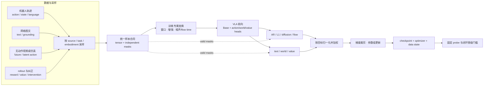

# 训练 Pipeline 与目标函数

VLA 训练的核心不是选择一个 loss 名称，而是把数据来源、标签有效性、动作表示、参数更新范围和阶段目标组合成一条可审计的数据流。相同的交叉熵或 MSE，在不同采样配比、mask/reduction 和梯度路径下会训练出完全不同的策略。

## 1. 从经验风险到多源、多目标训练

设数据源为 \(d\)，样本类型为 \(s\)，模型参数按语义主干、视觉端和动作模块分为 \(\theta_B,\theta_V,\theta_A\)。训练目标可写为：

\[
\mathcal L(\theta)=
\mathbb E_{d\sim p_D,\,x\sim p_d}
\left[
\sum_{k\in\mathcal K}
\lambda_{k,d}\,m_k(x)\,
\bar\ell_k(x;\theta)
\right].
\]

这里 \(p_D\) 是数据源采样分布，\(m_k\) 表示该样本是否具备第 \(k\) 类监督，\(\lambda_{k,d}\) 是损失权重，\(\bar\ell_k\) 则包含该目标自己的有效元素归一化。四者必须分开：采样权重改变模型见到什么，loss 权重改变一次见到后梯度多大，mask 决定标签是否存在，reduction 决定长序列或高维本体是否天然占更大权重。

## 2. 模块级训练数据流

数据加载器必须在 loss 之前保留 `dataset_id`、`embodiment_id` 和监督 mask；若在转换时把无动作视频的动作填零，后续 loss 已无法分辨“标签缺失”和“静止动作”。同理，跨本体补齐的动作维度不能仅依靠数值为零判断有效性。

## 3. 四类动作目标及正确 reduction

### 3.1 离散动作 token

对动作 token 序列 \(z_{1:N}\)：

\[
\mathcal L_{AR}=-
\frac{1}{\sum_j m_j}
\sum_{j=1}^{N}m_j
\log p_\theta(z_j\mid h,z_{<j}).
\]

RT-2 和 OpenVLA 使用 next-token 目标，机器人样本只在动作段计算 CE；RT-2 的网络 VQA/caption 样本则在相应答案 token 上计算语言损失。动作 token accuracy 是训练诊断，不是物理误差：它看不到反量化尺度、坐标错配和闭环分布偏移。

### 3.2 连续 L1/L2 回归

对动作块 \(A\in\mathbb R^{H_{pred}\times D_a}\)：

\[
\mathcal L_{L1}=\frac{\sum_{h,d}m_{h,d}|A_{h,d}-\hat A_{h,d}|}
{\max(1,\sum_{h,d}m_{h,d})}.
\]

OpenVLA-OFT 的默认连续头使用 L1。回归目标低延迟、易诊断，但在同一条件对应互斥动作模式时可能学习条件中位数/均值附近的折中。是否需要生成式目标应由模式分析和闭环对照决定。

### 3.3 Diffusion 噪声预测

\[
A^k=\sqrt{\bar\alpha_k}A+\sqrt{1-\bar\alpha_k}\epsilon,
\qquad
\mathcal L_{diff}=
\frac{
\sum_{b,h,d}m_{b,h,d}
\left(\epsilon_{b,h,d}-\epsilon_{\theta,b,h,d}(A^k,k,c)\right)^2
}{
\max\!\left(1,\sum_{b,h,d}m_{b,h,d}\right)
}.
\]

Octo 用主干 readout 条件化小型扩散头；主干一次前向，去噪迭代发生在动作头。训练需记录噪声调度、时间步采样、条件 dropout 和动作归一化，推理还要另报采样器与步数。

### 3.4 条件 Flow Matching

以当前本地 openpi 约定为例，\(\tau=0\) 为数据、\(\tau=1\) 为噪声：

\[
X_\tau=\tau\epsilon+(1-\tau)A,
\qquad u_\tau=\epsilon-A,
\]

\[
\mathcal L_{flow}=
\frac{
\sum_{b,h,d}m_{b,h,d}
\left(v_{\theta,b,h,d}(X_\tau,\tau,c)-u_{\tau,b,h,d}\right)^2
}{
\max\!\left(1,\sum_{b,h,d}m_{b,h,d}\right)
}.
\]

其中 $m_{b,h,d}$ 只表示 action batch、时间和维度的有效位；图像/文本 token mask 不进入动作 loss 的分母。推理从 \(\tau=1\) 以负步长积分到 0。其他论文可能把端点记号反过来；路径、速度符号和积分方向必须成套核对。π0 论文采用偏置的 flow-time 采样，而不是简单均匀采样；当前本地 openpi 也显式实现 Beta 采样。这属于训练分布超参，不能只记录“使用 Flow”。

## 4. 混合目标：mask、尺度和梯度责任

混合 VLA 常见总目标为：

\[
\mathcal L=\lambda_{txt}\mathcal L_{txt}
+\lambda_{disc}\mathcal L_{AR-action}
+\lambda_{cont}\mathcal L_{flow/L1}
+\lambda_w\mathcal L_{world}
+\lambda_v\mathcal L_{value}.
\]

实现时先在各目标内部按有效 token/动作元素归一化，再做目标间加权。否则 200 个文本 token、50×32 个动作元素和一个标量 value 的数量差异会隐式决定权重。还要分别报告：

- 每个目标的有效样本比例与有效元素数；
- 加权前后 loss、梯度范数和更新到的参数组；
- 某目标没有标签时是否真正跳过，而非产生零目标；
- world/value 目标是否只更新专用头、共享 Backbone，或通过 stop-gradient 隔离。

π0.5 给出清晰的阶段实例：论文配方在约 280k-step 预训练中设连续 Flow 权重 \(\alpha=0\)，用文本、边界框和 FAST 动作 token 的统一自回归目标；后训练新增随机初始化的连续动作专家，把 \(\alpha\) 设为 10，并约训练 80k steps。数字均为作者论文配方，不是可直接迁移的默认值。

## 5. Staged training：每阶段改变了什么

| 阶段 | 初始化与数据 | 目标和参数责任 | 退出条件 |
|---|---|---|---|
| 0 语义/视觉 Base | 网络图文、视频或公开 VLM | 建立视觉语言先验；通常没有真实动作语义 | 通用 VL probe 与初始化资产冻结 |
| 1 机器人 Base | 多任务、多本体轨迹 | 注入动作目标；决定视觉/语言主干是否联合适配 | 动作学习稳定，跨数据源 probe 不崩溃 |
| 2 Co-training | 机器人 + 网络 + 跨本体/视频 | 保持语义并扩展动作覆盖；目标按样本 mask | 各数据源有效采样、旧能力保持 |
| 3 目标域后训练 | 高质量目标本体/任务数据 | 调动作合同、传感器与技能分布 | 固定仿真/真机协议达到晋级阈值 |
| 4 经验学习 | on-policy rollout、奖励、失败和纠正 | value/advantage/RL 或再次监督学习 | 收益超过采集成本且安全约束不退化 |

阶段切换时不应只换数据路径。要生成新的 `stage_id`，冻结父 checkpoint、训练数据 manifest、归一化统计和评测协议。若同时新增相机、state、动作块和 loss，后续结果必须通过消融拆分。

### 5.1 代表配方事实

| 模型 | 论文/官方事实 | 不应外推的部分 |
|---|---|---|
| OpenVLA | OXE 约 970k 演示；作者报告 64×A100、14 天、batch 2048、固定 LR 2e-5、无 warmup、27 epochs | 训练预算绑定其数据混合与实现；下游不应照搬 27 epochs |
| Octo-Base | OXE 25 子集、约 800k 轨迹；作者报告 TPU v4-128、batch 2048、300k steps、约 14h；目标域约 100 轨迹/50k steps | 微调预算和消费级 GPU 时间是作者硬件口径 |
| π0 | 作者披露约 10k 小时、903M timesteps；主模型预训练 700k steps，再做高质量下游后训练 | 学习率、完整数据配比和目标域规模未充分公开 |
| π0.5 | 预训练约 280k steps、后训练约 80k；α 从 0 切至 10 | 两阶段数据组成也变化，收益不能只归因于 α |
| KI | stop-gradient + FAST 离散监督 + 网络 co-training；作者自评约 7.5× step efficiency，训练计算约增加 20% | 非独立复现；“步数效率”不等于任意硬件 wall-clock 7.5× |

## 6. Co-training：采样分布就是训练目标的一部分

设数据源 \(d\) 有 \(n_d\) 个可采样窗口，可用温度式权重：

\[
p_D(d)=\frac{w_d n_d^\alpha}{\sum_j w_j n_j^\alpha}.
\]

\(\alpha=1\) 近似按规模采样，\(\alpha=0\) 近似数据源均匀；\(w_d\) 用于任务价值、质量或重复度修正。它不是唯一方案，但能把“数据量”和“人工优先级”拆开。实际训练需记录每个 source 的期望和实测 batch 占比，并检查 worker 分片、过滤和短数据集耗尽是否改变分布。

RT-2 的 co-fine-tune 把原网络 VL 任务与机器人轨迹共同训练，以减缓只用机器人数据导致的网络知识遗忘；Octo 主要按数据规模采样，并对多样数据升权、重复度高数据降权；π0.5 混合移动操作、多环境、跨本体、高层、网络和口头指令等数据。它们说明 co-training 至少有三种目的：保持旧知识、扩大动作覆盖、建立跨本体共享。三者应使用不同 probe 判断是否成功。

### 6.1 Co-training 的诊断表

| 现象 | 先检查 | 可能机制 |
|---|---|---|
| 大数据源 loss 降、小数据源不学习 | 实测采样占比、每源梯度 | 小源饥饿或 reduction 被大源支配 |
| 机器人成功率升、语言改写退化 | 网络样本权重、Base 梯度 | 灾难性遗忘或动作梯度冲突 |
| 跨本体平均升、个别本体崩溃 | 本体分桶、归一化和 mask | 平均指标隐藏负迁移 |
| 加仿真后训练更快、真机不升 | 域标签、视觉与动力学差距 | 模型利用仿真捷径 |
| 配比改动看似有效但复现实验漂移 | sampler seed、分布式分片 | 实际 batch 分布与配置不一致 |

## 7. 优化预算与关键超参的语义

| 超参 | 它实际控制什么 | 比较时需要固定/报告 |
|---|---|---|
| global batch | 单次更新汇总的窗口和来源多样性 | micro batch、设备数、累积、每源占比 |
| learning rate | 参数更新尺度 | 参数组、batch 变化、warmup 与 schedule |
| max steps / epochs | 重复看到数据的次数 | 原始 episode、窗口重叠、有效动作元素 |
| weight decay | 权重先验与正则 | 是否作用于 bias/norm/LoRA 参数 |
| grad clip | 限制异常 batch 的更新 | clip 前梯度分布和触发率 |
| mixed precision | 吞吐、显存和数值范围 | bf16/fp16、loss scaling、关键算子精度 |
| EMA | 平滑权重用于评估/部署 | decay、开始时刻、是否保存原权重 |
| loss weight | 目标之间的梯度比例 | 加权前 loss 与共享参数梯度范数 |

当前本地 openpi 优化模块提供 warmup+cosine 和 warmup+inverse-square-root 两类 schedule，默认 warmup 字段为 1,000 steps；训练配置默认 batch 为 32，但具体任务配置存在 64/128/256 等值。它们是当前代码快照的配置能力和示例，不是 π0 论文的统一训练配方。

## 8. Checkpoint 必须保存训练状态与接口状态

一个可恢复、可部署的 checkpoint 至少绑定：

- 模型、EMA（若有）、优化器、schedule step 和随机数状态；
- sampler epoch/offset 与数据 manifest；
- tokenizer、动作统计、动作维度 mask 和本体 adapter；
- 输入相机顺序、图像预处理、文本模板和模型版本；
- trainable/frozen 参数组与 stop-gradient 图；
- 父 checkpoint 和阶段说明。

只保存权重而不保存归一化和 action contract，模型可能能前向但无法安全执行；只保存 optimizer 而不保存 sampler 状态，恢复训练后会改变数据源曝光分布。

## 9. 可归因实验

1. **目标函数实验**：固定 Base、数据、动作块和执行协议，只替换 L1、Diffusion 或 Flow；匹配训练 FLOPs并报告推理预算。
2. **阶段实验**：比较直接目标域训练、Base→后训练、Base+co-training→后训练；每组消费相同目标域数据。
3. **配比实验**：扫描单一 source 权重时同步报告每源 exposure 和 per-source metric，不只报告总平均。
4. **梯度实验**：固定前向结构，比较全回传、冻结、stop-gradient；同时测动作能力与 VL 保持。
5. **预算实验**：给 learning curve 对齐 consumed samples、optimizer steps 和 wall-clock，避免只取各组最佳 checkpoint。

## 10. 失败诊断与验收清单

| 失败 | 优先证据 | 修正方向 |
|---|---|---|
| loss 突然变小但成功率下降 | 有效 mask 数、padding 比例 | 检查分母和空监督 batch |
| 恢复训练后曲线跳变 | optimizer/schedule/sampler 状态 | 完整恢复并记录数据 offset |
| 多源训练不稳定 | 每源 loss/梯度与采样占比 | 先修采样，再调 loss 权重 |
| Flow 训练正常、采样发散 | 路径端点、速度符号、积分方向 | 单样本向量场与 round-trip 测试 |
| 训练 token accuracy 高、动作失败 | 反量化、坐标、闭环分布 | 解码回物理量并做控制器回放 |
| 后训练提升新任务、旧能力消失 | 固定旧任务/VL probe | co-training、较小更新或梯度隔离 |

- [ ] 每个 loss 都有独立有效 mask、reduction 和梯度目标；
- [ ] 每个数据源有配置权重与实测曝光率；
- [ ] 报告 global batch、steps、有效动作元素、wall-clock 和硬件；
- [ ] checkpoint 可恢复 sampler、optimizer、schedule 与接口元数据；
- [ ] 阶段切换前运行固定动作、语言和旧任务 probe；
- [ ] 所有作者数字与当前代码默认值均标明口径。

## 资料来源

- [训练全流程细读](../../依赖索引.md)
- [RT-2 co-fine-tune](../../依赖索引.md)
- [OpenVLA](../../依赖索引.md)
- [Octo](../../依赖索引.md)
- [π0](../../依赖索引.md)
- [π0.5](../../依赖索引.md)
- [Knowledge Insulation](../../依赖索引.md)
- [动作生成目标](<../架构与动作生成/Diffusion与Flow Matching.md>)
- [训练样本构造](../数据与特征/轨迹切分与训练样本构造.md)
