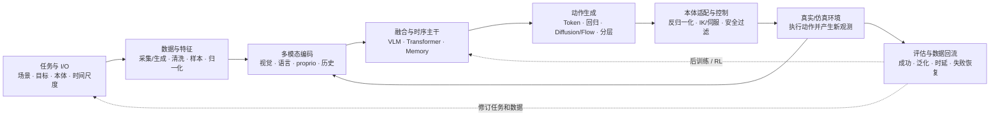
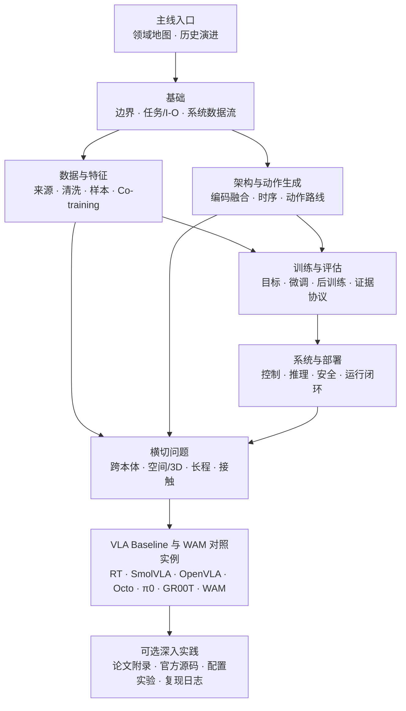

# VLA：领域主线与工程地图

> 本文是 VLA 模块化研究手册的总入口。目标读者已经了解 Transformer、视觉—语言预训练、模仿学习和常见生成模型，希望在 15—20 分钟内建立 VLA 的任务边界、系统模块、技术路线和研究选型框架。

## 0. 一句话结论

Vision-Language-Action（VLA）不是“给 VLM 再加一个动作输出”这么简单，而是一类在视觉与语言任务条件下产生具身动作接口的闭环策略系统。开放世界视觉—语言预训练是现代 VLA 的常见知识来源和核心价值之一，但不是命名资格本身。它通常学习：

\[
\pi_\theta(A_t\mid O_{\le t},S_{\le t},A_{<t},L,G,E)
\]

其中，\(O\) 是单帧、多视角或视频观测，\(S\) 是本体状态，\(A_{<t}\) 是可选的历史动作，\(L\) 是语言任务，\(G\) 是可选目标或子任务上下文，\(E\) 描述机器人本体、传感器与动作接口条件。\(A_t\in\mathcal A_E^{H_{pred}}\) 表示长度为 \(H_{pred}\) 的语义动作接口：它可以是连续末端/关节动作、离散 token、路点或带下游执行约定的 skill，而不是预先限定为连续矩阵。模型内部的 token、回归量或生成流还需经过解码、本体适配和控制，才能成为物理动作。

VLA 的核心工程矛盾是：互联网预训练模型擅长语义和知识迁移，机器人控制却要求动作语义精确、时序连续、低延迟并能在真实反馈下恢复。因此，数据、模块接口、动作表示和控制闭环相互耦合；改变其中一项通常会改变其余部分的训练或评测条件。

## 1. VLA 工程主线

下面的主线将领域概念落到研发流程。研究创新通常改变其中一个节点，也可能改变两个节点之间的接口。



| 节点 | 首要问题 | 典型研究选择 | 选择带来的直接影响 |
|---|---|---|---|
| 任务与 I/O | 模型究竟负责哪一层动作 | 关节/末端、绝对/增量、单步/chunk | 决定数据语义、可迁移性和低层控制接口 |
| 数据与特征 | 哪些数据提供语义、动作和后果监督 | 真机、仿真、人类视频、互联网、合成 | 决定能力上限与分布偏差 |
| 编码与融合 | 语义、几何、状态和历史怎样进入策略 | 冻结/解冻 VLM、状态编码、多视角融合 | 决定适配成本、空间能力和推理开销 |
| 动作生成 | 怎样表达多峰、连续和高频动作 | 离散 token、回归、Diffusion/Flow、混合 | 决定延迟、精度、chunk 和训练目标 |
| 控制与部署 | 模型输出怎样安全落到机器人 | action adapter、重规划、端云、双系统 | 决定真实控制频率和失效模式 |
| 评估与回流 | 改进是否来自目标模块 | 离线、仿真、真机、消融、RL | 决定结论是否可归因、能否部署 |

这条链解释了为什么“换一个更强 VLM”不足以定义 VLA 进展：如果动作协议、数据混合、推理预算和闭环协议同时改变，就无法把收益只归因于主干。

## 2. 文档阅读图

手册按“主线—通用方法—Baseline—深入实践”组织。通用专题解释模块职责和技术选型，Baseline 文档再给具体实现与参数。



当前入口、基础、数据与特征、架构与动作生成、训练评估、系统部署和横切专题已经完成；第四批将用 Baseline 技术卡把通用方法实例化。完整状态见[手册目录](index.md)。

## 3. 一个 VLA 系统由哪些模块组成

从模型内部看，多数 VLA 可以抽象成六个模块：

1. **视觉编码**：把单帧、多视角或视频变成视觉特征；语义对齐、局部几何和时间运动能力取决于 Base 与输入组织；
2. **语言与任务编码**：表达自然语言指令、目标、子任务或策略元数据；
3. **本体与历史编码**：注入关节、末端、夹爪、力觉、过去动作与短期记忆；
4. **多模态融合/时序主干**：让不同模态在统一上下文中交互，可能是单体 VLM，也可能与动作专家解耦；
5. **动作生成模块**：输出动作 token、连续动作块或分层子目标；
6. **本体适配与控制接口**：把统一表示映射回具体机器人，衔接低层控制、安全约束和反馈重规划。

模块边界不要求对应六个独立网络。例如单体 Transformer 可以隐式承担编码、融合和动作生成；工程分析仍需要区分这些功能，否则难以判断数据、损失或架构改动作用在哪一层。

模块级训练与推理数据流见[基础/VLA 系统数据流](基础/VLA系统数据流.md)。

## 4. 主要动作与系统路线

动作端是 VLA 区别于普通 VLM 的关键接口，也是 2023 年以后路线分化的主要来源。

| 路线 | 方法核心 | 选择原因 | 主要代价 | 代表工作 |
|---|---|---|---|---|
| [离散动作 token](架构与动作生成/离散动作Token.md) | 对动作分箱或压缩后做自回归预测 | 最大程度复用语言模型词表和 next-token 训练 | 量化误差、串行延迟、长动作序列 | RT-2、OpenVLA |
| [连续并行回归](<架构与动作生成/连续回归与Action Chunk.md>) | 一次回归一个连续动作块 | 结构直接、推理快、适合低延迟 | 多峰动作可能被均值化 | OpenVLA-OFT |
| [Diffusion / Flow Matching](<架构与动作生成/Diffusion与Flow Matching.md>) | 条件生成连续动作分布 | 能表达多峰轨迹并支持 action chunk | 需要动作专家和多步生成 | Diffusion Policy（非 VLA，动作路线源头）、Octo、π0、GR00T |
| [分层/混合](架构与动作生成/分层、混合与双系统架构.md) | 高层子任务、skill 或离散语义作为低层动作生成条件 | 分离长程任务结构与连续控制 | 层间标签、切换和错误归因更复杂 | π0.5 |
| 双系统/多速率 | 语义模块与动作模块使用不同刷新率或部署路径 | 慢语义更新与快动作流可以并行 | 缓存、同步、陈旧条件和故障传播 | Helix、GR00T |
| [预测辅助 VLA](架构与动作生成/预测式VLA与世界模型辅助.md) | future/world 目标只用于预训练或辅助监督 | 吸收视频与动态先验，不承担在线 rollout 成本 | 预测质量提升未必转化为控制收益 | RynnVLA 等 |
| [WAM / 模型式决策](架构与动作生成/预测式VLA与世界模型辅助.md) | 同一系统以共享或显式耦合表示联合建模 world 与 action；部署可只走动作路径或在线评估后果 | 建立动作—后果 grounding、支持反事实与规划 | 因果对齐、联合目标、规划与评估成本 | WorldVLA、DreamZero 等；纯 action-conditioned WM 只是组件 |

这些路线不是互斥的模型类别。分层描述语义抽象，双系统描述刷新率或部署路径，梯度隔离描述训练耦合；π0.5 可同时采用 Flow 与分层接口，WAM 也可以采用自回归、Diffusion 或 Flow。选择时应先看任务接口、控制频率和监督来源，再确定架构组合。

## 5. 数据为什么是模型设计的一部分

VLA 常混合五类信息密度不同的数据：

| 数据 | 主要提供 | 不能自动提供 |
|---|---|---|
| 真机示范 | 精确观测—状态—动作对应 | 大规模开放场景覆盖、失败恢复 |
| 仿真 | 完整状态、动作、接触与程序化变化 | 真实视觉和动力学分布 |
| 人类/第一视角视频 | 丰富任务、对象交互和运动先验 | 机器人动作标签和本体对齐 |
| 互联网图文/视频 | 语言、语义和长尾知识 | 精确控制因果 |
| 真实部署与 RL 日志 | 失败、恢复、偏好和结果反馈 | 低成本、安全的大规模采集 |

模型能否利用这些数据取决于样本字段、有效 mask、动作语义和混合目标。把无动作视频加入训练集不等于获得动作监督；把不同机器人轨迹拼接也不等于完成跨本体学习。[数据与特征](数据与特征/index.md)将数据来源、生成与清洗、样本构造、动作归一化、特征设计和 Co-training 分开说明。

## 6. 训练方法的共同骨架

VLA 训练通常由以下阶段组合，而不是一次端到端训练完成：

```text
视觉—语言或视频 Base
→ 机器人动作对齐
→ 多任务 / 多本体协同训练
→ 特定本体或任务微调
→ 偏好、价值或强化后训练
→ 蒸馏、量化与部署适配
```

影响不同工作结果的实现因素包括：哪些模块冻结，动作损失是否回传主干，机器人与互联网数据如何采样，缺失动作的数据如何 mask，动作专家如何初始化，以及部署经验是否回流。训练专题将以这些决策为主线，而不是只罗列 optimizer 和学习率。

## 7. 评估应与能力声明对应

| 声称的能力 | 至少需要的证据 | 不足以单独证明 |
|---|---|---|
| 动作拟合 | 保留集动作误差、token/轨迹质量 | 真实任务成功 |
| 任务执行 | 固定协议的仿真或真机闭环成功率 | 跨环境和跨本体泛化 |
| 语言泛化 | 新表达、组合指令和指代切分 | 精细接触控制 |
| 跨本体 | 未见本体或严格 held-out embodiment | 同本体换场景 |
| 长程能力 | 多阶段任务、记忆、恢复和误差累积 | 单步/短程成功率 |
| 实时部署 | 端到端延迟、稳定频率、动作队列和安全事件 | 仅模型前向吞吐 |
| 世界建模收益 | action-only、future auxiliary、联合/规划对照 | 仅未来视频质量 |

LIBERO、CALVIN、SimplerEnv、RoboCasa 和真机评测使用不同任务、动作接口与成功判据，分数只能在协议对齐后比较。[训练与评估](训练与评估/index.md)将离线—仿真—真机证据链、统计协议和公平消融分别展开。

## 8. 与相邻系统的关系

| 对象 | 核心职责 | 与 VLA 的接口 |
|---|---|---|
| VLM | 视觉—语言理解和生成 | 提供预训练表示与语义主干 |
| 具身 Agent / Planner | 长程任务分解、记忆、工具和技能选择 | 输出任务、子目标或调用 VLA |
| 世界模型（WM） | 给定状态和动作预测未来 | 提供 future supervision、规划或数据生成 |
| 世界—行动模型（WAM） | 耦合未来状态和动作生成 | 是 VLA 与世界建模相交的一类系统 |
| SLAM / 状态估计 | 当前位姿、地图和 belief | 为 VLA 提供可持续空间状态 |
| 运动控制器 | 高频、稳定、安全地执行目标动作 | 消费 VLA 输出并反馈真实状态 |

端到端模型可以共享参数，但研究结论仍应区分功能：模型能输出动作不代表它显式预测动作后果；模型能生成未来视频也不代表它产生可执行机器人动作。更严格的定义见[基础/定义、边界与能力范围](基础/定义、边界与能力范围.md)。

Skill 位于哪一层取决于接口而非名称：若模型只选择一个符号技能，物理闭环由独立 skill policy 完成，它更接近 Agent/Planner 输出；若文档同时定义该下游策略、执行接口与闭环评测，则 skill 也可作为广义 VLA 动作。

## 9. 技术选型的起点

- **动作和场景较窄、部署资源有限**：从轻量模型或连续回归 Baseline 开始，先验证数据与控制接口；
- **需要最大化继承 VLM 能力**：离散 token 路线接口最统一，但需验证动作精度和延迟；
- **多峰、灵巧和高频连续控制**：优先考察 Diffusion/Flow、动作块和专用动作模块；
- **任务包含语义规划与快速执行**：采用分层或双系统，明确高低层刷新频率与接口；
- **有大量无动作视频或需要后果预测**：考察视频预训练、future auxiliary 或 WAM，并设置 action-only 对照；
- **目标是跨机器人迁移**：先固定动作与状态语义，再讨论统一模型和数据规模。

这些是进入实验的起点，不是脱离数据和评测条件的固定结论。对应模块已在[训练与评估](训练与评估/index.md)、[系统与部署](系统与部署/index.md)和[横切专题](横切专题/index.md)中给出工程合同与验证方法；具体 Baseline 参数与结果在第四批实例化。

## 10. 阅读顺序

1. [定义、边界与能力范围](基础/定义、边界与能力范围.md)：先锁定 VLA、VLM、Agent、WM、WAM 和控制器的责任；
2. [历史沿革](历史沿革.md)：理解每次架构变化解决了什么工程瓶颈；
3. [任务定义与输入输出协议](基础/任务定义与输入输出协议.md)：把研究问题固定到语义接口；
4. [VLA 系统数据流](基础/VLA系统数据流.md)：建立模块级训练与部署图；
5. [Base、Backbone、Baseline 与常见误解](基础/Base、Backbone、Baseline与常见误解.md)：建立公平归因语言；
6. [数据与特征](数据与特征/index.md)与[架构与动作生成](架构与动作生成/index.md)：沿数据 Pipeline 或模型内部数据流加深理解；
7. [训练与评估](训练与评估/index.md)、[系统与部署](系统与部署/index.md)和[横切专题](横切专题/index.md)：按研究问题进入目标函数、证据、在线闭环或能力约束；
8. Baseline 对照矩阵：将代表模型连同任务、数据、recipe 与评测协议实例化，再选择论文和代码精读对象。

完整导航、建设状态与本地资料入口见[手册目录](index.md)。

## 参考入口

- [VLA 深度调研主报告](../依赖索引.md)
- [VLA × WAM 发展时间线](../依赖索引.md)
- [全模型规格对比](../依赖索引.md)
- [具身数据全景](../依赖索引.md)
- [训练全流程](../依赖索引.md)
- [推理加速与部署](../依赖索引.md)
- [预测式 VLA](../依赖索引.md)
- [世界模型工程手册](../world-model/index.md)
